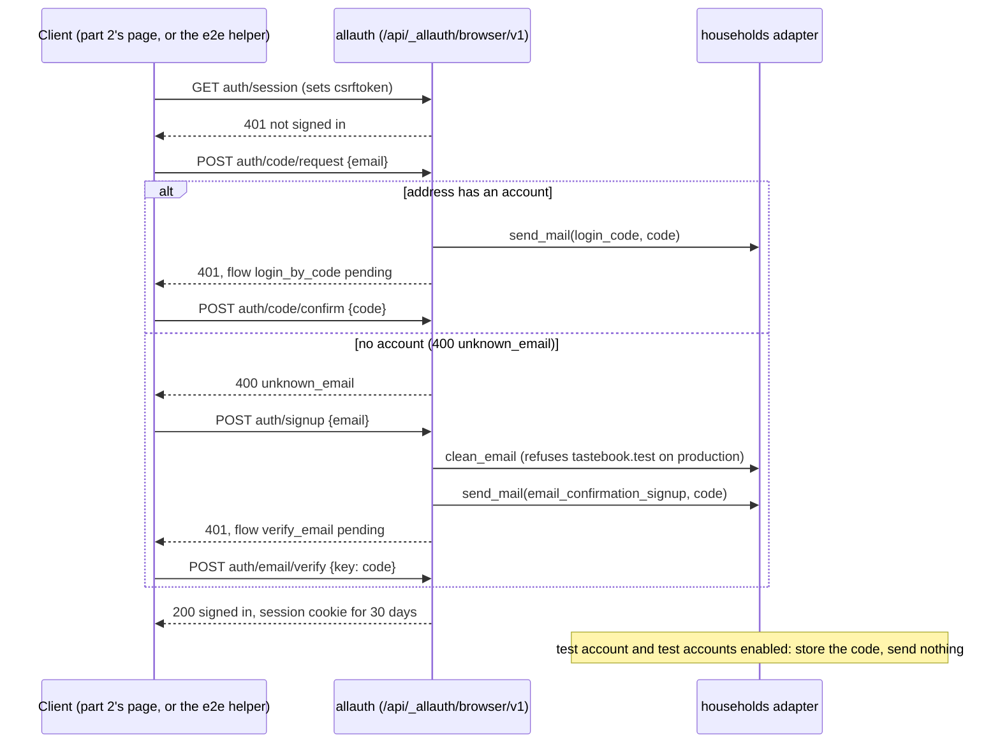

# Sign in and out with an email code

Linear: TAS-102

## Summary

Tastebook has no accounts yet. This adds them: anyone signs up or signs in with their email address and a 6-digit code sent to it, stays signed in on a device for 30 days of use, and signs out from the account menu. It's built on django-allauth's headless API with a custom `User` in a new `households` app, Resend for email on production, and throwaway test accounts at `tastebook.test` whose codes previews and local runs can read, so the end-to-end tests can sign in on every preview.

The work is split in two PRs, each merged to `main` on its own:

- **Part 1 (this issue, TAS-102):** the API. Accounts, codes by email, sessions, Resend, the one-off switch to the custom `User`, test accounts and reading their codes. Proved by API tests and an API-level Playwright spec; nothing on screen changes.
- **Part 2 (a sub-issue filed when this spec is approved):** the sign-in page, the top bar's Sign in and account menu with Sign out, coming back to where you were, and the journey's Playwright spec, built to the approved design.

Evidence: part 1 is a chore (no page changes; the API tests and the API-level Playwright spec on the preview prove it). Part 2 is a feature (a new page and the top bar's account end on every page).
Design: needed. Part 2 adds a new screen, the sign-in page, in two steps, and no board in `docs/design/` draws it. Part 1 has nothing to draw.
Components: none new or changed expected. The page is built from Field, Input, Button, Banner, Page and the existing TopBar account end; the design stage says so if it needs more.

## Required reading

- `AGENTS.md`: hard constraints, Domain areas (`households` depends on no other area), API contract, Tests, Standards (OWASP ASVS L1, UK GDPR: no personal data in logs).
- `docs/architecture.md`: Environments (previews, secrets), Accounts. Part 1 updates Accounts.
- `GLOSSARY.md`: `households` terms. Part 1 adds two.
- `backend/build.py`: the build step part 1 adds the one-off switch to; mirror `was_born_empty()` for raw SQL through `connection.cursor()`.
- `backend/tests/test_build.py`: mirror `an_empty_database` and `build.main()` for the one-off's tests; its `create_user(username=…)` calls change.
- `backend/tests/test_settings.py`: mirror `settings_with()` for the email and test-account settings.
- `backend/health/`: the smallest app layout (`views.py`, `serializers.py`, `services.py`, `urls.py`) to mirror for `households`.
- `frontend/playwright.config.ts`: the preview's bypass headers and why traces are off on previews.
- `frontend/src/dino/top-bar.tsx:15-24`: `TopBarAccount`, which part 2 fills in.
- `specs/lessons/vercel-preview-checks.md`: how the specs reach a preview.
- `specs/lessons/blank-model-fields-are-optional-in-the-schema.md`: applies to the code serializer's required field.
- Part 2 also: `docs/design.md` (Voice, States, Field, Banner), the approved design from the design stage, `specs/lessons/design-doc-wins-over-a-board.md`, `specs/lessons/move-the-approved-board-out-of-specs.md`, `specs/lessons/factory-runs-make-baselines-in-place.md`, `specs/lessons/radix-modal-menus-fail-axe.md`.

## Product behaviour

One claim per acceptance criterion, in the issue's order, with the part that delivers it.

1. **(Part 2)** Signed out, you browse as today; Sign in brings you back where you were.
2. **(Part 1 API, part 2 page)** You sign in or sign up with an emailed 6-digit code; no passwords exist.
3. **(Part 1)** A code signs you in once, and only within 10 minutes of being sent.
4. **(Part 1 API, part 2 Sign out)** You stay signed in until you sign out, or 30 days unused.
5. **(Part 1)** Sign-in emails come from `Tastebook <noreply@tastebook.dev>`.
6. **(Part 1)** Previews and local runs read test accounts' codes; production refuses `tastebook.test` addresses.
7. **(Part 1 API spec, part 2 journey)** A Playwright spec signs in locally and on each PR's preview.

## Technical design

### How it works today

- No accounts. `django.contrib.auth`, sessions, CSRF and the admin are installed (`backend/config/settings.py:41-63`) with Django's built-in `auth.User`; no `AUTH_USER_MODEL`, no `EMAIL_*`, no DRF authentication settings (DRF's defaults: session and basic).
- Every deploy has run `migrate` with the admin installed, so `admin.0001_initial` is recorded on production and on every preview made since. The admin isn't reachable on Vercel (only `/api/*` reaches Django), so its log is empty there.
- `backend/build.py` migrates, refuses a preview whose database holds accounts it didn't make other than test accounts (`refuse_a_preview_with_accounts`, through `get_user_model()`), then loads the catalogue.
- `TopBar` takes an optional `account` (`frontend/src/dino/top-bar.tsx:15-24`); `AppLayout` (`frontend/src/app/app-layout.tsx:10`) passes none.

### Part 1: the API

**Approach, layer by layer:**

- **Dependency:** `django-allauth[headless]>=65.21.0` in `backend/pyproject.toml` (the `headless` extra brings `pyjwt`, which allauth's headless package imports). `uv lock` updates `backend/uv.lock`.
- **App:** a new Django app `households` (`backend/households/`), the area that owns accounts. It holds the custom `User`, the stored codes of test accounts, allauth's account adapter, the code emails' templates and the test-account endpoint.
- **Model:** `User` (email is the identifier, no username, no name yet: TAS-103 adds the name) and `StoredSignInCode` (a test account's latest code). One migration, `households/migrations/0001_initial.py`, made by `makemigrations`. `AUTH_USER_MODEL = 'households.User'`.
- **allauth, headless only:** mounted at `/api/_allauth/`, so allauth's documented paths work with `/api` in front (`/api/_allauth/browser/v1/auth/session`). Only the `browser` client (session cookies, CSRF). Codes for sign-in and for sign-up's email check are 6 digits, numeric, with no dash, and expire after 10 minutes. Sign-up asks only for the email address, so accounts have no usable password.
- **Sign-up and sign-in from one email field** (allauth stock, Asked below): the client asks for a sign-in code; for an address with no account allauth answers `400` with error code `unknown_email`, and the client then signs up with the same address, which emails a code to verify it; confirming that code signs the new account in. This needs `ACCOUNT_PREVENT_ENUMERATION = False`.
- **Sessions:** Django's database sessions. `SESSION_COOKIE_AGE` is 30 days and `SESSION_SAVE_EVERY_REQUEST = True`, so each request from a signed-in device sets the cookie again with a fresh 30 days. `ACCOUNT_SESSION_REMEMBER = True`, so allauth never shortens a session to the browser's. Signing out is allauth's `DELETE …/auth/session`.
- **Email:** Resend through Django's SMTP backend when `RESEND_API_KEY` is set (production only). Production without the key stops at start-up. Locally and in CI (`DJANGO_DEBUG=true`) email goes to the console; pytest uses Django's in-memory outbox. Previews have no key and send nothing (Django's dummy backend). The sender is `DJANGO_DEFAULT_FROM_EMAIL`, defaulting to `Tastebook <noreply@tastebook.dev>`.
- **Test accounts:** addresses at `tastebook.test` (RFC 2606 reserves `.test`, so no real inbox exists). Where test accounts are enabled (local and CI runs with `DJANGO_DEBUG=true`, and previews), the account adapter stores a test account's code in `StoredSignInCode` instead of emailing it, and `GET /api/test-accounts/code/?email=` returns it. On previews that endpoint also needs the previews' bypass secret in `X-Test-Account-Secret`. On production, test accounts are disabled: the endpoint answers 404 and sign-up refuses a `tastebook.test` address.
- **The one-off switch to the custom `User`** (Asked below), in `backend/build.py` before `migrate`: when `admin.0001_initial` is recorded and `households.0001_initial` isn't, and neither `django_admin_log` nor the old `auth_user` holds a row, drop the admin's log table, the old `auth_user` tables and the admin's migration rows, in one transaction. `migrate` then makes `households` first and the admin's table again. If either table holds a row, the build stops with a message and the deployment never goes live. A database that has never migrated, or has already switched, is left alone.
- **API contract:** one new DRF endpoint, `GET /api/test-accounts/code/`, in `backend/schema.yml` and `frontend/src/api/schema.d.ts`. allauth's endpoints aren't DRF views, so they stay out of the OpenAPI schema; part 2 types the few it calls by hand.



#### Settings (`backend/config/settings.py`)

Add, in this order, after `DEBUG` and `SECRET_KEY` (the test-account and email blocks read `VERCEL_ENV`):

```py
VERCEL_ENV = os.environ.get('VERCEL_ENV', '')

# Throwaway accounts at a reserved domain, for end-to-end tests: open locally and in CI, behind the previews'
# bypass secret on previews, and refused on production.
TEST_ACCOUNT_DOMAIN = 'tastebook.test'
TEST_ACCOUNTS_ENABLED = DEBUG or VERCEL_ENV == 'preview'
TEST_ACCOUNT_CODES_NEED_SECRET = not DEBUG
# Vercel sets this on deployments when Protection Bypass for Automation is on.
TEST_ACCOUNT_SECRET = os.environ.get('VERCEL_AUTOMATION_BYPASS_SECRET', '')

DEFAULT_FROM_EMAIL = os.environ.get('DJANGO_DEFAULT_FROM_EMAIL', 'Tastebook <noreply@tastebook.dev>')
RESEND_API_KEY = os.environ.get('RESEND_API_KEY', '')
if RESEND_API_KEY:
    EMAIL_BACKEND = 'django.core.mail.backends.smtp.EmailBackend'
    EMAIL_HOST = 'smtp.resend.com'
    EMAIL_PORT = 465
    EMAIL_USE_SSL = True
    EMAIL_HOST_USER = 'resend'
    EMAIL_HOST_PASSWORD = RESEND_API_KEY
    EMAIL_TIMEOUT = 10
elif VERCEL_ENV == 'production':
    raise RuntimeError('RESEND_API_KEY must be set on production')
elif DEBUG:
    EMAIL_BACKEND = 'django.core.mail.backends.console.EmailBackend'
else:
    # Previews send no email: only test accounts, whose codes are stored instead, can sign in there.
    EMAIL_BACKEND = 'django.core.mail.backends.dummy.EmailBackend'
```

Change and add:

- `INSTALLED_APPS`: add `'households'` after `'drf_spectacular'` and before the allauth apps (so its `account/email/*` templates win over allauth's), then `'allauth'`, `'allauth.account'`, `'allauth.headless'`. Keep `health` and `recipes` where they are.
- `MIDDLEWARE`: append `'allauth.account.middleware.AccountMiddleware'` at the end.
- `AUTH_USER_MODEL = 'households.User'`.
- `AUTHENTICATION_BACKENDS = ['django.contrib.auth.backends.ModelBackend', 'allauth.account.auth_backends.AuthenticationBackend']` (the first keeps `createsuperuser` and the admin's password sign-in working locally).
- Sessions: `SESSION_COOKIE_AGE = 60 * 60 * 24 * 30`, `SESSION_SAVE_EVERY_REQUEST = True`.
- allauth:

```py
ACCOUNT_ADAPTER = 'households.adapter.AccountAdapter'
ACCOUNT_USER_MODEL_USERNAME_FIELD = None
ACCOUNT_LOGIN_METHODS = {'email'}
ACCOUNT_SIGNUP_FIELDS = ['email*']
ACCOUNT_EMAIL_VERIFICATION = 'mandatory'
ACCOUNT_EMAIL_VERIFICATION_BY_CODE_ENABLED = True
ACCOUNT_EMAIL_VERIFICATION_BY_CODE_TIMEOUT = 10 * 60
ACCOUNT_LOGIN_BY_CODE_ENABLED = True
ACCOUNT_LOGIN_BY_CODE_TIMEOUT = 10 * 60
# Signing up and signing in share one email field, so asking for a code says whether an account exists.
ACCOUNT_PREVENT_ENUMERATION = False
ACCOUNT_SESSION_REMEMBER = True
ACCOUNT_EMAIL_SUBJECT_PREFIX = ''
ALLAUTH_USER_CODE_FORMAT = {'numeric': True, 'length': 6, 'dashed': False}
HEADLESS_ONLY = True
HEADLESS_CLIENTS = ('browser',)
```

Leave `ACCOUNT_LOGIN_BY_CODE_MAX_ATTEMPTS`, `ACCOUNT_EMAIL_VERIFICATION_BY_CODE_MAX_ATTEMPTS` and `ACCOUNT_RATE_LIMITS` at allauth's defaults: TAS-104 (Limit sign-in codes) sets them. Leave `AUTH_PASSWORD_VALIDATORS` alone (staff passwords for the admin).

#### Models (`backend/households/models.py`)

```py
class UserManager(BaseUserManager['User']):
    use_in_migrations = True

    def create_user(self, email: str, password: str | None = None, **extra_fields: Any) -> 'User': ...
    def create_superuser(self, email: str, password: str | None = None, **extra_fields: Any) -> 'User': ...


class User(AbstractBaseUser, PermissionsMixin):
    email = models.EmailField(unique=True)
    is_staff = models.BooleanField(default=False)
    is_active = models.BooleanField(default=True)
    date_joined = models.DateTimeField(default=timezone.now)

    objects = UserManager()

    USERNAME_FIELD = 'email'
    EMAIL_FIELD = 'email'
    REQUIRED_FIELDS: list[str] = []


class StoredSignInCode(models.Model):
    email = models.EmailField(unique=True)
    code = models.CharField(max_length=6)
    sent_at = models.DateTimeField(auto_now=True)
```

- `create_user` normalises the address with `self.normalize_email`, sets `password` with `set_password` when given and `set_unusable_password()` otherwise, and saves. `create_superuser` sets `is_staff` and `is_superuser` to `True` and calls `create_user`.
- `StoredSignInCode` keeps one row per address, its latest code. Its name doesn't start with `Test`, so pytest never tries to collect it.

#### Services (`backend/households/services.py`)

```py
def is_test_account(email: str) -> bool:
    """True for an address at settings.TEST_ACCOUNT_DOMAIN (case-insensitive, exact domain)."""

def store_sign_in_code(email: str, code: str) -> None:
    """Keeps a test account's latest code: update_or_create on the lower-cased address."""

def latest_sign_in_code(email: str) -> str | None:
    """The stored code for that address (lower-cased), or None."""
```

`is_test_account` compares the part after the last `@`, lower-cased, with `TEST_ACCOUNT_DOMAIN`; `cook@sub.tastebook.test` and `cook@tastebook.testing` aren't test accounts.

#### Account adapter (`backend/households/adapter.py`)

```py
class AccountAdapter(DefaultAccountAdapter):
    def clean_email(self, email: str) -> str:
        email = super().clean_email(email)
        if is_test_account(email) and not settings.TEST_ACCOUNTS_ENABLED:
            raise ValidationError(TEST_ADDRESS_REFUSED, code='test_account')
        return email

    def send_mail(self, template_prefix: str, email: str, context: dict[str, Any]) -> None:
        # A test account's code is stored for the end-to-end tests to read, never emailed.
        if settings.TEST_ACCOUNTS_ENABLED and is_test_account(email) and 'code' in context:
            store_sign_in_code(email, context['code'])
            return
        super().send_mail(template_prefix, email, context)
```

`TEST_ADDRESS_REFUSED = 'Addresses at tastebook.test are only for testing. Use your own email address.'` is a module constant. allauth calls `clean_email` on sign-up, not on a code request, which is enough: a `tastebook.test` address never has an account on production, so its code request answers `unknown_email` and its sign-up is refused.

#### Code emails (`backend/households/templates/account/email/`)

Four plain-text templates, overriding allauth's. None extends allauth's base template (which adds "Hello from <site>").

- `login_code_subject.txt` and `email_confirmation_signup_subject.txt`: `Your Tastebook code is {{ code }}`
- `login_code_message.txt` and `email_confirmation_signup_message.txt`, the same body in both, so signing up feels the same as signing in:

```text
Here's your code to sign in to Tastebook:

{{ code }}

It works once, for the next 10 minutes.

If you didn't ask for it, you can ignore this email. Nobody can sign in without the code.
```

#### Test-account endpoint

- `backend/households/serializers.py`: `SignInCodeSerializer` with `code = serializers.CharField()`.
- `backend/households/views.py`: `TestAccountCodeView(APIView)` with `authentication_classes = []` and `permission_classes = []` (mirror `HealthView`). `get` answers `404` (DRF's `NotFound`, body `{"detail": "Not found."}`) when any of these holds: `TEST_ACCOUNTS_ENABLED` is false; `TEST_ACCOUNT_CODES_NEED_SECRET` is true and either `TEST_ACCOUNT_SECRET` is empty or the `X-Test-Account-Secret` header doesn't match it (compare with `hmac.compare_digest`); the `email` query parameter isn't a test account; no code is stored for it. Otherwise `200` with `{"code": "123456"}`.
- `@extend_schema(operation_id='test_account_code_retrieve', parameters=[OpenApiParameter('email', str, required=True)], responses={200: SignInCodeSerializer, 404: None}, description='The latest sign-in code of a test account at tastebook.test. Local runs and previews only; 404 on production.')`.
- `backend/households/urls.py`: `path('code/', TestAccountCodeView.as_view(), name='test-account-code')`.
- `backend/config/urls.py`: add `path('api/test-accounts/', include('households.urls'))` and `path('api/_allauth/', include('allauth.headless.urls'))`.

#### The one-off switch (`backend/build.py`)

```py
SWITCH_REFUSED = (
    "The admin's log or the old auth_user table holds rows, so the switch to households.User can't drop them. "
    'Keep what they hold elsewhere, empty them, and deploy again: see specs/TAS-102.md.'
)


def switch_to_the_custom_user() -> None:
    # admin.0001 ran before AUTH_USER_MODEL named households.User, so migrate would stop with
    # InconsistentMigrationHistory. The admin has never been reachable on Vercel, so its log is empty.
    ...
```

- Does nothing when `django_migrations` doesn't exist, when `('admin', '0001_initial')` isn't in `MigrationRecorder(connection).applied_migrations()`, or when `('households', '0001_initial')` is.
- Otherwise, inside `transaction.atomic()`: if `SELECT EXISTS (SELECT 1 FROM django_admin_log)` or the same on `auth_user` (only when that table exists) is true, raise `SystemExit(SWITCH_REFUSED)`. Then `DROP TABLE IF EXISTS django_admin_log, auth_user_groups, auth_user_user_permissions, auth_user` and `DELETE FROM django_migrations WHERE app = 'admin'`.
- `main()` calls it right before `call_command('migrate', interactive=False)`, after the preview's empty mark.
- It stays in `build.py` for good: on every later build it finds `households.0001_initial` recorded and does nothing. Removing it is a follow-up once every preview database made before the switch is gone.
- Local databases made before this PR: the switch only runs in `build.py`, and a local admin log or superuser would refuse it anyway, so run `docker compose down -v` once, then `pnpm dev`. The PR description says so.

#### e2e helper and API-level spec (`frontend/e2e/`)

- `frontend/e2e/test-accounts.ts` (new), used by part 1's spec and part 2's:

```ts
// A fresh throwaway address per test, so tests never share an account.
export const newTestAccountEmail = (): string => `cook-${crypto.randomUUID()}@tastebook.test`;

// Reads the code the backend stored for a test account instead of emailing it.
export const readSignInCode = async (request: APIRequestContext, email: string): Promise<string> => { … };
```

`readSignInCode` sends `GET /api/test-accounts/code/?email=…` with `X-Test-Account-Secret: process.env.VERCEL_AUTOMATION_BYPASS_SECRET` only when that variable is set (previews), expects `200` and returns `code`.

- `frontend/e2e/sign-in-api.spec.ts` (new) drives allauth through the `request` fixture, with no page. It imports `test` and `expect` from `@playwright/test`, not `./fixtures`, because `./fixtures` runs axe on a page and this spec opens none. Every `POST` and `DELETE` sends `X-CSRFToken` (the `csrftoken` cookie set by the first `GET …/auth/session`) and `Origin` (the `baseURL`'s origin): on an HTTPS preview Django's CSRF check refuses an unsafe request with neither `Origin` nor `Referer`.

### Part 2: the sign-in page and the top bar

Built to the approved design; the visual values come from it, the behaviour and copy from here.

- **allauth client:** `frontend/src/households/auth-api.ts` (new). allauth's endpoints aren't in the OpenAPI schema, so this file types the responses it reads by hand and calls them with `fetch` on the same origin (`credentials: 'same-origin'`, `Content-Type: application/json`, `X-CSRFToken` from the `csrftoken` cookie on unsafe requests). It exports `requestCode(email)`, `signUp(email)`, `confirmSignInCode(code)`, `verifyEmail(code)` and `signOut()`, each resolving to an `AuthResult` and throwing only on a network failure or a `5xx`. When no `csrftoken` cookie is set yet, an unsafe request first asks `GET /api/account/`, which sets it.

```ts
type AuthError = { code: string; param?: string; message: string };
type Flow = { id: 'login_by_code' | 'verify_email' | string; is_pending?: boolean };

export type AuthResult =
  | { kind: 'signed-in'; account: { email: string } }
  | { kind: 'code-sent'; flow: 'login_by_code' | 'verify_email' }
  | { kind: 'signed-out' }
  | { kind: 'rejected'; status: 400 | 409; errors: AuthError[] };
```

- **Current account:** `GET /api/account/` (new, `CurrentAccountView` in `backend/households/views.py`, in the OpenAPI schema) answers `200` with `{"account": {"email": …}}` when signed in and `{"account": null}` when not, and sets the CSRF cookie (`ensure_csrf_cookie`). allauth's `GET …/auth/session` answers `401` to anyone signed out, which Chrome logs as a console error on every page and Lighthouse scores against Best Practices.
- **Hooks:** `frontend/src/households/session-api.ts` (new). `useSession()` is a `useQuery` with key `['households', 'session']` on `GET /api/account/` through the typed client, returning `{ account, isPending, isError }`; `useSignOut()` is a `useMutation` that calls `signOut()` and then sets the session query to signed out. The sign-in page's three calls are `useMutation`s in `frontend/src/households/sign-in-api.ts` (new): `useRequestCode()` (asks for a code, and on `unknown_email` signs up with the same address, returning which flow is pending) and `useConfirmCode()` (calls `confirmSignInCode` for `login_by_code` or `verifyEmail` for `verify_email`, then invalidates `['households', 'session']`).
- **Page:** `frontend/src/households/sign-in-page.tsx` (new), route `/sign-in` in `frontend/src/app/routes.tsx` (inside `AppLayout`). Exported from `frontend/src/households/index.ts` (new) with `useSession`, `useSignOut` and `safeNextPath`.
  - Step 1: heading (`h1`) "Sign in"; text "We'll email you a 6-digit code. New to Tastebook? The same code makes your account."; Field "Email address" (`type="email"`, `autoComplete="email"`); main action "Send code", loading "Sending…".
  - Step 2: heading "Check your email"; text "We sent a 6-digit code to {email}. It works for 10 minutes."; Field "Code" (`inputMode="numeric"`, `autoComplete="one-time-code"`, `maxLength={6}`); main action "Sign in", loading "Signing in…"; a secondary action "Use a different email" back to step 1 with the address kept in the field.
  - Errors, in the field's error line: an empty or malformed address, "Enter your email address, like sam@example.com."; a code that isn't 6 digits (checked before sending), "Enter the 6-digit code from the email, like 123456."; `400 incorrect_code`, "That code isn't right. Check the email and try again."; `409`, "That code has run out. Use a different email or send a new code from step 1."; another `400` on the address, the server's message (for example the refused test address). A network failure or `5xx`: a danger Banner "Couldn't reach Tastebook. Check your connection and try again." above the form, the form kept as it was.
  - On success: navigate (replace) to `safeNextPath(searchParams.get('next'))`.
  - Already signed in when the page opens: navigate (replace) to the same path straight away.
- **`safeNextPath(next: string | null): string`** in `frontend/src/households/safe-next-path.ts` (new): returns `next` when it starts with `/` and its second character isn't `/` or `\`, otherwise `/`. It's the open-redirect guard.
- **Top bar:** `AppLayout` passes `account` from `useSession()`: `undefined` while pending, on error and on `/sign-in`; signed out, `{ status: 'signed-out', signInTo: '/sign-in?next=' + encodeURIComponent(pathname + search) }`; signed in, `{ status: 'signed-in', name: '', menuItems: [{ kind: 'action', label: 'Sign out', onSelect: signOut }] }`. The name is blank until TAS-103 (Name on first sign-in), so the avatar shows the UserRound icon and is named "Account". After signing out you stay on the page and the top bar shows Sign in. If signing out fails (a network failure or a `5xx`), an error toast says "Couldn't sign out. Check your connection and try again." and the bar keeps Account; `AppLayout` mounts the Dino `Toaster`.
- **Gated actions:** none exist yet (saving, lists, households, share links and reports come later). Part 2 builds the way back (`next`), and each later issue sends its signed-out action to `/sign-in?next=…` the same way.
- **MSW:** `frontend/src/test/handlers.ts` gains a default handler: `GET /api/account/` answers `{"account": null}` (signed out), so every existing page test keeps passing with a Sign in link in the bar.
- **Journey:** `frontend/e2e/sign-in.spec.ts` (new), on `./fixtures` (axe on every page).

### Decisions

- **A custom `User` in `households`, switched in by a guarded one-off in `build.py`.** Django advises a custom model from the start and this is the last cheap moment: email is the identifier and households will hang off it. The one-off drops only tables the guard proves empty, and a guard failure stops the deploy before it goes live. `AbstractBaseUser` with `PermissionsMixin` rather than `AbstractUser`, so there's no unused `username`, `first_name` or `last_name`; TAS-103 adds the name it needs. Asked: custom User model, with production's one-off fix? → Custom User, fix once.
- **allauth stock: asking for a code says whether an account exists.** One email field for both needs either `ACCOUNT_PREVENT_ENUMERATION = False` or a custom view over allauth's private internals. ASVS Level 1 doesn't ask for it, and TAS-104's limits slow probing. Asked: is it acceptable that the sign-in API reveals whether an address has an account? → Yes, keep allauth stock.
- **Sender `Tastebook <noreply@tastebook.dev>`**, the default of `DJANGO_DEFAULT_FROM_EMAIL`, so nothing needs setting in Vercel. Asked: which address should emails come from? → noreply@tastebook.dev.
- **Two parts: the API, then the screens.** About 25 files and over 1,000 lines in one PR; the API reviews on its own and its preview proves test accounts work before any screen depends on them. Asked: split into two PRs? → Two parts.
- **allauth headless, browser client, mounted at `/api/_allauth/`**, because only `/api/*` reaches Django on Vercel, and keeping allauth's own path under it means its docs and tests map one to one.
- **Resend over SMTP with Django's own backend**, because it needs no new dependency and no code. The HTTP API would need a client or a backend of our own.
- **A missing `RESEND_API_KEY` stops production at start-up**, because settings are fail-closed (`AGENTS.md`): production silently sending no codes would lock everyone out with no error.
- **Previews send no email at all (dummy backend)**, because the console backend would write codes and addresses into Vercel's logs (UK GDPR, no personal data in logs). Only test accounts sign in on previews.
- **Test accounts at `tastebook.test`**, because RFC 2606 reserves `.test`, so no real person can own one.
- **The test-account endpoint is always routed and answers 404 where it's off**, rather than being routed only where enabled, because a 404 is indistinguishable from a missing route and the view-level switch can be tested both ways in one test run.
- **Its secret travels in `X-Test-Account-Secret`, compared with `VERCEL_AUTOMATION_BYPASS_SECRET`**, a header Tastebook owns, so the check doesn't depend on whether Vercel passes its own `x-vercel-protection-bypass` header to the function.
- **The stored code is kept in plain text**, because it exists only for `tastebook.test` addresses on throwaway databases, and the endpoint has to give it back.
- **Sliding 30-day sessions with `SESSION_SAVE_EVERY_REQUEST`**, because it's Django's own setting for "unused for 30 days". It writes the session row on each signed-in request, which is nothing at a household app's traffic.
- **An API-level Playwright spec in part 1**, so the preview proves test accounts, the secret and CSRF from the first PR rather than only once the screens land.
- **No admin page for accounts here**, because the admin isn't reachable on Vercel and staff come with TAS-107 (Two-factor admin sign-in).
- **The preview build's backstop ignores test accounts**, because production refuses `tastebook.test` addresses, so a test account can't have come from production, and the end-to-end tests make them on every preview, including those whose databases weren't born empty. Asked: how should the failing Vercel preview on this PR be cleared? → Ignore test accounts in check.
- **The top bar asks `GET /api/account/`, which answers `200` either way, not allauth's session endpoint**, because allauth answers `401` to a visitor who isn't signed in, Chrome logs it as a console error, and Lighthouse Best Practices fell to 96 on every page (PR #100's first preview checks). Asked: how should the top bar learn who's signed in without a 401 on every page? → Add a 200 session endpoint.
- **A failed sign out shows an error toast and keeps the bar signed in**, because every request needs an error state and the boards draw none for it. Asked: what should happen when signing out fails? → Show a toast if it fails.

## Blast radius

- **`get_user_model()` callers:** `backend/build.py:36` (`refuse_a_preview_with_accounts`) keeps working, since it counts whatever the user model is. `backend/tests/test_build.py` calls `create_user(username=…)` three times; change each to `create_user(email=…)`: `someone@example.com` where the test already gives it, and `cook{number}@example.com` in the loop.
- **`backend/build.py`'s order:** the switch runs after `mark_born_empty()` and before `migrate`. `test_a_preview_born_empty_keeps_its_own_accounts_on_the_next_build` proves an empty database is left alone.
- **Every existing table with no foreign key to a user** (`recipes`, `health`): nothing points at `auth.User` today (`grep -rn "settings.AUTH_USER_MODEL\|auth.User" backend/` finds none outside Django), so no migration other than the new one changes.
- **Production's first deploy of part 1:** if production's `django_admin_log` or `auth_user` holds a row, the build stops and production stays on the previous deployment. The PR's preview runs the same switch first (its database was made from `previews-base` and migrated with the admin on an earlier push), so the PR shows it working before merge.
- **DRF authentication:** DRF's defaults (session, then basic) are unchanged. `SessionAuthentication` now finds real users and enforces CSRF on their unsafe requests; no unsafe DRF endpoint exists yet.
- **Generated contract:** `backend/schema.yml` and `frontend/src/api/schema.d.ts` gain `test_account_code_retrieve` only.
- **Part 2:** `AppLayout` renders the top bar on every page, so every page test now sees the session request; the default MSW handler answers signed out. The `Dino/TopBar` stories and baselines don't change.

## Out of scope

- Signing in with Google: TAS-105.
- Limits on codes (attempts, resends, rate limits): TAS-104. allauth's defaults apply until then.
- The account's name and its household of one: TAS-103.
- Staff sign-in to the admin, two factors, and an admin page for accounts: TAS-107.
- Hiding whether an address has an account (decided above).
- Removing the one-off switch from `build.py` (a follow-up once older preview databases are gone).
- A privacy page: TAS-135.
- Any gated action (save, lists, households, share links, reports); each later issue sends its signed-out action through `/sign-in?next=…`.

## Steps

### Part 1 (this issue)

1. **Add allauth.** `backend/pyproject.toml`, `backend/uv.lock` (edit)
   Add `django-allauth[headless]>=65.21.0` and run `uv lock`.
   Done when: `uv sync --locked` succeeds.

2. **Add the `households` app with `User` and `StoredSignInCode`.** `backend/households/__init__.py`, `apps.py`, `models.py`, `migrations/__init__.py`, `migrations/0001_initial.py` (new)
   Models as sketched; the migration from `uv run python manage.py makemigrations households`.
   Done when: `uv run python manage.py makemigrations --check --dry-run` reports no changes.

3. **Configure accounts, sessions, allauth and email.** `backend/config/settings.py`, `backend/config/urls.py` (edit)
   Settings as sketched; both URL includes.
   Done when: `uv run python manage.py check` passes with no warnings, and `GET /api/_allauth/browser/v1/auth/session` answers `401` locally.

4. **Add the services, adapter and code emails.** `backend/households/services.py`, `adapter.py`, `templates/account/email/login_code_subject.txt`, `login_code_message.txt`, `email_confirmation_signup_subject.txt`, `email_confirmation_signup_message.txt` (new)
   Done when: the sign-up and sign-in tests in `backend/tests/test_accounts.py` pass.

5. **Add the test-account endpoint.** `backend/households/serializers.py`, `views.py`, `urls.py` (new); `backend/schema.yml`, `frontend/src/api/schema.d.ts` (regenerated)
   Done when: `backend/tests/test_test_accounts.py` passes and `uv run python manage.py spectacular --validate --fail-on-warn --file schema.yml` passes.

6. **Add the one-off switch.** `backend/build.py`, `backend/tests/test_build.py` (edit)
   Done when: `backend/tests/test_build.py` passes, the new cases included.

7. **Add the e2e helper and the API-level spec.** `frontend/e2e/test-accounts.ts`, `frontend/e2e/sign-in-api.spec.ts` (new)
   Done when: `pnpm test:e2e` passes locally, and the preview checks' Playwright run passes on the PR's preview.

8. **Update the docs.** `docs/architecture.md`, `GLOSSARY.md` (edit)
   In `docs/architecture.md` › Accounts: remove "_planned_" from the sign-in and sessions lines and say what's built (allauth headless under `/api/_allauth/`, 30-day sliding sessions); replace the Email line with "Resend over SMTP from `noreply@tastebook.dev` (`DJANGO_DEFAULT_FROM_EMAIL`), production only; `RESEND_API_KEY` is a Production secret and production won't start without it. Previews send no email; locally and in CI it goes to the console."; replace the Previews line with how test accounts at `tastebook.test` sign in there and that reading their codes needs the bypass secret. In Environments › Secrets, add `RESEND_API_KEY`. In `GLOSSARY.md` › `households`: Account's code becomes `User` (no longer _planned_); add **Sign-in code** ("The 6-digit code emailed to sign in or sign up. Works once, for 10 minutes.", `allauth`'s login code and email verification code) and **Test account** ("A throwaway account at tastebook.test for end-to-end tests. Its codes are stored, not emailed, and production refuses it.", `StoredSignInCode`, `is_test_account()`).
   Done when: both files describe what part 1 built and nothing still says "Resend's shared address".

### Part 2 (sub-issue)

1. **Move the approved board into `docs/design/`** per `specs/lessons/move-the-approved-board-out-of-specs.md`.
   Done when: the board and its PNG are in `docs/design/` and `docs/design.md` names them.
2. **Add the allauth client and hooks.** `frontend/src/households/auth-api.ts`, `session-api.ts`, `sign-in-api.ts`, `safe-next-path.ts`, `index.ts` (new); `frontend/src/test/handlers.ts` (edit)
   Done when: `pnpm lint` passes.
3. **Add the sign-in page and route.** `frontend/src/households/sign-in-page.tsx` (new), `frontend/src/app/routes.tsx` (edit)
   Done when: `frontend/src/households/sign-in-page.test.tsx` passes.
4. **Show the account end in the top bar.** `frontend/src/app/app-layout.tsx` (edit)
   Done when: `frontend/src/app/app-layout.test.tsx` passes, with the new cases.
5. **Add the journey's Playwright spec.** `frontend/e2e/sign-in.spec.ts` (new)
   Done when: `pnpm test:e2e` passes locally and on the PR's preview.

## Tests

### Part 1

- `backend/tests/test_accounts.py` (new). An autouse fixture clears Django's cache before each test, so allauth's rate limits never carry over. A `browser_client()` helper returns `APIClient(enforce_csrf_checks=True)` after `GET /api/_allauth/browser/v1/auth/session`, sending the `csrftoken` cookie's value as `X-CSRFToken` on every later request.
  - A new address signs up and is signed in, asserts: `POST …/auth/code/request {"email": "sam@example.com"}` answers `400` with `errors[0].code == "unknown_email"`; `POST …/auth/signup` answers `401` with a pending `verify_email` flow; `mail.outbox` holds one email to `sam@example.com` whose subject is `Your Tastebook code is <6 digits>`; `POST …/auth/email/verify {"key": <that code>}` answers `200`; `GET …/auth/session` answers `200` with `data.user.email == "sam@example.com"`.
  - An existing account signs in with a code, asserts: after `code/request` (`401`, pending `login_by_code`) and `code/confirm` with the emailed code, the session answers `200` with that email.
  - The code email, asserts: `from_email == "Tastebook <noreply@tastebook.dev>"`, and the body contains the code on its own line and `It works once, for the next 10 minutes.`
  - No account has a usable password, asserts: after sign-up, `User.objects.get(email="sam@example.com").has_usable_password()` is `False`, and `POST …/auth/login {"email": …, "password": "anything"}` doesn't answer `200`.
  - A code works once, asserts: after signing in, `DELETE …/auth/session`, then `POST …/auth/code/confirm` with the same code doesn't answer `200`, and the session answers `401`.
  - A wrong code is refused, asserts: `code/confirm {"code": "000000"}` (or another code than the emailed one) answers `400` with `errors[0].code == "incorrect_code"`.
  - Parametrised over sign-in (`code/confirm`) and sign-up (`email/verify`), a code expires after 10 minutes: monkeypatch `time.time` to 601 seconds after the code was sent for the confirm request, asserts: it doesn't answer `200` and the session answers `401`; with 599 seconds, asserts: `200`.
  - A session lasts 30 days and every request renews it, asserts: the confirm response sets `sessionid` with `max-age` `2592000`, and a later `GET …/auth/session` sets `sessionid` again with `max-age` `2592000`.
  - Signing out ends the session, asserts: `DELETE …/auth/session` answers `401` and a following `GET …/auth/session` answers `401`.
  - Parametrised over `TEST_ACCOUNTS_ENABLED` (`settings` fixture), a test address on sign-up: disabled, asserts: `POST …/auth/signup {"email": "cook@tastebook.test"}` answers `400` with the message `Addresses at tastebook.test are only for testing. Use your own email address.` and no `User` exists; enabled, asserts: `401` with a pending `verify_email` flow, `mail.outbox` is empty, and a `StoredSignInCode` row holds a 6-digit code for `cook@tastebook.test`.
- `backend/tests/test_test_accounts.py` (new), through `GET /api/test-accounts/code/?email=` after signing up `cook@tastebook.test` with test accounts enabled.
  - Local and CI (`TEST_ACCOUNT_CODES_NEED_SECRET=False`), asserts: `200` with `{"code": <the code the sign-up stored>}`; a second code request replaces it, and the endpoint returns the new one.
  - Parametrised, each answers `404`: test accounts disabled; secret needed and no header; secret needed and a wrong header; secret needed and `TEST_ACCOUNT_SECRET` empty with an empty header; an address that isn't a test account (`sam@example.com`, `cook@sub.tastebook.test`); a test address with no stored code.
  - Secret needed and the right `X-Test-Account-Secret`, asserts: `200` with the code.
- `backend/tests/test_settings.py` (edit), through `settings_with()`.
  - Parametrised, asserts `(TEST_ACCOUNTS_ENABLED, TEST_ACCOUNT_CODES_NEED_SECRET)`: `DJANGO_DEBUG=true` → `(True, False)`; `VERCEL_ENV=preview` → `(True, True)`; `VERCEL_ENV=production` with `RESEND_API_KEY` → `(False, True)`.
  - Production with the key, asserts: `EMAIL_BACKEND == "django.core.mail.backends.smtp.EmailBackend"`, `EMAIL_HOST == "smtp.resend.com"`, `EMAIL_PORT == 465`, `EMAIL_USE_SSL is True`, `EMAIL_HOST_USER == "resend"`, `DEFAULT_FROM_EMAIL == "Tastebook <noreply@tastebook.dev>"`.
  - A preview with no key, asserts: `EMAIL_BACKEND == "django.core.mail.backends.dummy.EmailBackend"`.
  - Production with no key, asserts: the process exits non-zero and its stderr contains `RESEND_API_KEY must be set on production` (a second helper that runs the same subprocess without `check=True`).
- `backend/tests/test_build.py` (edit). The three `create_user` calls take `email=` instead of `username=`. New cases, each with `an_empty_database`, then `MigrationRecorder(connection).ensure_schema()`, then recording `admin` `0001_initial`, `0002_logentry_remove_auto_add` and `0003_logentry_add_action_flag`, then `CREATE TABLE django_admin_log (id serial PRIMARY KEY)` and `CREATE TABLE auth_user (id serial PRIMARY KEY)`, standing in for a database migrated before the switch:
  - Both tables empty, `build.main()`, asserts: `Recipe.objects.count() == 305`, `('households', '0001_initial')` and `('admin', '0001_initial')` are both recorded, and `get_user_model().objects.create_user(email="sam@example.com")` then `count() == 1`.
  - Parametrised over `django_admin_log` and `auth_user` holding one row, `build.main()`, asserts: `SystemExit` with `SWITCH_REFUSED`'s text, and `('households', '0001_initial')` isn't recorded.
- `frontend/e2e/sign-in-api.spec.ts` (new), against the local stack and the preview.
  - A new test account signs up, signs out and signs in again, asserts: `code/request` answers `400` `unknown_email`; `signup` answers `401`; `email/verify` with `readSignInCode`'s code answers `200` and the session's `data.user.email` is the test address; `DELETE …/auth/session` answers `401`; `code/request` now answers `401`; `code/confirm` with the newly read code answers `200`.
- Checks: `uv run ruff check . && uv run ruff format --check .`, `uv run python manage.py makemigrations --check --dry-run`, `uv run pytest` (in `backend/`); the spectacular command above; `pnpm lint`; `pnpm test`; `pnpm test:e2e`.

### Part 2

- `backend/tests/test_accounts.py` (edit), through `GET /api/account/`.
  - A visitor, asserts: `200` with `{"account": null}` and a `csrftoken` cookie.
  - After signing up `sam@example.com`, asserts: `200` with `{"account": {"email": "sam@example.com"}}`; after `DELETE …/auth/session`, `200` with `{"account": null}`.
- `frontend/src/households/sign-in-page.test.tsx` (new), rendering `/sign-in?next=/recipes/baguette` with MSW.
  - An existing account signs in, asserts: after typing the address, pressing "Send code", typing `123456` and pressing "Sign in", the page at `/recipes/baguette` renders and the `code/confirm` request's body was `{"code": "123456"}`.
  - A new address signs up, asserts: `code/request` answers `unknown_email`, the next request is `signup` with the same address, step 2 says "We sent a 6-digit code to sam@example.com. It works for 10 minutes.", and confirming sends `email/verify` with `{"key": "123456"}`.
  - Parametrised error lines: a malformed address → "Enter your email address, like sam@example.com."; code `12ab` → "Enter the 6-digit code from the email, like 123456." with no request sent; `400 incorrect_code` → "That code isn't right. Check the email and try again."; `409` → "That code has run out. Use a different email or send a new code from step 1."
  - A network failure, asserts: the Banner "Couldn't reach Tastebook. Check your connection and try again." shows and the address is still in the field.
  - "Use a different email", asserts: step 1 shows with the address in the field.
  - Parametrised `next`: `/recipes/baguette` → lands there; `//evil.example`, `/\evil.example`, `https://evil.example` and none → lands on `/` (the home page's heading).
  - Already signed in, asserts: opening `/sign-in?next=/recipes` shows the recipes page.
- `frontend/src/app/app-layout.test.tsx` (edit).
  - Signed out on `/recipes?q=soup`, asserts: the Sign in link's `href` is `/sign-in?next=%2Frecipes%3Fq%3Dsoup`.
  - Signed in, asserts: the button named "Account" opens a menu with "Sign out"; choosing it sends `DELETE …/auth/session` and the bar then shows the Sign in link.
  - Parametrised over a `500` and a network failure on `DELETE …/auth/session`, asserts: the toast "Couldn't sign out. Check your connection and try again." shows and the bar still has the Account button and no Sign in link.
  - While the session is loading, and on `/sign-in`, asserts: neither the Sign in link nor the Account button is in the bar, while the wordmark is.
- `frontend/e2e/sign-in.spec.ts` (new), on `./fixtures`.
  - From `/recipes/baguette`, Sign in, a new test account's address, the code from `readSignInCode`, Sign in, asserts: the URL is `/recipes/baguette` and the "Account" button shows; after Sign out from its menu, the Sign in link shows; signing in again with the same address lands back on the page with "Account" showing.
- Checks: as part 1, plus `pnpm --filter frontend build-storybook && pnpm --filter frontend test:visual` (no baseline should change).

## Assumptions

- **Vercel sets `VERCEL_AUTOMATION_BYPASS_SECRET` in previews' functions**, since Protection Bypass for Automation is on and system environment variables are exposed (the build already reads `VERCEL_ENV`). If it doesn't, the endpoint answers 404 on the preview and part 1's API spec fails there, before merge. Confirm with: part 1's first preview checks run.
- **Vercel functions can reach `smtp.resend.com` on port 465**, and `RESEND_API_KEY` is available to production's functions as well as its build. Nothing before merge can prove it, since previews have no key. Confirm with: Milo, signing in on production straight after part 1 merges (After merge in the PR).
- **Production's `django_admin_log` and `auth_user` are empty**, since the admin has never been reachable on Vercel and nothing creates users. If not, the build refuses and production stays as it was. Confirm with: part 1's first production deploy.
- **Confirming a sign-up's email code signs the account in** under headless with `ACCOUNT_EMAIL_VERIFICATION_BY_CODE_ENABLED` (allauth's `verify_email` stage completes the sign-up login). The first test in `test_accounts.py` proves it. Confirm with: the implement stage, running that test.
- **The allauth response shapes and status codes above** (`401` with pending flows, `400` with `errors[].code`, `409` for a flow that has gone) match allauth 65.21's headless spec. Confirm with: the implement stage, against allauth's own headless tests; any difference changes this spec's test asserts, not its behaviour.

## Validation criteria

- [ ] Part 1: `uv run ruff check . && uv run ruff format --check .`, `makemigrations --check --dry-run`, `uv run pytest`, spectacular `--validate --fail-on-warn`, `pnpm lint`, `pnpm test` and `pnpm test:e2e` pass.
- [ ] Part 1: the preview's build runs the switch (its log shows migrate making `households.0001_initial` then `admin.0001_initial`) and the preview checks' Playwright run passes `sign-in-api.spec.ts`.
- [ ] Part 2: the same checks, `test:visual` with no baseline changed, and `sign-in.spec.ts` passing on the preview with axe clean on `/sign-in`.
- Evidence: part 1, chore: "No visible change." with the checks line and an **After merge** line for signing in on production. Part 2, feature: the sign-in page's two steps on a phone, the top bar signed out and signed in, one laptop shot and the walkthrough.
