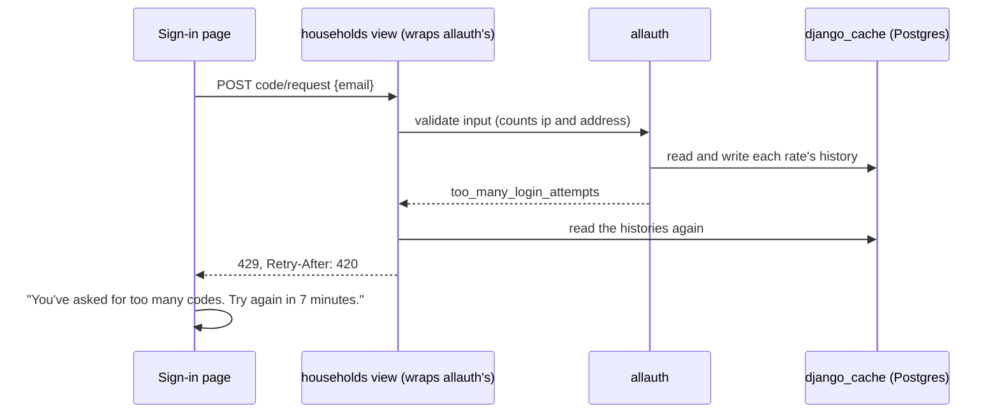

# Limit sign-in codes

Linear: TAS-104

## Summary

Sign-in codes come from allauth, whose limits today are too loose and are kept in each server instance's own memory: an address can be sent 3 codes a minute, a code allows only 3 wrong tries, and a refused request says nothing about when to try again. This sets the limits the Accounts and households PRD asks for (3 codes per address in 10 minutes, 5 wrong tries per code), keeps their counts in Postgres so every instance shares them, and has the sign-in page say exactly when you can try again. A code stopped by its 5th wrong try says so on that try, not the next.

Evidence: feature. Someone over a limit sees a new message on the sign-in page, and the 5th wrong code shows the stopped-code message at once.
Design: skip. Both messages are the email and code fields' existing error lines on the sign-in page (Field's `error`), with new copy and no visual change; `docs/design.md` (Voice, Field) already decides how they look.

## Required reading

- `AGENTS.md`: hard constraints, Tests, API contract.
- `specs/TAS-102.md`: how sign-in by code works through allauth's headless API, and why `ACCOUNT_PREVENT_ENUMERATION` is off.
- `backend/config/settings.py:145-163`: allauth's settings, where the new ones go.
- `backend/tests/test_accounts.py:19-66` and `:136-178`: `BrowserClient`, `sign_up`, `emailed_code`, `ask_to_sign_in` / `ask_to_sign_up` and the frozen-`time.time` pattern the new tests reuse.
- `backend/tests/test_settings.py`: mirror `READ_SETTINGS` and `settings_with` for the client IP setting.
- `frontend/src/households/auth-api.ts`: `send` and `toResult`, where a 429 becomes a result.
- `frontend/src/households/sign-in-page.tsx`: the two steps' `refuse(message)` pattern the new copy uses.
- `frontend/src/households/sign-in-page.test.tsx:55-110` and `:188-210`: the `rejected` helper, the default handlers and the per-answer `it.each` to extend.
- `frontend/e2e/sign-in-api.spec.ts`: mirror its `post` helper for the new end-to-end test.
- allauth 65.21 (in `backend/.venv/lib/python3.14/site-packages/allauth`): `core/internal/ratelimit.py` (`get_rates`, `get_cache_key`, the newest-first history list), `account/forms.py:760-776` (`RequestLoginCodeForm.clean_email`), `headless/account/views.py:71-130` and `:178-245`.
- `specs/lessons/neon-previews-branch-from-the-default-branch.md`: check a provider's setting exists before naming it (this spec names Vercel's `X-Real-IP` header, checked in [Vercel's request headers](https://vercel.com/docs/headers/request-headers)).

## Product behaviour

1. An address can be sent at most 3 codes in any 10 minutes.
2. The 5th wrong code stops that code; signing in then needs a new one.
3. Over a limit, the sign-in page says how many minutes until you can try again.
4. The limits hold whichever server instance answers each request.

What else holds, each proved by a test below:

- Another address is unaffected when one address is over its limit.
- 4 wrong codes and then the right one still signs you in, for sign-in and sign-up codes alike.
- The 5th wrong code shows "That code has stopped working." straight away.

## Technical design

### How it works today

- Sign-in is allauth's headless browser API under `/api/_allauth/browser/v1/auth/` (`backend/config/urls.py:14`). The page first asks `code/request`; an address with no account gets `400 unknown_email` (before any limit is counted) and the page signs it up with `signup`, which emails a verification code (`frontend/src/households/sign-in-api.ts:20-30`).
- `code/request` counts against allauth's `request_login_code` limit, default `20/m/ip,3/m/key` with the address as key (`allauth/account/app_settings.py:303`). Over it, `RequestLoginCodeForm.clean_email` raises `too_many_login_attempts`, so the answer is **`400`** with `errors: [{code: 'too_many_login_attempts', param: 'email', message: 'Too many failed login attempts. Try again later.'}]` and no wait.
- `signup` is limited `20/m/ip` by allauth's `rate_limit` decorator, which answers **`429`** with body `{"status": 429}` and no wait (`allauth/headless/base/response.py:198`).
- A code allows 3 wrong tries (`LOGIN_BY_CODE_MAX_ATTEMPTS` and `EMAIL_VERIFICATION_BY_CODE_MAX_ATTEMPTS` default 3). On the last one, `record_invalid_attempt()` ends the flow but the view still answers `400 incorrect_code`; only the next try gets `409` (`allauth/account/internal/flows/code_verification.py:63-69`, `headless/account/views.py:125-127` and `:211-214`).
- allauth keeps each limit's history in `django.core.cache` (`core/internal/ratelimit.py:196-210`). `settings.py` has no `CACHES`, so Django uses local memory: each Vercel instance counts on its own.
- allauth finds the client's IP from `REMOTE_ADDR` unless told to trust a header (`core/internal/httpkit.py:213-221`). Vercel puts the client's IP in `X-Real-IP` and overwrites any the client sent ([Vercel request headers](https://vercel.com/docs/headers/request-headers)). What `REMOTE_ADDR` holds in a Vercel Python function isn't documented; once the cache is shared, a shared `REMOTE_ADDR` would make the per-IP limits one limit for everyone.
- The page shows `400` errors' messages under the field, shows `409` on the code step as "That code has run out…" (`sign-in-page.tsx:17,135-138`), and treats any other status, including `429`, as "Couldn't reach Tastebook" (`auth-api.ts:62`).

### Approach, layer by layer



- **Settings** (`backend/config/settings.py`):
  ```py
  CACHES = {
      'default': {
          'BACKEND': 'django.core.cache.backends.db.DatabaseCache',
          'LOCATION': 'django_cache',
          # Room for every live limit, so culling never drops an address's history early.
          'OPTIONS': {'MAX_ENTRIES': 10_000},
      }
  }
  ```
  beside allauth's settings:
  ```py
  ACCOUNT_RATE_LIMITS = {'request_login_code': '20/m/ip,3/10m/key'}
  ACCOUNT_LOGIN_BY_CODE_MAX_ATTEMPTS = 5
  ACCOUNT_EMAIL_VERIFICATION_BY_CODE_MAX_ATTEMPTS = 5
  if VERCEL_ENV:
      # Vercel sets X-Real-IP to the client's address and overwrites one the client sends.
      ALLAUTH_TRUSTED_CLIENT_IP_HEADER = 'X-Real-IP'
  ```
  `ACCOUNT_RATE_LIMITS` is merged over allauth's defaults, so `signup` stays `20/m/ip`. Put `CACHES` after `DATABASES`.
- **Cache table**: a migration, `backend/households/migrations/0003_sign_in_limits_cache.py`, depending on `0002_household_user_name_user_household_and_more`, with one `migrations.RunPython(make_cache_table, migrations.RunPython.noop)` where `make_cache_table` runs `call_command('createcachetable', database=schema_editor.connection.alias)`. `createcachetable` skips a table that exists. Every place that migrates (the Vercel build in `backend/build.py`, `pnpm dev`, CI's e2e job, pytest-django's test database) then has the table, with no other change.
- **The wait** (`backend/households/services.py`, new function, module-level imports of `math`, `time`, `django.core.cache.cache`, `django.http.HttpRequest` and `from allauth.core.internal.ratelimit import Rate, get_cache_key, get_rates`):
  ```py
  ALLAUTH_LIMITS = 'allauth.account'

  def seconds_until_allowed(request: HttpRequest, action: str, key: str | None = None) -> int:
      """Whole seconds until every allauth limit on `action` would let `request` through again; at least 1."""
      now = time.time()
      waits = [
          wait_for(rate, cache.get(get_cache_key(request, app=ALLAUTH_LIMITS, action=action, rate=rate, key=key), []), now)
          for rate in get_rates(app=ALLAUTH_LIMITS, action=action)
      ]
      return max(1, math.ceil(max(waits, default=0)))

  def wait_for(rate: Rate, history: list[float], now: float) -> float:
      # allauth keeps the newest hit first; a slot frees when the rate.amount-th newest one leaves the window.
      live = [hit for hit in history if hit > now - rate.duration]
      return live[rate.amount - 1] + rate.duration - now if len(live) >= rate.amount else 0
  ```
  `get_cache_key` ignores `key` for a per-IP rate, so one call covers both rates of `request_login_code`.
- **Views** (`backend/households/views.py`), four subclasses of allauth's headless views, each changing one method:
  ```py
  def rate_limited(request: HttpRequest, seconds: int) -> HttpResponse:
      response = RateLimitResponse(request)
      response['Retry-After'] = str(seconds)
      return response

  class RequestSignInCodeView(RequestLoginCodeView):
      def handle_invalid_input(self, input: RequestLoginCodeInput) -> HttpResponse:
          refused = [error.code for error in input.errors.as_data().get('email', [])]
          if 'too_many_login_attempts' not in refused:
              return super().handle_invalid_input(input)
          email = str(input.data.get('email', '')).strip().lower()
          return rate_limited(self.request, seconds_until_allowed(self.request, 'request_login_code', key=email))

  class SignUpView(SignupView):
      def handle(self, request: HttpRequest, *args: Any, **kwargs: Any) -> HttpResponseBase:
          response = super().handle(request, *args, **kwargs)
          if response.status_code != HTTPStatus.TOO_MANY_REQUESTS:
              return response
          return rate_limited(request, seconds_until_allowed(request, 'signup'))

  class ConfirmSignInCodeView(ConfirmLoginCodeView):
      # The last wrong try ends the code, so it answers as a stopped code rather than leaving that to the next try.
      def handle_invalid_input(self, input: ConfirmLoginCodeInput) -> HttpResponse:
          if self.process.record_invalid_attempt():
              return ErrorResponse(self.request, input=input)
          return ConflictResponse(self.request)

  class VerifyEmailCodeView(VerifyEmailView):
      # As ConfirmSignInCodeView, for the code that checks a new account's address.
      def handle_invalid_input(self, input: VerifyEmailInput) -> HttpResponse:
          if self.process.record_invalid_attempt():
              return ErrorResponse(self.request, input=input)
          return ConflictResponse(self.request)
  ```
  The confirm views call `ErrorResponse` themselves instead of `super()`, because allauth's own `handle_invalid_input` records the attempt again. `self.process` is never `None` in `VerifyEmailCodeView`, because `EMAIL_VERIFICATION_BY_CODE_ENABLED` is on and allauth's `handle` answers `409` without one. Import `RateLimitResponse` and `ConflictResponse` from `allauth.headless.base.response`, `ErrorResponse` from `allauth.headless.internal.restkit.response`, the views from `allauth.headless.account.views` and the inputs from `allauth.headless.account.inputs`.
- **URLs** (`backend/config/urls.py`): four `path()`s placed before `path('api/_allauth/', include('allauth.headless.urls'))`, so they answer first on the same paths, each `<View>.as_api_view(client=Client.BROWSER)` (`from allauth.headless.constants import Client`):
  ```diff
  +    # Ours first, so they answer on allauth's own paths: see households.views.
  +    path('api/_allauth/browser/v1/auth/code/request', RequestSignInCodeView.as_api_view(client=Client.BROWSER)),
  +    path('api/_allauth/browser/v1/auth/code/confirm', ConfirmSignInCodeView.as_api_view(client=Client.BROWSER)),
  +    path('api/_allauth/browser/v1/auth/signup', SignUpView.as_api_view(client=Client.BROWSER)),
  +    path('api/_allauth/browser/v1/auth/email/verify', VerifyEmailCodeView.as_api_view(client=Client.BROWSER)),
       path('api/_allauth/', include('allauth.headless.urls')),
  ```
- **API contract:** no change to `backend/schema.yml` or `schema.d.ts`; allauth's views aren't DRF views, so drf-spectacular doesn't see them. The changed answers: `code/request` and `signup` over a limit answer `429` with body `{"status": 429}` and header `Retry-After: <whole seconds>`; `code/confirm` and `email/verify` answer the 5th wrong code with `409` and body `{"status": 409}`.
- **Frontend, `auth-api.ts`:** `AuthResult` gains `| { kind: 'limited'; retryAfterSeconds: number | undefined }`. In `send`, before reading the body, a `429` returns `{ kind: 'limited', retryAfterSeconds: retryAfter(response) }`, where
  ```ts
  // Whole seconds from the server's Retry-After; undefined when it's missing or isn't a positive whole number.
  const retryAfter = (response: Response): number | undefined => {
    const seconds = Number(response.headers.get('Retry-After'));
    return Number.isInteger(seconds) && seconds > 0 ? seconds : undefined;
  };
  ```
- **Frontend, `sign-in-api.ts`:** `export type CodeRequest = Extract<AuthResult, { kind: 'code-sent' | 'limited' }> | Rejected;` and `useRequestCode` returns a `limited` result from either request. `CodeConfirmation` is unchanged: a `429` on confirming still throws, as today.
- **Frontend, `sign-in-page.tsx`:**
  ```ts
  const minutes = (seconds: number): string => {
    const count = Math.ceil(seconds / 60);
    return count === 1 ? '1 minute' : `${count} minutes`;
  };

  const tooManyCodes = (retryAfterSeconds: number | undefined): string =>
    `You've asked for too many codes. Try again in ${retryAfterSeconds === undefined ? 'a few minutes' : minutes(retryAfterSeconds)}.`;
  ```
  `EmailStep.submit` handles `result.kind === 'limited'` with `refuse(tooManyCodes(result.retryAfterSeconds))` before the rejected path, so it shows under the email field and focuses it. `RUN_OUT` becomes `STOPPED = 'That code has stopped working. Use a different email or send a new code from step 1.'`, used where `RUN_OUT` was.
- **Glossary** (`GLOSSARY.md:49`): Sign-in code's meaning becomes "The 6-digit code emailed to sign in or sign up. Works once, for 10 minutes, and stops after 5 wrong tries. An address is sent at most 3 in 10 minutes."
- **Architecture** (`docs/architecture.md`, in the API's section of "Where it runs"): one sentence: "Sign-in's limits (codes per address, tries per code) are counted in Django's database cache, the `django_cache` table a migration makes, so every instance shares them; on Vercel the client's address comes from `X-Real-IP`."

### Steps

1. **Share the limits through Postgres.** `backend/config/settings.py` (edit: `CACHES`, the client IP header), `backend/households/migrations/0003_sign_in_limits_cache.py` (new), `backend/tests/test_build.py` (edit), `backend/tests/test_settings.py` (edit), `backend/tests/test_accounts.py` (edit: the cache-row test).
   Done when: `uv run python manage.py makemigrations --check --dry-run` reports no changes, and the build, settings and cache-row tests below pass.
2. **Set the limits and answer the 5th wrong code at once.** `backend/config/settings.py` (edit: `ACCOUNT_RATE_LIMITS`, both `*_MAX_ATTEMPTS`), `backend/households/views.py` (edit: `ConfirmSignInCodeView`, `VerifyEmailCodeView`), `backend/config/urls.py` (edit: their two paths), `backend/tests/test_accounts.py` (edit).
   Done when: the wrong-code tests below pass, and `test_a_wrong_code_is_refused` still does.
3. **Send the wait.** `backend/households/services.py` (edit: `seconds_until_allowed`, `wait_for`), `backend/households/views.py` (edit: `rate_limited`, `RequestSignInCodeView`, `SignUpView`), `backend/config/urls.py` (edit: their two paths), `backend/tests/test_accounts.py` (edit).
   Done when: the limit tests below pass, and `uv run --env-file .env python manage.py spectacular --file schema.yml` leaves `schema.yml` unchanged.
4. **Say when to try again on the page.** `frontend/src/households/auth-api.ts`, `sign-in-api.ts`, `sign-in-page.tsx`, `sign-in-page.test.tsx` (edit).
   Done when: `pnpm lint` and `pnpm test` pass with the page tests below.
5. **Prove it across instances.** `frontend/e2e/sign-in-api.spec.ts` (edit).
   Done when: `pnpm test:e2e` passes locally, and the PR's preview run passes.
6. **Words and docs.** `GLOSSARY.md`, `docs/architecture.md` (edit).
   Done when: both read as written above.

### Tests

Freeze time as `test_a_code_works_for_10_minutes` does, at `SENT_AT = 1_800_000_000.0` (a whole number, so `Retry-After` has no float error). A wrong code is `'000000'` unless the emailed code is `'000000'`, then `'111111'`.

- `backend/tests/test_accounts.py`
  - A 4th code for one address 3 minutes after the first: sign up `sam@example.com`, then request a code at `SENT_AT`, `+60`, `+120` and `+180`, asserts: `([401, 401, 401, 429], '420', 3)` for the statuses, the 4th answer's `Retry-After` and the login-code emails sent to `sam@example.com` after sign-up.
  - `parametrize` seconds after the first of 3 codes (asked at `SENT_AT`, `+60` and `+120`) `(599, 429, '1')` and `(600, 401, None)`: request a 4th then, asserts: its status and `Retry-After` header (`response.get('Retry-After')`) equal the case's.
  - Another address isn't held back: after `sam@example.com`'s 4th request is refused, `kim@example.com` (signed up) requests a code, asserts: `(429, 401)` for Sam's 4th and Kim's first.
  - The limit is kept in the database: after one code request for a signed-up address, asserts: `SELECT cache_key FROM django_cache` returns exactly 2 keys containing `request_login_code` (the IP's and the address's).
  - A 21st sign-up from one IP in a minute: 20 sign-ups of `cook<n>@example.com` at `SENT_AT`, then a 21st at `SENT_AT + 15`, asserts: `(429, '45')` for its status and `Retry-After`.
  - `parametrize` over `ask_to_sign_in` and `ask_to_sign_up`: 5 wrong codes, then the right one, asserts: statuses `[400, 400, 400, 400, 409, 409]` and `GET session` answers `401`.
  - `parametrize` over `ask_to_sign_in` and `ask_to_sign_up`: 4 wrong codes, then the right one, asserts: statuses `[400, 400, 400, 400, 200]` and the session's email is `sam@example.com`.
- `backend/tests/test_build.py`
  - A build on an empty database (the `an_empty_database` fixture) makes the cache table, asserts: `'django_cache' in connection.introspection.table_names()` after `build.main()`.
- `backend/tests/test_settings.py`
  - Add `'ALLAUTH_TRUSTED_CLIENT_IP_HEADER': getattr(settings, 'ALLAUTH_TRUSTED_CLIENT_IP_HEADER', None)` to `READ_SETTINGS`. `parametrize` `({'VERCEL_ENV': 'preview'}, 'X-Real-IP')` and `({'DJANGO_DEBUG': 'true'}, None)` (each with `DJANGO_SECRET_KEY`), asserts: the setting equals the case's.
- `frontend/src/households/sign-in-page.test.tsx`
  - `it.each` over `code/request` answering `429` with `Retry-After` `'420'`, `'60'`, `'61'` and none, asserts: the email field's error reads "You've asked for too many codes. Try again in 7 minutes." / "…in 1 minute." / "…in 2 minutes." / "…in a few minutes.", the field has focus and the "Sign in" heading is still shown.
  - A new address whose `signup` answers `429` with `Retry-After: 30`, asserts: "You've asked for too many codes. Try again in 1 minute."
  - The existing `409` case's expected text becomes "That code has stopped working. Use a different email or send a new code from step 1."
- `frontend/e2e/sign-in-api.spec.ts`
  - A new test account signs up and signs out, then asks for 4 codes, asserts: `[401, 401, 401, 429, true]` for the 4 statuses and whether the 4th's `Retry-After` is a whole number from 1 to 600. On a preview this runs against Vercel's instances, which proves behaviour 4.

## Decisions

- **The wait comes from the server as `Retry-After` on a `429`**, because only the server knows which limit was hit and how old its hits are; fixed copy would say 10 minutes when the wait is 1 minute or 30 seconds. Asked: how exactly should the page say when you can try again? → Exact, from the server.
- **The 5th wrong code answers `409`, like a stopped code**, so the page shows "That code has stopped working." on that try instead of "isn't right" followed by a surprise. Asked: when the 5th wrong code stops a code, should the page say so straight away? → Straight away.
- **The over-limit `400 too_many_login_attempts` becomes a `429`**, because `Retry-After` belongs on a `429` and the page then has one path for every limit (`code/request` and `signup` alike).
- **One message for an expired and a stopped code** ("That code has stopped working."), because a `409` doesn't say which happened and both need the same next step: a new code.
- **The wait is shown in whole minutes, rounded up**, so the page never tells someone to try too early; it doesn't count down, and pressing Send code again asks the server afresh.
- **Django's database cache, not a model of our own**, because allauth already counts through `django.core.cache` and Postgres is the one store every instance shares; no Redis to run. `MAX_ENTRIES` is 10,000, not Django's 300, because culling at 300 would let a flood of other addresses evict one address's history; 10,000 is about 5,000 code requests in 10 minutes, far above Tastebook's traffic, and keeps the `COUNT(*)` on each write cheap.
- **A migration makes the cache table, not a line in `build.py`**, because every place that migrates (the Vercel build, `pnpm dev`, CI, pytest) then has it, with no list of places to keep in step.
- **The wait is worked out from allauth's own histories (`allauth.core.internal.ratelimit`)**, rather than a second counter of our own, so there is one count; it is an internal module, pinned by `uv.lock`, and the limit tests break if a new allauth changes it.
- **Wrapping allauth's four views on their own paths**, rather than a middleware that reads bodies, because each wrapper changes one method and knows its action and key.
- **The per-IP limits stay allauth's (`20/m/ip` for codes and sign-ups)**; IP-wide limiting of the whole API stays with TAS-58 (API rate limiting).

## Assumptions

- **A brand-new address can get 4 codes in its first 10 minutes**: one sign-up code (sent once ever, since a second sign-up is refused as `email_taken`) and then 3 sign-in codes. Counting the sign-up code too would need its own wrapper for one extra code, once. Confirm with: Milo, at spec approval.
- **On Vercel the client's address is read from `X-Real-IP`**, because Vercel documents it as the client's IP and overwrites one the client sends, and whether `REMOTE_ADDR` holds the client in a Vercel Python function isn't documented. Off Vercel the header is ignored, so nobody can spoof it locally or in CI. Confirm with: Milo, at spec approval; the verify stage's preview run shows sign-in still works.
- **A `429` on sign-out or on confirming a code still counts as a failed request**, because allauth limits neither, so only a future firewall rule (TAS-58) could send one. Confirm with: Milo, at spec approval.

## Out of scope

- Rate limiting the whole API by IP: TAS-58 (API rate limiting).
- A "Send a new code" button on the code step, or resending codes (allauth's resend stays off).
- A countdown, or enabling Send code again by itself when the wait ends.
- Changing the code email's text or the code step's "It works for 10 minutes." line.
- Clearing expired rows from `django_cache` on a schedule: Django culls them when the table passes `MAX_ENTRIES`.
- What happens when an unverified account whose sign-up code stopped asks again: unchanged from TAS-102.

## Blast radius

- **allauth's four endpoints** answer from our subclasses now. Only the limit and last-wrong-code answers change; `backend/tests/test_accounts.py` (every existing test) and `frontend/e2e/sign-in-api.spec.ts` and `sign-in.spec.ts` re-check the rest. allauth reverses its own URL names to the same paths, so its links are unaffected.
- **Django's cache** moves from local memory to Postgres. The only users are allauth's limits and the `cache.clear()` fixtures in `backend/tests/test_accounts.py:19-24` and `backend/tests/test_test_accounts.py:15-20`, which work the same on the database cache. `health/services.py` uses `functools.cache`, not Django's.
- **`AuthResult`** gains `limited`. `useSignOut` (`session-api.ts:23-33`) treats any non-`signed-in` result as signed out, so a `429` on sign-out would show signed out; allauth doesn't limit sign-out (Assumptions).
- **The client's IP on Vercel** now comes from `X-Real-IP`, which also changes allauth's other per-IP limits (`login`, `signup`) to count per real client.

## Validation criteria

- [ ] `uv run ruff check . && uv run ruff format --check .` and `uv run pytest` (in `backend/`)
- [ ] `uv run python manage.py makemigrations --check --dry-run` (in `backend/`)
- [ ] `spectacular --file schema.yml --validate --fail-on-warn` leaves `backend/schema.yml` unchanged
- [ ] `pnpm lint` and `pnpm test`
- [ ] `pnpm test:e2e`, locally and against the PR's preview
- [ ] On the preview, a test account asked 4 codes in a row sees "You've asked for too many codes. Try again in 10 minutes." under the email field, and 5 wrong codes show "That code has stopped working." on the 5th
- Evidence: feature: a laptop screenshot of the sign-in page with the limit message, phone screenshots of the limit message and the stopped-code message, and the walkthrough.
