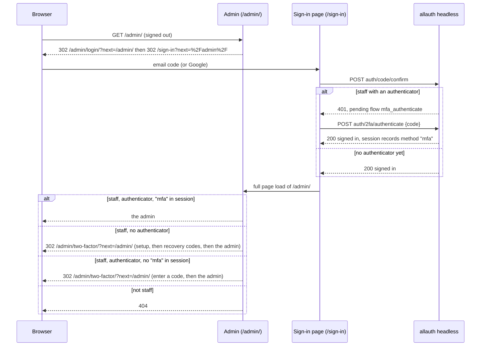

# Let staff sign in to the admin with two factors

Linear: TAS-107

## Summary

Staff get the Django admin on production at `/admin/`, and only after two-factor sign-in: an email code or Google, then a 6-digit code from an authenticator app. A staff account sets its authenticator up on an admin page the first time it opens `/admin/`, gets ten recovery codes for a lost phone, and from then on every sign-in to Tastebook asks it for the app's code. Nobody else sees the admin: signed out, `/admin/` sends you to the app's sign-in; signed in without staff, it answers 404. It comes now because moderation (TAS-130, TAS-131) happens in the admin, and the admin can change every recipe and account.

Evidence: feature. A new step on the sign-in page and three admin pages a staff member sees; `/admin/` now answers on production.
Design: skip. The admin pages use Django's own look, which `docs/design.md` doesn't cover and only staff see. The sign-in page's new step is the code step drawn on `docs/design/picnic/sign-in-step-2.dc.html` again (heading, one paragraph, a Code field, Sign in and a secondary button) with other words, so the board already draws it.
Components: none new or changed.

## Required reading

- `AGENTS.md`: hard constraints, tests, the API contract (no DRF change here, so no regeneration).
- `docs/architecture.md`, Accounts: how sign-in works (allauth headless, codes, Google), and the lines this spec rewrites.
- `backend/config/settings.py`, `backend/config/urls.py`, `vercel.json`, `frontend/vite.config.ts`: what changes in each is under Steps.
- `backend/households/services.py`: where the new staff and two-factor functions go, beside `seconds_until_allowed`, which already reaches into `allauth`'s internals.
- `backend/households/management/commands/clear_expired_sign_in_limits.py`: mirror it for the two new commands.
- `backend/tests/test_accounts.py`: `BrowserClient` and `emailed_code` show how to drive allauth's browser API in a test.
- `frontend/src/households/sign-in-page.tsx`, `auth-api.ts`, `sign-in-api.ts`: the code step to mirror for the two-factor step.
- `frontend/e2e/account.spec.ts`, `frontend/e2e/test-accounts.ts`: sign-up in an end-to-end test.
- Lessons: `django-admin-is-on-screen.md` (verify signs in to the admin and screenshots it; never `notOnScreen`), `vite-proxy-string-target-rewrites-host.md` (the `/admin` proxy entry uses the object form), `vercel-preview-checks.md` (previews and their bypass), `tanstack-refetch-resets-error-state.md`.
- allauth 65.21's MFA, read in `backend/.venv/lib/python3.14/site-packages/allauth/mfa/`: `stages.py` (`AuthenticateStage`), `totp/forms.py` (`ActivateTOTPForm`), `base/forms.py` (`AuthenticateForm`), `totp/internal/flows.py` (`activate_totp`), `base/internal/flows.py` (`post_authentication`), and `allauth/account/authentication.py` (`get_authentication_records`).

## Product behaviour

1. A staff member signs in with an email code or Google, then their authenticator app's code.
2. A staff member with no authenticator who opens `/admin/` sets one up there first.
3. Setting one up shows a QR code, its key, and then ten recovery codes.
4. A recovery code works once in place of the app's code.
5. Staff who passed both factors in this session see the admin on production at `/admin/`.
6. Signed out, `/admin/` sends you to the sign-in page and back to the admin after it.
7. A signed-in account that isn't staff gets a 404 from every admin address.
8. A staff session that hasn't passed the second factor gets the code page, not the admin.
9. `make_staff <email>` makes an existing account staff; `reset_two_factor <email>` removes its authenticator.

## Technical design

### How it works today

- `/admin/` is `admin.site.urls` (`backend/config/urls.py:15`), Django's default site with its password form. Accounts have unusable passwords (`backend/households/models.py:11-17`), so nobody can sign in to it, and `vercel.json` sends only `/api/(.*)` to Django, so production's `/admin/` is the app's not-found page.
- Sign-in is allauth headless (`HEADLESS_ONLY = True`, `backend/config/settings.py:174`). The sign-in page posts to `/api/_allauth/browser/v1/auth/code/confirm`; allauth answers 200 when signed in, or 401 with a pending flow (`frontend/src/households/auth-api.ts:56-72`). `allauth.mfa` isn't installed.
- Admin tests use pytest-django's `admin_client`, a superuser signed in with `force_login` (`backend/tests/test_recipes.py:313-389`).
- Nothing can make an account staff on production: there's no shell on Vercel and the admin isn't reachable.

### The flow



### Approach, layer by layer

**Dependencies and settings.** `backend/pyproject.toml`: `django-allauth[headless,mfa,socialaccount]>=65.21.0` (the `mfa` extra brings `qrcode` and `fido2`), then `uv lock`. `backend/config/settings.py`:

```py
INSTALLED_APPS = [
    'households.admin_apps.StaffAdminConfig',  # replaces 'django.contrib.admin'
    ...
    'allauth.account',
    'allauth.mfa',
    'allauth.headless',
    ...
]

# Staff only: an account with an authenticator is asked for its code at every sign-in (households.admin_site).
MFA_SUPPORTED_TYPES = ['totp', 'recovery_codes']
MFA_TOTP_ISSUER = 'Tastebook'
# A code from the 30 seconds either side is accepted, for a phone whose clock has drifted.
MFA_TOTP_TOLERANCE = 1
```

`allauth.mfa` brings its own migrations (`mfa_authenticator`); no households model changes, so no households migration. Installing it adds allauth's headless MFA endpoints under `/api/_allauth/browser/v1/` (`auth/2fa/authenticate`, `account/authenticators/...`). The sign-in page uses only `auth/2fa/authenticate`.

**The admin site.** `backend/households/admin_apps.py` (new) holds only the app config, as Django's docs do for a custom default site, so the app registry never imports the admin's forms early:

```py
class StaffAdminConfig(AdminConfig):
    default_site = 'households.admin_site.StaffAdminSite'
```

`backend/households/admin_site.py` (new):

```py
ADMIN_PATH = '/admin/'

class StaffAdminSite(admin.AdminSite):
    def has_permission(self, request: HttpRequest) -> bool:
        return may_open_admin(request)

    # Django's password form goes: staff sign in through the app, so this is where admin_view sends anyone it refuses.
    def login(self, request: HttpRequest, extra_context: dict[str, Any] | None = None) -> HttpResponse: ...

    def get_urls(self) -> list[URLPattern | URLResolver]:
        return [path('two-factor/', self.two_factor, name='two_factor'), *super().get_urls()]

    def two_factor(self, request: HttpRequest) -> HttpResponse: ...
```

- `admin_next(request) -> str`: `request.GET['next']` when it starts with `/admin/`, otherwise `/admin/`. It's the open-redirect guard for both views.
- `login`: anonymous → `302 /sign-in?next=<urlencoded admin_next>`; signed in and `not is_staff_account(user)` → `raise Http404`; otherwise `302 /admin/two-factor/?next=<urlencoded admin_next>`. When `may_open_admin` is already true, `two_factor` sends them straight on, so `login` needs no case of its own for it.
- `two_factor` (not wrapped in `admin_view`, which would send it back to `login`): anonymous → sign-in as above; not staff → 404; `may_open_admin` → `302 admin_next`. Then, with no authenticator, the setup page; with one, the code page. Each GET renders its form; each POST validates it.
  - Setup: GET renders `ActivateTOTPForm(user=request.user)` (unbound, so allauth makes a new key and keeps it in the session). POST binds `ActivateTOTPForm(request.POST, user=request.user)`; valid → `recovery_codes = turn_on_two_factor(request, form)` and render the recovery codes page; invalid → the setup page again with the same key (a bound form reads it from the session) and the form's error.
  - Code: `AuthenticateForm(request.POST or None, user=request.user)`; valid → `form.save()` (allauth records `method: 'mfa'` in the session) and `302 admin_next`; invalid → the page with the error.
  - The QR code is `adapter.build_totp_svg(adapter.build_totp_url(user, form.secret))` from `allauth.mfa.adapter.get_adapter()`, base64-encoded into a `data:image/svg+xml;base64,` URI for an ``, as allauth's own template does.
- Every page renders with `{**self.each_context(request), 'title': <title>, ...}`, so it has the admin's header, styles and dark theme.

**Services.** `backend/households/services.py` (edit), the only place with the rules:

```py
def is_staff_account(user: AbstractBaseUser | AnonymousUser) -> bool:
    return user.is_authenticated and user.is_active and user.is_staff

def has_authenticator(user: User) -> bool:
    return Authenticator.objects.filter(user=user, type=Authenticator.Type.TOTP).exists()

def passed_two_factors(request: HttpRequest) -> bool:
    """Whether this session's sign-in included an authenticator or recovery code."""
    return any(record.get('method') == 'mfa' for record in get_authentication_records(request, request.user))

def may_open_admin(request: HttpRequest) -> bool:
    # has_authenticator too: a session that passed before reset_two_factor loses the admin with the authenticator.
    return is_staff_account(request.user) and has_authenticator(request.user) and passed_two_factors(request)

def turn_on_two_factor(request: HttpRequest, form: ActivateTOTPForm) -> list[str]:
    """Saves the authenticator and recovery codes; counts as this session's second factor. Returns the codes."""
    totp, recovery = activate_totp(request, form)  # allauth.mfa.totp.internal.flows
    # The code that confirmed the app proves the second factor, so the admin opens without asking again.
    post_authentication(request, totp)  # allauth.mfa.base.internal.flows
    # Never None here: setup runs only without an authenticator, and removing one removes its recovery codes.
    return RecoveryCodes(recovery).get_unused_codes()  # allauth.mfa.recovery_codes.internal.auth

def make_staff(email: str) -> User:
    """Makes the account with this address staff and superuser; raises User.DoesNotExist when there's none."""

def reset_two_factor(email: str) -> int:
    """Deletes the account's authenticator and recovery codes, and says how many it deleted; raises User.DoesNotExist."""
```

`make_staff` and `reset_two_factor` look the account up with `email__iexact`. `reset_two_factor` deletes `Authenticator.objects.filter(user=...)`.

`activate_totp` refuses with `ReauthenticationRequired` when allauth thinks the account must sign in again. It doesn't for these accounts: they have no usable password and, before setup, no authenticator, so `did_recently_reauthenticate` returns true (`allauth/account/internal/flows/reauthentication.py:91-107`). The setup page catches nothing for it.

**Commands.** `backend/households/management/commands/make_staff.py` and `reset_two_factor.py` (new), each taking one positional `email` and calling its service. Output:

- `make_staff`: `sam@example.com is now staff. Open /admin/ to set up two-factor sign-in.`; no account → `CommandError('No account uses sam@example.com. Sign up in the app with it first.')`.
- `reset_two_factor`: `Removed sam@example.com's authenticator and recovery codes. They set up a new one the next time they open /admin/.`; no account → the same `CommandError` text as `make_staff`; an account with none → `sam@example.com has no authenticator.` (exit 0).

**Admin templates.** `backend/households/templates/admin/households/` (new), each `` with its ``, forms posting to the same URL with ``, labels tied to inputs and errors shown with Django's `errorlist`, mirroring `registration/password_change_form.html`.

- `two_factor_setup.html`, title **Set up two-factor sign-in**:
  - "The admin needs a code from an authenticator app, such as Google Authenticator, Microsoft Authenticator or 1Password, each time you sign in. Scan this QR code with the app."
  - The QR ``, `alt="QR code for your authenticator app"`, inside an element with a white background and 16 px padding. A comment says why: the QR's modules are drawn black on transparent, and the admin's dark theme would make it unreadable.
  - "Can't scan it? Type this key into the app instead:" then the key in `<code>`.
  - Field **Code from the app**, `autocomplete="one-time-code"`, `inputmode="numeric"`, help "The 6-digit code the app shows for Tastebook."
  - Button **Turn on two-factor sign-in**.
- `two_factor_recovery_codes.html`, title **Save your recovery codes**:
  - "Two-factor sign-in is on. If you lose your phone, each of these codes signs you in once in place of the app's code. Save them now, somewhere safe like a password manager: this page won't show them again."
  - The ten codes in an `<ol>`, each in `<code>`.
  - A link styled as the admin's button (`class="button"`) **Open the admin**, to `admin_next`.
- `two_factor_code.html`, title **Enter your two-factor code**:
  - "Open your authenticator app and enter the 6-digit code for Tastebook. Lost your phone? Enter one of your recovery codes instead."
  - Field **Code**, `autocomplete="one-time-code"`, `inputmode="numeric"`.
  - Button **Continue**.

The forms' error messages are allauth's own (for example "Incorrect code.").

**Routing.** `vercel.json`: two rewrites to the backend service, after `/api/(.*)` and before the frontend's catch-all: `{ "source": "/admin", ... }` and `{ "source": "/admin/(.*)", ... }`. The admin's CSS and scripts are already under `/api/static/`. `frontend/vite.config.ts`: `'/admin': { target: 'http://localhost:8000' }` beside `/api`, in the object form, so local runs and the end-to-end tests use one origin as production does. `backend/config/urls.py` keeps `path('admin/', admin.site.urls)`: `admin.site` is now the staff site.

**The sign-in page.** No DRF endpoint changes, so the schema files don't change. allauth's endpoints are typed by hand in `frontend/src/households/auth-api.ts` (edit):

```ts
export type AuthResult =
  | { kind: 'signed-in'; account: AuthUser }
  | { kind: 'code-sent'; flow: CodeFlow }
  | { kind: 'two-factor' } // signed in up to the second factor: allauth's pending flow mfa_authenticate
  | { kind: 'signed-out' }
  | { kind: 'rejected'; status: 400 | 409; errors: AuthError[] }
  | { kind: 'limited'; retryAfterSeconds: number | undefined };

export const confirmTwoFactorCode = (code: string) => send('POST', '/2fa/authenticate', { code });
// allauth's session answers 401 to anyone not fully signed in, which the browser logs, so only the page Google
// sends back to asks it.
export const fetchSignInState = () => send('GET', '/session');
```

- `toResult` on 401: when a pending flow is `mfa_authenticate`, `{ kind: 'two-factor' }`; else the code flow as today; else `signed-out`.
- `send` accepts `'GET'` too, sending no body.
- `goToProvider`'s callback becomes `/sign-in?next=<next>&via=google`, built in `sign-in-page.tsx`'s `goToGoogle`.

`frontend/src/households/sign-in-api.ts` (edit):

- `CodeConfirmation` gains `{ kind: 'two-factor' }`; `useConfirmCode` returns it instead of throwing.
- `useConfirmTwoFactorCode()`: a mutation over `confirmTwoFactorCode`, returning `signed-in | rejected` and throwing on anything else; on `signed-in` it invalidates `SESSION_KEY`, as `useConfirmCode` does.
- `useSignInState(isBackFromGoogle: boolean)`: `useQuery({ queryKey: ['households', 'sign-in-state'], queryFn: fetchSignInState, enabled: isBackFromGoogle, retry: false })`, returning `{ isChecking: isBackFromGoogle && isPending, needsTwoFactor: data?.kind === 'two-factor' }`. A failed check counts as not needing it, as `useGoogleSignIn` does with its providers: the email step is the way in either way.

`frontend/src/households/safe-next-path.ts` (edit):

```ts
// Django serves these, not the app, so reaching one takes a full page load.
export const isServerPage = (path: string): boolean => path === '/admin' || path.startsWith('/admin/');
```

`frontend/src/households/sign-in-page.tsx` (edit). The step becomes one state, so a new step is a new case and a new component:

```ts
type Step = { name: 'email' } | { name: 'code'; email: string; flow: CodeFlow } | { name: 'two-factor' };
```

- `SignInPage` keeps `chosenStep: Step | undefined` in state and derives `step = chosenStep ?? (signInState.needsTwoFactor ? { name: 'two-factor' } : { name: 'email' })`, with `isBackFromGoogle = searchParams.get('via') === 'google'`.
- Signed in (`account` set): `isServerPage(next)` renders `<LeaveForServerPage to={next} />`; otherwise `<Navigate to={next} replace />` as today. `LeaveForServerPage` renders `<Loading>Opening the admin…</Loading>` in a `Page` and calls `window.location.replace(to)` in an effect, with a comment that the browser leaves the app, which is the external system the effect syncs with. A server page's `onSignedIn` does nothing: the session's refetch brings the account, and this branch leaves.
- While `signInState.isChecking` and no step is chosen: `<Loading>Signing you in…</Loading>` in the page.
- `CodeStep`: `result.kind === 'two-factor'` calls `onTwoFactor()`, which moves to the two-factor step and focuses its heading with `flushSync`, as `showCodeStep` does.
- `TwoFactorStep` (new, in the same file), shaped like `CodeStep`:
  - Heading (focusable, `tabIndex={-1}`): **Enter your two-factor code**
  - Paragraph: "Open your authenticator app and enter the 6-digit code for Tastebook. Lost your phone? Enter one of your recovery codes instead."
  - Field **Code**, `inputMode="numeric"`, `autoComplete="one-time-code"`, `maxLength={8}`.
  - Buttons: **Sign in** (`loadingLabel="Signing in…"`) and secondary **Start again**, which shows the email step and focuses the email field (`showEmailStep`).
  - Checked before sending: `/^(\d{6}|\d{8})$/`, else "Enter the 6-digit code from your authenticator app, like 123456, or an 8-digit recovery code."
  - Answers: 400 `incorrect_code` → "That code isn't right. Check the app and try again."; 400 `too_many_login_attempts` → "You've tried too many codes. Wait a few minutes and try again."; 409 → "That sign-in has timed out. Start again from step 1."; any other 400 → its first error's message; a thrown request → the `Unreachable` banner.

### Blast radius

- `admin.site` becomes `StaffAdminSite` for every app. `backend/recipes/admin.py` registers on it unchanged; recheck the recipe, ingredient, equipment and cuisine admin tests.
- pytest-django's `admin_client` signs in without a second factor, so the six admin tests in `backend/tests/test_recipes.py` would get the code page. `backend/tests/conftest.py` (new) overrides `admin_client` with one that has passed both factors (see Tests); those tests keep their bodies.
- `AuthResult` and `CodeConfirmation` gain a case: every `switch`/`if` on `kind` in `sign-in-page.tsx`, `sign-in-api.ts` and `session-api.ts` must still type-check and handle it.
- `goToGoogle`'s callback gains `&via=google`: `frontend/src/households/sign-in-page.test.tsx:370` asserts the old URL and changes to the new one.
- `vercel.json`'s new rewrites must sit before the frontend's `/(.*)`, or production's `/admin/` stays the app's not-found page.
- allauth's MFA internals (`activate_totp`, `post_authentication`, `RecoveryCodes`) aren't public API. They're pinned by `uv.lock`, and the backend tests below fail if an upgrade changes them.
- `docs/architecture.md`, Environments' "The admin isn't reachable on Vercel yet" and Accounts' Staff line become wrong with this change and are rewritten in it.

### Not changing

- The account page: setting up an authenticator happens only in the admin.
- Accounts that aren't staff: allauth's headless authenticator endpoints are installed and would let any account add one, but nothing in the app offers it.
- The admin's model pages and what staff can do in them.
- Django's password change pages stay reachable from the admin, but staff never use a password to sign in.

### Steps

1. **Install allauth's MFA.** `backend/pyproject.toml`, `backend/uv.lock` (edit), `backend/config/settings.py` (edit: `allauth.mfa`, the three `MFA_` settings; not yet the admin config).
   Done when: `uv run --env-file .env python manage.py migrate` applies `mfa`'s migrations and `uv run pytest` passes.
2. **The staff services and commands.** `backend/households/services.py` (edit), `backend/households/management/commands/make_staff.py`, `reset_two_factor.py` (new), `backend/tests/test_staff.py` (new: the command cases).
   Done when: the command tests pass.
3. **The staff admin site and its two-factor pages.** `backend/households/admin_apps.py`, `admin_site.py` (new), the three templates (new), `backend/config/settings.py` (edit: `INSTALLED_APPS`), `backend/tests/two_factor.py`, `backend/tests/conftest.py` (new), `backend/tests/test_staff.py` (edit: the admin cases).
   Done when: `uv run pytest` passes, the existing admin tests included, and `uv run ruff check . && uv run ruff format --check .` are clean.
4. **Route the admin.** `vercel.json`, `frontend/vite.config.ts` (edit).
   Done when: with `pnpm dev` running, `curl -sI http://localhost:5173/admin/` answers 302 to `/admin/login/?next=/admin/`.
5. **The sign-in page's two-factor step.** `frontend/src/households/auth-api.ts`, `sign-in-api.ts`, `safe-next-path.ts`, `sign-in-page.tsx`, `sign-in-page.test.tsx` (edit).
   Done when: `pnpm lint` and `pnpm test` pass.
6. **The journey end to end.** `frontend/e2e/totp.ts`, `frontend/e2e/admin.spec.ts` (new).
   Done when: `pnpm test:e2e` passes locally, axe clean on every page the spec visits.
7. **Docs.** `docs/architecture.md` (edit): Environments' admin line says `/admin/` reaches Django through `vercel.json`'s rewrite and is for staff with two-factor sign-in; Accounts' Staff line loses _planned_ and says how it works (allauth MFA, every sign-in, setup at `/admin/two-factor/`, recovery codes); a new **Staff accounts** paragraph under Accounts gives the two commands, run from `backend/` against production with `DJANGO_DEBUG=true DATABASE_URL='<production's DATABASE_URL_UNPOOLED>' uv run python manage.py make_staff you@example.com` (the same for `reset_two_factor`), and says to sign up in the app first; the personal-data list gains "Authenticators (`mfa_authenticator`): a staff account's authenticator key and recovery codes, until it's reset or the account is deleted. They're stored unencrypted: anyone who can read the database can already change it." `GLOSSARY.md` (edit), under `households`: the Staff row's code column becomes `User.is_staff`, `make_staff`; new rows **Two-factor sign-in** ("Signing in with an email code or Google and then a 6-digit code from an authenticator app. Staff only; asked at every sign-in." / `allauth.mfa`, `passed_two_factors()`) and **Recovery code** ("One of ten 8-digit codes shown once when two-factor sign-in is set up. Each signs in once in place of the app's code." / `allauth`'s recovery codes).
   Done when: the docs say the above and no line calls the admin unreachable or TAS-107 planned.

### Tests

- `backend/tests/two_factor.py` (new, helpers):
  - `current_code(key: str) -> str`: the TOTP code for now, from `allauth.mfa.totp.internal.auth.hotp_value` and `format_hotp_value` with `int(time.time()) // 30`.
  - `set_up_two_factor(client: Client) -> tuple[str, list[str]]`: GETs `/admin/two-factor/`, reads the key from the page (`re.search(r'\b[A-Z2-7]{32}\b', html)`), POSTs `current_code(key)`, reads the recovery codes (`re.findall(r'<code>(\d{8})</code>', html)`), returns both.
- `backend/tests/conftest.py` (new): `admin_client` overrides pytest-django's: `client.force_login(admin_user)`, then `set_up_two_factor(client)`.
- `backend/tests/test_staff.py` (new):
  - signed out, `GET /admin/` followed, asserts: the last response is a 302 to `/sign-in?next=%2Fadmin%2F`.
  - parametrised `next` of `/admin/recipes/recipe/`, `https://evil.example/`, `//evil.example/admin/`, `/recipes/`, signed out, `GET /admin/login/?next=<next>`, asserts: `Location` is `/sign-in?next=%2Fadmin%2Frecipes%2Frecipe%2F` for the first and `/sign-in?next=%2Fadmin%2F` for the rest.
  - parametrised over `/admin/`, `/admin/login/`, `/admin/two-factor/`, `/admin/recipes/recipe/`: a signed-in account that isn't staff, followed, asserts: status 404.
  - a staff account with no authenticator, `GET /admin/` followed, asserts: status 200 with "Set up two-factor sign-in", a 32-character key, and an `` whose `src` starts `data:image/svg+xml;base64,`.
  - setup with a wrong code (`000000` when that isn't the current code), asserts: 200 with "Set up two-factor sign-in", "Incorrect code." and the same key as the GET showed.
  - setup with the right code, asserts: "Save your recovery codes", ten different 8-digit codes, a link to `/admin/`; then `GET /admin/` is 200 with "Site administration".
  - a staff account with an authenticator, signed in with `force_login` (no second factor), `GET /admin/` followed, asserts: 200 with "Enter your two-factor code" and not "Site administration"; POST the current code, asserts: 302 to `/admin/`, then 200 with "Site administration".
  - parametrised: on the code page, a recovery code, asserts: 302 to `/admin/`; the same recovery code in a new session, asserts: 200 with "Incorrect code.".
  - the full sign-in through allauth's browser API (`BrowserClient` copied from `test_accounts.py`: its second use): a staff account with an authenticator asks for an email code and confirms it, asserts: 401 with pending flow `mfa_authenticate` and `GET /api/account/` is `{"account": null}`; then `POST auth/2fa/authenticate` with the current code, asserts: 200 with the account's email, and `GET /admin/` through the same client is 200 with "Site administration".
  - the same with `000000`, asserts: 400 with error code `incorrect_code`, and `GET /api/account/` is still `{"account": null}`.
  - an account that isn't staff and has no authenticator signs in with an email code, asserts: 200 straight away (no `mfa_authenticate`).
  - `make_staff sam@example.com` for an existing account, asserts: the row has `is_staff` and `is_superuser` true, and the output is the line under Commands.
  - `make_staff nobody@example.com`, asserts: `CommandError` with "No account uses nobody@example.com. Sign up in the app with it first."
  - `reset_two_factor` for a staff account whose session passed both factors, asserts: no `Authenticator` rows for it, the output line, and that session's `GET /admin/` followed ends on "Set up two-factor sign-in".
- `backend/tests/test_recipes.py`: unchanged; its six admin tests pass with the new `admin_client`.
- `frontend/src/households/sign-in-page.test.tsx` (edit; `answerAllauth` gains `staff@example.com`, whose code confirm answers 401 `mfa_authenticate`, and a `2fa/authenticate` handler where `654321` is the app's code and `12345678` a recovery code):
  - staff signs in with the email code, asserts: heading "Enter your two-factor code" is focused.
  - parametrised `654321` and `12345678`, asserts: the request sent `{ code: <it> }` to `2fa/authenticate`, and the router is at `/recipes/baguette`.
  - `12345`, asserts: "Enter the 6-digit code from your authenticator app, like 123456, or an 8-digit recovery code." and no request to `2fa/authenticate`.
  - parametrised answers: 400 `incorrect_code` → "That code isn't right. Check the app and try again."; 400 `too_many_login_attempts` → "You've tried too many codes. Wait a few minutes and try again."; 409 → "That sign-in has timed out. Start again from step 1.", asserts: that text, and the Code field focused.
  - a network error on `2fa/authenticate`, asserts: "Couldn't reach Tastebook".
  - **Start again**, asserts: heading "Sign in" and the email field focused.
  - `/sign-in?next=%2Frecipes&via=google` with `GET auth/session` answering 401 `mfa_authenticate`, asserts: "Signing you in…" first, then heading "Enter your two-factor code".
  - `/sign-in?next=%2Frecipes` without `via`, after `queryClient.isFetching()` is 0, asserts: no request to `auth/session` and heading "Sign in"; and with `via=google`, one request to it (the presence on the other input).
  - `via=google` with `auth/session` failing with 500, asserts: heading "Sign in".
  - Continue with Google, asserts: the posted `callback_url` is `/sign-in?next=%2Frecipes%2Fbaguette&via=google` (the existing test's assertion, updated).
- `frontend/e2e/totp.ts` (new): `totpCode(key: string, at = Date.now()): string`, RFC 6238 with `node:crypto` (HMAC-SHA1, 30-second steps, 6 digits), decoding the base32 key itself; no new dependency.
- `frontend/e2e/admin.spec.ts` (new):
  - "the admin sends someone signed out to sign in", on every run including previews (it's what proves `vercel.json`'s rewrite): `page.goto('/admin/')`, asserts: URL `/sign-in?next=%2Fadmin%2F` and heading "Sign in".
  - "the admin isn't there for an account that isn't staff", on every run: sign up a test account as `account.spec.ts` does, then `page.request.get('/admin/')`, asserts: status 404. It uses `page.request` so the page stays on the app, which the fixture scans with axe; Django's bare 404 page isn't the app's.
  - "a staff member sets up two-factor sign-in and then signs in with it", locally and in CI only (`test.skip(Boolean(process.env.PREVIEW_URL), 'make_staff needs the database')`): sign up a test account; run `uv run python manage.py make_staff <email>` in `../backend` with `DJANGO_DEBUG=true` (`execFileSync`); `page.goto('/admin/')`, asserts: heading "Set up two-factor sign-in"; `accessibility.check()`; fill **Code from the app** with `totpCode(key)` read from the page's `<code>`, press **Turn on two-factor sign-in**, asserts: heading "Save your recovery codes" and ten codes; `accessibility.check()`; **Open the admin**, asserts: "Site administration"; `accessibility.check()`; the admin's **Log out**; `page.goto('/admin/')`, sign in with the email code, asserts: heading "Enter your two-factor code" focused; `accessibility.check()`; enter `totpCode(key)`, press **Sign in**, asserts: URL `/admin/` and "Site administration".
  - If axe reports a violation inside Django's own admin markup (not a Tastebook template), the implementer doesn't disable the rule: they report it on the PR for a decision.
- Checks: `pnpm lint`, `pnpm test`, `pnpm test:e2e`; in `backend/`, `uv run pytest`, `uv run ruff check . && uv run ruff format --check .`, `uv run python manage.py makemigrations --check`.

## Decisions

- Staff give the app's code at every sign-in to Tastebook, through allauth's MFA stage, not only when the admin opens, because a staff page added to the app later is covered without its own check. Asked: when staff type the authenticator code → Every staff sign-in.
- Staff sign in to the admin through the app's sign-in, and Django's password form goes, because staff have no passwords and one way in is one to secure and test. Asked: how staff sign in to the admin → Through the app's sign-in.
- The authenticator is set up on an admin page in Django's look, because only staff see it and it needs no Picnic design or split. Asked: where staff set up the authenticator → On an admin page.
- A lost phone is covered by ten recovery codes and by a `reset_two_factor` command, because with one staff account nobody else could reset it in the admin. Asked: how staff get back in after losing their phone → Both.
- The first staff account is made by `make_staff`, run by a person against production's database, because a list in an environment variable would be a setting that grants the admin. Asked: how the first staff account is made → make_staff command.
- The admin stays at `/admin/` with two rewrites in `vercel.json`, because every admin link and test keeps its address. Asked: which address the admin lives at → /admin/.
- It ships as one PR, because with setup in the admin it's mostly backend and about 20 files. Asked: one PR or two → One PR.
- The admin's gate is the session's allauth record of an `mfa` sign-in, plus a live authenticator, rather than a flag of our own, because allauth writes that record on both ways in (the sign-in page and the code page), so there's one source of truth; the authenticator check makes `reset_two_factor` end older sessions' access too.
- A staff session without the second factor (signed in before setting it up, on another browser) gets a code page in the admin rather than being sent to sign out, because the same `AuthenticateForm` page is all it needs.
- A signed-in account that isn't staff gets 404 from the admin rather than Django's "not authorised" page, because it then learns nothing about the admin.
- `make_staff` makes the account a superuser too, because the first staff account has to be able to do everything in the admin, including making others staff with narrower permissions.
- The Google return carries `&via=google`, and only then does the sign-in page ask allauth's session for a pending second factor, because that endpoint answers 401 to anyone not signed in, which the browser logs as an error and Lighthouse counts on every sign-in page.
- After signing in for an admin address, the sign-in page leaves with a full page load (`window.location.replace`), because `/admin/` isn't one of the app's routes and the router would show its not-found page.
- The staff end-to-end test runs locally and in CI only, using `make_staff`, and previews run the signed-out and not-staff tests, because making a test account staff on a preview would need an endpoint that grants the admin; the signed-out test still proves the rewrite on each preview.
- Authenticator keys are stored unencrypted (allauth's default), because anyone who can read the database can already change it, and the key's only use is the admin, which that person could change anyway.
- A code from 30 seconds either side is accepted (`MFA_TOTP_TOLERANCE = 1`), because phones' clocks drift and the default of 0 fails a code typed as it changes.

## Assumptions

- No question was left unasked or unanswered; every human decision is above. Confirm with: Milo at spec approval.
- `make_staff` making a superuser, not only staff, is what's wanted for the first account. Confirm with: Milo at spec approval.
- Previews have no staff account and need none: the admin is checked on a preview only signed out and as a non-staff account. Confirm with: Milo at spec approval.
- The verify stage, which runs the app in its runner, can run `make_staff` and compute the app's code from the key on the setup page, as the end-to-end test does, to screenshot the setup, recovery codes, code page and the sign-in page's two-factor step. Confirm with: the verify stage when it runs.

## Out of scope

- Reviewing reports (TAS-130) and held recipes (TAS-131) in the admin.
- Setting up or removing an authenticator from the account page, and two-factor sign-in for accounts that aren't staff.
- Passkeys (WebAuthn) and "trust this browser".
- Showing recovery codes again, or making new ones, after setup.
- Ending a staff account's other sessions when its authenticator is reset (`reset_two_factor` removes the admin from them, but they stay signed in to the app).

## Validation criteria

- [ ] `pnpm lint`, `pnpm test` and `pnpm test:e2e` pass.
- [ ] In `backend/`: `uv run pytest`, `uv run ruff check . && uv run ruff format --check .` and `uv run python manage.py makemigrations --check` pass.
- [ ] On the PR's preview, `/admin/` sends a signed-out visitor to `/sign-in?next=%2Fadmin%2F`, and the preview checks' end-to-end run passes.
- [ ] Verify, in the runner: the setup page, the recovery codes page, the admin's code page, the sign-in page's two-factor step (phone width), and the admin index after both factors, each screenshotted.
- Evidence: feature: a laptop screenshot of the admin index after both factors; phone screenshots of the sign-in page's two-factor step; screenshots of the setup, recovery codes and code pages; the walkthrough.
