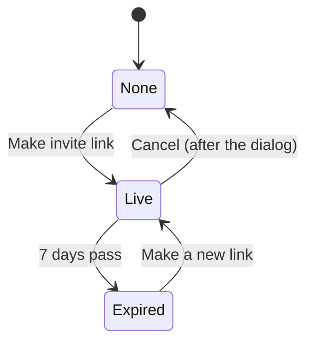

# Add a household page with invite links

Linear: TAS-108

## Summary

Every named account has been in a household since TAS-103, but nothing shows it. This adds a household page at `/household`, opened from the account menu, where any member sees and renames the household and sees who's in it; then invite links, which any member makes, copies or cancels there, one link at a time, each working for 7 days. It comes now because joining (TAS-110), leaving and removing (TAS-109) and the outsiders test (TAS-111) all build on this page and its endpoints.

The work ships in two PRs, each merging to `main` on its own:

- **Part 1 (this issue, TAS-108):** the household page with its name, renaming and members.
- **Part 2 (a sub-issue filed at approval):** invite links on that page.

Evidence: feature. A new page and a new menu item; part 2 adds the invite link's states to the page.
Design: needed. The household page is a new screen and no board in `docs/design/` draws it. The design draws every state of the page, part 2's invite link states included, so part 2 builds to the same boards and skips design.
Components: ConfirmDialog (changed: a label for its way out, "Keep link", since "Cancel" beside "Cancel link" reads as two ways to cancel). Everything else reuses Page, Field, Input, Button, Avatar, Loading, ErrorWithRetry, Squiggle and Toast; the design stage says so if it needs more.

## Required reading

- `AGENTS.md`: hard constraints, Domain areas (`households` depends on no other area), API contract, Tests.
- `specs/TAS-103.md` and `specs/TAS-106.md`: how the household of one, `PATCH /api/account/` and the account page work; this page mirrors them.
- `backend/households/views.py:61-90`: `CurrentAccountView`; mirror its `extend_schema`, `NotAuthenticated` and serializer use.
- `backend/households/services.py:40-60`: `name_account` and `update_account`; mirror their `transaction.atomic()` and `select_for_update()`.
- `backend/tests/test_accounts.py:30-70, 392-397`: `BrowserClient`, `sign_up` and `save_name`, which the new backend tests import (as `tests/test_google_sign_in.py:13` does).
- `frontend/src/households/account-page.tsx`: mirror `NameForm` (field, error line, focus, toasts) and `AccountContent` (Navigate, Loading, ErrorWithRetry).
- `frontend/src/households/name-api.ts`: mirror its `refusal` and its result union for the rename hook.
- `frontend/src/households/account-page.test.tsx:15-50`: mirror `answerSignedIn` for a household that a `PATCH` changes.
- `frontend/e2e/account.spec.ts`: mirror `signUpAs` and the forced-colours test.
- `docs/design.md`: Voice, States, Field, Avatar, Dialog, Toast; and the approved household boards from the design stage.
- `specs/lessons/move-the-approved-board-out-of-specs.md`: the design stage's boards move into `docs/design/` first.
- `specs/lessons/patch-requests-are-partial-in-the-schema.md`: the rename body is `PatchedHouseholdChanges` with `name?: string`.
- `specs/lessons/blank-model-fields-are-optional-in-the-schema.md`: why the serializers are plain `Serializer`s.
- `specs/lessons/design-doc-wins-over-a-board.md`, `specs/lessons/factory-runs-make-baselines-in-place.md` (part 2's ConfirmDialog baselines), `specs/lessons/tanstack-refetch-resets-error-state.md` (the load error through a retry).

## Product behaviour

One claim per acceptance criterion, in the issue's order, with the part that delivers it.

1. Any member can rename the household from the household page. (Part 1)
2. Any member can make an invite link from the household page. (Part 2)
3. A link works for 7 days; any member can cancel it; an expired one shows as expired. (Part 2; what someone opening a dead link sees is TAS-110's)
4. The household page shows its name, its members and the current invite link with Copy and Cancel. (Name and members in part 1; the link in part 2)

What else holds, each proved by a test below:

- The account menu has a "Household" item that opens the page.
- Each member shows by name, with "(you)" after the person looking; no email addresses.
- Signed out, `/household` sends you to sign in and back.
- A household has at most one live link. While one is live there's no way to make another; once it's cancelled or expired, a new one can be made.
- Cancel asks first in a dialog.

## Technical design

### How it works today

- `Household` has only `name` (`backend/households/models.py:33-37`, up to 100 characters). `User.household` is a `PROTECT` foreign key with `related_name='members'` (`:44`). A named account always has a household (the `named_account_has_household` constraint, `:57-64`); a nameless one has none.
- The only `households` endpoint for pages is `/api/account/` (`backend/config/urls.py:20`, `CurrentAccountView`). Views check `request.user.is_authenticated` themselves and raise `NotAuthenticated` (answered `403` under session authentication); DRF's default permission is `AllowAny` (`backend/config/settings.py:222`).
- The typed client sends `X-CSRFToken` on every unsafe request (`frontend/src/api/client.ts`).
- The account menu has "Account" and "Sign out" (`frontend/src/app/app-layout.tsx:26-34`). `NameGate` sends a nameless account to `/welcome` from every page (`frontend/src/households/name-gate.tsx`), so a page under it never meets an account without a household once the session has loaded.

### Part 1: the page, renaming and members

#### Service (`backend/households/services.py`, edit)

```py
@dataclass(frozen=True)
class Member:
    id: int
    name: str
    is_you: bool


def members_seen_by(account: User) -> list[Member]:
    """The account's household's members: the account first, then the others by name."""


def rename_household(account: User, name: str) -> Household:
    """Renames the account's household and returns it."""
```

- `members_seen_by` runs one query: `User.objects.filter(household_id=account.household_id).order_by(Lower('name'), 'pk')`, then puts `account` first. `is_you` is `member.pk == account.pk`.
- `rename_household` sets `name` on `Household.objects.get(pk=account.household_id)` and saves `update_fields=['name']`. Two renames at once: the last one wins, which is what both people see after a reload.
- Both are called only for an account with a household; the view refuses one without (`404`).
- The household is always the caller's own: no endpoint takes a household ID, so no request can reach another household's data.

#### Serializers (`backend/households/serializers.py`, edit)

```py
HOUSEHOLD_NAME_MAX_LENGTH = 100  # in models.py, used by Household.name and here


class MemberSerializer(serializers.Serializer):
    id = serializers.IntegerField()
    name = serializers.CharField()
    is_you = serializers.BooleanField()


class HouseholdSerializer(serializers.Serializer):
    name = serializers.CharField()
    members = MemberSerializer(many=True)


class HouseholdChangesSerializer(serializers.Serializer):
    name = serializers.CharField(max_length=HOUSEHOLD_NAME_MAX_LENGTH)
```

- `HOUSEHOLD_NAME_MAX_LENGTH = 100` goes in `models.py` beside `NAME_MAX_LENGTH`, and `Household.name` uses it. No migration: the length doesn't change.
- `CharField` trims and refuses blank: `"   "` → `400` "This field may not be blank."; 101 characters → `400` "Ensure this field has no more than 100 characters."

#### Endpoint (`backend/households/views.py`, edit; `backend/config/urls.py`, edit)

```py
def household_body(account: User) -> dict[str, Any]:
    return HouseholdSerializer({'name': account.household.name, 'members': members_seen_by(account)}).data


class HouseholdView(APIView):
    def signed_in_member(self, request: Request) -> User: ...  # NotAuthenticated when signed out; NotFound with no household

    @extend_schema(operation_id='household_retrieve', responses={200: HouseholdSerializer, 403: None, 404: None}, ...)
    def get(self, request: Request) -> Response: ...

    @extend_schema(
        operation_id='household_partial_update',
        request=HouseholdChangesSerializer,
        responses={200: HouseholdSerializer, 400: None, 403: None, 404: None},
        ...
    )
    def patch(self, request: Request) -> Response: ...
```

- `patch` validates with `HouseholdChangesSerializer(data=request.data)` (`partial=False`, so a missing `name` is `400`), calls `rename_household`, then answers `household_body` of the reloaded account.
- `backend/config/urls.py`: `path('api/household/', HouseholdView.as_view(), name='household')` after `api/account/`.
- `household_body` is a module-level function because part 2's invite view answers the same body.

#### API contract (part 1)

```diff
+GET   /api/household/  → 200 {"name": string, "members": [{"id": int, "name": string, "is_you": bool}]} | 403 | 404
+PATCH /api/household/  {"name": string (1–100, trimmed)} → 200 (as GET) | 400 | 403 | 404
```

`backend/schema.yml` and `frontend/src/api/schema.d.ts` are regenerated together. New components: `Household`, `Member`, `PatchedHouseholdChanges`.

#### Hooks (`frontend/src/households/household-api.ts`, new)

```ts
export type Household = components['schemas']['Household'];

export const HOUSEHOLD_KEY = ['households', 'household'];
export const HOUSEHOLD_NAME_MAX_LENGTH = 100;
export const NOT_A_HOUSEHOLD_NAME = 'Enter a name for your household, like The Bedinis.';

export type HouseholdRename = { kind: 'saved'; household: Household } | { kind: 'refused'; message: string };

export const useHousehold = () => {
  const { data, errorUpdatedAt, refetch } = useQuery({ queryKey: HOUSEHOLD_KEY, queryFn: … });
  return { household: data, errorUpdatedAt, refetch };
};

export const useRenameHousehold = () => useMutation({ mutationFn: async (name: string): Promise<HouseholdRename> => { … }, onSuccess: … });
```

- `useHousehold`'s `queryFn` calls `api.GET('/api/household/')` and throws on anything but `200`.
- `useRenameHousehold` mirrors `useSaveName` (`name-api.ts`): `200` → `saved`; `400` → `refused` with the first message under `name`, or `NOT_A_HOUSEHOLD_NAME`; anything else throws. `onSuccess` puts a saved household in `HOUSEHOLD_KEY` with `setQueryData`. The `refusal` helper is copied from `name-api.ts` with this message (a second use; `AGENTS.md` abstracts on the third).

#### The page (`frontend/src/households/household-page.tsx`, new)

Built to the approved design; the visual values come from it, the behaviour and copy from here.

- `<title>Your household · Tastebook</title>` in a `Page`.
- `HouseholdContent` follows `AccountContent` (`account-page.tsx:106-123`) for the session: signed out → `<Navigate to="/sign-in?next=%2Fhousehold" replace />`; session failed → `ErrorWithRetry` "Couldn't reach Tastebook"; pending → `<Loading>Checking your account…</Loading>`.
- Signed in, `HouseholdDetails` calls `useHousehold()`: data → the page; no data and `errorUpdatedAt > 0` → `<ErrorWithRetry title="Couldn't load your household" onRetry={refetch}>Check your connection and try again.</ErrorWithRetry>`; otherwise `<Loading>Getting your household…</Loading>`. Calling the hook only once signed in means a visitor never sends the request.
- The page:
  - `h1`: `Your <Squiggle emphasis>household</Squiggle>`.
  - Section "Name" (`h2`), a form like `NameForm`: Field "Household name", help "Everyone in the household sees it.", `Input` with `maxLength={100}`, seeded from `household.name`; submit Button "Save name", loading "Saving…". Blank or only spaces: no request, `NOT_A_HOUSEHOLD_NAME` in the error line, focus to the input. `refused`: the message in the error line, focus to the input. `saved`: the field takes the saved name, toast "Household name saved". A throw: toast "Couldn't save the household's name. Check your connection and try again."; the field keeps what was typed.
  - Section "Members" (`h2`): a `<ul aria-labelledby>` with one `<li>` per member, in the API's order: `<Avatar name={member.name} />` then the name, and for `is_you` the text " (you)" after it. Keyed by `member.id`.
- `frontend/src/households/index.ts` (edit): export `HouseholdPage`.
- `frontend/src/app/routes.tsx` (edit): `{ path: '/household', Component: HouseholdPage }` after `/account`, inside `NameGate`.
- `frontend/src/app/app-layout.tsx` (edit): `menuItems` become Account, `{ kind: 'link', label: 'Household', to: '/household' }`, Sign out.

#### Docs (part 1)

- `GLOSSARY.md` › `households`: add **Member**, "An account in a household. Members are equal: any of them can rename it and, later, invite, remove or leave.", in code `User.household`, `Household.members`.
- `docs/design.md`: names the moved household boards next to the account page's (line 5).

### Part 2: invite links

#### Model (`backend/households/models.py`, edit; migration from `makemigrations households`)

```py
INVITE_LIFETIME = timedelta(days=7)


def new_invite_token() -> str:
    return secrets.token_urlsafe(32)  # 43 characters


class Invite(models.Model):
    household = models.ForeignKey(Household, on_delete=models.CASCADE, related_name='invites')
    # Whoever holds it can join the household, so it's long and random and never derived from an ID.
    token = models.CharField(max_length=43, unique=True, default=new_invite_token)
    expires_at = models.DateTimeField()
    cancelled_at = models.DateTimeField(null=True, blank=True)
```

- A household's **current invite** is its newest invite (`-pk`) with `cancelled_at` null. It's **live** while `expires_at > timezone.now()` and **expired** after. Cancelled invites are never shown again; their rows stay so TAS-110 can say a link was cancelled.
- No `made_by` or `made_at`: nothing shows them (UK GDPR: collect only what a feature needs).



#### Services (`backend/households/services.py`, edit)

```py
class InviteStatus(models.TextChoices):  # in models.py
    LIVE = 'live', 'Live'
    EXPIRED = 'expired', 'Expired'


def current_invite(household_id: int) -> Invite | None: ...


def make_invite(account: User) -> Invite:
    """The household's live invite, made now if it has none (none at all, or only an expired one)."""


def cancel_invite(account: User) -> None:
    """Cancels the household's current invite, live or expired; does nothing when there's none."""


def invite_status(invite: Invite) -> InviteStatus: ...
```

- `make_invite` runs in `transaction.atomic()` and first locks the household row (`Household.objects.select_for_update().get(pk=account.household_id)`), so two members pressing at once get the same link rather than two live ones. It returns the live invite if there is one; otherwise it creates `Invite(household=…, expires_at=timezone.now() + INVITE_LIFETIME)`.
- `cancel_invite` sets `cancelled_at = timezone.now()` on `current_invite`, under the same lock. Cancelling twice, or after another member already did, is not an error.
- Every time comparison uses `timezone.now()` (from `django.utils`), so tests move time with `monkeypatch.setattr(timezone, 'now', …)`.

#### Serializers and endpoints

```py
class InviteSerializer(serializers.Serializer):
    token = serializers.CharField()
    expires_at = serializers.DateTimeField()
    status = serializers.ChoiceField(choices=InviteStatus.choices)


class HouseholdSerializer(serializers.Serializer):
    name = serializers.CharField()
    members = MemberSerializer(many=True)
    invite = InviteSerializer(allow_null=True)
```

- `household_body` adds `'invite'`: the current invite as `{'token', 'expires_at', 'status'}`, or `None`. The server decides `status`, so a phone with the wrong clock still shows the right state.
- `InviteView` at `path('api/household/invite/', InviteView.as_view(), name='household-invite')`, with the same `signed_in_member` check: `post` (`operation_id='household_invite_create'`) calls `make_invite`; `delete` (`operation_id='household_invite_destroy'`) calls `cancel_invite`. Both answer `200` with `household_body`, so the page updates from one response. `signed_in_member` moves to a module-level function both views call.

```diff
 GET    /api/household/         → 200 {"name", "members", "invite": {"token": string, "expires_at": date-time, "status": "live" | "expired"} | null}
+POST   /api/household/invite/  → 200 (as GET, "invite" live) | 403 | 404
+DELETE /api/household/invite/  → 200 (as GET, "invite": null) | 403 | 404
```

New components: `Invite`, `InviteStatus`; `Household` gains `invite`.

#### The link's address

The page shows and copies `${window.location.origin}/join/${token}`. `/join/:token` is the route TAS-110 (Join a household from an invite link) builds, and its page says when a link is cancelled or expired. Until TAS-110 ships, the address opens the not-found page.

#### Hooks (`frontend/src/households/invite-api.ts`, new)

- `useMakeInvite()`: `api.POST('/api/household/invite/')`; `200` → the household, anything else throws; `onSuccess` sets `HOUSEHOLD_KEY`.
- `useCancelInvite()`: the same with `api.DELETE`.
- `inviteAddress(token: string): string` returns the address above.

#### The invite section (`frontend/src/households/household-page.tsx`, edit)

Section "Invite link" (`h2`) after Members, one component per state, picked by `household.invite?.status ?? 'none'`:

- **None:** text "Make a link to invite someone. It works for 7 days, for anyone you send it to." and Button "Make invite link", loading "Making…".
- **Live:** a read-only `Input` in Field "Invite link" holding the address, help "Anyone with this link can join until 7 November." (the date is `expires_at` as `Intl.DateTimeFormat('en-GB', { day: 'numeric', month: 'long' })` in the browser's time zone). Buttons "Copy link" and "Cancel link".
  - Copy: `navigator.clipboard.writeText(address)`; then toast "Link copied". If it rejects: toast "Couldn't copy the link. Select it and copy it yourself."
  - Cancel link opens `ConfirmDialog`: title "Cancel this invite link?", description "Anyone who opens it will be told it no longer works. You can make a new link afterwards.", confirm "Cancel link", way out "Keep link". Confirming calls `useCancelInvite`; on success toast "Link cancelled" and the section shows None.
- **Expired:** text "This invite link expired on 7 November." and Button "Make a new link", loading "Making…". No Copy or Cancel.
- A failed make: toast "Couldn't make a link. Check your connection and try again." A failed cancel: toast "Couldn't cancel the link. Check your connection and try again."; the link stays.

#### ConfirmDialog (`frontend/src/dino/confirm-dialog.tsx`, edit)

Add `cancelLabel?: string`, default `'Cancel'`, used for the secondary button. Add a story `KeepLabel` (open, `cancelLabel: 'Keep link'`) in `confirm-dialog.stories.tsx`, with its two baselines, and name its board in `boards.ts`. `docs/design.md` › Dialog becomes: "the other is "Cancel", or names what it keeps when the action itself is a cancel ("Keep link")".

#### Docs (part 2)

- `GLOSSARY.md`: Invite becomes "A link that lets anyone who has it join a household, for 7 days, until a member cancels it. A household has at most one live invite.", in code `Invite`, `make_invite()`, `cancel_invite()` (no longer _planned_).

## Decisions

- **Two PRs: the page with renaming and members, then invite links**, because the invite model, endpoints, page states and a Dino change double the review, and the page stands on its own. Asked: one PR or two? → Two PRs: page, then links.
- **One live link at a time; making a link while one is live returns that link**, because one link is all requirement 16 shows, and a returned link rather than an error keeps two members pressing at once from seeing a failure. Asked: several live links or one? → One at a time.
- **An expired link stays on the page, marked expired, with "Make a new link"**, so members see why their link stopped working. Asked: does an expired link still show? → Show it as expired.
- **A cancelled or expired link says so on TAS-110's join page, not here**, because that page owns `/join/:token`; this spec fixes the address shape (`/join/<token>`) and keeps cancelled rows so TAS-110 can tell cancelled from unknown. Asked: where does someone opening a dead link see it's dead? → On TAS-110's join page.
- **Cancel asks first in a dialog**, because a cancelled link can't be brought back and anyone already sent it is stopped. Asked: dialog or cancel at once? → Ask first in a dialog.
- **A member's row shows the name, and "(you)" after the person looking**, with no email addresses, because members don't need each other's addresses (UK GDPR). Asked: what does each member's row show? → Name, and "(you)".
- **The dialog's way out says "Keep link", through a new optional `cancelLabel` on ConfirmDialog**, because "Cancel" beside "Cancel link" reads as two ways to cancel (NN/g 4); every other dialog keeps "Cancel". (agent)
- **Endpoints are `/api/household/` and `/api/household/invite/`, always the caller's own household, with no ID in the path**, because a member belongs to exactly one household, and no ID means no other household's data can be asked for (ASVS L1 object authorisation; TAS-111 proves it). (agent)
- **The server sends each invite's `status`**, so the page never trusts the phone's clock. (agent)
- **Make and Cancel answer the whole household**, so the page updates from one response without a second request. (agent)
- **The token is 32 random bytes (`secrets.token_urlsafe`), stored as is**, because the page must show the link again for Copy, so it can't be stored hashed; it's as hard to guess as a session ID. (agent)
- **The page lives at `/household` and the menu item is "Household"**, beside "Account". (agent)
- **The household query runs only once the session says someone is signed in**, so a visitor's page sends no request that would answer `403`. (agent)

## Blast radius

- **The account menu (`app-layout.tsx`):** gains an item. `frontend/src/app/app-layout.test.tsx:177` asserts the menu's text `^SamAccountSign out$`; it becomes `^SamAccountHouseholdSign out$`. `e2e/account.spec.ts` picks "Account" by name and is unaffected. `top-bar.stories.tsx` has its own items and doesn't change.
- **`routes.tsx`:** a new path; nothing else moves.
- **`HOUSEHOLD_NAME_MAX_LENGTH` in `models.py`:** `Household.name` switches from the literal `100` to it; `makemigrations --check` proves no migration follows.
- **Part 2's `ConfirmDialog`:** the new prop defaults to today's label, so its existing stories and baselines don't change; only the new story adds baselines. It has no other users yet (`grep -r ConfirmDialog frontend/src` finds only Dino).
- **Part 2's `HouseholdSerializer`:** gains `invite`; part 1's tests that compare whole bodies gain `'invite': None`, and the frontend fixtures gain `invite: null`.

## Out of scope

- Remove and Leave on the household page: TAS-109.
- The join page at `/join/:token`, joining, and what a cancelled or expired link says to whoever opens it: TAS-110.
- The outsiders test across every endpoint: TAS-111.
- Showing who made a link or when; several live links; links that work once or for a set number of people.
- Emailing an invite; the household's name anywhere but this page.
- A tab or dock entry for the household (`docs/design.md`, Layout: navigation).

## Steps

Part 1 (this issue):

1. **Move the approved boards into `docs/design/`** per `specs/lessons/move-the-approved-board-out-of-specs.md`, as `docs/design/picnic/household-page*.dc.html` and `.dc.png`; `docs/design.md` (edit) names them beside the account page's.
   Done when: `pnpm lint` passes and `docs/design.md` links each moved board.
2. **Add the household endpoint.** `backend/households/models.py`, `services.py`, `serializers.py`, `views.py`, `backend/config/urls.py` (edit); `backend/schema.yml`, `frontend/src/api/schema.d.ts` (regenerated); `backend/tests/test_household.py` (new).
   Done when: `test_household.py` passes, `makemigrations --check --dry-run` reports no changes, and `spectacular --validate --fail-on-warn` passes.
3. **Add the hooks and the page.** `frontend/src/households/household-api.ts`, `household-page.tsx`, `household-page.test.tsx` (new); `index.ts`, `frontend/src/app/routes.tsx`, `app-layout.tsx`, `app-layout.test.tsx` (edit), built to the approved boards.
   Done when: `household-page.test.tsx` and `app-layout.test.tsx` pass.
4. **Add the journey.** `frontend/e2e/household.spec.ts` (new).
   Done when: `pnpm test:e2e` passes locally and on the PR's preview.
5. **Update the glossary.** `GLOSSARY.md` (edit).
   Done when: the Member row is there.

Part 2 (the sub-issue):

1. **Add `Invite`, its services and endpoints.** `backend/households/models.py`, `services.py`, `serializers.py`, `views.py`, `backend/config/urls.py` (edit); a new migration; `backend/schema.yml`, `frontend/src/api/schema.d.ts` (regenerated); `backend/tests/test_household.py` (edit).
   Done when: the invite cases pass, with `makemigrations --check` and `spectacular` as above.
2. **Give ConfirmDialog its way-out label.** `frontend/src/dino/confirm-dialog.tsx`, `confirm-dialog.stories.tsx`, `boards.ts`, `docs/design.md` (edit); new baselines from `pnpm --filter frontend test:visual:update`.
   Done when: `pnpm test` passes and only the `KeepLabel` baselines are new.
3. **Add the invite section.** `frontend/src/households/invite-api.ts` (new); `household-page.tsx`, `household-page.test.tsx` (edit).
   Done when: `household-page.test.tsx` passes.
4. **Extend the journey and the glossary.** `frontend/e2e/household.spec.ts`, `GLOSSARY.md` (edit).
   Done when: `pnpm test:e2e` passes and Invite's code is `Invite`.

## Tests

Part 1:

- `backend/tests/test_household.py` (new), through `/api/household/` with `BrowserClient`, after `sign_up` and `save_name` from `tests.test_accounts`; `PATCH` sends `format='json'` and `browser.csrf_header()`.
  - A new account sees its household of one, asserts: after `sam@example.com` saves "Milo", `GET` answers `200` with `{'name': "Milo's household", 'members': [{'id': <Milo's pk>, 'name': 'Milo', 'is_you': True}]}`.
  - Members come you first, then by name, asserts: with "Milo", "zoe" and "Ann" in one household (put there through `User.household` in the test, as joining doesn't exist yet), Milo's `GET` lists names `['Milo', 'Ann', 'zoe']` with `is_you` `[True, False, False]`, and no member object has an `email` key.
  - Each account sees only its own household, asserts: with Milo and Jo in households of one, Jo's `GET` answers `{'name': "Jo's household", 'members': [{… 'name': 'Jo', 'is_you': True}]}`.
  - Renaming, asserts: `PATCH {"name": "  The Bedinis "}` answers `200` with `name: 'The Bedinis'`; `Household.objects.get().name == 'The Bedinis'`; another member's `GET` answers that name.
  - Parametrised refusals (`{}`, `{"name": ""}`, `{"name": "   "}`, `{"name": 101 × "a"}`), asserts: `400` with a `name` key, and the household is still "Milo's household". 100 × `"a"`, asserts: `200` with that name.
  - Parametrised over `GET` and `PATCH` signed out, asserts: `403`, and `PATCH` leaves the name.
  - A nameless account, asserts: `GET` answers `404`.
  - `PATCH` without the CSRF header, asserts: `403` and the name unchanged.
- `frontend/src/households/household-page.test.tsx` (new), with `renderRoute` and MSW. Signed in as Milo (`name: 'Milo'`); `GET /api/household/` answers `{name: "Milo's household", members: [{id: 1, name: 'Milo', is_you: true}, {id: 2, name: 'Ann', is_you: false}]}` until a `PATCH` changes it. `document.cookie = 'csrftoken=abc'`; `toast.dismiss()` after each.
  - The page, asserts: at `/household` the heading "Your household" shows, "Household name" holds "Milo's household", and the "Members" list's items read "Milo (you)" and "Ann", in that order.
  - Loading, asserts: while the household request is held, "Getting your household…" shows; once released, "Household name" shows.
  - Renaming, asserts: after typing "The Bedinis" and pressing "Save name", the `PATCH` body was `{"name": "The Bedinis"}` with `X-CSRFToken` `abc`, "Household name saved" shows and the field holds "The Bedinis".
  - Parametrised blank names (`""`, `"   "`), asserts: "Enter a name for your household, like The Bedinis." shows, the input has focus, and no `PATCH` was sent.
  - A refused name, asserts: with `PATCH` answering `400 {"name": ["Ensure this field has no more than 100 characters."]}`, that sentence shows in the error line.
  - Parametrised over a `500` and a network failure on `PATCH`, asserts: "Couldn't save the household's name. Check your connection and try again." shows and the field still holds "The Bedinis".
  - The household request failing, asserts: "Couldn't load your household" shows with "Try again"; after the handler answers and it's pressed, "Household name" shows.
  - Signed out, asserts: `/household` lands on `/sign-in` with search `?next=%2Fhousehold`, and no request reached `/api/household/` (counted in the handler, checked after `queryClient.isFetching()` is 0).
- `frontend/src/app/app-layout.test.tsx` (edit).
  - The account menu, asserts: its text is `SamAccountHouseholdSign out`; choosing "Household" shows the heading "Your household" at `/household`.
- `frontend/e2e/household.spec.ts` (new), on `./fixtures`, with `signUpAs` copied from `account.spec.ts` (a second use).
  - A new test account renames its household, asserts: after signing up as "Sam" and choosing "Household" from the menu, "Household name" holds "Sam's household" and the Members list reads "Sam (you)"; after saving "The Jones" and reloading, the field holds "The Jones"; axe is clean.
  - Under forced colours, asserts: the page shows "Your household", axe passes, the squiggle's stroke equals the heading's colour, and a full-page screenshot is attached as "household page under forced colours".

Part 2:

- `backend/tests/test_household.py` (edit), through `/api/household/invite/` and `/api/household/`; time moved with `monkeypatch.setattr(timezone, 'now', …)`.
  - Making a link, asserts: `POST` answers `200` whose `invite` has `status: 'live'`, a 43-character `token` and `expires_at` exactly 7 days after the frozen now; `GET` answers the same invite.
  - Making again while live, asserts: a second `POST`, from another member, answers the same `token`, and `Invite.objects.count() == 1`.
  - Parametrised over 7 days less a second (`live`) and 7 days and a second (`expired`), asserts: `GET`'s `invite.status`.
  - Making after expiry, asserts: `POST` answers a different `token` with `status: 'live'`.
  - Cancelling, asserts: `DELETE` answers `invite: None`, the row's `cancelled_at` is set, and a second `DELETE` also answers `200` with `invite: None`.
  - Making after cancelling, asserts: `POST` answers a new live `token`.
  - Each household sees only its own link, asserts: after Milo makes a link, Jo's `GET` answers `invite: None`.
  - Parametrised over `POST` and `DELETE` signed out, asserts: `403` and `Invite.objects.count()` unchanged.
- `frontend/src/households/household-page.test.tsx` (edit). Handlers answer `invite` from a state the `POST` and `DELETE` handlers change. `userEvent.setup()` for its clipboard stub.
  - Making a link, asserts: after "Make invite link", "Invite link" holds `` `${window.location.origin}/join/tok-123` `` (the handler's token) and "Anyone with this link can join until 7 November." shows.
  - Copying, asserts: after "Copy link", `navigator.clipboard.readText()` gives the address and "Link copied" shows.
  - Copying refused, asserts: with `writeText` rejecting, "Couldn't copy the link. Select it and copy it yourself." shows.
  - Cancelling, asserts: "Cancel link" opens a dialog "Cancel this invite link?"; "Keep link" closes it with no `DELETE` sent and the link still shown; confirming "Cancel link" sends one `DELETE`, shows "Link cancelled" and the "Make invite link" button.
  - An expired link, asserts: "This invite link expired on 7 November." and "Make a new link" show, and no "Copy link" button exists.
  - Parametrised over make and cancel failing with `500`, asserts: their toast text, and the section as it was.
- `frontend/src/dino/confirm-dialog.stories.tsx` (edit): `KeepLabel`'s play asserts the buttons read "Keep link" and the confirm label; the existing stories still show "Cancel".
- `frontend/e2e/household.spec.ts` (edit).
  - A member makes, copies and cancels a link, asserts: after "Make invite link", "Invite link" holds an address matching `/\/join\/[\w-]{43}$/`; after "Cancel link" and confirming, "Make invite link" shows; axe is clean with the dialog open and after.

Checks for both parts: `uv run ruff check . && uv run ruff format --check .`, `uv run python manage.py makemigrations --check --dry-run`, `uv run pytest` (in `backend/`); `spectacular --validate --fail-on-warn` and `pnpm generate:api` leaving no diff; `pnpm lint`; `pnpm test`; `pnpm test:e2e`; `pnpm --filter frontend build-storybook && pnpm --filter frontend test:visual` (part 1: no baseline changes; part 2: only the new `KeepLabel` ones).

## Assumptions

- **The page's copy** (headings "Your household", "Name", "Members", "Invite link"; field "Household name" and its help; the toasts, dialog and error lines above) follows `docs/design.md` Voice; the design stage may change the wording and says so. Confirm with: Milo, at Design Review.
- **Members are listed you first, then by name**, and a member who'd show as just an initial uses Avatar as it is. Confirm with: Milo, at spec approval.
- **Until TAS-110 ships, a copied link opens the not-found page.** Part 2 can merge before TAS-110, since nobody outside the household is sent links until the milestone is released. Confirm with: Milo, at spec approval.
- **A household name is 1 to 100 characters after trimming, with no other rule**, as TAS-103 already allowed. Confirm with: Milo, at spec approval.
- **The expiry date shows as day and month only** ("7 November"), since a link never lives past 7 days. Confirm with: Milo, at Design Review.

## Validation criteria

- [ ] The checks listed under Tests pass for each part.
- [ ] `household.spec.ts` passes on each PR's preview, with axe clean on `/household` and under forced colours.
- [ ] Part 1: behaviours 1 and 4 (name and members) hold on the preview. Part 2: behaviours 2, 3 and 4 (the link) hold on its preview.
- Evidence: feature. Part 1: one laptop screenshot of the household page; on a phone, the page, a blank-name error and the saved name; then the walkthrough. Part 2: on a phone, no link, a live link and the cancel dialog; then the walkthrough. A preview can't age a link 7 days, so the expired state is proved by the page test, and the PR says so.
