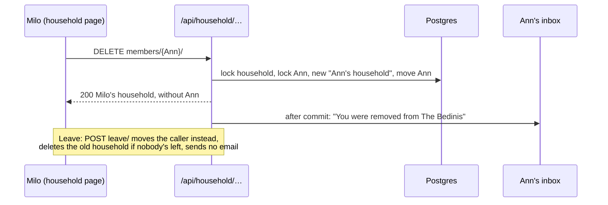

# Leave the household or remove a member

Linear: TAS-109

## Summary

Members are equal, but today nothing moves an account out of a household. This adds Remove beside each other member and a Leave section on the household page (`/household`, TAS-108). Whoever goes lands in a new household of one, named "<name>'s household"; a removed member is emailed; a household with nobody left in it is deleted. It comes now because joining from an invite link (TAS-110) needs a way back out.

Evidence: feature. New controls, dialogs and toasts on the household page, and a new email.
Design: needed. A visible layout change on the household page: a Remove button at the end of each other member's row and a Leave section. The household boards leave room for both ("TAS-109 adds Remove and Leave at the row's end"; "TAS-109's Leave slot[s] in as [a section] of [its] own", `docs/design/picnic/household-page.dc.html:258-260`) but don't draw them, and the two notes disagree on where Leave goes.
Components: none new or changed. The work reuses Button (secondary and danger), ConfirmDialog with its "Cancel" way out, Avatar, Squiggle and Toast; the design stage says so if it needs more.

## Required reading

- `AGENTS.md`: hard constraints, Domain areas (`households` depends on no other area), API contract, Tests, Standards (UK GDPR, ASVS object authorisation).
- `specs/TAS-108.md`: the page, `/api/household/` and its decisions; this builds on part 1 and changes part 2's plan by one bullet (see Blast radius).
- `backend/households/services.py:38-55`: `household_name_for` and `name_account`; mirror their `transaction.atomic()` and `select_for_update()`.
- `backend/households/views.py:97-130`: `household_body` and `HouseholdView`; mirror their `extend_schema` and errors.
- `backend/households/templates/account/email/login_code_*.txt`: the shape and tone of an email's subject and message files.
- `backend/tests/test_household.py:1-26`: `signed_up`, `join` and `HOUSEHOLD`, which the new cases reuse.
- `frontend/src/households/household-api.ts`: mirror `useRenameHousehold`'s result union and `setQueryData`.
- `frontend/src/households/household-page.tsx` and `household-page.test.tsx`: the page and its MSW state handlers.
- `frontend/src/dino/confirm-dialog.tsx`: the dialog both actions open.
- `docs/design.md`: Voice (a dialog says exactly what happens), Components › Button, Dialog, Toast; and the approved boards from the design stage.
- `specs/lessons/move-the-approved-board-out-of-specs.md`, `design-doc-wins-over-a-board.md`, `django-mail-settings-are-mailers.md` (pytest-django swaps every mailer for the in-memory one), `factory-runs-make-baselines-in-place.md`.

## Product behaviour

One claim per acceptance criterion, in the issue's order.

1. Any member can remove another member, or leave the household.
2. The household page shows Remove beside each other member, and Leave.
3. A removed member is emailed and lands in a new household of one.
4. A household with nobody left in it is deleted.
5. Someone who leaves lands in a new household of one.

What else holds, each proved by a test below:

- The only member of a household sees neither Leave nor any Remove.
- Remove and Leave each ask first in a dialog that says what will happen.
- After leaving, the page stays at `/household` and shows the new household of one, with a toast "You left The Bedinis".
- The email names the household and the member who removed them, and nothing about anyone else.
- Nobody can remove an account outside their own household, or themselves.

## Technical design

### How it works today

- `User.household` is a nullable `PROTECT` foreign key with `related_name='members'` (`backend/households/models.py:45`); a named account always has one (`named_account_has_household`, `:57-64`). `Household` has only `name`.
- `GET` and `PATCH /api/household/` (`backend/config/urls.py:20`, `HouseholdView` at `views.py:101`) answer `{name, members: [{id, name, is_you}]}` for the caller's own household; `signed_in_member` (`views.py:102`) answers `403` signed out and `404` with no household.
- The page (`household-page.tsx`) lists members with no actions (`:72-90`). `HouseholdNameForm` seeds its field from `household.name` once, on mount (`:14-17`).
- Email goes through Django's `MAILERS` (`backend/config/settings.py:28-49`): Resend on production, the console locally, nothing on previews, in-memory under pytest.
- Invites don't exist on `main`: they're TAS-108 part 2 (TAS-147, in Backlog).

### Flow



### Services (`backend/households/services.py`, edit)

```py
def leave_household(account: User) -> User:
    """Moves the account into a new household of one, named after it; deletes the household it left if that's now empty.
    Returns the account as saved."""


def remove_member(account: User, member_id: int) -> User:
    """Moves another member of the account's household into a new household of one and emails them once that's saved.
    Returns the account. Raises User.DoesNotExist when member_id isn't another member of the account's household."""


def tell_removed_member(member: User, removed_by: str, household_name: str, new_household_name: str) -> None:
    """Emails a removed member who removed them, from which household, and the name of their new one."""
```

Both moves serialise on the household row, always locked before any account row, so two moves in one household (a double press, two members acting at once, A removing B while B removes A) run one after the other and can't deadlock:

```py
def leave_household(account: User) -> User:
    with transaction.atomic():
        household = Household.objects.select_for_update().filter(pk=account.household_id).first()
        account = User.objects.select_for_update().get(pk=account.pk)
        # Removed while this waited for the lock: already in a household of one, so there's nothing to leave.
        if household is None or account.household_id != household.pk:
            return account
        account.household = Household.objects.create(name=household_name_for(account.name))
        account.save(update_fields=['household'])
        if not household.members.exists():
            household.delete()
    return account
```

- `remove_member` takes the same lock, re-reads the caller (`User.objects.get(pk=account.pk)`) and raises `User.DoesNotExist` when the caller is no longer in the locked household (removed meanwhile). It then gets the target with `User.objects.select_for_update().exclude(pk=account.pk).get(pk=member_id, household=household)`, which raises `User.DoesNotExist` for the caller's own ID, an account in another household and an ID that doesn't exist alike, so the answer never says whether an account exists. It creates `Household(name=household_name_for(member.name))`, moves the member, saves `update_fields=['household']`, and registers `transaction.on_commit(partial(tell_removed_member, member, account.name, household.name, new_household.name))`. Removing never empties the household (the caller stays), so it never deletes one.
- `tell_removed_member` renders the two templates below with `{'name', 'removed_by', 'household', 'new_household'}`, joins the subject's lines with spaces and strips it (as allauth does, so a household name can't break the header), and calls `django.core.mail.send_mail(subject, message, None, [member.email])`. It catches `smtplib.SMTPException` and `OSError` and logs `logger.error("Couldn't send the removal email")` with no exception details, since those carry the address (UK GDPR: no personal data in logs). The removal stands either way. `logger = logging.getLogger(__name__)` at module level.
- `household_name_for` (`:38`) names both new households, as `name_account` does.
- Leaving as the only member is allowed by the API: it deletes the household and makes a new one named after the account. The page never offers it (see Decisions), but it keeps the rule "whoever leaves lands in a household of one; an empty household is deleted" true without exceptions, including when the last two members leave at once.

### Email templates (`backend/households/templates/households/email/`, new)

Both start with `` and end with ``, because Django escapes `'` in a plain-text template too ("Milo&#x27;s household").

`member_removed_subject.txt`:

```text
You were removed from {{ household }}
```

`member_removed_message.txt`:

```text
Hi {{ name }},

{{ removed_by }} removed you from {{ household }} on Tastebook.

You're now in a household of your own, {{ new_household }}. You can rename it on your household page whenever you like.
```

### Serializers (`backend/households/serializers.py`, edit)

`HouseholdSerializer` gains `id = serializers.IntegerField()` as its first field, and `household_body` (`views.py:97`) passes `'id': account.household_id`. The page keys the name form on it (see The page).

### Endpoints (`backend/households/views.py`, `backend/config/urls.py`, edit)

- `signed_in_member` moves out of `HouseholdView` to a module-level `signed_in_member(request: Request) -> User`, unchanged, since three views now call it (TAS-108 part 2 planned the same move).
- `LeaveHouseholdView(APIView).post`: `@extend_schema(operation_id='household_leave_create', request=None, responses={200: HouseholdSerializer, 403: None, 404: None}, description="Moves the signed-in account into a new household of one, named after it. A household left with nobody in it is deleted.")`. Calls `leave_household(signed_in_member(request))` and answers `household_body` of the returned account.
- `HouseholdMemberView(APIView).delete(request, member_id: int)`: `@extend_schema(operation_id='household_members_destroy', parameters=[OpenApiParameter('member_id', int, OpenApiParameter.PATH)], responses={200: HouseholdSerializer, 403: None, 404: None}, description="Removes another member of the signed-in account's household into a new household of one, and emails them. Any member may. 404 for anyone who isn't another member of it.")`. Calls `remove_member`; `User.DoesNotExist` → `NotFound`; answers `household_body` of the returned account.
- `backend/config/urls.py`, after `api/household/`:
  - `path('api/household/leave/', LeaveHouseholdView.as_view(), name='household-leave')`
  - `path('api/household/members/<int:member_id>/', HouseholdMemberView.as_view(), name='household-member')`

```diff
 GET    /api/household/                       → 200 {"id": int, "name", "members"} | 403 | 404
 PATCH  /api/household/                       → 200 (as GET) | 400 | 403 | 404
+POST   /api/household/leave/                 → 200 (the new household, as GET) | 403 | 404
+DELETE /api/household/members/{member_id}/   → 200 (the caller's household, as GET) | 403 | 404
```

Regenerate `backend/schema.yml` and `frontend/src/api/schema.d.ts` together. Session authentication makes both new endpoints check the CSRF header, as `PATCH` does.

### Hooks (`frontend/src/households/household-api.ts`, edit)

```ts
export type Member = components['schemas']['Member'];

export type MemberRemoval = { kind: 'removed'; household: Household } | { kind: 'gone' };

export const useRemoveMember = () => { … };   // mutationFn: (member: Member) => Promise<MemberRemoval>
export const useLeaveHousehold = () => { … }; // mutationFn: () => Promise<Household>
```

- `useRemoveMember`: `api.DELETE('/api/household/members/{member_id}/', { params: { path: { member_id: member.id } } })`. `200` → `removed`; `404` → `gone` (they'd already gone, or the caller had); anything else throws. `onSuccess`: `removed` → `setQueryData(HOUSEHOLD_KEY, household)`; `gone` → `invalidateQueries({ queryKey: HOUSEHOLD_KEY })`.
- `useLeaveHousehold`: `api.POST('/api/household/leave/')`. `200` → the household; anything else throws. `onSuccess` → `setQueryData(HOUSEHOLD_KEY, household)`.

### The page (`frontend/src/households/household-page.tsx`, edit)

Built to the approved design; the visual values (button variants, where Leave sits) come from it, the behaviour and copy from here.

- `HouseholdSettings` keys the form: `<HouseholdNameForm key={household.id} name={household.name} />`, so after leaving (or after being removed and refetching) the field shows the new household's name instead of keeping the old one. The `h1` gets `tabIndex={-1}` and a ref.
- **Members:** each member who isn't `is_you` gets a `Remove` button at the row's end, its accessible name "Remove Ann" (`Remove<span className="sr-only"> Ann</span>`, so the visible label starts the name, WCAG 2.5.3). It's the `trigger` of a `ConfirmDialog`:
  - title `Remove Ann from The Bedinis?`
  - description `Ann will move to a household of their own, and we'll email them to say you removed them.`
  - confirm `Remove Ann`; the way out stays "Cancel".
  - While that member's removal runs, their button shows `loading` with `loadingLabel="Removing…"` (`removeMember.isPending && removeMember.variables?.id === member.id`).
  - `removed`: toast `Removed Ann`, and focus moves to the "Members" `h2` (`tabIndex={-1}`), since the row that held focus is gone.
  - `gone`: toast `Ann isn't in your household any more.`; the refetch redraws the list.
  - A throw: toast `Couldn't remove Ann. Check your connection and try again.`; Ann stays listed.
- **Leave:** a section after Members, shown only when `household.members.length > 1`:
  - `h2` `Leave`, text `Move to a household of your own. Everyone else stays in The Bedinis.`, and a `Leave household` button (`loadingLabel="Leaving…"`) that triggers a `ConfirmDialog`:
  - title `Leave The Bedinis?`
  - description `You'll move to a household of your own. Ann and Jo stay in The Bedinis.` The other members' names join with `new Intl.ListFormat('en-GB', { type: 'conjunction' })` ("Ann, Jo and Sam"); with one other member it reads `Ann stays in The Bedinis.` (`stays` for one name, `stay` for more).
  - confirm `Leave household`; the way out stays "Cancel".
  - Success: the page stays at `/household` and shows the response (the new household of one: its name in the field, "Milo (you)" alone, no Leave section); toast `You left The Bedinis` with the name captured before the request; focus moves to the `h1`.
  - A throw: toast `Couldn't leave the household. Check your connection and try again.`; the page is unchanged.
- Members' names and the household's name are text, never markup.

### Docs

- `GLOSSARY.md` › Member becomes: "An account in a household. Members are equal: any of them can rename it, remove another member or leave; whoever goes lands in a household of their own." (In code unchanged.)
- `docs/design.md` line 5: the household page is "where members rename the household, see who's in it, remove a member or leave, and share an invite link".

## Decisions

- **The only member sees no Leave**, because leaving alone would delete the household and make an identical one, losing its name for nothing. Asked: what does the page offer the only member? → Hide Leave.
- **After leaving, the page stays at `/household` and shows the new household, with a toast "You left The Bedinis"**, so the leaver sees at once where they now are. Asked: where does someone land after leaving? → Stay, show new household.
- **Removing a member cancels the household's current invite link; leaving doesn't**, because a removed member who kept the link could join straight back. Invites don't exist on `main` yet (TAS-147), so this spec adds the cancel to TAS-108 part 2's plan (`specs/TAS-108.md`, Services and Tests); if TAS-147 merges before this is built, the implementer adds `cancel_invite(account)` inside `remove_member`'s transaction instead, with the test written there. Asked: cancel the live invite link on removal? → Cancel it on removal.
- **The email names the household and who removed them, and the new household's name; nothing about anyone else**, because they'd already seen each other's names on the page, and no other member's details or address go out (UK GDPR). Asked: what does the removal email say? → Household and who removed.
- **Remove and Leave both ask first in a ConfirmDialog**, because neither can be undone from the page (getting back needs an invite), and Voice asks a dialog to say exactly what will happen. Suggested at triage; taken as a default. (agent)
- **The new household is named "<name>'s household"**, as `household_name_for` names every new one. Suggested at triage. (agent)
- **The API lets the only member leave** (deleting the household and making a new one) even though the page hides it, so "whoever leaves lands in a household of one; an empty household is deleted" holds without an exception, including when the last two members leave at the same moment. (agent)
- **Every move locks the household row first, then account rows**, so concurrent moves in one household run in turn and can't deadlock; a request that finds its caller already moved answers as if done (leave) or `404` (remove). (agent)
- **`DELETE /api/household/members/{id}/` answers `404` for yourself, another household's account and an unknown ID alike**, so it never says whether an account exists (ASVS L1 object authorisation); you leave with Leave, not by removing yourself. (agent)
- **Both endpoints answer the caller's whole household**, so the page updates from one response, as rename does. (agent)
- **The household response gains `id`**, so the page can tell a different household from a renamed one and reset the name form; it exposes nothing, since no endpoint takes a household ID. (agent)
- **The email is sent after the commit, and a failure to send is logged without the address and doesn't undo the removal**, because the removal is what was asked for and an error page would invite a second try. (agent)
- **Remove's way out stays "Cancel"**: unlike "Cancel link", "Remove Ann" and "Leave household" don't read as a second way to cancel, so ConfirmDialog doesn't change. (agent)

## Blast radius

- **`HouseholdSerializer` gains `id`:** `backend/tests/test_household.py`'s whole-body comparisons (`:29-70`) gain `'id'`; the frontend fixtures in `household-page.test.tsx` and `app-layout.test.tsx:194-199` gain `id`. `schema.d.ts`'s `Household` gains a required `id`, so `pnpm lint` finds any fixture that misses it.
- **`signed_in_member` becomes module-level:** only `HouseholdView` calls it today (`views.py:102-108`); its `get` and `patch` tests re-check it.
- **`specs/TAS-108.md` part 2:** gains one Services bullet and one test case (removing cancels the link). TAS-147 builds from that file, so it inherits them.
- **`HouseholdNameForm` keyed on `household.id`:** a rename keeps the same ID, so saving a name doesn't remount the form or lose the button's focus; the existing rename tests re-check it.

## Out of scope

- Keeping or copying the private recipes of whoever goes: TAS-121. What happens to their lists: TAS-124. Neither recipes nor lists belong to a household yet, so deleting a `Household` row deletes only the row today.
- Joining a household, and the end-to-end journey through Remove and Leave, which needs two accounts in one household: TAS-110 (see Assumptions).
- Invite links themselves: TAS-147.
- Undo for Remove or Leave; telling the other members someone left or was removed; emailing the leaver.
- Deleting an account (a later issue reuses "an empty household is deleted").

## Steps

1. **Move the approved boards into `docs/design/`** per `specs/lessons/move-the-approved-board-out-of-specs.md`, as `docs/design/picnic/household-page-*.dc.html` and `.dc.png` beside part 1's; `docs/design.md` (edit) line 5 as above.
   Done when: `pnpm lint` passes and `docs/design.md` names the moved boards.
2. **Add the services, templates and endpoints.** `backend/households/services.py`, `serializers.py`, `views.py`, `backend/config/urls.py` (edit); `backend/households/templates/households/email/member_removed_subject.txt`, `member_removed_message.txt` (new); `backend/schema.yml`, `frontend/src/api/schema.d.ts` (regenerated); `backend/tests/test_household.py` (edit).
   Done when: `uv run pytest tests/test_household.py` passes, `makemigrations --check --dry-run` reports no changes, and `spectacular --validate --fail-on-warn` passes.
3. **Add the hooks and the page's Remove and Leave.** `frontend/src/households/household-api.ts`, `household-page.tsx`, `household-page.test.tsx`, `frontend/src/app/app-layout.test.tsx` (edit), built to the approved boards.
   Done when: `household-page.test.tsx` and `app-layout.test.tsx` pass and `pnpm lint` is clean.
4. **Check the sole member's page end to end.** `frontend/e2e/household.spec.ts` (edit).
   Done when: `pnpm test:e2e` passes locally and on the PR's preview.
5. **Update the glossary and TAS-108's part 2 plan.** `GLOSSARY.md` (edit); `specs/TAS-108.md` is already edited in this PR. If `Invite` is on `main` by now, add `cancel_invite` to `remove_member` and the test from `specs/TAS-108.md` part 2 here instead.
   Done when: the Member row reads as above.

## Tests

- `backend/tests/test_household.py` (edit), through the HTTP API with `BrowserClient`; two accounts share a household through `join`. Unsafe requests send `**browser.csrf_header()`. Email cases use pytest-django's `mailoutbox` and wrap the request in `django_capture_on_commit_callbacks(execute=True)`.
  - Existing whole-body cases gain `'id': <the household's pk>`.
  - Removing a member, asserts: with Ann joined to Milo's household and the household renamed "The Bedinis", Milo's `DELETE /api/household/members/<Ann's pk>/` answers `200` with `{'id': <the same pk>, 'name': 'The Bedinis', 'members': [{'id': <Milo's pk>, 'name': 'Milo', 'is_you': True}]}`; Ann's `GET` answers `name: "Ann's household"`, her one member entry, and an `id` that isn't The Bedinis's.
  - The removal email, asserts: `len(mailoutbox) == 1`; `to == ['ann@example.com']`; `subject == 'You were removed from The Bedinis'`; the body contains `Milo removed you from The Bedinis on Tastebook.` and `You're now in a household of your own, Ann's household.`; the body doesn't contain `milo@example.com`.
  - An apostrophe survives, asserts: with the household still "Milo's household", the subject is exactly `You were removed from Milo's household`.
  - Parametrised over removing yourself, Jo (in a household of her own) and the ID `999999`, asserts: `404`; every account's `household_id` is as before; `mailoutbox` is empty.
  - Parametrised over signed out and no CSRF header, asserts: `403`, and Ann is still in Milo's household.
  - Leaving, asserts: Ann's `POST /api/household/leave/` answers `200` with `name: "Ann's household"` and her alone; Milo's `GET` lists only Milo; `Household.objects.count() == 2`; `mailoutbox` is empty.
  - The last member leaving, asserts: Milo alone `POST`s leave and gets `200` with `name: "Milo's household"` and an `id` other than the old one; `Household.objects.filter(pk=<old pk>).exists()` is `False`; `Household.objects.count() == 1`.
  - Parametrised over signed out and no CSRF header on leave, asserts: `403`, and Ann's `household_id` is unchanged.
  - A nameless account leaving, asserts: `404`.
- `frontend/src/households/household-page.test.tsx` (edit). `answerHousehold` gains `DELETE /api/household/members/:id` (records the ID and `X-CSRFToken`, drops that member from the state, answers it) and `POST /api/household/leave/` (records the call, answers `{id: 11, name: "Milo's household", members: [{id: 1, name: 'Milo', is_you: true}]}` and makes that the state). The default household is `{id: 10, name: 'The Bedinis', members: [Milo (you), Ann]}`.
  - Remove and Leave are offered, asserts: Ann's list item holds a button "Remove Ann"; Milo's item holds no button; a "Leave household" button shows.
  - The only member, asserts: with `{id: 10, name: "Milo's household", members: [Milo]}`, once "Household name" holds "Milo's household", no button named "Leave household" or matching `/^Remove/` exists.
  - Removing, asserts: "Remove Ann" opens a dialog titled "Remove Ann from The Bedinis?" with "Ann will move to a household of their own, and we'll email them to say you removed them."; "Cancel" closes it with no `DELETE` recorded; confirming "Remove Ann" records one `DELETE` for ID `2` with token `abc`, "Removed Ann" shows, the list reads only "Milo (you)", and the "Members" heading has focus.
  - Removing someone already gone, asserts: with `DELETE` answering `404` and `GET` answering Milo alone, "Ann isn't in your household any more." shows and the list then reads only "Milo (you)".
  - Parametrised over a `500` and a network failure on `DELETE`, asserts: "Couldn't remove Ann. Check your connection and try again." shows and "Ann" is still listed.
  - Leaving, asserts: "Leave household" opens a dialog titled "Leave The Bedinis?" with "You'll move to a household of your own. Ann stays in The Bedinis."; confirming records one `POST`; "You left The Bedinis" shows; "Household name" holds "Milo's household"; the list reads only "Milo (you)"; no "Leave household" button exists; the `h1` has focus; the path is still `/household`.
  - Several others, asserts: with Ann, Jo and Sam as the others, the Leave dialog says "Ann, Jo and Sam stay in The Bedinis."
  - Parametrised over a `500` and a network failure on leave, asserts: "Couldn't leave the household. Check your connection and try again." shows and "Household name" still holds "The Bedinis".
- `frontend/src/app/app-layout.test.tsx` (edit): the household fixture gains `id: 1`; its existing assertion stands.
- `frontend/e2e/household.spec.ts` (edit).
  - A new test account renames its household gains, asserts: once the Members list reads "Sam (you)", no button named "Leave household" exists.

Checks: `uv run ruff check . && uv run ruff format --check .`, `uv run python manage.py makemigrations --check --dry-run`, `uv run pytest` (in `backend/`); `spectacular --validate --fail-on-warn` and `pnpm generate:api` leaving no diff; `pnpm lint`; `pnpm test`; `pnpm test:e2e`; `pnpm --filter frontend build-storybook && pnpm --filter frontend test:visual` with no baseline changes.

## Assumptions

- **The end-to-end journey through Remove and Leave lands with TAS-110 (joining)**, since nothing can put two accounts in one household until then, and a test-only endpoint to do it would be a new backdoor on previews. Until then the page tests prove the two-member states, and the verify stage can show only the sole member's page on a preview; the PR says so. Confirm with: Milo, at spec approval (the alternative is a test-account-only endpoint, gated like `TestAccountCodeView`, that adds a test account to the caller's household).
- **The API lets the only member leave** (see Decisions), though the page doesn't offer it. Confirm with: Milo, at spec approval.
- **The copy above** (section, dialogs, toasts, email) follows `docs/design.md` Voice; the design stage may change the on-screen wording and says so. Confirm with: Milo, at Design Review.
- **A removed member's open page shows their new household on its next fetch** (focus, or after 30 seconds of staleness), with no push. Confirm with: Milo, at spec approval.

## Validation criteria

- [ ] The checks listed under Tests pass.
- [ ] `household.spec.ts` passes on the PR's preview, with axe clean on `/household`.
- [ ] Behaviours 1 to 5 are each proved by a backend or page test above.
- Evidence: feature. One laptop screenshot of the household page; on a phone, the sole member's page with no Leave; then the walkthrough. A preview can't put two accounts in one household before TAS-110, so Remove, Leave and their dialogs are proved by the page tests, and the PR says so.
