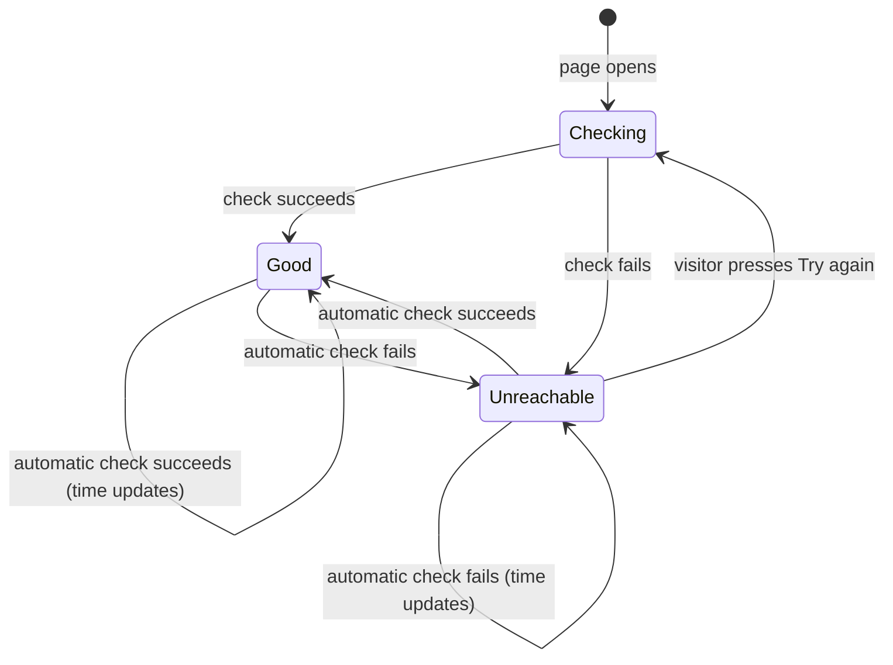

# Keep the API status on the home page up to date

Linear: TAS-11

## Summary

The home page checks the API once on load and never again, so its status can be hours out of date. This change re-checks the status every minute while the tab is visible, shows the time of the last check, and lets a failed re-check replace a stale good status with "The API is unreachable." and the TAS-10 (retry when unreachable) "Try again" button. Frontend only; no API change.

Evidence: feature — visitors see a new "Last checked at …" line and a status that changes without a reload.

## Required reading

- `AGENTS.md`: hard constraints, especially the frontend and Tests sections.
- `frontend/src/api/health.ts`: the `useHealth` hook this change configures.
- `frontend/src/pages/home-page.tsx`: `ApiStatus` and `ApiUnreachable`, the components this change edits.
- `frontend/src/app/query-client.ts`: the app's defaults (`staleTime: 30_000`, `retry: 1`) this change relies on.
- `frontend/src/pages/home-page.test.tsx`: mirror `failHealth` and `holdHealth` for the new tests.
- `frontend/src/test/render-route.tsx`: the test query client uses `retry: false` and the default `staleTime` of 0.
- `specs/lessons/`: no entries yet.

## Product behaviour

1. While the tab is visible, the page re-checks the API status every 60 seconds.
2. While the tab is hidden, the page makes no checks; returning to it checks straight away.
3. Under the status, the visitor sees "Last checked at HH:MM." for the latest check.
4. A failed re-check after a good one shows "The API is unreachable." and "Try again".
5. Automatic checks never show "Checking the API…"; only pressing "Try again" does.

## Technical design

**Today.** `useHealth` (`frontend/src/api/health.ts:5`) is a bare `useQuery` on `['health']`. With the client defaults (`frontend/src/app/query-client.ts:5`) it refetches only on mount, window focus or reconnect. `ApiStatus` (`frontend/src/pages/home-page.tsx:18`) shows "Checking the API…" when `isPending || (isError && isFetching)`, so any background refetch of a failed query hides the unreachable message and "Try again".

**Approach.**

- **Hook.** `useHealth` adds `refetchInterval: 60_000`. TanStack Query's `refetchIntervalInBackground` stays at its default `false`, so the interval skips ticks while `document.visibilityState` is `"hidden"`. `refetchOnWindowFocus` stays at its default `true`; TanStack listens for `visibilitychange`, so returning to the tab refetches when the data is older than the app's `staleTime` of 30 seconds. Nothing else in the hook changes.
- **Failure rule.** One failed check shows the page as unreachable. The app's `retry: 1` already retries a failed request once, about a second later, before the query fails. No new setting.
- **Last checked.** The time of the latest completed check is `Math.max(dataUpdatedAt, errorUpdatedAt)` from the query result. `dataUpdatedAt` moves only on success and `errorUpdatedAt` only on failure, so the larger one is the latest check of either kind. Derive it during render in `ApiStatus`.
- **Format.** A module-level formatter in `home-page.tsx`:

  ```ts
  // en-GB pins the 24-hour "15:42" shape; the time zone stays the visitor's own.
  const checkTime = new Intl.DateTimeFormat('en-GB', { hour: '2-digit', minute: '2-digit' });

  type LastCheckedProps = { at: number };

  const LastChecked = ({ at }: LastCheckedProps) => <p>Last checked at {checkTime.format(at)}.</p>;
  ```

- **Checking message.** `ApiStatus` owns `const [isRetrying, setIsRetrying] = useState(false)`. The "Try again" handler sets it, awaits `refetch()` and clears it. `refetch()` resolves (never rejects) once the fetch settles, so the flag always clears. The checking message shows on `isPending || isRetrying`. The current `isError && isFetching` branch and its comment go.

  ```tsx
  const ApiStatus = () => {
    const { data, isPending, isError, dataUpdatedAt, errorUpdatedAt, refetch } = useHealth();
    const [isRetrying, setIsRetrying] = useState(false);
    const retry = useCallback(async () => {
      setIsRetrying(true);
      await refetch();
      setIsRetrying(false);
    }, [refetch]);

    // Only a visitor's retry shows the checking message; automatic checks leave the current status up until they finish.
    if (isPending || isRetrying) {
      return <p>Checking the API…</p>;
    }
    const lastCheckedAt = Math.max(dataUpdatedAt, errorUpdatedAt);
    if (isError) {
      return (
        <>
          <ApiUnreachable onRetry={retry} />
          <LastChecked at={lastCheckedAt} />
        </>
      );
    }
    return (
      <>
        <p>API: {data.status}, database: {data.database}</p>
        <LastChecked at={lastCheckedAt} />
      </>
    );
  };
  ```

  `ApiUnreachable`'s `onRetry` type stays `() => void`; pass `retry` through `() => void retry()` if the linter flags the floating promise, matching today's `void refetch()`.

- **Order of branches matters.** TanStack keeps the last good `data` when a later check fails, so the `isError` branch must stay before the good-status branch. That is what makes behaviour 4 work.
- **API contract:** No change.
- **Blast radius:** `useHealth` is exported, but `home-page.tsx` is its only caller, and the `['health']` query key appears nowhere else. The polling stops when the home page unmounts, because the interval belongs to the query observer. Nothing outside this feature.
- **Not changing:** the app-wide defaults in `query-client.ts`, the "Try again" copy and the not-found page.



### Steps

1. **Poll the health check.** `frontend/src/api/health.ts` (edit)
   Add `refetchInterval: 60_000` to the `useQuery` options.
   Done when: `pnpm lint` passes.
2. **Show the last check and keep the message up during automatic checks.** `frontend/src/pages/home-page.tsx` (edit)
   Add `checkTime` and `LastChecked`. Rewrite `ApiStatus` as sketched above. Import `useState` by name.
   Done when: the five existing `home-page.test.tsx` tests still pass unchanged.
3. **Test the new behaviour.** `frontend/src/pages/home-page.test.tsx` (edit)
   Add the `describe` block below. Write each test first and watch it fail against the code before step 1 where it can.
   Done when: `pnpm test` passes and `pnpm lint` is clean.

### Tests

- `frontend/src/pages/home-page.test.tsx`, new `describe('HomePage status checks', …)`:
  - Setup: `beforeEach` calls `vi.useFakeTimers({ shouldAdvanceTime: true })` and `vi.setSystemTime(new Date(2026, 9, 25, 15, 42))` (local-time constructor, so the expected text holds in any time zone). `afterEach` calls `vi.useRealTimers()` and resets tab visibility to `"visible"`. Move time with `await vi.advanceTimersByTimeAsync(ms)`.
  - Helper `setTabVisibility(state: DocumentVisibilityState)`: `Object.defineProperty(document, 'visibilityState', { value: state, configurable: true })`, then `window.dispatchEvent(new Event('visibilitychange'))` (TanStack listens on `window`).
  - Shows when the status was checked, asserts: "API: ok, database: ok" and "Last checked at 15:42." are on screen.
  - Re-checks after a minute and updates the time, asserts: after the first check, `server.use` returns `{ status: 'ok', database: 'unavailable' }`; after 60 000 ms "API: ok, database: unavailable" and "Last checked at 15:43." are on screen.
  - Replaces a good status with the unreachable message when a re-check fails, asserts: after the first check, `failHealth()`; after 59 000 ms "API: ok, database: ok" is still on screen and there is no `alert`; after 1 000 ms more the `alert` reads "The API is unreachable.", the "Try again" button is present, "API: ok, database: ok" is gone and "Last checked at 15:43." is on screen.
  - Keeps the message and "Try again" up during an automatic check, asserts: start with `failHealth()`; once the `alert` shows, `holdHealth(() => HttpResponse.json<Health>({ status: 'ok', database: 'ok' }))`; after 60 000 ms the `alert` and "Try again" are still on screen and "Checking the API…" is not; after `release()` "API: ok, database: ok" shows and "Try again" is gone.
  - Pauses while the tab is hidden and checks on return, asserts: after the first check, `failHealth()` and `setTabVisibility('hidden')`; after 120 000 ms "API: ok, database: ok" is still on screen and there is no `alert`; after `setTabVisibility('visible')` the `alert` reads "The API is unreachable.".
- Existing tests in `home-page.test.tsx` stay as they are. "checks the API again and shows its status when the retry succeeds" and "brings the message and retry back when the retry fails again" now prove that pressing "Try again" still shows "Checking the API…".
- Checks: `pnpm lint` and `pnpm test` from the repo root.

## Decisions

- Check every 60 seconds while visible, pause while hidden, check on return when the last check is over 30 seconds old, because a hidden tab has no one to read it and the return check catches up at once. The 30 seconds is the app-wide `staleTime`, not a new setting. Asked: how often, and in background tabs → every 60 s, paused while hidden, checked on return.
- "Last checked at 15:42." as a 24-hour clock time in the visitor's time zone, because with a check every minute a relative time would read "less than a minute ago" almost always and would need its own ticking timer. Asked: relative or clock time → clock time.
- One failed check shows the page as unreachable, because the existing `retry: 1` already absorbs a single blip, and waiting for a second check would leave a stale good status up for another minute. Asked: one failed check or two → one.
- "Last checked" also shows under the unreachable message, with the time of the failed check, so the visitor knows the failure is recent. Asked: last checked when unreachable → yes, the failed check's time.
- Automatic checks leave the current message and "Try again" on screen; only pressing "Try again" shows "Checking the API…", because a message that flashes every minute would hide the button the visitor needs. Asked: automatic checks while unreachable → keep the message up.
- A local `isRetrying` flag in `ApiStatus` decides the checking message, because TanStack Query can't tell a visitor's refetch from an interval refetch. It is user intent, not a copy of query state.
- Rely on TanStack's built-in `refetchInterval` and focus refetching rather than a custom timer or visibility listener, because they already pause in hidden tabs and catch up on return.
- `Math.max(dataUpdatedAt, errorUpdatedAt)` for the last check, because each field moves on only one kind of result.
- Hardcode the `en-GB` locale in the formatter, because the visitor's own locale can produce other shapes ("15.42", "3:42 PM") and the agreed copy is "15:42".

## Assumptions

- No end-to-end test is added: proving a 60-second interval in Playwright would add a minute to the suite, and the unit tests drive the same behaviour with fake timers. Confirm with: Milo Bedini at spec approval.
- The 30-second return threshold isn't tested; it is the app's existing `staleTime` and TanStack's behaviour, and the test client sets `staleTime` to 0. Confirm with: Milo Bedini at spec approval.
- `vi.useFakeTimers({ shouldAdvanceTime: true })` works with TanStack Query 5.104 and MSW 3 here: TanStack's `timeoutManager` calls the global `setInterval` at call time, so faked timers reach it. The implementer confirms when the tests run.

## Out of scope

- Notifications of any kind.
- The status anywhere but the home page.
- Any API change, or the health endpoint's response.
- The "Try again" button itself and its copy (TAS-10, merged).
- The app-wide query defaults in `frontend/src/app/query-client.ts`.
- The end-to-end spec `frontend/e2e/home.spec.ts`.

## Validation criteria

- [ ] `pnpm lint` passes.
- [ ] `pnpm test` passes, with the five new cases above.
- [ ] Manual or recorded check: with the app running, the status line shows "Last checked at HH:MM."; stopping the backend turns it into "The API is unreachable." within about a minute without a reload, and starting it again brings the good status back within about a minute.
- Evidence: feature — a video of the page going from the good status to unreachable and back without a reload, with the "Last checked" time moving.
