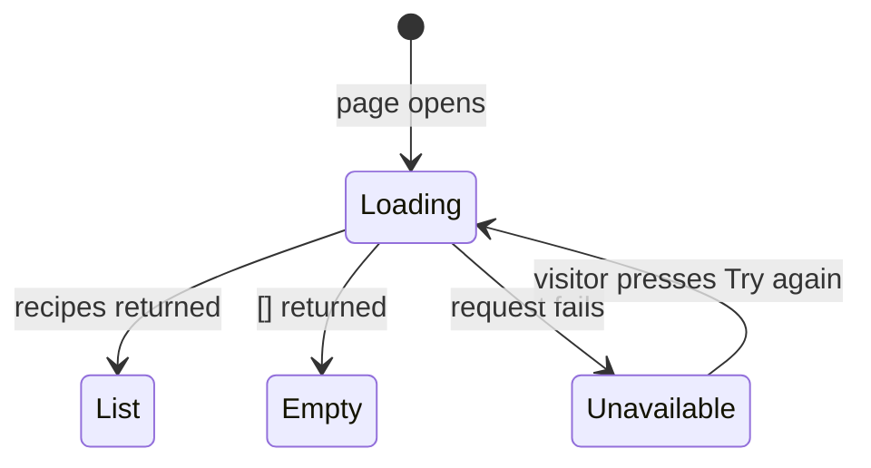

# Let visitors browse a list of recipes

Linear: TAS-13

## Summary

Tastebook has no recipes yet. This first slice adds a `Recipe` model that staff manage in the Django admin, a public `GET /api/recipes/` endpoint that returns every recipe alphabetically, and a `/recipes` page, linked from the home page, that lists them. The page has loading, empty and error states. Creating recipes in the app, a detail page and paging come later.

Evidence: feature — visitors see a new "Browse recipes" link and a new `/recipes` page.

## Required reading

- `AGENTS.md`: hard constraints, the API contract steps and the Tests section.
- `backend/health/` (`apps.py`, `urls.py`, `views.py`, `serializers.py`): mirror its layout and the public-view settings (`authentication_classes = []`, `permission_classes = []`).
- `backend/tests/test_health.py`: mirror its test style (`APIClient`, `reverse`, `@pytest.mark.django_db`).
- `frontend/src/api/health.ts`: mirror for `useRecipes`.
- `frontend/src/pages/home-page.tsx`: mirror `ApiUnreachable` for the recipes error state; this file gains the link.
- `frontend/src/pages/home-page.test.tsx`: mirror `failHealth` and `holdHealth` for the recipes test helpers.
- `frontend/src/pages/not-found-page.tsx`: mirror the `<title>` and "Back to Tastebook" link.
- `frontend/src/test/render-route.tsx`: the test client uses `retry: false`.
- `specs/lessons/tanstack-refetch-resets-error-state.md`: refetching a query with no data sets it back to `pending`. The retry design below relies on that.

## Product behaviour

1. A staff user can add and edit a recipe's title and description in the Django admin.
2. `GET /api/recipes/` returns every recipe, sorted by title ignoring case, in the generated schema.
3. The home page's "Browse recipes" link opens `/recipes`, which lists each recipe's title and description.
4. With no recipes, the `/recipes` page says "No recipes yet."
5. The page shows "Loading recipes…" while loading, and an alert with "Try again" on failure.

## Technical design

**Today.** The backend has one app, `health/`, mounted at `api/health/` (`backend/config/urls.py:7`) and listed in `INSTALLED_APPS` (`backend/config/settings.py:27`). `REST_FRAMEWORK` (`backend/config/settings.py:82`) sets no pagination class, so a DRF list view returns a plain JSON array. The frontend has two routes (`frontend/src/app/routes.tsx:6`): `/` and the `*` not-found page.

**Approach, layer by layer.**

- **Model.** New app `backend/recipes/`. The ordering lives in a queryset method, per `AGENTS.md` (no logic in views):

  ```py
  class RecipeQuerySet(models.QuerySet['Recipe']):
      def alphabetical(self) -> 'RecipeQuerySet':
          # id breaks ties, so the recipe added first comes first when two titles match.
          return self.order_by(Lower('title'), 'id')


  class Recipe(models.Model):
      title = models.CharField(max_length=200)
      description = models.CharField(max_length=300, blank=True)

      objects = RecipeQuerySet.as_manager()

      def __str__(self) -> str:
          return self.title
  ```

  `title` is required (Django's default `blank=False`). An empty description is stored as `''`, never `NULL` (ruff's `DJ001`). No `Meta.ordering`: the order belongs to the list endpoint, not to every query.
- **Admin.** `backend/recipes/admin.py` registers `Recipe` with `list_display = ('title', 'description')`. Nothing else.
- **Serializer.** `RecipeSerializer(serializers.ModelSerializer)` with `model = Recipe` and `fields = ['id', 'title', 'description']`. `id` is there for React list keys and the future detail page.
- **View.** `RecipeListView(ListAPIView)` with `authentication_classes = []`, `permission_classes = []`, `serializer_class = RecipeSerializer` and `queryset = Recipe.objects.alphabetical()`. drf-spectacular names the operation `recipes_list` and the component `Recipe` on its own; don't add `@extend_schema` unless `spectacular --validate --fail-on-warn` asks for it.
- **URLs.** `backend/recipes/urls.py` maps `''` to `RecipeListView` with `name='recipe-list'`. `backend/config/urls.py` adds `path('api/recipes/', include('recipes.urls'))` after the health line.
- **API contract.**

  ```diff
  + GET /api/recipes/  (no auth)
  + 200 application/json: Recipe[]
  + Recipe: { readonly id: integer, title: string (max 200), description: string (max 300, may be "") }
  ```

  Regenerate `backend/schema.yml` and `frontend/src/api/schema.d.ts` with the commands in `AGENTS.md`.
- **Hook.** `frontend/src/api/recipes.ts`, mirroring `useHealth` without `refetchInterval`:

  ```ts
  export const useRecipes = () =>
    useQuery({
      queryKey: ['recipes'],
      queryFn: async () => {
        const { data, error } = await api.GET('/api/recipes/');
        if (error || !data) {
          throw new Error('Recipes request failed');
        }
        return data;
      }
    });
  ```

- **Page.** `frontend/src/pages/recipes-page.tsx`. One component per rendering, with early returns in `RecipeList`:

  ```tsx
  type Recipe = components['schemas']['Recipe'];

  const RecipesUnavailable = ({ onRetry }: { onRetry: () => void }) => (
    <>
      <p role="alert">The recipes couldn't be loaded.</p>
      <button type="button" onClick={onRetry}>Try again</button>
    </>
  );

  const RecipeItem = ({ recipe }: { recipe: Recipe }) => (
    <li>
      <h2>{recipe.title}</h2>
      {recipe.description !== '' && <p>{recipe.description}</p>}
    </li>
  );

  const Recipes = ({ recipes }: { recipes: Recipe[] }) => {
    if (recipes.length === 0) {
      return <p>No recipes yet.</p>;
    }
    return <ul>{recipes.map((recipe) => <RecipeItem key={recipe.id} recipe={recipe} />)}</ul>;
  };

  const RecipeList = () => {
    const { data, isPending, refetch } = useRecipes();
    // A list already shown stays up if a background refetch fails.
    if (data !== undefined) {
      return <Recipes recipes={data} />;
    }
    // Refetching a query that has never succeeded resets it to pending, so "Try again" shows this too.
    if (isPending) {
      return <p>Loading recipes…</p>;
    }
    return <RecipesUnavailable onRetry={() => void refetch()} />;
  };

  export const RecipesPage = () => (
    <main>
      <title>Recipes · Tastebook</title>
      <h1>Recipes</h1>
      <RecipeList />
      <Link to="/">Back to Tastebook</Link>
    </main>
  );
  ```

  Props types may be named type aliases (`type RecipeItemProps = …`) to match `home-page.tsx`; the shapes stay as above. The page renders recipes in the order the API returns them and never sorts.
- **Route.** `frontend/src/app/routes.tsx` adds `{ path: '/recipes', Component: RecipesPage }` between `/` and `*`.
- **Home page.** `frontend/src/pages/home-page.tsx` adds `<Link to="/recipes">Browse recipes</Link>` between the `<h1>` and `<ApiStatus />`, importing `Link` from `react-router`. Nothing else in the file changes.



**Blast radius.**

- `frontend/src/app/routes.tsx`: the new route matches `/recipes` exactly, so `/recipes/missing/deeper` in `not-found-page.test.tsx:8` still reaches the not-found page. Re-run that test.
- `frontend/src/pages/home-page.tsx`: the link is a new element; the home page tests query by text and role, and none queries links. Re-run `home-page.test.tsx` and `e2e/home.spec.ts`.
- `frontend/src/test/handlers.ts`: a new default handler for a new URL; no existing test calls `/api/recipes/`.
- `backend/schema.yml` and `frontend/src/api/schema.d.ts` are regenerated; the `Health` types must come out unchanged.
- `backend/config/settings.py` and `backend/config/urls.py`: additions only.

**Not changing:** the health endpoint, `ApiStatus`, the app-wide query defaults in `frontend/src/app/query-client.ts` and the not-found page.

### Steps

1. **Add the recipes app and model.** `backend/recipes/__init__.py` (new, empty), `backend/recipes/apps.py` (new, `RecipesConfig` with `name = 'recipes'`), `backend/recipes/models.py` (new, as sketched), `backend/recipes/admin.py` (new), `backend/config/settings.py` (edit: add `'recipes'` after `'health'` in `INSTALLED_APPS`). Generate `backend/recipes/migrations/0001_initial.py` (and `migrations/__init__.py`) with `uv run --env-file .env python manage.py makemigrations recipes`.
   Done when: `uv run python manage.py makemigrations --check --dry-run` reports no changes and the admin tests below pass.
2. **Add the endpoint.** `backend/recipes/serializers.py`, `backend/recipes/views.py`, `backend/recipes/urls.py` (new), `backend/config/urls.py` (edit).
   Done when: the API tests in `backend/tests/test_recipes.py` pass, and `uv run ruff check . && uv run ruff format --check .` is clean.
3. **Regenerate the contract.** `backend/schema.yml`, `frontend/src/api/schema.d.ts` (regenerated, never hand-edited).
   Done when: `spectacular --validate --fail-on-warn` passes and `schema.d.ts` has `"/api/recipes/"` with `operations["recipes_list"]` returning `components["schemas"]["Recipe"][]`.
4. **Add the hook, page, route and default handler.** `frontend/src/api/recipes.ts` (new), `frontend/src/pages/recipes-page.tsx` (new), `frontend/src/app/routes.tsx` (edit), `frontend/src/test/handlers.ts` (edit: add `http.get('/api/recipes/', () => HttpResponse.json<Recipe[]>([{ id: 1, title: 'Apple tart', description: 'Sharp apples on buttery pastry.' }, { id: 2, title: 'Banana bread', description: '' }]))`).
   Done when: `frontend/src/pages/recipes-page.test.tsx` passes and `pnpm lint` is clean.
5. **Link from the home page.** `frontend/src/pages/home-page.tsx` (edit), `frontend/src/pages/home-page.test.tsx` (edit: one new test).
   Done when: `pnpm test` passes.
6. **Add the end-to-end check.** `frontend/e2e/recipes.spec.ts` (new).
   Done when: `pnpm test:e2e` passes.

### Tests

- `backend/tests/test_recipes.py` (all `@pytest.mark.django_db`):
  - Lists recipes alphabetically ignoring case, oldest first on a tie: create, in this order, `Recipe(title='Shakshuka', description='Eggs in spiced tomatoes.')`, `('banana bread', '')`, `('Apple tart', 'Sharp apples.')`, `('Shakshuka', 'Green version.')`, `('apple pie', '')`; `APIClient().get(reverse('recipe-list'))` with no login, asserts: status 200 and `[(r['title'], r['description']) for r in body]` equals `[('apple pie', ''), ('Apple tart', 'Sharp apples.'), ('banana bread', ''), ('Shakshuka', 'Eggs in spiced tomatoes.'), ('Shakshuka', 'Green version.')]`.
  - Returns each recipe's id, title and description: one recipe, asserts: `response.json() == [{'id': recipe.id, 'title': 'Shakshuka', 'description': 'Eggs in spiced tomatoes.'}]`.
  - Returns an empty list with no recipes, asserts: status 200 and `response.json() == []`.
  - A staff user adds a recipe in the admin: `admin_client.post(reverse('admin:recipes_recipe_add'), {'title': 'Shakshuka', 'description': ''})`, asserts: a 302 and `list(Recipe.objects.values_list('title', 'description')) == [('Shakshuka', '')]`.
  - A staff user edits a recipe in the admin: post `{'title': 'Green shakshuka', 'description': 'With spinach.'}` to `reverse('admin:recipes_recipe_change', args=[recipe.id])`, asserts: a 302 and the refreshed row has title `'Green shakshuka'` and description `'With spinach.'`.
  - The admin refuses a recipe with no title: post `{'title': '', 'description': 'No name.'}` to the add URL, asserts: status 200 (form redisplayed) and `Recipe.objects.count() == 0`.
- `frontend/src/pages/recipes-page.test.tsx` (helpers `failRecipes` and `holdRecipes`, mirroring `failHealth` and `holdHealth` in `home-page.test.tsx`):
  - Titles the tab, asserts: `document.title` becomes `'Recipes · Tastebook'`.
  - Shows a loading message, then the recipes in the order the API sends: `holdRecipes` returning `[{ id: 7, title: 'Shakshuka', description: 'Eggs in spiced tomatoes.' }, { id: 3, title: 'Apple tart', description: '' }]`, asserts: "Loading recipes…" is on screen before `release()`; after it, `getAllByRole('heading', { level: 2 })` text is `['Shakshuka', 'Apple tart']`, "Eggs in spiced tomatoes." is on screen, the Apple tart `listitem` has text content exactly `'Apple tart'`, "Loading recipes…" and "No recipes yet." are gone.
  - Says so when there are no recipes: `server.use` returning `[]`, asserts: "No recipes yet." is on screen and `queryByRole('list')` is null.
  - Shows an alert and a retry when the request fails: `failRecipes()`, asserts: the `alert` reads "The recipes couldn't be loaded.", the "Try again" button is present and "No recipes yet." is absent.
  - Loads again and shows the recipes when the retry succeeds: `failRecipes()`, then `holdRecipes` returning one recipe titled `'Shakshuka'`, click "Try again", asserts: "Loading recipes…" shows and the `alert` is gone; after `release()` the heading "Shakshuka" shows and "Try again" is gone.
  - Brings the alert back when the retry fails again: `failRecipes()`, then `holdRecipes` returning a 503, click "Try again", asserts: "Loading recipes…" shows; after `release()` the `alert` reads "The recipes couldn't be loaded." and "Try again" is present.
  - Takes the visitor home from the back link, asserts: after clicking "Back to Tastebook", the heading "Tastebook" shows and the heading "Recipes" is gone.
- `frontend/src/pages/home-page.test.tsx`, one new test in the first `describe`:
  - Opens the recipes page from the "Browse recipes" link, asserts: after the click, the heading "Recipes" shows and the heading "Tastebook" is gone.
- `frontend/e2e/recipes.spec.ts`:
  - Reaches the recipes page from home against the real backend: `page.goto('/')`, click "Browse recipes", asserts: the heading "Recipes" is visible, then `page.getByText('No recipes yet.').or(page.getByRole('list'))` is visible and `page.getByRole('alert')` has count 0.
- Checks: `pnpm lint`, `pnpm test`, `pnpm test:e2e` from the root; `uv run ruff check . && uv run ruff format --check .`, `uv run python manage.py makemigrations --check --dry-run` and `uv run pytest` in `backend/`; the contract regenerates with no diff.

## Decisions

- A recipe has a required title (up to 200 characters) and an optional description (up to 300), because nothing would show cooking time or servings until a detail page exists. Asked: which fields → title and optional description; cooking time and servings come with the detail page.
- Each list item shows the title as a level-2 heading, with the description beneath it when there is one; items aren't links, because there is no detail page yet. Asked: what an item shows → title, description beneath when present, no links.
- Alphabetical by title ignoring case, oldest first on a tie, decided by the backend; the page never re-sorts. Asked: order → alphabetical, case-insensitive, oldest first on a tie.
- No paging: `GET /api/recipes/` returns a plain JSON array, because the only client is our frontend, so moving to a paginated envelope later is cheap. Asked: paging → none now.
- Empty-state copy "No recipes yet." Asked: empty state → "No recipes yet."
- Page copy: a "Browse recipes" link under the home heading; on the page the heading "Recipes", tab title "Recipes · Tastebook", "Loading recipes…" while loading and a "Back to Tastebook" link. Asked: page copy → as suggested.
- Error state: an alert "The recipes couldn't be loaded." with "Try again"; pressing it shows "Loading recipes…" again. No polling. Asked: error state → as suggested.
- A local `RecipesUnavailable` on the recipes page rather than a component shared with the home page, because sharing it means editing the home page's status code, which this issue didn't ask for. The test helpers `failRecipes` and `holdRecipes` stay local for the same reason. A follow-up shares both. Asked: shared retry message → local now, follow-up later.
- `id` breaks title ties instead of a new `created_at` column, because ids increase with each insert and nothing else needs a timestamp yet.
- The order lives in `RecipeQuerySet.alphabetical()`, not `Meta.ordering`, because `AGENTS.md` keeps logic in querysets and a default ordering would apply to every query, including the admin's.
- `RecipeList` branches on `data` first, then `isPending`, rather than on `isError`. A never-loaded query that is refetched goes back to `pending` (see the lesson), so "Try again" shows "Loading recipes…" with no `isRetrying` flag. A list already on screen stays up if a background refetch on window focus fails, because a slightly stale list is more use to a visitor than an error.
- An empty description is `''` in the database and the API, not `null`, following Django's convention for text fields and ruff's `DJ001`.
- `RecipeSerializer` sets `extra_kwargs = {'description': {'required': True, 'allow_blank': True}}`, because a `blank=True` model field otherwise comes out optional in the schema (`description?: string`), while the API contract above says the field is always sent. Found during the build.
- A small end-to-end check, because the unit tests mock HTTP and nothing else proves the page reaches the real endpoint through the Vite proxy. It accepts either the empty state or a list, so a local database with recipes in it doesn't break it.

## Assumptions

- Staff reach the admin with an existing superuser (`createsuperuser`); no new permissions or groups. Confirm with: Milo Bedini at spec approval.
- "Oldest first on a tie" means the recipe saved first, judged by `id`. Confirm with: Milo Bedini at spec approval.
- No test proves that a visible list survives a failed background refetch: triggering a focus refetch adds a test for a case no acceptance criterion names. Confirm with: Milo Bedini at spec approval.

## Out of scope

- A recipe detail page, and links from list items.
- Creating, editing or deleting recipes in the app.
- Cooking time, servings, images, search, filtering and paging.
- Sign-in, or restricting who can read recipes.
- Sharing the retry message or the test helpers with the home page (a follow-up).
- Any change to the health endpoint, `ApiStatus` or `frontend/src/app/query-client.ts`.

## Validation criteria

- [ ] `pnpm lint`, `pnpm test` and `pnpm test:e2e` pass.
- [ ] In `backend/`: `uv run ruff check . && uv run ruff format --check .`, `uv run python manage.py makemigrations --check --dry-run` and `uv run pytest` pass.
- [ ] CI's **API contract** job passes with the regenerated `backend/schema.yml` and `frontend/src/api/schema.d.ts`.
- [ ] Recorded check: from the home page, "Browse recipes" opens `/recipes`, which shows "No recipes yet."; after adding "Shakshuka" and "Apple tart" in the admin, a reload lists "Apple tart" before "Shakshuka".
- Evidence: feature — a video of the home page link, the empty state, adding two recipes in the admin and the list in alphabetical order.
