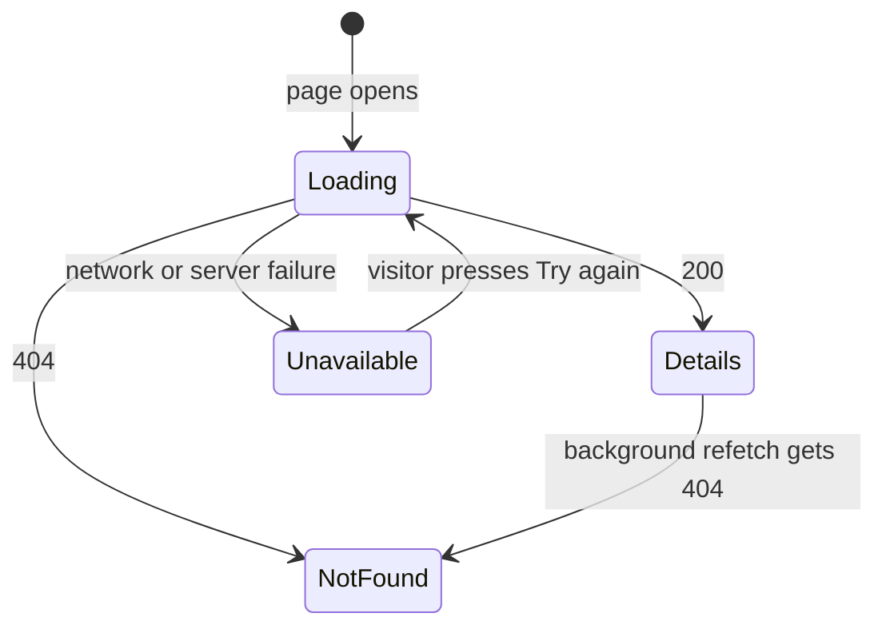

# Let visitors open a recipe to see its details

Linear: TAS-14

## Summary

Visitors can browse `/recipes` (TAS-13) but can't open a recipe. This adds a readable address for each recipe (`/recipes/apple-tart`), a public `GET /api/recipes/<slug>/` endpoint, and a recipe page that shows the title and description, with loading, error and "not found" states. Each title in the list becomes a link to its page. New recipe fields (ingredients, method, cooking time) are a separate issue.

Evidence: feature — visitors see recipe titles become links and a new recipe page with a "Recipe not found" state.

## Required reading

- `AGENTS.md`: hard constraints, the API contract steps and the Tests section.
- `specs/TAS-13.md`: the list page this extends; its decisions still hold.
- `backend/recipes/models.py`: `RecipeQuerySet` is where the slug lookup goes, next to `alphabetical()`.
- `backend/recipes/views.py`: mirror `RecipeListView`'s public-view settings for the detail view.
- `backend/health/services.py`: a plain module of helpers with no model import; mirror that for `recipes/slugs.py`.
- `backend/tests/test_recipes.py`: mirror its style (`APIClient`, `reverse`, `@pytest.mark.django_db`, `admin_client`).
- `frontend/src/api/recipes.ts`: mirror `useRecipes` for `useRecipe`.
- `frontend/src/pages/recipes-page.tsx`: mirror `RecipeList`'s branching and `RecipesUnavailable` for the recipe page; this file gains the link.
- `frontend/src/pages/recipes-page.test.tsx`: mirror `failRecipes` and `holdRecipes` for the recipe page's tests; its fixtures gain `slug`.
- `frontend/src/test/handlers.ts`: gains the detail handler.
- `specs/lessons/tanstack-refetch-resets-error-state.md`: refetching a query that never had data sets it back to `pending`, so "Try again" shows "Loading recipe…" with no extra flag.
- `specs/lessons/blank-model-fields-are-optional-in-the-schema.md`: why `description` keeps its `extra_kwargs`; check that `slug` comes out required too.

## Product behaviour

1. Each recipe title in the `/recipes` list links to that recipe's own page.
2. A recipe's page lives at `/recipes/<slug>`, a readable address made from its title.
3. The recipe page shows the title as its heading and the description beneath, when there is one.
4. An unknown address shows "Recipe not found" with links to all recipes and home.
5. The page shows "Loading recipe…" while loading, and an alert with "Try again" on failure.

## Technical design

**Today.** `Recipe` has `title` and `description` (`backend/recipes/models.py:11`). The only endpoint is `GET /api/recipes/` (`backend/recipes/urls.py:6`), serialised by `RecipeSerializer` with `fields = ['id', 'title', 'description']` (`backend/recipes/serializers.py:9`). Recipes are created only in the Django admin (`backend/recipes/admin.py:7`). The frontend routes are `/`, `/recipes` and `*` (`frontend/src/app/routes.tsx:7`); `RecipeItem` renders the title as a plain `<h2>` (`frontend/src/pages/recipes-page.tsx:25`).

**Approach, layer by layer.**

- **Slug helpers.** New `backend/recipes/slugs.py`, pure functions with no model import, so the model and the migration share them:

  ```py
  from collections.abc import Container
  from itertools import chain, count

  from django.utils.text import slugify


  def base_slug(title: str) -> str:
      # A title with no letters or digits (say '!!!') slugifies to ''.
      return slugify(title) or 'recipe'


  def first_free_slug(base: str, taken: Container[str]) -> str:
      candidates = chain([base], (f'{base}-{n}' for n in count(2)))
      return next(candidate for candidate in candidates if candidate not in taken)
  ```

  `slugify` lowercases, drops accents (`Crème brûlée` → `creme-brulee`) and anything that isn't a letter, digit, hyphen or underscore, and joins words with hyphens.
- **Model.** `backend/recipes/models.py`:

  ```py
  class RecipeQuerySet(models.QuerySet['Recipe']):
      def alphabetical(self) -> RecipeQuerySet: ...  # unchanged

      def unique_slug_for(self, title: str) -> str:
          base = base_slug(title)
          taken = set(self.filter(slug__startswith=base).values_list('slug', flat=True))
          return first_free_slug(base, taken)


  class Recipe(models.Model):
      title = models.CharField(max_length=200)
      description = models.CharField(max_length=300, blank=True)
      slug = models.SlugField(max_length=255, unique=True, editable=False)

      objects = RecipeQuerySet.as_manager()

      def __str__(self) -> str:
          return self.title

      def save(self, **kwargs: Any) -> None:
          # Set once, so a recipe keeps its address when its title changes.
          if not self.slug:
              self.slug = Recipe.objects.unique_slug_for(self.title)
          super().save(**kwargs)
  ```

  `save` goes after `__str__` (ruff's `DJ012`). `editable=False` keeps the slug out of admin forms and makes it read-only in the serializer. One query finds every taken slug that could clash, so a clash costs no extra round trips. `max_length=255` leaves room for a suffix on a 200-character title.
- **Migration.** `backend/recipes/migrations/0002_recipe_slug.py`, written by hand in three operations so existing rows get slugs before the unique constraint:
  1. `AddField('recipe', 'slug', models.SlugField(max_length=255, editable=False, default=''), preserve_default=False)`.
  2. `RunPython(fill_slugs, migrations.RunPython.noop)`, where `fill_slugs` walks `apps.get_model('recipes', 'Recipe').objects.order_by('id')`, keeps a local `taken: set[str]`, sets each `recipe.slug = first_free_slug(base_slug(recipe.title), taken)`, adds it to `taken` and calls `recipe.save(update_fields=['slug'])`. Ordering by `id` gives the oldest recipe the plain slug.
  3. `AlterField('recipe', 'slug', models.SlugField(max_length=255, unique=True, editable=False))`.

  `makemigrations --check` must report no changes afterwards.
- **Admin.** `backend/recipes/admin.py` adds `readonly_fields = ('slug',)` so staff can see each recipe's address. `list_display` is unchanged.
- **Serializer.** `RecipeSerializer.Meta.fields` becomes `['id', 'slug', 'title', 'description']`. The `extra_kwargs` line stays. The list endpoint gains `slug` too, because the list page builds its links from it.
- **View.** `backend/recipes/views.py` adds:

  ```py
  @extend_schema(responses={200: RecipeSerializer, 404: OpenApiResponse(description='No recipe has this slug.')})
  class RecipeDetailView(RetrieveAPIView):
      authentication_classes = []
      permission_classes = []
      serializer_class = RecipeSerializer
      queryset = Recipe.objects.all()
      lookup_field = 'slug'
  ```

  The decorator documents the 404 so the contract says what the frontend relies on.
- **URLs.** `backend/recipes/urls.py` adds `path('<slug:slug>/', RecipeDetailView.as_view(), name='recipe-detail')` after the list route. A path segment that isn't a valid slug (`/api/recipes/Apple Tart/`) doesn't match and gets Django's 404, which the page treats the same way.
- **API contract.**

  ```diff
    GET /api/recipes/  (no auth)
    200 application/json: Recipe[]
  + GET /api/recipes/{slug}/  (no auth)
  + 200 application/json: Recipe
  + 404 no body
    Recipe: {
      readonly id: integer,
  +   readonly slug: string (max 255, pattern ^[-a-zA-Z0-9_]+$),
      title: string (max 200),
      description: string (max 300, may be "")
    }
  ```

  `slug` must be in the component's `required` list (drf-spectacular marks read-only fields required, as it does `id`), so `schema.d.ts` types it `readonly slug: string`. Regenerate `backend/schema.yml` and `frontend/src/api/schema.d.ts` with the commands in `AGENTS.md`.
- **Hook.** `frontend/src/api/recipes.ts` adds `useRecipe`. A 404 resolves to `null`, so "not found" is cached data, not an error, and TanStack Query never retries it:

  ```ts
  export const useRecipe = (slug: string) =>
    useQuery({
      queryKey: ['recipes', slug],
      queryFn: async () => {
        const { data, error, response } = await api.GET('/api/recipes/{slug}/', { params: { path: { slug } } });
        // A missing recipe is an answer, not a failure, so it's cached and never retried.
        if (response.status === 404) {
          return null;
        }
        if (error || !data) {
          throw new Error('Recipe request failed');
        }
        return data;
      }
    });
  ```

  openapi-fetch encodes the path parameter, so any text in the address is safe to send.
- **Recipe page.** New `frontend/src/pages/recipe-page.tsx`. One component per state, with early returns; each state sets its own tab title. The links sit outside the states, so every state has them:

  ```tsx
  type Recipe = components['schemas']['Recipe'];

  const RecipeDetails = ({ recipe }: RecipeDetailsProps) => (
    <>
      {/* React 19 needs <title> to have a single string child. */}
      <title>{`${recipe.title} · Tastebook`}</title>
      <h1>{recipe.title}</h1>
      {recipe.description !== '' && <p>{recipe.description}</p>}
    </>
  );

  const RecipeNotFound = () => (
    <>
      <title>Recipe not found · Tastebook</title>
      <h1>Recipe not found</h1>
      <p>This recipe doesn't exist or has been removed.</p>
    </>
  );

  const RecipeLoading = () => (
    <>
      <title>Recipe · Tastebook</title>
      <p>Loading recipe…</p>
    </>
  );

  const RecipeUnavailable = ({ onRetry }: RecipeUnavailableProps) => (
    <>
      <title>Recipe · Tastebook</title>
      <p role="alert">The recipe couldn't be loaded.</p>
      <button type="button" onClick={onRetry}>Try again</button>
    </>
  );

  const RecipeForSlug = ({ slug }: RecipeForSlugProps) => {
    const { data, isPending, refetch } = useRecipe(slug);
    if (data === null) {
      return <RecipeNotFound />;
    }
    // A recipe already shown stays up if a background refetch fails.
    if (data !== undefined) {
      return <RecipeDetails recipe={data} />;
    }
    // Refetching a query that has never succeeded resets it to pending, so "Try again" shows this too.
    if (isPending) {
      return <RecipeLoading />;
    }
    return <RecipeUnavailable onRetry={() => void refetch()} />;
  };

  const RecipeContent = () => {
    const { slug } = useParams();
    // The route always supplies a slug; this only narrows the type.
    if (slug === undefined) {
      return <RecipeNotFound />;
    }
    return <RecipeForSlug slug={slug} />;
  };

  export const RecipePage = () => (
    <main>
      <RecipeContent />
      <Link to="/recipes">All recipes</Link>
      <Link to="/">Back to Tastebook</Link>
    </main>
  );
  ```

  Props types are named aliases (`type RecipeDetailsProps = { recipe: Recipe }`), as in `recipes-page.tsx`.
- **Route.** `frontend/src/app/routes.tsx` adds `{ path: '/recipes/:slug', Component: RecipePage }` after `/recipes`. It matches one segment only, so `/recipes/missing/deeper` still reaches `NotFoundPage`.
- **List link.** In `RecipeItem` (`frontend/src/pages/recipes-page.tsx:25`), the heading becomes `<h2><Link to={`/recipes/${recipe.slug}`}>{recipe.title}</Link></h2>`. A slug only holds URL-safe characters, so it needs no encoding. Nothing else in the file changes.



**Blast radius.**

- `RecipeSerializer` is shared by the list endpoint, which gains `slug`. `test_returns_each_recipes_id_title_and_description` (`backend/tests/test_recipes.py:33`) asserts the exact body, so it changes (see Tests). The list's order and other fields are unchanged.
- `components['schemas']['Recipe']` gains a required `slug`, so every typed fixture needs one: `frontend/src/test/handlers.ts:11` and the fixtures in `frontend/src/pages/recipes-page.test.tsx` (lines 38–41 and 85). `pnpm lint` fails until they have it.
- `Recipe.save()` now runs a query before inserting. Every existing `Recipe.objects.create` in `backend/tests/test_recipes.py` goes through it; the two `'Shakshuka'` rows in the ordering test get `shakshuka` and `shakshuka-2`, which that test doesn't assert. `bulk_create` would skip `save()`; nothing calls it.
- `RecipeItem`'s heading now wraps a link. Its accessible name and text stay the title, so the list tests' heading queries and the exact `'Apple tart'` text check at `recipes-page.test.tsx:55` still pass.
- `frontend/src/app/routes.tsx`: re-run `not-found-page.test.tsx`, which uses `/recipes/missing/deeper`.
- `backend/schema.yml` and `frontend/src/api/schema.d.ts` are regenerated; the `Health` types and the list operation's shape must come out unchanged apart from `slug`.

**Not changing:** the list's order, empty state and error state; `NotFoundPage`; `frontend/src/app/query-client.ts`; the health endpoint; `RecipesUnavailable` and the list's test helpers.

### Steps

1. **Add slugs to recipes.** `backend/recipes/slugs.py` (new), `backend/recipes/models.py` (edit), `backend/recipes/migrations/0002_recipe_slug.py` (new, as described), `backend/recipes/admin.py` (edit), `backend/tests/test_recipes.py` (edit: the slug and admin tests below).
   Done when: `uv run --env-file .env python manage.py migrate` applies cleanly on a database that already has recipes with clashing titles, `uv run python manage.py makemigrations --check --dry-run` reports no changes, and the slug tests pass.
2. **Add the detail endpoint.** `backend/recipes/serializers.py`, `backend/recipes/views.py`, `backend/recipes/urls.py` (edit), `backend/tests/test_recipes.py` (edit: the API tests below).
   Done when: `uv run pytest` passes and `uv run ruff check . && uv run ruff format --check .` is clean.
3. **Regenerate the contract.** `backend/schema.yml`, `frontend/src/api/schema.d.ts` (regenerated, never hand-edited).
   Done when: `spectacular --validate --fail-on-warn` passes, and `schema.d.ts` has `"/api/recipes/{slug}/"` with `operations["recipes_retrieve"]` and `readonly slug: string` on `Recipe`.
4. **Add the hook, handlers and list link.** `frontend/src/api/recipes.ts` (edit), `frontend/src/test/handlers.ts` (edit), `frontend/src/pages/recipes-page.tsx` (edit), `frontend/src/pages/recipes-page.test.tsx` (edit: add `slug` to every fixture, plus the new link test). In `handlers.ts`, lift the two recipes into one `const recipes: Recipe[]` (`{ id: 1, slug: 'apple-tart', title: 'Apple tart', description: 'Sharp apples on buttery pastry.' }`, `{ id: 2, slug: 'banana-bread', title: 'Banana bread', description: '' }`), return it from the list handler, and add `http.get('/api/recipes/:slug/', …)` that returns the recipe whose `slug` equals `params.slug`, or `new HttpResponse(null, { status: 404 })`.
   Done when: `recipes-page.test.tsx` passes and `pnpm lint` is clean.
5. **Add the recipe page and route.** `frontend/src/pages/recipe-page.tsx` (new), `frontend/src/app/routes.tsx` (edit), `frontend/src/pages/recipe-page.test.tsx` (new).
   Done when: `pnpm test` passes.
6. **Add the end-to-end check.** `frontend/e2e/recipe.spec.ts` (new).
   Done when: `pnpm test:e2e` passes.

### Tests

- `backend/tests/test_recipes.py` (all `@pytest.mark.django_db`):
  - Makes a slug from the title, parametrised over `('Apple tart', 'apple-tart')`, `('Crème brûlée', 'creme-brulee')`, `('  Eggs & soldiers!  ', 'eggs-soldiers')` and `('!!!', 'recipe')`: `Recipe.objects.create(title=title)`, asserts: `recipe.slug` equals the expected slug.
  - Numbers clashing slugs from 2, skipping one already taken: create, in order, `'Shakshuka 2'`, `'Shakshuka'`, `'Shakshuka'`, `'Shakshuka'`, asserts: `list(Recipe.objects.order_by('id').values_list('slug', flat=True)) == ['shakshuka-2', 'shakshuka', 'shakshuka-3', 'shakshuka-4']`.
  - A recipe added in the admin gets a slug from its title: `admin_client.post(reverse('admin:recipes_recipe_add'), {'title': 'Apple tart', 'description': ''})`, asserts: a 302 and `list(Recipe.objects.values_list('slug', flat=True)) == ['apple-tart']`.
  - Renaming a recipe in the admin keeps its slug: create `'Shakshuka'`, post `{'title': 'Green shakshuka', 'description': ''}` to `reverse('admin:recipes_recipe_change', args=[recipe.id])`, asserts: a 302, and the refreshed row has title `'Green shakshuka'` and slug `'shakshuka'`.
  - Returns a recipe by its slug, or 404 for an unknown one, parametrised over `('shakshuka', 200)` and `('apple-tart', 404)`: create `Recipe(title='Shakshuka', description='Eggs in spiced tomatoes.')`, `APIClient().get(reverse('recipe-detail', args=[slug]))` with no login, asserts: the status code equals the expected one.
  - Returns the recipe's id, slug, title and description: same recipe, asserts: `response.json() == {'id': recipe.id, 'slug': 'shakshuka', 'title': 'Shakshuka', 'description': 'Eggs in spiced tomatoes.'}`.
  - Rename `test_returns_each_recipes_id_title_and_description` to `test_returns_each_recipes_id_slug_title_and_description`, asserts: `response.json() == [{'id': recipe.id, 'slug': 'shakshuka', 'title': 'Shakshuka', 'description': 'Eggs in spiced tomatoes.'}]`.
  - The other existing tests stay as they are and must still pass.
- `frontend/src/pages/recipes-page.test.tsx`, one new test:
  - Opens a recipe from its title in the list: `renderRoute('/recipes')` with the default handlers, asserts: the link "Apple tart" has `href` `/recipes/apple-tart`; after clicking it, the level-1 heading "Apple tart" and "Sharp apples on buttery pastry." show and the heading "Recipes" is gone.
- `frontend/src/pages/recipe-page.test.tsx` (new; local `failRecipe` and `holdRecipe` helpers for `/api/recipes/:slug/`, mirroring `failRecipes` and `holdRecipes`):
  - Shows a loading message, then the recipe: `holdRecipe` returning `{ id: 7, slug: 'shakshuka', title: 'Shakshuka', description: 'Eggs in spiced tomatoes.' }`, `renderRoute('/recipes/shakshuka')`, asserts: "Loading recipe…" shows and `document.title` is `'Recipe · Tastebook'` before `release()`; after it, the level-1 heading "Shakshuka" and "Eggs in spiced tomatoes." show, `document.title` becomes `'Shakshuka · Tastebook'` and "Loading recipe…" is gone.
  - Shows no description line when the description is empty: `renderRoute('/recipes/banana-bread')` with the default handlers, asserts: the heading "Banana bread" shows and `screen.getByRole('main')` has text content exactly `'Banana breadAll recipesBack to Tastebook'`.
  - Says the recipe isn't found for an unknown address: `renderRoute('/recipes/no-such-recipe')` with the default handlers, asserts: the heading "Recipe not found" and "This recipe doesn't exist or has been removed." show, `document.title` becomes `'Recipe not found · Tastebook'`, and the `alert` and the "Try again" button are absent.
  - Shows an alert and a retry when the request fails: `failRecipe()` (503), asserts: the `alert` reads "The recipe couldn't be loaded.", the "Try again" button is present and the heading "Recipe not found" is absent.
  - Loads again and shows the recipe when the retry succeeds: `failRecipe()`, then `holdRecipe` returning the Shakshuka recipe, click "Try again", asserts: "Loading recipe…" shows and the `alert` is gone; after `release()` the heading "Shakshuka" shows and "Try again" is gone.
  - Brings the alert back when the retry fails again: `failRecipe()`, then `holdRecipe` returning a 503, click "Try again", asserts: "Loading recipe…" shows; after `release()` the `alert` reads "The recipe couldn't be loaded." and "Try again" is present.
  - Follows each link at the foot of the page, `it.each` over `('/recipes/apple-tart', 'All recipes', 'Recipes')`, `('/recipes/apple-tart', 'Back to Tastebook', 'Tastebook')`, `('/recipes/no-such-recipe', 'All recipes', 'Recipes')` and `('/recipes/no-such-recipe', 'Back to Tastebook', 'Tastebook')`: render the path, click the link, asserts: the level-1 heading with the expected name shows.
- `frontend/e2e/recipe.spec.ts`:
  - An unknown recipe shows "not found" through the real API: `page.goto('/recipes/no-such-recipe')`, asserts: the heading "Recipe not found" is visible and `page.getByRole('alert')` has count 0; after clicking "All recipes", the heading "Recipes" is visible. CI's database is empty, so this checks the real 404 path; the found path is in the recorded evidence.
- Checks: `pnpm lint`, `pnpm test`, `pnpm test:e2e` from the root; `uv run ruff check . && uv run ruff format --check .`, `uv run python manage.py makemigrations --check --dry-run` and `uv run pytest` in `backend/`; the contract regenerates with no diff.

## Decisions

- The page shows only the title and description; new fields need a model change, migration, admin field and contract change each, so they get their own issue. Asked: which fields → title and description only; new fields are a separate issue.
- A recipe's address is a readable slug, `/recipes/apple-tart`, not its numeric ID. Asked: address format → a readable slug.
- The slug is made from the title once, when the recipe is first saved, and never changes when the title does, so shared links keep working. Staff see it read-only in the admin and can't edit it. The alternative, re-slugging on rename, breaks every link already shared.
- A clashing slug gets the first free suffix from `-2` (`shakshuka`, `shakshuka-2`, `shakshuka-3`). One query fetches every slug that starts with the base, so a clash costs no extra round trips.
- The slug lives on the model and is set in `Recipe.save()`, because the admin is the only way recipes are created and `save()` is the one path every creation takes. The lookup of taken slugs is a `RecipeQuerySet` method, per `AGENTS.md`; the pure helpers live in `recipes/slugs.py` so the migration reuses them instead of copying them.
- The migration backfills existing recipes oldest first before adding the unique constraint, so a database that already has recipes migrates without errors.
- The detail endpoint documents its 404 with `@extend_schema`, because the frontend's "not found" state depends on it.
- `useRecipe` resolves a 404 to `null` instead of throwing, so "not found" is cached data: it is never retried and never shows the error alert. The page branches on `null`, then data, then `isPending`, as the list does.
- Not found shows the heading "Recipe not found", the line "This recipe doesn't exist or has been removed." and links to all recipes and the home page. Asked: what not found offers → links to all recipes and to the home page.
- The title heading in the list becomes the link, keeping one accessible link per recipe. Asked: how list items link → the title heading becomes the link.
- A found recipe shows its title as the heading and its description beneath, hidden when empty; the tab reads "<title> · Tastebook"; "Loading recipe…" while loading; links "All recipes" and "Back to Tastebook" at the foot. Asked: page copy → yes, as proposed.
- A load failure shows the alert "The recipe couldn't be loaded." with "Try again", which shows "Loading recipe…" again; not found is never retried. Asked: error state → yes, mirror the list page.
- `RecipeUnavailable` and the test helpers `failRecipe` and `holdRecipe` stay local to the recipe page, as TAS-13 decided for the list page. Sharing them means editing the home and list pages, which this issue didn't ask for; the TAS-13 follow-up covers all three.
- The end-to-end check covers the "not found" path only, because CI's database has no recipes and seeding one means changing the CI workflow.
- The migration's `AddField` sets `db_index=False`, because on Postgres altering an indexed `SlugField` to `unique=True` tries to create the same `_like` index again and fails with `relation "recipes_recipe_slug_b40bdd3d_like" already exists`. The `AlterField` creates the unique constraint and the `_like` index once. Found during the build; see `specs/lessons/indexed-slugfield-to-unique-migration.md`.
- The list's "opens a recipe from its title" test is committed with the recipe page, not in step 4, because it clicks through to the page that step 5 adds. Found during the build.

## Assumptions

- While loading or after a failure the page has no heading and the tab reads "Recipe · Tastebook", because the title isn't known yet. Confirm with: Milo Bedini at spec approval.
- Slugs are ASCII: accents are dropped (`Crème brûlée` → `creme-brulee`), and a title with no letters or digits gets `recipe`. A title in a non-Latin script would also get `recipe` (then `recipe-2` and so on). Confirm with: Milo Bedini at spec approval.
- Deleting a recipe frees its slug, so a later recipe with the same title takes over the old address. Keeping a record of retired slugs isn't worth it while only staff add recipes. Confirm with: Milo Bedini at spec approval.
- Two staff saving recipes with the same title at the same instant could both pick the same slug; the unique constraint rejects the second with a server error, and staff save again. Acceptable while recipes are added by hand in the admin. Confirm with: Milo Bedini at spec approval.
- Addresses match slugs exactly: `/recipes/Apple-Tart` is "not found" rather than redirecting to `/recipes/apple-tart`. Confirm with: Milo Bedini at spec approval.

## Out of scope

- Ingredients, method, cooking time, servings and images (a separate issue).
- Editing a slug, redirects from old or mistyped addresses, and keeping retired slugs.
- Creating, editing or deleting recipes in the app.
- Seeding the detail page from the list's cached data.
- Sharing `RecipeUnavailable`, `RecipesUnavailable` or the test helpers across pages (the TAS-13 follow-up).
- Any change to `NotFoundPage`, the health endpoint or `frontend/src/app/query-client.ts`.

## Validation criteria

- [ ] `pnpm lint`, `pnpm test` and `pnpm test:e2e` pass.
- [ ] In `backend/`: `uv run ruff check . && uv run ruff format --check .`, `uv run python manage.py makemigrations --check --dry-run` and `uv run pytest` pass.
- [ ] CI's **API contract** job passes with the regenerated `backend/schema.yml` and `frontend/src/api/schema.d.ts`.
- [ ] Recorded check: add "Apple tart" (with a description) and "Banana bread" (without) in the admin; on `/recipes`, clicking "Apple tart" opens `/recipes/apple-tart` with its heading and description; `/recipes/banana-bread` shows no description line; `/recipes/no-such-recipe` shows "Recipe not found" and its "All recipes" link returns to the list.
- Evidence: feature — a video of the list's title links, a recipe page with and without a description, and the "Recipe not found" page.
