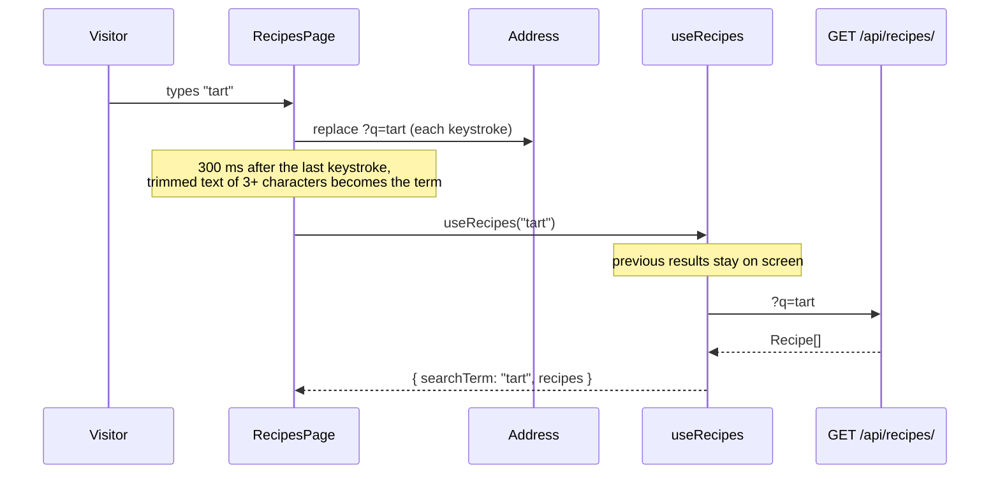

# Let visitors search recipes by title

Linear: TAS-15

## Summary

Visitors can browse `/recipes` (TAS-13) and open a recipe (TAS-14), but can't find one by name. This adds a search box above the list. Once the visitor has typed at least 3 characters and paused, the list shows only recipes whose title contains that text, ignoring case and accents. The term lives in the address (`/recipes?q=tart`), so a search survives a reload, can be shared and comes back when the visitor returns from a recipe. Matching happens in the API (`GET /api/recipes/?q=tart`), using Postgres's `unaccent` extension.

Evidence: feature — visitors see a new search box that narrows the list as they type, and a "No recipes match" message.

## Required reading

- `AGENTS.md`: hard constraints, the API contract steps and the Tests section.
- `specs/TAS-13.md` and `specs/TAS-14.md`: the list page and recipe page this extends; their decisions still hold.
- `backend/recipes/models.py`: `RecipeQuerySet` gains the title match, next to `alphabetical()`.
- `backend/recipes/views.py`: `RecipeDetailView`'s class-level `@extend_schema` is the pattern for documenting `q`.
- `backend/tests/test_recipes.py`: mirror its style (`APIClient`, `reverse`, `@pytest.mark.django_db`, `parametrize`).
- `frontend/src/api/recipes.ts`: `useRecipes` gains the search term.
- `frontend/src/pages/recipes-page.tsx`: gains the search box; mirror its one-component-per-state style.
- `frontend/src/pages/recipes-page.test.tsx`: `failRecipes` and `holdRecipes` are the helpers to reuse and extend.
- `frontend/src/test/render-route.tsx`: gains the router in its return value.
- `specs/lessons/tanstack-refetch-resets-error-state.md`: why `RecipeList` still branches on `data` first, then `isPending`, with `keepPreviousData` added.

## Product behaviour

1. Typing at least 3 characters of a title shows only the recipes that match.
2. A match is anywhere in the title, ignoring case and accents ("creme" finds "Crème brûlée").
3. Clearing the search box shows the full list again.
4. A search with no matches says `No recipes match “<term>”.`, not "No recipes yet.".
5. The address holds the search (`/recipes?q=tart`), so reload, sharing and Back from a recipe keep it.
6. While a new search loads, the previous results stay on screen.
7. A failed search shows the existing alert and "Try again", as the full list does.

## Technical design

**Today.** `RecipeListView` (`backend/recipes/views.py:9`) returns `Recipe.objects.alphabetical()` and ignores any query parameter. `useRecipes()` (`frontend/src/api/recipes.ts:5`) fetches `GET /api/recipes/` under the query key `['recipes']`. `RecipesPage` (`frontend/src/pages/recipes-page.tsx:60`) renders the heading, `RecipeList` and a back link. `RecipeList` (`recipes-page.tsx:47`) branches on `data`, then `isPending`, then shows `RecipesUnavailable`. `Recipes` (`recipes-page.tsx:34`) shows "No recipes yet." for an empty array.

**Approach, layer by layer.**

- **Settings.** `backend/config/settings.py` adds `'django.contrib.postgres'` to `INSTALLED_APPS`, after `'django.contrib.staticfiles'`. Its `ready()` registers the `unaccent` lookup on text fields.
- **Migration.** New `backend/recipes/migrations/0003_unaccent.py`, depending on `('recipes', '0002_recipe_slug')`, with one operation: `UnaccentExtension()` from `django.contrib.postgres.operations`. It runs `CREATE EXTENSION IF NOT EXISTS unaccent`, and its reverse drops it. There is no model change, so `makemigrations --check` must still report nothing.
- **Queryset.** `backend/recipes/models.py`, in `RecipeQuerySet` after `alphabetical()`:

  ```py
  def matching_title(self, text: str) -> RecipeQuerySet:
      term = text.strip()
      if term == '':
          return self
      # unaccent is bilateral, so the term loses its accents too: 'crème' and 'creme' both find 'Crème brûlée'.
      return self.filter(title__unaccent__icontains=term)
  ```

  This produces `UPPER(UNACCENT(title)) LIKE '%' || UPPER(UNACCENT(<escaped term>)) || '%'`. Django escapes `%`, `_` and `\` in the term, so they match literally. A `LIKE '%…%'` can't use an index; at today's volumes that's fine (see Out of scope).
- **View.** `backend/recipes/views.py`. `RecipeListView` drops its `queryset` attribute and gains a class-level schema decorator and `get_queryset`:

  ```py
  @extend_schema(
      parameters=[
          OpenApiParameter(
              name='q',
              type=str,
              location=OpenApiParameter.QUERY,
              required=False,
              description='Only recipes whose title contains this text, ignoring case and accents.',
          )
      ]
  )
  class RecipeListView(ListAPIView):
      authentication_classes = []
      permission_classes = []
      serializer_class = RecipeSerializer

      def get_queryset(self) -> RecipeQuerySet:
          return Recipe.objects.matching_title(self.request.query_params.get('q', '')).alphabetical()
  ```

  Import `OpenApiParameter` alongside the existing `drf_spectacular.utils` imports, and `RecipeQuerySet` from `recipes.models`. The view only orchestrates; the matching rule is the queryset's.
- **API contract.**

  ```diff
    GET /api/recipes/  (no auth)
  + query: q?: string  (title contains, ignoring case and accents; blank or missing means every recipe)
    200 application/json: Recipe[]  (alphabetical, as before)
  ```

  Regenerate `backend/schema.yml` and `frontend/src/api/schema.d.ts` with the commands in `AGENTS.md`. In `schema.d.ts`, `operations["recipes_list"].parameters.query` becomes `{ q?: string }`. Nothing else in either file changes.
- **Hook.** `frontend/src/api/recipes.ts`. `useRecipes` takes the search term, keeps the previous results on screen while a new term loads, and returns the term with its results:

  ```ts
  import { keepPreviousData, useQuery } from '@tanstack/react-query';

  export const useRecipes = (searchTerm: string) =>
    useQuery({
      queryKey: ['recipes', { q: searchTerm }],
      queryFn: async () => {
        const { data, error } = await api.GET('/api/recipes/', {
          params: { query: searchTerm === '' ? {} : { q: searchTerm } }
        });
        if (error || !data) {
          throw new Error('Recipes request failed');
        }
        // The term travels with its results, so previous results shown while loading keep their own empty message.
        return { searchTerm, recipes: data };
      },
      placeholderData: keepPreviousData
    });
  ```

  The full list still requests `/api/recipes/` with no `q`. The key `['recipes', { q }]` can't clash with `useRecipe`'s `['recipes', slug]`, because a slug is a string and this is an object.
- **Page.** `frontend/src/pages/recipes-page.tsx`. New pieces, all local to the file:

  ```tsx
  const SEARCH_DELAY_MS = 300;
  const MIN_SEARCH_LENGTH = 3;

  // Shorter terms would match most of the list, so they search nothing and show it all.
  const toSearchTerm = (text: string) => {
    const term = text.trim();
    return term.length >= MIN_SEARCH_LENGTH ? term : '';
  };

  // Syncs with a timer, not with React state: the value settles once typing pauses.
  const useDebouncedValue = (value: string, delayMs: number) => {
    const [settled, setSettled] = useState(value);
    useEffect(() => {
      const timer = setTimeout(() => setSettled(value), delayMs);
      return () => clearTimeout(timer);
    }, [value, delayMs]);
    return settled;
  };

  type RecipeSearchProps = {
    value: string;
    onChange: (event: ChangeEvent<HTMLInputElement>) => void;
  };

  const RecipeSearch = ({ value, onChange }: RecipeSearchProps) => (
    // Results follow the typing, so Enter has nothing to submit.
    <form role="search" onSubmit={(event) => event.preventDefault()}>
      <label>
        Search recipes <input type="search" value={value} onChange={onChange} />
      </label>
    </form>
  );

  type NoRecipesProps = { searchTerm: string };

  const NoRecipes = ({ searchTerm }: NoRecipesProps) => {
    if (searchTerm === '') {
      return <p>No recipes yet.</p>;
    }
    return <p>{`No recipes match “${searchTerm}”.`}</p>;
  };

  export const RecipesPage = () => {
    const [searchParams, setSearchParams] = useSearchParams();
    // The box owns the text while the page is open; the address keeps a copy for reloads, sharing and Back.
    const [searchText, setSearchText] = useState(() => searchParams.get('q') ?? '');
    const searchTerm = toSearchTerm(useDebouncedValue(searchText, SEARCH_DELAY_MS));

    const handleSearchChange = useCallback(
      (event: ChangeEvent<HTMLInputElement>) => {
        const text = event.target.value;
        setSearchText(text);
        setSearchParams(text === '' ? {} : { q: text }, { replace: true });
      },
      [setSearchParams]
    );

    return (
      <main>
        <title>Recipes · Tastebook</title>
        <h1>Recipes</h1>
        <RecipeSearch value={searchText} onChange={handleSearchChange} />
        <RecipeList searchTerm={searchTerm} />
        <Link to="/">Back to Tastebook</Link>
      </main>
    );
  };
  ```

  Changes to existing pieces:
  - `RecipeList` takes `{ searchTerm }: RecipeListProps` (`type RecipeListProps = { searchTerm: string }`), calls `useRecipes(searchTerm)`, and renders `<Recipes recipes={data.recipes} searchTerm={data.searchTerm} />`. Its branching order (data, then `isPending`, then `RecipesUnavailable`) and comments stay.
  - `Recipes` takes `searchTerm` too (`type RecipesProps = { recipes: Recipe[]; searchTerm: string }`) and returns `<NoRecipes searchTerm={searchTerm} />` for an empty array instead of the inline "No recipes yet.".
  - Imports: `ChangeEvent` as a type from `react`, plus `useCallback`, `useEffect` and `useState`; `useSearchParams` from `react-router`.
  - `RecipeItem`, `RecipesUnavailable`, the heading, tab title and back link are unchanged.

- **Test helper.** `frontend/src/test/render-route.tsx` returns `{ ...render(…), router }`, so tests can read `router.state.location` and call `router.navigate(-1)`. Existing callers ignore the return value.



**Blast radius.**

- `RecipeListView` now builds its queryset per request. The ordering test and the fields test in `backend/tests/test_recipes.py` (lines 10 and 33) call it with no `q` and must pass unchanged.
- `INSTALLED_APPS` gains `django.contrib.postgres`. It adds no models or URLs. Re-run the full `pytest` suite and the admin tests.
- Every database now needs the `unaccent` extension, which the migration creates. CI's and `compose.yaml`'s `tastebook` role is the Postgres superuser, so `migrate` and `pytest-django`'s test database can create it. Production is an assumption (see below).
- `useRecipes` takes an argument and returns `{ searchTerm, recipes }` instead of `Recipe[]`. Its only caller is `RecipeList` (`recipes-page.tsx:48`). Its query key changes from `['recipes']` to `['recipes', { q }]`; nothing invalidates or reads `['recipes']` by key.
- `renderRoute` returns more; its callers in `home-page.test.tsx`, `not-found-page.test.tsx`, `recipe-page.test.tsx` and `recipes-page.test.tsx` only call it.
- `holdRecipes` in `recipes-page.test.tsx` returns `{ requested, release }` instead of a function, so its three existing callers (lines 37, 84 and 105 today) destructure `release`.
- The default MSW list handler (`frontend/src/test/handlers.ts:15`) ignores `q` and stays as it is; search tests install their own.
- `backend/schema.yml` and `frontend/src/api/schema.d.ts` are regenerated; only the list operation's query parameter changes.

**Not changing:** `RecipeSerializer`, the detail endpoint and `RecipePage`, `NotFoundPage`, the home page, `frontend/src/app/query-client.ts` (staleTime 30 s and retry 1 still apply), `frontend/src/test/handlers.ts`, and the list's order, item layout, loading copy and error copy.

### Steps

1. **Match titles in the API.** `backend/config/settings.py` (edit), `backend/recipes/migrations/0003_unaccent.py` (new), `backend/recipes/models.py` (edit), `backend/recipes/views.py` (edit), `backend/tests/test_recipes.py` (edit: the search test below).
   Done when: `uv run pytest` passes, `uv run ruff check . && uv run ruff format --check .` is clean, and `uv run python manage.py makemigrations --check --dry-run` reports no changes (all in `backend/`).
2. **Regenerate the contract.** `backend/schema.yml`, `frontend/src/api/schema.d.ts` (regenerated, never hand-edited).
   Done when: `uv run --env-file .env python manage.py spectacular --validate --fail-on-warn --file schema.yml` passes and `schema.d.ts` types `recipes_list`'s query as `{ q?: string }`.
3. **Search from the list page.** `frontend/src/api/recipes.ts`, `frontend/src/pages/recipes-page.tsx`, `frontend/src/test/render-route.tsx`, `frontend/src/pages/recipes-page.test.tsx` (edit).
   Done when: `pnpm test` passes and `pnpm lint` is clean.
4. **Check search against the real API.** `frontend/e2e/recipes.spec.ts` (edit: one new test).
   Done when: `pnpm test:e2e` passes.

### Tests

- `backend/tests/test_recipes.py`, one new parametrised test (`@pytest.mark.django_db`):
  - Searches titles anywhere, ignoring case, accents and surrounding spaces. Create `'Tarte Tatin'`, `'Crème brûlée'`, `'Banana bread'` and `'Apple tart'`, then `APIClient().get(reverse('recipe-list'), {'q': q})` with no login, parametrised over `(q, titles)`:
    - `('tart', ['Apple tart', 'Tarte Tatin'])`
    - `('TART', ['Apple tart', 'Tarte Tatin'])`
    - `('creme', ['Crème brûlée'])`
    - `('CRÈME', ['Crème brûlée'])`
    - `('brulee', ['Crème brûlée'])`
    - `('  bread  ', ['Banana bread'])`
    - `('pie', [])`
    - `('%', [])`
    - `('_', [])`
    - `('', ['Apple tart', 'Banana bread', 'Crème brûlée', 'Tarte Tatin'])`

    asserts: status 200 and `[recipe['title'] for recipe in response.json()] == titles`.
  - The existing tests stay as they are and must still pass.
- `frontend/src/pages/recipes-page.test.tsx`. Add fixtures `appleTart` (`{ id: 1, slug: 'apple-tart', title: 'Apple tart', description: 'Sharp apples on buttery pastry.' }`) and `bananaBread` (`{ id: 2, slug: 'banana-bread', title: 'Banana bread', description: '' }`). Add a helper:

  ```ts
  // Answers each list request from `results` by its q ('' for none) and records the q each request sent.
  const answerSearches = (results: Record<string, Recipe[]>) => {
    const searches: (string | null)[] = [];
    server.use(
      http.get('/api/recipes/', ({ request }) => {
        const q = new URL(request.url).searchParams.get('q');
        searches.push(q);
        return HttpResponse.json<Recipe[]>(results[q ?? ''] ?? []);
      })
    );
    return searches;
  };
  ```

  Change `holdRecipes` to return `{ requested, release }`, where `requested` is a `Promise<void>` that resolves when the held request arrives; update its existing callers to `const { release } = holdRecipes(…)`. `headings()` below means `screen.getAllByRole('heading', { level: 2 }).map((heading) => heading.textContent)`; the search box is `screen.getByRole('searchbox', { name: 'Search recipes' })`.
  - Searches once typing pauses: `answerSearches({ '': [appleTart, bananaBread], tart: [appleTart] })`, `renderRoute('/recipes')`, wait for "Banana bread", type `tart` into the search box, asserts: `headings()` becomes `['Apple tart']`, `router.state.location.search` is `'?q=tart'`, and `searches` equals `[null, 'tart']` (one request for four keystrokes).
  - Searches nothing under 3 characters: `answerSearches({ '': [appleTart, bananaBread], tar: [appleTart] })`, `renderRoute('/recipes?q=ta')`, asserts: the search box has value `'ta'`, `headings()` is `['Apple tart', 'Banana bread']` and `searches` is `[null]`; then type `r`, asserts: `headings()` becomes `['Apple tart']` and `searches` is `[null, 'tar']`.
  - Opens a search from the address, `it.each` over `('/recipes?q=tart', 'tart')` and `('/recipes?q=%20tart%20', ' tart ')`: `answerSearches({ tart: [appleTart] })`, render the path, asserts: the search box has the expected value, `headings()` becomes `['Apple tart']` and `searches` is `['tart']`.
  - Shows the full list again when the search is cleared: `answerSearches({ tart: [appleTart], '': [appleTart, bananaBread] })`, `renderRoute('/recipes?q=tart')`, wait for `headings()` to be `['Apple tart']`, `userEvent.clear` the search box, asserts: `headings()` becomes `['Apple tart', 'Banana bread']`, `router.state.location.search` is `''` and `searches` is `['tart', null]`.
  - Replace "says so when there are no recipes" with `it.each` over `('/recipes', 'No recipes yet.', 'No recipes match “xyzzy”.')` and `('/recipes?q=xyzzy', 'No recipes match “xyzzy”.', 'No recipes yet.')`: `server.use` a list handler returning `[]`, render the path, asserts: the expected text shows, the other text is absent and there is no `list`.
  - Keeps the previous results while a search loads: `renderRoute('/recipes')` with the default handlers, wait for "Banana bread", `const search = holdRecipes(() => HttpResponse.json<Recipe[]>([appleTart]))`, type `tart`, `await search.requested`, asserts: `headings()` is `['Apple tart', 'Banana bread']` and "Loading recipes…" is absent; after `search.release()`, `headings()` becomes `['Apple tart']`.
  - Replace "shows an alert and a retry when the request fails" with `it.each` over `'/recipes'` and `'/recipes?q=tart'`: `failRecipes()`, render the path, asserts: the `alert` reads "The recipes couldn't be loaded.", "Try again" is present and "No recipes yet." is absent.
  - Comes back to the search from a recipe: `answerSearches({ tart: [appleTart] })`, `renderRoute('/recipes?q=tart')`, click the link "Apple tart", wait for the level-1 heading "Apple tart", then `await act(async () => { await router.navigate(-1); })`, asserts: the search box has value `'tart'` and `headings()` is `['Apple tart']`.
  - The other existing tests stay and must pass, with `holdRecipes` destructured.
- `frontend/e2e/recipes.spec.ts`, one new test:
  - A search with no matches says so through the real API: `page.goto('/recipes')`, fill the search box "Search recipes" with `xyzzy`, asserts: the page URL ends `/recipes?q=xyzzy`, the text `No recipes match “xyzzy”.` is visible and `page.getByRole('alert')` has count 0. This proves the real endpoint accepts `q` and the `unaccent` extension exists; an error would show the alert. CI's database is empty, so matches are in the recorded evidence.
- Checks: `pnpm lint`, `pnpm test`, `pnpm test:e2e` from the root; `uv run ruff check . && uv run ruff format --check .`, `uv run python manage.py makemigrations --check --dry-run` and `uv run pytest` in `backend/`; the contract regenerates with no diff.

## Decisions

- The search box sits above the list on `/recipes` and searches as the visitor types, after a pause, once there are at least 3 characters. Asked: where the search lives and when it searches → "A debounced search whilst typing is fine, maybe 3 character limit also."
- A match is anywhere in the title, ignoring case. Asked: how a term matches → anywhere in the title, ignoring case.
- Accents are ignored on both sides, using Postgres's `unaccent` extension (a migration and `django.contrib.postgres` in `INSTALLED_APPS`). Asked: should "creme" find "Crème brûlée" → ignore accents. Django's `unaccent` transform is bilateral, so `title__unaccent__icontains` strips accents from the term too and "crème" works as well as "creme"; no hand-written SQL is needed.
- The term lives in the address as `/recipes?q=<term>`. Asked: should the term live in the address → yes, `/recipes?q=<term>`.
- Matching happens in the API, `GET /api/recipes/?q=<term>`, in `RecipeQuerySet.matching_title()`, per `AGENTS.md`. Asked: where matching happens → in the API, with a `q` parameter.
- No matches shows `No recipes match “<term>”.`, and previous results stay on screen while a new search loads (`keepPreviousData`). Asked: no-match copy and loading behaviour → "No recipes match “tart”."; keep previous results while loading.
- The pause is 300 ms, long enough to skip the requests between keystrokes and short enough to feel immediate.
- The 3-character minimum is counted on the trimmed text and lives in the page, not the API. It exists to save requests and keep one or two letters from matching most of the list; the API answers any term, so another client isn't bound by a UI choice.
- The address is updated with `replace` on every keystroke, so typing adds no history entries and Back leaves the page rather than stepping back through letters. Back from a recipe returns to `/recipes?q=tart` with the search in place.
- The search box keeps its own text in state, initialised from the address once. Driving the box straight from `useSearchParams` would update the input through a router navigation, which can lag a keystroke and move the caret. With `replace` there are no in-page history entries, so the address can't change under the open page; a reload or Back from another page mounts it again from the address.
- The debounce is a small `useEffect` timer, which `AGENTS.md` allows because it syncs with a timer rather than deriving state. Debouncing in the change handler would leave a timer that can fire after the page has gone, with nothing to clear it.
- `useRecipes` returns `{ searchTerm, recipes }`, so the results on screen always carry the term they answered. With `keepPreviousData`, the hook's data can belong to the previous term while the next one loads, and the empty message must name the term that produced it.
- `RecipeList` keeps branching on `data`, then `isPending` (see the lesson). After a failed search the query has no data of its own, so the alert shows; pressing "Try again" shows the previous search's results while it retries, if there were any, and "Loading recipes…" otherwise.
- The search box is a `form` with `role="search"` and a visible label "Search recipes" around an `input type="search"`, so it is a landmark and a named `searchbox`, and browsers that offer a clear button on search inputs clear it in one click.

## Assumptions

- The pause is 300 ms. Confirm with: Milo Bedini at spec approval.
- Under 3 characters (after trimming) the page shows the full list and no hint, and still writes the text to the address. Confirm with: Milo Bedini at spec approval.
- The production database's role can run `CREATE EXTENSION unaccent` (it's a trusted extension since Postgres 13, so a role with `CREATE` on the database can). If it can't, someone with that right runs it once before deploying. Confirm with: Milo Bedini before the first deploy.
- Matching uses Postgres's own `unaccent` rules, so ligatures fold too ("oeuf" finds "Œufs"), and non-Latin scripts match as typed. Confirm with: Milo Bedini at spec approval.
- Enter in the search box does nothing extra; results already follow the typing. Confirm with: Milo Bedini at spec approval.

## Out of scope

- Searching descriptions, ingredients or anything but the title.
- Paging the list, ranking results or highlighting the matched text.
- A trigram index for `LIKE '%…%'`: worth it once the list is large, not with a handful of recipes added by hand.
- A hint for terms under 3 characters, a search button, or search anywhere but `/recipes`.
- Changing the default MSW list handler to understand `q`.
- Sharing `RecipesUnavailable` or the test helpers across pages (the TAS-13 follow-up).
- Any change to the recipe page, `NotFoundPage`, the home page, the health endpoint or `frontend/src/app/query-client.ts`.

## Validation criteria

- [ ] `pnpm lint`, `pnpm test` and `pnpm test:e2e` pass.
- [ ] In `backend/`: `uv run ruff check . && uv run ruff format --check .`, `uv run python manage.py makemigrations --check --dry-run` and `uv run pytest` pass.
- [ ] CI's **API contract** job passes with the regenerated `backend/schema.yml` and `frontend/src/api/schema.d.ts`.
- [ ] Recorded check: add "Apple tart", "Tarte Tatin", "Crème brûlée" and "Banana bread" in the admin; on `/recipes`, typing `ta` keeps all four; typing `tart` leaves "Apple tart" and "Tarte Tatin" and the address reads `/recipes?q=tart`; replacing it with `creme` leaves "Crème brûlée"; `xyzzy` shows `No recipes match “xyzzy”.`; clearing the box brings back all four; opening "Apple tart" from a `tart` search and pressing Back returns to the search.
- Evidence: feature — a video of typing a search, an accent-insensitive match, the no-match message, clearing the search, and Back from a recipe to the search.
