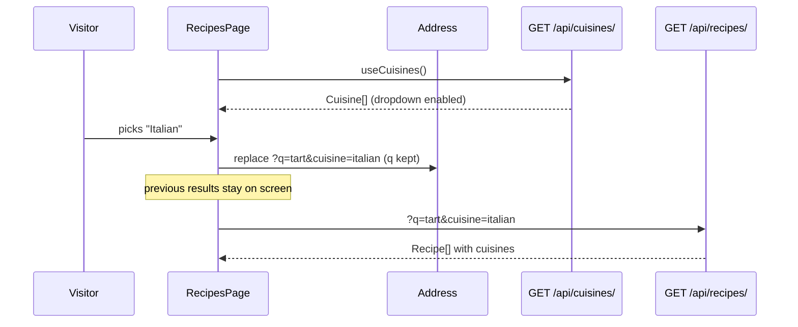

# Let visitors filter recipes by cuisine

Linear: TAS-17

## Summary

Recipes have no cuisine today, so visitors can't narrow the list by one. This adds a `Cuisine` model, seeded with ten cuisines and managed by staff in the Django admin, and lets a recipe have several of them; the admin requires at least one. A public `GET /api/cuisines/` lists them, recipes carry their cuisines in the API, and the list endpoint gains a `cuisine` filter. On `/recipes`, a "Cuisine" dropdown beside the search box narrows the list, combines with the title search and lives in the address (`/recipes?cuisine=italian`). Each recipe shows its cuisines in the list and on its own page.

Evidence: feature — visitors see a new cuisine dropdown, a narrowed list, cuisine-specific empty messages and each recipe's cuisines.

## Required reading

- `AGENTS.md`: hard constraints, the API contract steps and the Tests section.
- `specs/TAS-15.md`: the search this extends; its decisions on the address (`replace`, the box owning its text) and on `keepPreviousData` still hold.
- `backend/recipes/models.py`: `RecipeQuerySet.matching_title()` is the pattern for the new `with_cuisine()`.
- `backend/recipes/migrations/0002_recipe_slug.py`: the pattern for a `RunPython` data step with a typed function.
- `backend/recipes/views.py`: `RecipeListView`'s `@extend_schema` with `OpenApiParameter` is the pattern for documenting `cuisine`.
- `backend/tests/test_recipes.py`: mirror its style (`APIClient`, `reverse`, `admin_client`, `parametrize`).
- `frontend/src/api/recipes.ts` and `frontend/src/api/health.ts`: the hook shape `useCuisines` mirrors.
- `frontend/src/pages/recipes-page.tsx`: one component per state; `RecipeList` is the pattern for the picker's pending and error branches.
- `frontend/src/pages/recipes-page.test.tsx`: `holdRecipes`, `failRecipes`, `answerSearches` and `recipeCount` are the helpers to mirror.
- `specs/lessons/blank-model-fields-are-optional-in-the-schema.md`: check that `cuisines` comes out required in `schema.d.ts`.
- `specs/lessons/biome-wants-native-landmark-elements.md`: the filters stay inside the native `<search>` element.
- `specs/lessons/tanstack-refetch-resets-error-state.md`: why the picker branches on `data` first, then `isPending`.

## Product behaviour

1. A recipe can have several cuisines, chosen from a list staff manage in the admin.
2. The admin refuses to save a recipe with no cuisine.
3. The list page offers a "Cuisine" dropdown with "All cuisines" and every cuisine.
4. Picking a cuisine shows only recipes with that cuisine, and the count follows.
5. The cuisine filter combines with the title search.
6. The address holds the cuisine (`/recipes?cuisine=italian`), so reload, sharing and Back keep it.
7. No matches says `No Italian recipes yet.`, or `No Italian recipes match “tart”.` with a search.
8. Each recipe shows its cuisines in the list and on its page, as `Cuisines: Japanese, Mexican`.
9. While the cuisines load the dropdown is disabled; if they fail, an alert offers a retry.

## Technical design

**Today.** `Recipe` (`backend/recipes/models.py:27`) has `title`, `description` and `slug`. `RecipeListView.get_queryset` (`backend/recipes/views.py:24`) applies `matching_title(q)` then `alphabetical()`. `RecipeSerializer` (`backend/recipes/serializers.py:6`) sends `id`, `slug`, `title`, `description`. `useRecipes(searchTerm)` (`frontend/src/api/recipes.ts:5`) keys on `['recipes', { q }]` and returns `{ searchTerm, recipes }`. `RecipesPage` (`frontend/src/pages/recipes-page.tsx:104`) keeps the search text in state, copies it to `?q=` with `replace`, and renders `RecipeSearch` (a `<search>` landmark), then `RecipeList`. `NoRecipes` (`recipes-page.tsx:60`) names the search term. `RecipeDetails` (`frontend/src/pages/recipe-page.tsx:10`) shows the title and description.

**Approach, layer by layer.**

- **Model.** `backend/recipes/models.py`. A new `Cuisine` model above `RecipeQuerySet`, and a many-to-many field on `Recipe`:

  ```py
  class Cuisine(models.Model):
      name = models.CharField(max_length=50, unique=True)
      slug = models.SlugField(max_length=50, unique=True)

      class Meta:
          # Every list of cuisines (the endpoint, a recipe's own) reads alphabetically.
          ordering = ['name']

      def __str__(self) -> str:
          return self.name


  class Recipe(models.Model):
      ...
      cuisines = models.ManyToManyField(Cuisine, related_name='recipes')
  ```

  `cuisines` has no `blank=True`, so the admin's form field is required. The database can't enforce "at least one" on a many-to-many, and the API is read-only, so the admin form is the one place that writes it.

- **Queryset.** `RecipeQuerySet`, after `matching_title()`:

  ```py
  def with_cuisine(self, slug: str) -> RecipeQuerySet:
      # An unknown slug (a removed cuisine, a mistyped link) filters nothing, like a blank one.
      if slug == '' or not Cuisine.objects.filter(slug=slug).exists():
          return self
      return self.filter(cuisines__slug=slug)
  ```

  The slug is unique, so the join matches at most one row per recipe and needs no `distinct()`.

- **Migration.** New `backend/recipes/migrations/0004_cuisine.py`, depending on `('recipes', '0003_unaccent')`. Generate the schema part with `makemigrations recipes --name cuisine`, then add a `RunPython(add_cuisines, migrations.RunPython.noop)` as the last operation. `add_cuisines(apps: Apps, schema_editor: BaseDatabaseSchemaEditor) -> None` gets the historical model with `apps.get_model('recipes', 'Cuisine')` and `bulk_create`s these ten `(name, slug)` pairs: British `british`, Chinese `chinese`, French `french`, Greek `greek`, Indian `indian`, Italian `italian`, Japanese `japanese`, Mexican `mexican`, Spanish `spanish`, Thai `thai`. Existing recipes get no cuisine (see Assumptions). The reverse is a no-op because reversing `CreateModel` drops the table.

- **Admin.** `backend/recipes/admin.py`. Register `Cuisine` with `list_display = ('name', 'slug')` and `prepopulated_fields = {'slug': ('name',)}`. `RecipeAdmin` gains `filter_horizontal = ('cuisines',)`; its other options stay.

- **Serializers.** `backend/recipes/serializers.py`:

  ```py
  class CuisineSerializer(serializers.ModelSerializer):
      class Meta:
          model = Cuisine
          fields = ['slug', 'name']


  class RecipeSerializer(serializers.ModelSerializer):
      cuisines = CuisineSerializer(many=True, read_only=True)

      class Meta:
          model = Recipe
          fields = ['id', 'slug', 'title', 'description', 'cuisines']
          ...  # extra_kwargs and its comment unchanged
  ```

- **Views.** `backend/recipes/views.py`.
  - `RecipeListView`'s `@extend_schema` gains a second `OpenApiParameter`: `name='cuisine'`, `type=str`, `location=OpenApiParameter.QUERY`, `required=False`, `description='Only recipes with the cuisine that has this slug. A blank or unknown slug means every cuisine.'`.
  - `get_queryset` becomes, reading both parameters into locals first:

    ```py
    def get_queryset(self) -> RecipeQuerySet:
        params = self.request.query_params
        return (
            Recipe.objects.matching_title(params.get('q', ''))
            .with_cuisine(params.get('cuisine', ''))
            .prefetch_related('cuisines')
            .alphabetical()
        )
    ```

  - `RecipeDetailView.queryset` becomes `Recipe.objects.prefetch_related('cuisines')`.
  - New `CuisineListView(ListAPIView)` with `authentication_classes = []`, `permission_classes = []`, `serializer_class = CuisineSerializer`, `queryset = Cuisine.objects.all()`. No pagination, as for recipes.

- **URLs.** `backend/config/urls.py` gains `path('api/cuisines/', CuisineListView.as_view(), name='cuisine-list')` after the recipes line, importing `CuisineListView` from `recipes.views`. It isn't under `api/recipes/` because `api/recipes/<slug>/` would claim a recipe titled "Cuisines".

- **API contract.**

  ```diff
    GET /api/recipes/  (no auth)
      query: q?: string
  +   query: cuisine?: string  (a cuisine's slug; blank or unknown means every cuisine)
      200: Recipe[]
  + GET /api/cuisines/  (no auth)
  +   200: Cuisine[]  (alphabetical by name)

    Recipe {
      id: number; slug: string; title: string; description: string
  +   cuisines: Cuisine[]  (alphabetical by name; [] for a recipe added before this change)
    }
  + Cuisine { slug: string; name: string }
  ```

  Regenerate `backend/schema.yml` and `frontend/src/api/schema.d.ts` with the commands in `AGENTS.md`. `cuisines` is read-only, and drf-spectacular lists read-only fields as required, so `schema.d.ts` must type it `cuisines: components["schemas"]["Cuisine"][]` with no `?`. If it comes out optional, apply the lesson above.

- **Cuisines hook.** New `frontend/src/api/cuisines.ts`, mirroring `useHealth` without the polling:

  ```ts
  export const useCuisines = () =>
    useQuery({
      queryKey: ['cuisines'],
      queryFn: async () => {
        const { data, error } = await api.GET('/api/cuisines/');
        if (error || !data) {
          throw new Error('Cuisines request failed');
        }
        return data;
      }
    });
  ```

- **Recipes hook.** `frontend/src/api/recipes.ts`. The search term and the cuisine travel together, so they become one type:

  ```ts
  export type RecipeFilters = { searchTerm: string; cuisine: string };

  const toQuery = ({ searchTerm, cuisine }: RecipeFilters) => ({
    ...(searchTerm === '' ? {} : { q: searchTerm }),
    ...(cuisine === '' ? {} : { cuisine })
  });

  export const useRecipes = (filters: RecipeFilters) =>
    useQuery({
      queryKey: ['recipes', { q: filters.searchTerm, cuisine: filters.cuisine }],
      queryFn: async () => {
        const { data, error } = await api.GET('/api/recipes/', { params: { query: toQuery(filters) } });
        if (error || !data) {
          throw new Error('Recipes request failed');
        }
        // The filters travel with their results, so previous results shown while loading keep their own empty message.
        return { filters, recipes: data };
      },
      placeholderData: keepPreviousData
    });
  ```

  `useRecipe` is unchanged.

- **Shared cuisine line.** New `frontend/src/components/recipe-cuisines.tsx`, used by both pages:

  ```tsx
  type RecipeCuisinesProps = { cuisines: Cuisine[] };

  export const RecipeCuisines = ({ cuisines }: RecipeCuisinesProps) => {
    if (cuisines.length === 0) {
      return null;
    }
    const label = cuisines.length === 1 ? 'Cuisine' : 'Cuisines';
    return <p>{`${label}: ${cuisines.map(({ name }) => name).join(', ')}`}</p>;
  };
  ```

  `Cuisine` is `components['schemas']['Cuisine']`. The names keep the API's order. `AGENTS.md`'s Layout gains one line after `src/app/`: `src/components/   UI pieces shared by more than one page`.

- **List page.** `frontend/src/pages/recipes-page.tsx`.
  - Address helper, local to the file:

    ```ts
    // Each control writes its own parameter and keeps the others, so the search and the cuisine combine.
    const withParam = (params: URLSearchParams, name: string, value: string) => {
      const next = new URLSearchParams(params);
      if (value === '') {
        next.delete(name);
      } else {
        next.set(name, value);
      }
      return next;
    };
    ```

  - `handleSearchChange` calls `setSearchParams((params) => withParam(params, 'q', text), { replace: true })` instead of replacing every parameter.
  - `RecipesPage` reads `const cuisine = searchParams.get('cuisine') ?? '';` during render (the dropdown changes the address at once, so it needs no state of its own) and adds `handleCuisineChange`, a `useCallback` taking `ChangeEvent<HTMLSelectElement>` that calls `setSearchParams((params) => withParam(params, 'cuisine', event.target.value), { replace: true })`.
  - `RecipeSearch` returns only its `<label>`; `RecipesPage` renders the `<search>` element around `<RecipeSearch …/>` and `<CuisinePicker value={cuisine} onChange={handleCuisineChange} />`. It then renders `<RecipeList filters={{ searchTerm, cuisine }} />`.
  - New components, one per state:

    ```tsx
    type CuisinePickerProps = { value: string; onChange: (event: ChangeEvent<HTMLSelectElement>) => void };

    const CuisinePicker = ({ value, onChange }: CuisinePickerProps) => {
      const { data: cuisines, isPending, refetch } = useCuisines();
      if (cuisines !== undefined) {
        return <CuisineSelect cuisines={cuisines} value={value} onChange={onChange} />;
      }
      if (isPending) {
        return <CuisinesLoading />;
      }
      return <CuisinesUnavailable onRetry={() => void refetch()} />;
    };
    ```

    - `CuisineSelect`: `<label>Cuisine <select value={known ? value : ''} onChange={onChange}>`, first `<option value="">All cuisines</option>`, then one `<option value={slug}>{name}</option>` per cuisine. `known` is `cuisines.some(({ slug }) => slug === value)`. A select can't show a value it has no option for, and the API ignores an unknown slug, so the dropdown shows "All cuisines" in agreement with the list.
    - `CuisinesLoading`: `<label>Cuisine <select disabled><option>Loading cuisines…</option></select></label>`.
    - `CuisinesUnavailable`: `<p role="alert">The cuisines couldn't be loaded.</p>` and `<button type="button" onClick={onRetry}>Load cuisines again</button>`. The button isn't "Try again", so it never shares a name with the recipes' retry.
  - `RecipeList` takes `{ filters }: { filters: RecipeFilters }` and calls `useRecipes(filters)`. It also calls `useCuisines()` (TanStack shares the one request with the picker) and passes `cuisineName={cuisines?.find(({ slug }) => slug === data.filters.cuisine)?.name}` and `searchTerm={data.filters.searchTerm}` to `Recipes`, which passes both to `NoRecipes`. Its branching order and comments stay.
  - `NoRecipes`:

    ```tsx
    type NoRecipesProps = { searchTerm: string; cuisineName: string | undefined };

    const NoRecipes = ({ searchTerm, cuisineName }: NoRecipesProps) => {
      const subject = cuisineName === undefined ? 'recipes' : `${cuisineName} recipes`;
      if (searchTerm === '') {
        return <p>{`No ${subject} yet.`}</p>;
      }
      return <p>{`No ${subject} match “${searchTerm}”.`}</p>;
    };
    ```

  - `RecipeItem` renders `<RecipeCuisines cuisines={recipe.cuisines} />` between the `<h2>` and the description.
  - Imports: `useCuisines` from `../api/cuisines`, `type RecipeFilters` from `../api/recipes`, `RecipeCuisines` from `../components/recipe-cuisines`.

- **Recipe page.** `frontend/src/pages/recipe-page.tsx`. `RecipeDetails` renders `<RecipeCuisines cuisines={recipe.cuisines} />` between the `<h1>` and the description. Nothing else changes.

- **Test handlers.** `frontend/src/test/handlers.ts`. Add `type Cuisine`, a `cuisines: Cuisine[]` of `{ slug: 'french', name: 'French' }`, `{ slug: 'italian', name: 'Italian' }`, `{ slug: 'japanese', name: 'Japanese' }`, and `http.get('/api/cuisines/', () => HttpResponse.json<Cuisine[]>(cuisines))`. "Apple tart" gets `cuisines: [{ slug: 'french', name: 'French' }]`; "Banana bread" gets `cuisines: []`, so the existing "no description line" test still holds.



### Steps

1. **Add cuisines to the model, admin and API.** `backend/recipes/models.py`, `backend/recipes/migrations/0004_cuisine.py` (new), `backend/recipes/admin.py`, `backend/recipes/serializers.py`, `backend/recipes/views.py`, `backend/config/urls.py`, `backend/tests/test_recipes.py` (edit).
   Done when: `uv run pytest` passes, `uv run ruff check . && uv run ruff format --check .` is clean, and `uv run python manage.py makemigrations --check --dry-run` reports no changes (all in `backend/`).
2. **Regenerate the contract.** `backend/schema.yml`, `frontend/src/api/schema.d.ts` (regenerated). Commit with step 1, as `AGENTS.md` requires.
   Done when: `spectacular --validate --fail-on-warn` passes and `schema.d.ts` has `cuisines: components["schemas"]["Cuisine"][]` on `Recipe` and `cuisine?: string` on `recipes_list`'s query.
3. **Show each recipe's cuisines.** `frontend/src/components/recipe-cuisines.tsx` (new), `frontend/src/pages/recipe-page.tsx`, `frontend/src/pages/recipes-page.tsx` (the `RecipeItem` line only), `frontend/src/test/handlers.ts`, `frontend/src/pages/recipe-page.test.tsx`, `frontend/src/pages/recipes-page.test.tsx` (add `cuisines` to every fixture, plus the display tests), `AGENTS.md` (the Layout line).
   Done when: `pnpm test` passes and `pnpm lint` is clean.
4. **Filter the list by cuisine.** `frontend/src/api/cuisines.ts` (new), `frontend/src/api/recipes.ts`, `frontend/src/pages/recipes-page.tsx`, `frontend/src/pages/recipes-page.test.tsx`.
   Done when: `pnpm test` passes and `pnpm lint` is clean.
5. **Check the filter against the real API.** `frontend/e2e/recipes.spec.ts` (one new test).
   Done when: `pnpm test:e2e` passes.

### Tests

- `backend/tests/test_recipes.py`. Tests read seeded cuisines with `Cuisine.objects.get(slug=…)`; the test database runs the migration, so all ten exist.
  - Lists the seeded cuisines alphabetically: `APIClient().get(reverse('cuisine-list'))`, asserts: status 200, `[c['name'] for c in response.json()] == ['British', 'Chinese', 'French', 'Greek', 'Indian', 'Italian', 'Japanese', 'Mexican', 'Spanish', 'Thai']` and `response.json()[0] == {'slug': 'british', 'name': 'British'}`.
  - A staff user adds a cuisine in the admin: `admin_client.post(reverse('admin:recipes_cuisine_add'), {'name': 'Korean', 'slug': 'korean'})`, asserts: status 302 and the cuisine list's names have `'Korean'` between `'Japanese'` and `'Mexican'`.
  - Returns each recipe's cuisines alphabetically: a recipe with Mexican then Japanese added, asserts: the list's `response.json()[0]['cuisines'] == [{'slug': 'japanese', 'name': 'Japanese'}, {'slug': 'mexican', 'name': 'Mexican'}]`.
  - Update `test_returns_each_recipes_id_slug_title_and_description` to expect `'cuisines': []` (a recipe with none), and `test_returns_the_recipes_id_slug_title_and_description` to give the recipe Italian and expect `'cuisines': [{'slug': 'italian', 'name': 'Italian'}]`.
  - Filters by cuisine and combines with the search, parametrised over `(params, titles)`. Create "Apple tart" (French), "Ramen tacos" (Japanese, Mexican), "Sushi" (Japanese), "Banana bread" (none), then `APIClient().get(reverse('recipe-list'), params)`:
    - `({'cuisine': 'japanese'}, ['Ramen tacos', 'Sushi'])`
    - `({'cuisine': 'mexican'}, ['Ramen tacos'])`
    - `({'cuisine': 'italian'}, [])`
    - `({'cuisine': 'klingon'}, ['Apple tart', 'Banana bread', 'Ramen tacos', 'Sushi'])`
    - `({'cuisine': ''}, ['Apple tart', 'Banana bread', 'Ramen tacos', 'Sushi'])`
    - `({'cuisine': 'japanese', 'q': 'ramen'}, ['Ramen tacos'])`
    - `({'cuisine': 'french', 'q': 'ramen'}, [])`

    asserts: status 200 and `[r['title'] for r in response.json()] == titles` (each recipe once).
  - Lists recipes with their cuisines in two queries: create three recipes with two cuisines each, then inside `django_assert_num_queries(2)` call the list with no parameters, asserts: status 200 and `len(response.json()) == 3` with each `cuisines` of length 2.
  - A staff user adds a recipe with cuisines: post `{'title': 'Ramen tacos', 'description': '', 'cuisines': [japanese.id, mexican.id]}` to `admin:recipes_recipe_add`, asserts: status 302 and `list(Recipe.objects.get().cuisines.values_list('slug', flat=True)) == ['japanese', 'mexican']`.
  - The admin refuses a recipe with no cuisine: post `{'title': 'Shakshuka', 'description': ''}`, asserts: status 200 and `Recipe.objects.count() == 0`.
  - The existing admin add, edit, slug and rename tests post `'cuisines': [italian.id]` as well, and must pass otherwise unchanged. The other existing tests stay as they are.
- `frontend/src/pages/recipe-page.test.tsx`. Add `cuisines: []` to `shakshuka`.
  - Shows the recipe's cuisines, `it.each` over `([{ slug: 'french', name: 'French' }], 'Cuisine: French')` and `([japanese, mexican], 'Cuisines: Japanese, Mexican')`: `server.use` a detail handler returning `shakshuka` with those cuisines, render `/recipes/shakshuka`, asserts: the text shows and its `compareDocumentPosition` with "Eggs in spiced tomatoes." is `Node.DOCUMENT_POSITION_FOLLOWING`.
  - The existing "no description line" test (Banana bread, `cuisines: []`) proves no cuisine line shows for an empty list.
- `frontend/src/pages/recipes-page.test.tsx`. Add `cuisines` to every fixture: `appleTart` gets French, `bananaBread` and the inline Shakshuka and Apple tart fixtures get `[]`. Add helpers mirroring the existing ones:
  - `failCuisines()` and `holdCuisines(respond)` (same shape as `holdRecipes`) for `/api/cuisines/`.
  - `answerFilters(results: Record<string, Recipe[]>)`: answers each list request from `results` keyed by its sorted query string (`params.sort(); params.toString()`, so `''`, `'cuisine=french'`, `'cuisine=french&q=tart'`) and returns the keys it was asked for, in order.
  - `cuisinePicker()` is `screen.getByRole('combobox', { name: 'Cuisine' })`.

  Cases:
  - Shows each recipe's cuisines in the list: `server.use` a list handler returning Apple tart with French and Ramen tacos with Japanese and Mexican, asserts: the Apple tart `li` contains "Cuisine: French", the Ramen tacos `li` contains "Cuisines: Japanese, Mexican", and the existing loading test's `/^Apple tart$/` check still proves an empty list shows nothing.
  - Offers every cuisine after "All cuisines": default handlers, asserts: once enabled, the picker's options read `['All cuisines', 'French', 'Italian', 'Japanese']` and its value is `''`.
  - Disables the picker while the cuisines load: `holdCuisines(…)`, asserts: the picker is disabled and its one option reads "Loading cuisines…"; after `release()`, it is enabled with four options.
  - Picking a cuisine narrows the list: `answerFilters({ '': [appleTart, bananaBread], 'cuisine=french': [appleTart] })`, `userEvent.selectOptions(cuisinePicker(), 'French')`, asserts: `headings()` becomes `['Apple tart']`, `recipeCount()` is `'1 recipe'`, `router.state.location.search` is `'?cuisine=french'` and the keys are `['', 'cuisine=french']`.
  - Combines with the search and "All cuisines" removes only the cuisine: `answerFilters({ 'q=tart': [appleTart], 'cuisine=french&q=tart': [appleTart] })`, render `/recipes?q=tart`, pick French, asserts: `location.search` is `'?q=tart&cuisine=french'`; pick "All cuisines", asserts: `location.search` is `'?q=tart'`, the search box still has `'tart'` and the last key is `'q=tart'`.
  - Typing keeps the cuisine: render `/recipes?cuisine=french` with `answerFilters({ 'cuisine=french': [appleTart], 'cuisine=french&q=tart': [appleTart] })`, type `tart`, asserts: `location.search` is `'?cuisine=french&q=tart'` and the last key is `'cuisine=french&q=tart'`.
  - Opens the filter from the address: `answerFilters({ 'cuisine=french&q=tart': [appleTart] })`, render `/recipes?q=tart&cuisine=french`, asserts: the picker's value is `'french'`, the search box has `'tart'` and the keys are `['cuisine=french&q=tart']`.
  - Shows "All cuisines" for an unknown cuisine: render `/recipes?cuisine=klingon` with the default handlers, asserts: once enabled, the picker's value is `''` and `headings()` is `['Apple tart', 'Banana bread']`.
  - Names the cuisine when nothing matches, `it.each` over `('/recipes?cuisine=italian', 'No Italian recipes yet.')` and `('/recipes?cuisine=italian&q=xyzzy', 'No Italian recipes match “xyzzy”.')`: a list handler returning `[]`, asserts: the text shows, "No recipes yet." is absent and there is no `list`.
  - Keeps the list when the cuisines fail: `failCuisines()`, render `/recipes`, asserts: the `alert` reads "The cuisines couldn't be loaded.", `headings()` is `['Apple tart', 'Banana bread']` and there is no combobox named "Cuisine"; then `server.resetHandlers()`, click "Load cuisines again", asserts: the picker appears with four options and the alert is gone.
  - The existing tests stay and must pass with the fixture changes.
- `frontend/e2e/recipes.spec.ts`, one new test:
  - Filters by cuisine through the real API: `page.goto('/recipes')`, `selectOption` "Italian" on the combobox "Cuisine", asserts: the URL ends `/recipes?cuisine=italian`, `page.getByText('No Italian recipes yet.').or(page.getByRole('list'))` is visible and `page.getByRole('alert')` has count 0. Selecting "Italian" at all proves the seeded cuisines reach the dropdown from the real endpoint.
- Checks: `pnpm lint`, `pnpm test`, `pnpm test:e2e` from the root; `uv run ruff check . && uv run ruff format --check .`, `uv run python manage.py makemigrations --check --dry-run` and `uv run pytest` in `backend/`; the contract regenerates with no diff.

**Blast radius.**

- `Recipe` gains a required many-to-many. Every `Recipe.objects.create(...)` in the tests still works, because a many-to-many is set after the row exists. The admin's add and change forms now require `cuisines`, so the four admin tests that post a valid recipe (add, edit, slug from title, rename) must send it.
- `RecipeSerializer` gains `cuisines`, so both recipe endpoints' bodies grow, and the two backend tests that compare a whole body change.
- `RecipeDetailView.queryset` gains a prefetch; the 404 test is unaffected.
- `useRecipes` takes `RecipeFilters` and returns `{ filters, recipes }` instead of `{ searchTerm, recipes }`. Its only caller is `RecipeList`. Its key gains `cuisine`; nothing reads `['recipes', …]` by key.
- `components['schemas']['Recipe']` gains a required `cuisines`, so every `Recipe` fixture fails the type-check until it has one: `frontend/src/test/handlers.ts`, `recipes-page.test.tsx` (`appleTart`, `bananaBread`, three inline fixtures) and `recipe-page.test.tsx` (`shakshuka`).
- `handleSearchChange` now keeps other parameters. The existing "cleared" test expects `''` with only `q` set, which still holds.
- MSW: every recipes-page test now also requests `/api/cuisines/`, answered by the new default handler.

## Decisions

- Cuisines are their own model, so staff add one in the admin without a code change. Asked: how a cuisine is stored → its own model.
- The list starts with ten, seeded by the migration: British, Chinese, French, Greek, Indian, Italian, Japanese, Mexican, Spanish, Thai. Asked: which cuisines to start with → the suggested ten.
- A recipe has several cuisines, through a many-to-many. Asked: one cuisine or several → several.
- A recipe must have at least one cuisine, enforced by the admin form, the only writer. Asked: what happens to existing recipes → require one. See Assumptions for recipes that exist before this change.
- The dropdown offers every cuisine, from `GET /api/cuisines/`, so it has its own loading and error state. Asked: which cuisines the picker offers → the whole list. The question assumed a fixed list with no request; with a model, one small request is the cost.
- A recipe's cuisines show in the list and on its page. Asked: where visitors see the cuisine → list and recipe page.
- A labelled dropdown picks one cuisine at a time, inside the existing `<search>` landmark. Asked: what control picks the cuisine → dropdown.
- The address holds a cuisine's slug (`?cuisine=italian`), not its name or id: it reads well, survives renaming the display name and is what the API filters on.
- Picking a cuisine updates the address with `replace`, like the search. TAS-15 relies on the address never changing under the open page (the search box initialises from it once), and a pushed entry would let Back restore an old `q` that the box doesn't show.
- An unknown cuisine slug filters nothing, in the API and in the dropdown. The alternatives were an empty list (but a select can't show a value it has no option for, so it would claim "All cuisines" over an empty page) or a 400 (an error page for a stale link).
- A cuisine filter matches recipes that have that cuisine among others, so "Ramen tacos" (Japanese, Mexican) shows under both.
- The filter lives in `RecipeQuerySet.with_cuisine()`, next to `matching_title()`, per `AGENTS.md`.
- `/api/cuisines/` sits beside `/api/recipes/`, not under it, because `/api/recipes/<slug>/` would claim the slug "cuisines".
- The list prefetches cuisines, so a page of recipes costs two queries, not one per recipe.
- Cuisines read alphabetically everywhere through `Cuisine.Meta.ordering`, so the endpoint, the dropdown and each recipe's line agree without each sorting.
- Staff set a cuisine's slug in the admin, prefilled from the name (`prepopulated_fields`). Recipes generate theirs, but cuisine names are unique, short and few.
- The cuisine line reads `Cuisine: French` or `Cuisines: Japanese, Mexican`, and is left out when a recipe has none. It is one shared component in a new `src/components/`, because both pages render it.
- The empty message names the cuisine (`No Italian recipes yet.`, `No Italian recipes match “tart”.`). The name comes from the cuisines query; if that query hasn't answered, the message falls back to the TAS-15 copy.
- `RecipeFilters` bundles the search term and the cuisine, and travels with the results as `filters`, so the empty message always describes the filters that produced it.
- The picker's retry button reads "Load cuisines again", so it never shares the name "Try again" with the recipes' retry.
- The existing search tests keep `answerSearches`; the new tests use `answerFilters`, so this change doesn't rewrite tests it doesn't affect.

## Assumptions

- Recipes that exist before this change get no cuisine from the migration, and show none until staff edit them; the admin then requires one. Choosing a cuisine for each would be inventing data, and only local databases have recipes yet (nothing is deployed). Confirm with: Milo Bedini at spec approval.
- Deleting a cuisine in the admin removes it from its recipes, which can leave a recipe with none until it is next edited. Confirm with: Milo Bedini at spec approval.
- The dropdown picks one cuisine at a time; a recipe with several shows under each. Confirm with: Milo Bedini at spec approval.

## Out of scope

- Choosing several cuisines at once in the filter, or counts per cuisine in the dropdown.
- Hiding cuisines no recipe has yet.
- Creating or editing recipes or cuisines outside the Django admin.
- A cuisine column or filter in the admin's recipe list.
- Paging, and a cuisine page or URL of its own (`/cuisines/italian`).
- Changing the default MSW list handler to understand `q` or `cuisine`, or rewriting `answerSearches`.
- Any change to the home page, `NotFoundPage`, the health endpoint or `frontend/src/app/query-client.ts`.

## Validation criteria

- [ ] `pnpm lint`, `pnpm test` and `pnpm test:e2e` pass.
- [ ] In `backend/`: `uv run ruff check . && uv run ruff format --check .`, `uv run python manage.py makemigrations --check --dry-run` and `uv run pytest` pass.
- [ ] CI's **API contract** job passes with the regenerated `backend/schema.yml` and `frontend/src/api/schema.d.ts`.
- [ ] Recorded check: in the admin, add "Apple tart" (French), "Ramen tacos" (Japanese, Mexican) and "Sushi" (Japanese), and see the admin refuse a recipe with no cuisine. On `/recipes`, each recipe shows its cuisines; picking Japanese leaves "Ramen tacos" and "Sushi" and the address reads `/recipes?cuisine=japanese`; typing `ramen` leaves "Ramen tacos"; picking Italian shows `No Italian recipes match “ramen”.`; picking "All cuisines" shows "Ramen tacos" again; opening "Sushi" shows "Cuisine: Japanese", and Back returns to the filtered list.
- Evidence: feature — a video of the admin refusing a recipe without a cuisine, the dropdown narrowing the list, the filter combining with the search, the named empty message, and a recipe page with its cuisines.
