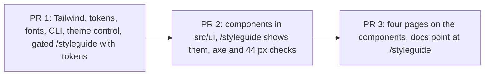

# Set up the Enamel design system in the frontend

Linear: TAS-29

## Summary

The frontend has no styles today: no Tailwind, no CSS, no `src/ui/` components. This sets up Enamel (`docs/design.md`) as the frontend's only way to style things: Tailwind with Enamel's tokens as its whole theme, both typefaces bundled with the app, shadcn/ui components restyled to Enamel in `src/ui/`, and a `/styleguide` page that shows every token and component in light and dark, locally and on previews but never in production. Then the four existing pages move onto the components with no change in behaviour. It ships as three PRs in sequence, so each one stays reviewable.

Evidence: feature — every page looks different (Enamel's colours, type and components), and `/styleguide` is new on previews.

## Required reading

- `AGENTS.md`: hard constraints, the Tests section and the Standards table (WCAG 2.2 AA).
- `docs/design.md`: every token value, the type scale, corners, motion, the component table and the rules. This spec doesn't repeat the values; take them from there.
- `docs/design/enamel.html`: the reference markup and copy for every component and for the style guide's sections. Mirror its demo copy, its `.plate` rules and its `PLATE_SVG` drawing.
- `frontend/src/recipes/recipes-page.tsx` and `frontend/src/recipes/recipe-page.tsx`: one component per state. Keep every state component; only its markup changes.
- `frontend/src/app/routes.tsx`: where the gated `/styleguide` route goes.
- `frontend/src/recipes/recipes-page.test.tsx`, `frontend/src/recipes/recipe-page.test.tsx`, `frontend/src/app/home-page.test.tsx`, `frontend/src/app/not-found-page.test.tsx`: the proof of "no change in behaviour". They must pass with no edits.
- `frontend/e2e/recipes.spec.ts`: the Playwright style the new `styleguide.spec.ts` mirrors.
- `specs/lessons/biome-wants-native-landmark-elements.md`: use native elements (`<fieldset>` for a group, `<search>`, `<main>`), not `role` attributes.
- `specs/lessons/tanstack-refetch-resets-error-state.md`: why the page state components branch the way they do; don't reorder them.

## Product behaviour

1. Pages use Enamel's colours, dark when the phone is in dark mode, and the style guide's theme control overrides that.
2. Headings are in Bricolage Grotesque and text in Atkinson Hyperlegible, with nothing loaded from Google.
3. `src/ui/` offers every component in the issue, each styled to Enamel.
4. Icons are Lucide, and an icon-only button always has an accessible name.
5. `/styleguide` shows every token and component in both themes, locally and on previews, and is "Page not found" in production.
6. `/styleguide` has no axe WCAG 2.2 A or AA violations in either theme, and every control on it is at least 44 px tall.
7. The home, recipes, recipe and not-found pages use the new components, and behave exactly as before.

| PR | Branch | Behaviours | PR description's first line |
| --- | --- | --- | --- |
| 1. Foundation | `tas-29-enamel-foundation` (this spec's branch and draft PR) | 1, 2, 5 (tokens, type, corners and the theme control only) | `Part of TAS-29` |
| 2. Components | `tas-29-enamel-components`, from `main` once PR 1 merges | 3, 4, 5 (all components), 6 | `Part of TAS-29` |
| 3. Pages | `tas-29-enamel-pages`, from `main` once PR 2 merges | 7 | `Fixes TAS-29` |

## Technical design

### Today

- `frontend/package.json` has no styling dependency. `frontend/vite.config.ts:4` has only the React plugin and the `/api` proxy. `frontend/src/main.tsx` imports no CSS. `frontend/index.html` loads no fonts.
- `frontend/src/app/routes.tsx:7` lists four routes; `frontend/src/test/render-route.tsx` renders them in a memory router for the page tests.
- `frontend/vitest.config.ts` merges `vite.config.ts`, so anything `define`d there also holds in Vitest.
- Previews and production are both `vite build` on Vercel (`vercel.json`, `docs/architecture.md`), so `import.meta.env.DEV` can't tell them apart. Vercel sets `VERCEL=1` and `VERCEL_ENV` (`production` or `preview`) in every build; CI and local builds have neither.
- `biome.json` lints CSS too, and Biome's CSS parser rejects Tailwind's at-rules (`@theme`, `@custom-variant`) unless `css.parser.tailwindDirectives` is on.

### Theming: one token list, `light-dark()`

Every colour token is written once, as `light-dark(<light>, <dark>)`, inside Tailwind's `@theme`. Which side applies follows `color-scheme` on the root: `light dark` by default (the phone decides), and `light` or `dark` when `data-theme` is set. So the dark values live in one place and the toggle is one attribute.

```css
/* frontend/src/ui/enamel.css (sketch) */
@import 'tailwindcss';
@import 'tw-animate-css';

/* static: the style guide reads tokens through var(), which Tailwind can't see, so emit them all. */
@theme static {
  --color-*: initial;
  --color-ground: light-dark(#f3f5f8, #0d1424);
  /* …every --color-* in docs/design.md, Colour table, in its order */

  --font-*: initial;
  --font-display: 'Bricolage Grotesque Variable', ui-sans-serif, system-ui, sans-serif;
  --font-body: 'Atkinson Hyperlegible', ui-sans-serif, system-ui, sans-serif;
  --default-font-family: var(--font-body);

  --text-*: initial;
  --text-display-xl: 2.5rem;
  --text-display-xl--line-height: 2.625rem;
  --text-display-xl--font-weight: 800;
  /* …display-l, display-m, title, step, body, small, label from docs/design.md, Type */

  --radius-*: initial;
  --radius-pill: 999px;
  --radius-card: 18px;
  --radius-photo: 14px;
  --radius-field: 12px;

  --default-transition-duration: 150ms;
  --default-transition-timing-function: cubic-bezier(0, 0, 0.2, 1);
}

:root {
  color-scheme: light dark;
  --cuisine-italian: #e2583e;
  /* …indian, japanese, mexican, french, other from docs/design.md */
}
:root[data-theme='light'] { color-scheme: light; }
:root[data-theme='dark'] { color-scheme: dark; }

@layer base {
  body { @apply bg-ground text-body text-ink; }
  h1, h2, h3 { @apply font-display; }
  h1 { @apply text-display-l; }
  h2 { @apply text-display-m; }
  h3 { @apply text-title; }
  a { @apply text-cobalt underline underline-offset-2; }
  :focus-visible { @apply outline-2 outline-offset-2 outline-cobalt; }
}

@media (prefers-reduced-motion: reduce) {
  *, ::before, ::after { animation-duration: 0.01ms !important; transition-duration: 0.01ms !important; }
}
```

`--color-*: initial`, `--text-*: initial` and `--radius-*: initial` remove Tailwind's default palette, sizes and radii, so `bg-red-500` or `rounded-lg` produce no CSS at all. That is the guard for "tokens only, never a literal colour". Spacing keeps Tailwind's default `--spacing: 0.25rem`, which is Enamel's 4 px base. Cuisine colours stay plain custom properties named as in `docs/design.md` (`--cuisine-italian`), because they're picked by a recipe's cuisine slug at run time, never as a utility class.

### Fonts

`frontend/src/main.tsx` imports `@fontsource-variable/bricolage-grotesque`, `@fontsource/atkinson-hyperlegible/400.css` and `@fontsource/atkinson-hyperlegible/700.css` before `./ui/enamel.css`. Vite copies the `woff2` files into `dist/assets`, so fonts come from the app's own origin. The Fontsource family names are `Bricolage Grotesque Variable` and `Atkinson Hyperlegible`.

### The style guide's gate

`frontend/vite.config.ts` decides once, at build time, and `define`s the result:

```ts
// Previews and production are both Vercel builds; only VERCEL_ENV tells them apart.
// Anything on Vercel that isn't a preview counts as production, so a missing variable hides the page.
const showStyleguide = process.env.VERCEL !== '1' || process.env.VERCEL_ENV === 'preview';

export default defineConfig({
  plugins: [react(), tailwindcss()],
  define: { 'import.meta.env.VITE_SHOW_STYLEGUIDE': JSON.stringify(showStyleguide) },
  resolve: { alias: { '@': fileURLToPath(new URL('./src', import.meta.url)) } },
  server: { /* unchanged */ }
});
```

`frontend/src/vite-env.d.ts` adds `readonly VITE_SHOW_STYLEGUIDE: boolean;`. `frontend/src/app/routes.tsx` adds the route before `*` only when the flag is true, loaded lazily so its code is a separate chunk that a production build drops:

```ts
const styleguideRoutes: RouteObject[] = import.meta.env.VITE_SHOW_STYLEGUIDE
  ? [{ path: '/styleguide', lazy: async () => ({ Component: (await import('./styleguide/styleguide-page')).StyleguidePage }) }]
  : [];

export const routes: RouteObject[] = [
  { path: '/', Component: HomePage },
  { path: '/recipes', Component: RecipesPage },
  { path: '/recipes/:slug', Component: RecipePage },
  ...styleguideRoutes,
  { path: '*', Component: NotFoundPage }
];
```

In production `/styleguide` falls through to `NotFoundPage`.

### shadcn/ui with the CLI

- `shadcn` is a dev dependency of `frontend`, so the lockfile pins the CLI. `frontend/package.json` gains the script `"ui:add": "shadcn add"`; adding a component is `pnpm --filter frontend ui:add <name>`.
- `frontend/components.json` is written by hand (not `shadcn init`, which would overwrite `enamel.css` with shadcn's own tokens):

  ```json
  {
    "$schema": "https://ui.shadcn.com/schema.json",
    "style": "new-york",
    "rsc": false,
    "tsx": true,
    "tailwind": { "config": "", "css": "src/ui/enamel.css", "baseColor": "neutral", "cssVariables": true, "prefix": "" },
    "iconLibrary": "lucide",
    "aliases": { "components": "@/ui", "ui": "@/ui", "utils": "@/ui/cn", "lib": "@/ui", "hooks": "@/ui" }
  }
  ```

- The CLI needs the `@/` path alias: `paths: { "@/*": ["./src/*"] }` in `compilerOptions` of both `frontend/tsconfig.json` and `frontend/tsconfig.app.json` (no `baseUrl`; TypeScript 7 resolves `paths` from the tsconfig's folder), plus the Vite alias above. Files in `src/ui/` use `@/ui/...` imports, as the CLI writes them. Code outside `src/ui/` keeps relative imports and imports components from `../ui` (the barrel), never a file inside it.
- Generated files are restyled in place to Enamel's tokens. Every shadcn token class (`bg-primary`, `text-muted-foreground`, `border-input`, `ring-ring`, …) and every `dark:` class is replaced; with the default palette removed they would silently produce no CSS. `shadcn add` may append CSS variables to `enamel.css`; remove them.
- `frontend/src/ui/cn.ts` is shadcn's `cn` with a `tailwind-merge` that knows Enamel's sizes and radii. Without this, `tailwind-merge` reads `text-small` as a text colour and drops it when merged with `text-ink`:

  ```ts
  const twMerge = extendTailwindMerge({
    extend: {
      theme: {
        text: ['display-xl', 'display-l', 'display-m', 'title', 'step', 'body', 'small', 'label'],
        radius: ['pill', 'card', 'photo', 'field']
      }
    }
  });
  export const cn = (...inputs: ClassValue[]) => twMerge(clsx(inputs));
  ```

### The components

All live in `frontend/src/ui/`, kebab-case files, arrow functions, named exports, and are re-exported from `frontend/src/ui/index.ts`. "CLI" means the file comes from `pnpm --filter frontend ui:add <name>` and is then restyled; "own" means written by hand.

| Export | File | Source | Shape |
| --- | --- | --- | --- |
| `SegmentedControl` | `segmented-control.tsx` | own, on Radix `Toggle` (`radix-ui`) | `<fieldset>` with an `sr-only` `<legend>{label}</legend>`; one Radix `Toggle.Root` per option, `pressed={option.value === value}`, `onPressedChange={() => onValueChange(option.value)}` (pressing the pressed one keeps it). PR 1 |
| `Button` | `button.tsx` | CLI `button` | cva `variant: primary \| secondary \| ghost \| danger` (default `primary`); one size, `h-11 px-5 rounded-pill text-body font-bold`; `disabled:` chip fill and muted text; `asChild` via Radix `Slot` for links |
| `IconButton` | `icon-button.tsx` | own | `{ icon: LucideIcon; label: string; pressed?: boolean } & Omit<ButtonHTMLAttributes<HTMLButtonElement>, 'children' \| 'aria-label' \| 'aria-pressed'>`; `size-11`, field border; `aria-label={label}`, `aria-pressed={pressed}`, cobalt fill when pressed; icon `aria-hidden` |
| `Field` | `field.tsx` | own | `{ label: string; help?: string; error?: string; children: (control: FieldControlProps) => ReactNode }`; `useId()` for the control and the help; error replaces help, in danger, with a `CircleAlert` icon |
| `Input`, `SearchInput` | `input.tsx` | CLI `input` | `Input`: `h-11 rounded-field border border-field bg-surface px-3`. `SearchInput`: `type="search"`, `rounded-pill`, a `Search` icon inside on the left |
| `NativeSelect` | `native-select.tsx` | CLI `native-select` | the shadcn wrapper with its chevron, `h-11 rounded-field border-field` |
| `FilterChip` | `filter-chip.tsx` | own, on Radix `Toggle` | `{ children: string; pressed: boolean; onPressedChange: (pressed: boolean) => void }`; pill, field border, cobalt fill when pressed, `h-11` |
| `Tag` | `tag.tsx` | own | `{ children: string }`; a `<span>`, yolk fill, `text-on-yolk`, `text-label`, pill |
| `ServingsStepper` | `servings-stepper.tsx` | own | `{ value: number; min: number; max: number; onValueChange: (value: number) => void }`; `IconButton` "Fewer servings" (`Minus`, disabled at `min`), `<output aria-live="polite" className="tabular-nums">{`Serves ${value}`}</output>`, `IconButton` "More servings" (`Plus`, disabled at `max`) |
| `Checkbox` | `checkbox.tsx` | CLI `checkbox` | restyled: `size-6`, field border, cobalt when checked. Not exported; `CheckboxRow` uses it |
| `CheckboxRow` | `checkbox-row.tsx` | own | `{ children: ReactNode; checked: boolean; onCheckedChange: (checked: boolean) => void }`; a `<label className="flex min-h-12 items-center gap-3 border-b border-line">` holding `Checkbox` and the text, struck through in muted when checked; maps Radix's `CheckedState` with `=== true` |
| `CuisinePlate` | `cuisine-plate.tsx` | own | `{ cuisineSlug: string \| undefined; shape: 'card' \| 'hero' }`; `aria-hidden` div, `rounded-photo`, 4:3 for `card`, 16:10 for `hero`, background `var(--cuisine-${slug}, var(--cuisine-other))` set through `style`, holding `docs/design/enamel.html`'s `PLATE_SVG` as JSX |
| `RecipeCard` | `recipe-card.tsx` | own | `{ title: string; to: string; cuisineSlug: string \| undefined; children?: ReactNode }`; `<article>` with the 3 px cobalt rim (`border-3 border-cobalt rounded-card bg-surface`), `CuisinePlate shape="card"`, `<h2 className="text-title"><Link to={to}>` whose `after:absolute after:inset-0` makes the whole card the link, then `children` in `text-small text-muted` |
| `Toaster`, `toast` | `sonner.tsx` | CLI `sonner` | drop shadcn's `next-themes` import; style through `toastOptions.classNames` (ink background, ground text, `rounded-field`); re-export `toast` from `sonner` |
| `Banner` | `banner.tsx` | own | `{ tone: 'success' \| 'warning' \| 'danger'; title: string; children?: ReactNode }`; 2 px border in the tone's colour, `rounded-field`, `bg-surface`, the tone's icon; one `const toneStyles: Record<Tone, { icon: LucideIcon; role: 'alert' \| 'status'; border: string; text: string }>` (`danger`: `CircleAlert`, `alert`; `warning`: `TriangleAlert`, `status`; `success`: `CircleCheck`, `status`) |
| `ConfirmDialog` | `confirm-dialog.tsx` (+ CLI `alert-dialog.tsx`) | own on CLI `alert-dialog` | `{ trigger: ReactElement; title: string; description: string; confirmLabel: string; onConfirm: () => void }`; `rounded-card` panel, a ghost "Cancel" and a danger button named `confirmLabel`; 150 ms fade |
| `EmptyState` | `empty-state.tsx` | own | `{ icon: LucideIcon; title: string; children?: ReactNode; action?: ReactNode }`; centred icon, `<h2 className="text-title">{title}</h2>`, `children` in muted, then `action` |
| `Page` | `page.tsx` | own | `{ children: ReactNode }`; `<main className="mx-auto flex w-full max-w-2xl flex-col gap-6 px-4 py-8">`. PR 3 (five users: four pages and the style guide) |

`IconButton`'s `label: string` is required by its type, so an icon-only button without an accessible name doesn't compile. That is the guard for behaviour 4.

### The style guide page

`frontend/src/app/styleguide/` (it belongs to no area, so it sits under `app/`):

- `styleguide-page.tsx`: `StyleguidePage`, `<title>Style guide · Tastebook</title>`, `<h1>Style guide</h1>`, `ThemeSwitcher`, then the sections. PR 1 renders `<main>` with the token sections; PR 2 adds the component sections; PR 3 swaps `<main>` for `Page`.
- `theme-switcher.tsx`: `ThemeSwitcher`, a `SegmentedControl` labelled "Theme" with System, Light and Dark. The root's `data-theme` attribute is the one owner of the theme; the component's state mirrors it.

  ```ts
  type Theme = 'system' | 'light' | 'dark';
  const readTheme = (): Theme => {
    const theme = document.documentElement.dataset.theme;
    return theme === 'light' || theme === 'dark' ? theme : 'system';
  };
  // In the click handler, not an effect: System removes the attribute, Light and Dark set it.
  ```

  The choice isn't remembered: a reload returns to System.
- `token-sections.tsx` (PR 1): `ColourSection` (a swatch per `--color-*` token with its name and use from `docs/design.md`, plus one plate swatch per cuisine colour), `TypeSection` (one sample line per text role, named "Display XL 40/42" and so on), `ShapeSection` (spacing steps 4 to 48 and the four corners). Swatches read `var(--color-${name})` through `style`.
- `control-sections.tsx` (PR 2): Buttons, Fields, Filters and tags, Servings and units, Shopping list. `content-sections.tsx` (PR 2): Recipe cards and placeholders, Feedback, Confirming something you can't undo, Empty state. Each section is a `<section aria-labelledby>` with an `<h2>`, demo state in `useState`, and the copy from `docs/design/enamel.html`'s panel of the same name. The Feedback section mounts `<Toaster />` and a secondary button "Show a toast" that calls `toast('Saved to Favourites', { action: { label: 'Undo', onClick: () => undefined } })`, and shows a warning and a success `Banner`. The dialog's trigger is a danger `Button` "Delete account"; its title is "Delete your account?", its description the reference's, its confirm label "Delete account", and confirming only closes it.

### The pages (PR 3)

Each page swaps `<main>` for `Page` and its raw elements for components. Every state component keeps its name, its branch and its exact text.

- `frontend/src/app/home-page.tsx`: `<h1 className="text-display-xl font-extrabold text-cobalt">Tastebook</h1>` (the wordmark); "Browse recipes" is `<Button asChild><Link to="/recipes">`; status lines are `text-small text-muted`; `ApiUnreachable` is `<Banner tone="danger" title="The API is unreachable." />` then a secondary `Button` "Try again".
- `frontend/src/app/not-found-page.tsx`: `Page`, the `<h1>`, the sentence, and "Back to Tastebook" as a primary `Button asChild` link.
- `frontend/src/recipes/recipes-page.tsx`: `RecipeSearch` is `<Field label="Search recipes">{(control) => <SearchInput {...control} value onChange />}</Field>`; `CuisineSelect` and `CuisinesLoading` use `Field label="Cuisine"` with `NativeSelect` (same options, same `disabled`); `CuisinesUnavailable` and `RecipesUnavailable` are a danger `Banner` with the same title, then a secondary `Button` with the same label; `RecipeItem` is `<li><RecipeCard title to cuisineSlug={recipe.cuisines[0]?.slug}>` with `RecipeCuisines` and the description inside; the `<ul>` is `grid gap-4`; `NoRecipes` is `EmptyState` with the `CookingPot` icon and today's sentence as its title (no new action); `RecipeCount` is `text-small text-muted`; "Back to Tastebook" is a ghost `Button asChild` link. The `<search>` element stays.
- `frontend/src/recipes/recipe-page.tsx`: `RecipeDetails` starts with `<CuisinePlate shape="hero" cuisineSlug={recipe.cuisines[0]?.slug} />`; `RecipeUnavailable` is a danger `Banner` and a secondary `Button`; "All recipes" and "Back to Tastebook" are ghost `Button asChild` links. No new text: `main`'s text for a recipe with no cuisines and no description stays exactly "Banana breadAll recipesBack to Tastebook" (`recipe-page.test.tsx`).
- `frontend/src/recipes/recipe-cuisines.tsx`: unchanged.



- **API contract:** No change.
- **Blast radius:** see Blast radius below.
- **Not changing:** see Out of scope below.

### Steps

**PR 1: Foundation** (branch `tas-29-enamel-foundation`)

1. **Allow Tailwind's at-rules in Biome.** `biome.json` (edit): add `"css": { "parser": { "tailwindDirectives": true } }`.
   Done when: `pnpm lint:biome` passes on `enamel.css` from step 3.
2. **Add the dependencies.** `frontend/package.json`, `pnpm-lock.yaml` (edit), with `pnpm --filter frontend add`: `tailwindcss`, `@tailwindcss/vite`, `@fontsource-variable/bricolage-grotesque`, `@fontsource/atkinson-hyperlegible`, `radix-ui`, `class-variance-authority`, `clsx`, `tailwind-merge`, `lucide-react`, `tw-animate-css`; dev: `shadcn`, `@axe-core/playwright`. Add the script `"ui:add": "shadcn add"`.
   Done when: `pnpm install --frozen-lockfile` passes.
3. **Write the tokens.** `frontend/src/ui/enamel.css` (new), as sketched, with every value from `docs/design.md`.
   Done when: `pnpm build` passes and the built CSS contains `--color-cobalt:light-dark(#1f4fd1,#8aa9ff)` (minified) and no `--color-red-500`.
4. **Wire Vite, TypeScript and the entry.** `frontend/vite.config.ts`, `frontend/src/vite-env.d.ts`, `frontend/tsconfig.json`, `frontend/tsconfig.app.json`, `frontend/src/main.tsx` (edit): the Tailwind plugin, the alias, the `define`, the `paths`, and the font and CSS imports.
   Done when: `pnpm lint` passes and `pnpm dev:web` shows the home page on the ground colour in Atkinson Hyperlegible.
5. **Set up the CLI.** `frontend/components.json` (new), `frontend/src/ui/cn.ts` (new), `frontend/src/ui/index.ts` (new).
   Done when: `pnpm --filter frontend exec shadcn info` (or `shadcn add --dry-run button`) resolves the aliases to `src/ui/` without error.
6. **Add the segmented control.** `frontend/src/ui/segmented-control.tsx` (new), exported from `index.ts`.
   Done when: the style guide test in step 8 passes.
7. **Add the gated style guide with the tokens.** `frontend/src/app/routes.tsx` (edit), `frontend/src/app/styleguide/styleguide-page.tsx`, `theme-switcher.tsx`, `token-sections.tsx` (new).
   Done when: `VERCEL=1 VERCEL_ENV=production pnpm build` leaves no file in `frontend/dist` containing "Style guide" (`grep -rl "Style guide" frontend/dist` prints nothing), and `VERCEL=1 VERCEL_ENV=preview pnpm build` and a plain `pnpm build` each produce one.
8. **Test it.** `frontend/src/app/styleguide/styleguide-page.test.tsx` (new), `frontend/src/test/setup.ts` (edit: `afterEach` also removes `data-theme` from `document.documentElement`), `frontend/e2e/styleguide.spec.ts` (new). See Tests.
   Done when: `pnpm test` and `pnpm test:e2e` pass.
9. **Point the docs at it.** `AGENTS.md` (edit): the Layout line for `src/ui/` becomes `design-system components: shadcn/ui restyled to Enamel, tokens in enamel.css; add one with pnpm --filter frontend ui:add <name>`.
   Done when: the line no longer says "none yet".

**PR 2: Components** (branch `tas-29-enamel-components`, from `main` after PR 1 merges)

10. **Add the CLI components.** `pnpm --filter frontend ui:add button input native-select checkbox alert-dialog sonner`, then restyle each file in `frontend/src/ui/` to the table above.
    Done when: `grep -rnE "(bg|text|border|ring)-(primary|secondary|muted-foreground|accent|destructive|input|ring|background|foreground|popover|card)\b|dark:" frontend/src/ui` prints nothing, and `pnpm lint` passes.
11. **Add the own components.** `frontend/src/ui/icon-button.tsx`, `field.tsx`, `filter-chip.tsx`, `tag.tsx`, `servings-stepper.tsx`, `checkbox-row.tsx`, `cuisine-plate.tsx`, `recipe-card.tsx`, `banner.tsx`, `confirm-dialog.tsx`, `empty-state.tsx` (new); `index.ts` (edit) exports every name in the table except `Checkbox`.
    Done when: `pnpm lint` passes.
12. **Show them on the style guide.** `frontend/src/app/styleguide/control-sections.tsx`, `content-sections.tsx` (new), `styleguide-page.tsx` (edit).
    Done when: the style guide tests for PR 2 pass.
13. **Check accessibility and size.** `frontend/e2e/styleguide.spec.ts` (edit), `frontend/src/app/styleguide/styleguide-page.test.tsx` (edit).
    Done when: `pnpm test` and `pnpm test:e2e` pass.
14. **Make `/styleguide` the reference.** `docs/design.md` (edit): the second paragraph says the app's `/styleguide` page (local and previews only) is the reference and `design/enamel.html` is the session's original; the Components paragraph says the tokens are in `frontend/src/ui/enamel.css` and how to add a component (`pnpm --filter frontend ui:add <name>`).
    Done when: the paragraph no longer says "Once TAS-29 lands".

**PR 3: Pages** (branch `tas-29-enamel-pages`, from `main` after PR 2 merges)

15. **Add `Page`.** `frontend/src/ui/page.tsx` (new), `index.ts` (edit); `styleguide-page.tsx` (edit) uses it.
    Done when: `pnpm lint` passes.
16. **Move the four pages.** `frontend/src/app/home-page.tsx`, `frontend/src/app/not-found-page.tsx`, `frontend/src/recipes/recipes-page.tsx`, `frontend/src/recipes/recipe-page.tsx` (edit), as described above.
    Done when: `pnpm test` passes with `git diff main -- 'frontend/src/**/*.test.tsx' frontend/e2e/home.spec.ts frontend/e2e/recipe.spec.ts frontend/e2e/recipes.spec.ts` empty, and `pnpm test:e2e` passes.

### Tests

- `frontend/src/app/styleguide/styleguide-page.test.tsx` (Vitest, `renderRoute('/styleguide')`)
  - PR 1. Shows the page and the token sections, asserts: `heading` "Style guide" (level 1) and `heading` "Colour", "Type" and "Space and shape" (level 2) are present.
  - PR 1. Theme control, parametrised over `[['Light', 'light'], ['Dark', 'dark']]`: click `button` named the option inside `group` "Theme", asserts: `document.documentElement` has `data-theme` equal to the value, and that button has `aria-pressed="true"` while "System" has `aria-pressed="false"`.
  - PR 1. Back to System: click "Dark", then "System", asserts: `document.documentElement` has no `data-theme` attribute and "System" has `aria-pressed="true"`.
  - PR 2. Servings stepper: click "More servings", asserts: text "Serves 5"; then click "Fewer servings" four times, asserts: text "Serves 1" and `button` "Fewer servings" is disabled.
  - PR 2. Filter chip: click `button` "Under 30 min", asserts: it has `aria-pressed="true"` (it starts `false`).
  - PR 2. Checkbox row: click `checkbox` "2 courgettes", asserts: it is checked (it starts unchecked).
  - PR 2. Field error: `textbox` "Servings" has `aria-invalid="true"` and accessible description "Enter a number, like 4."; `textbox` "Recipe title" has accessible description "Shown on cards and at the top of the recipe." and no `aria-invalid`.
  - PR 2. Icon buttons have names: `button` "Add to Favourites", "Share" and "More actions" are present; click "Add to Favourites", asserts: it has `aria-pressed="true"`.
  - PR 2. Toast: click "Show a toast", asserts: text "Saved to Favourites" and `button` "Undo" appear.
  - PR 2. Dialog: click "Delete account", asserts: `alertdialog` "Delete your account?" is present; click "Cancel", asserts: no `alertdialog` and focus is on the "Delete account" trigger.
  - PR 2. Recipe card: `link` "Courgette and lemon orzo" has `href` `/recipes/courgette-and-lemon-orzo`.
- `frontend/e2e/styleguide.spec.ts` (Playwright, against `pnpm dev`)
  - PR 1. Fonts are bundled: before `goto`, `context.route` aborts every request whose host isn't `localhost`, and records every URL requested; after `document.fonts.ready`, asserts: the families of `document.fonts` entries with `status === 'loaded'` include "Bricolage Grotesque Variable" and "Atkinson Hyperlegible", and no recorded URL contains `fonts.googleapis.com` or `fonts.gstatic.com`.
  - PR 1. Follows the phone, and the control overrides it: with `page.emulateMedia({ colorScheme: 'dark' })`, asserts: `body`'s computed `background-color` is `rgb(13, 20, 36)`; click "Light", asserts: `rgb(243, 245, 248)`.
  - PR 1, extended in PR 2. axe in both themes: click "Light", run `new AxeBuilder({ page }).withTags(['wcag2a', 'wcag2aa', 'wcag21a', 'wcag21aa', 'wcag22aa']).analyze()`, asserts: `violations` equals `[]`; click "Dark", the same. PR 2 adds: open the "Delete your account?" dialog and run it again, asserts: `violations` equals `[]`.
  - PR 2. Every control is at least 44 px tall: evaluate over every visible `button, a[href], input, select, [role="checkbox"]`, measuring the element's own box, or for `[role="checkbox"]` its `label` ancestor's; asserts: the list of `{ name, height }` under 44 equals `[]`.
- Existing tests, PR 3: `home-page.test.tsx`, `not-found-page.test.tsx`, `recipes-page.test.tsx`, `recipe-page.test.tsx` and the three existing e2e specs pass unchanged.
- Each PR: `pnpm lint`, `pnpm test`, `pnpm build`, `pnpm test:e2e`.

## Decisions

- Three PRs in sequence (foundation, components, pages), because together they're about 30 files and well over the one-PR ceiling, and each part can be reviewed on its own preview. PR 1 and PR 2 say `Part of TAS-29` so their merge doesn't close the issue; PR 3 says `Fixes TAS-29`. Asked: one PR or three in sequence? → Three PRs in sequence.
- The theme toggle lives only on `/styleguide` and isn't remembered, because the app has no settings or footer yet and a visitor-facing toggle is its own decision; until then pages follow the phone. Asked: where should the System / Light / Dark toggle live? → Styleguide only.
- All four pages move onto the components (home and not-found too, not only the two recipe pages), so no page is left unstyled next to Enamel ones. Asked: which of today's pages should move? → All four pages.
- shadcn's CLI is set up (`components.json`, `shadcn` as a dev dependency, `ui:add`), so later components arrive the same way. Asked: set up the CLI or copy by hand? → Set up the CLI.
- Colour tokens use `light-dark()` with `color-scheme`, not a second list of dark values under a media query and again under `[data-theme='dark']`, because one list can't drift. It needs Chrome 123, Safari 17.5 or Firefox 120 (all 2024), which mid-range phones have. (agent)
- Tailwind's default colours, sizes and radii are removed (`initial`), so a literal Tailwind colour builds to nothing; that's the cheapest guard for "tokens only". (agent)
- The style guide's gate is decided in `vite.config.ts` from `VERCEL` and `VERCEL_ENV`, and fails closed: a Vercel build that isn't a preview hides it. The route is lazy so a production bundle doesn't carry it. (agent)
- `components.json` is hand-written rather than generated by `shadcn init`, because `init` replaces the CSS file with shadcn's tokens. (agent)
- The issue lists the whole set up front, which the rule of three in `AGENTS.md` and `docs/design.md` would otherwise forbid; the issue's explicit list is the stated exception, and the style guide is every component's first user. Components no page uses yet (stepper, chips, checkbox rows, toast, dialog) stay unused outside the style guide until their features arrive. (agent)
- `SegmentedControl` and `FilterChip` are written on Radix `Toggle` rather than shadcn's `toggle`/`toggle-group`, because both are `aria-pressed` buttons as in the reference, and one shared `toggle.tsx` with two variants would be a middle man. (agent)
- The search field keeps its visible "Search recipes" label above it (the reference hides it), because the existing tests find the box by that name and Enamel's Field rule asks for a visible label. (agent)
- `src/ui/` files use the `@/` alias the CLI writes; everything else keeps relative imports, so no existing import changes. (agent)

## Assumptions

- Vercel sets `VERCEL_ENV` in the frontend service's build, as its docs say for every build. If it didn't, the gate hides `/styleguide` on previews too (fails closed). Confirm with: the verify stage, by opening `/styleguide` on PR 1's preview.
- Cuisines without a colour in `docs/design.md` (British, Chinese, Greek, Spanish, Thai, all in the catalogue today) get `--cuisine-other` through the CSS fallback until someone picks their colours. Confirm with: the design owner at spec approval.
- The recipe card's photo is always the plate, because recipes have no photo field yet. Confirm with: nobody; Real recipes adds photos.
- sonner calls `window.matchMedia`, which jsdom lacks. If the style guide test fails on it, add a `matchMedia` stub returning `matches: false` in `frontend/src/test/setup.ts`; that's a browser API, not Tastebook's own code. Confirm with: the implement stage, on the first test run.

## Out of scope

- A visitor-facing theme toggle and remembering the choice.
- The `lg` (52 px) button size, Step type in use, the timer and everything else for cooking mode (Cooking mode project). The Step text token is defined, because it's part of the type scale.
- Removable filter chips, "Clear filters" on the empty list, and any filter UI change on `/recipes`: the cuisine dropdown stays a dropdown.
- New copy or new states on any page, and editing any existing test.
- axe on the other pages and Lighthouse on previews (TAS-26, checks on previews).
- Colours for the five cuisines without one.
- The favicon and the home-screen mark.

## Blast radius

- `frontend/vite.config.ts` is also Vitest's config (`vitest.config.ts` merges it): the `define` and the alias apply to tests, which is what the style guide test needs. Re-check that `pnpm test` runs all existing tests.
- `frontend/src/app/routes.tsx` is shared by the app and `src/test/render-route.tsx`; the new route sits before `*`, so every existing path resolves as before. Re-check `not-found-page.test.tsx`.
- `biome.json` covers the whole repo; the CSS parser option only adds Tailwind's at-rules. Re-check `pnpm lint:biome` from the root.
- `frontend/src/test/setup.ts` runs for every Vitest file; removing `data-theme` after each test only touches the root element.
- PR 3 changes the four pages' markup. The fact it's safe because of: every existing page test and e2e spec queries by role, label and text, and Step 16's Done when requires them unchanged.

## Validation criteria

- [ ] `pnpm lint` (Biome and `tsc -b`) passes.
- [ ] `pnpm test` passes.
- [ ] `pnpm build` passes; the production-gate check in step 7 holds.
- [ ] `pnpm test:e2e` passes, including `styleguide.spec.ts`.
- [ ] On each PR's preview, `/styleguide` shows the tokens (and from PR 2 the components) and the theme control switches light and dark.
- [ ] After PR 3, `/`, `/recipes`, `/recipes/<slug>` and an unknown path look like Enamel and behave as before.
- Evidence: feature: PR 1 and PR 2, a video of `/styleguide` switching System, Light and Dark; PR 3, a video of home → recipes → search → cuisine → a recipe, in light and dark.
