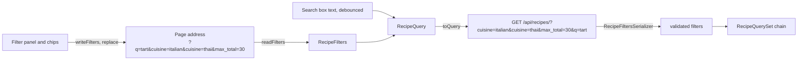

# Filter by time, difficulty, cuisine, course and one-pot

Linear: TAS-42

## Summary

The recipe list can only be narrowed by a title search and one cuisine. This lets someone narrow it by prep, cook and total time (up to 15, 30, 45 or 60 minutes), difficulty, cuisine, course and one-pot. Choices within one filter combine with OR and different filters with AND. The search and every filter live in the page address, so a filtered view can be shared, bookmarked and reloaded. The list shows how many recipes match, and the filters that are on as removable chips with "Clear filters".

It ships in two parts, each its own PR merged to `main` in order:

- **Part 1 (this issue, TAS-42): the API.** `GET /api/recipes/` gains every filter, and a new `GET /api/courses/` lists the courses. Nothing a person sees changes.
- **Part 2 (a sub-issue filed on approval): the page.** `/recipes` gains the "Filters" button and panel, the removable chips, "Clear filters" and the new empty states. The cuisine dropdown goes.

Evidence:
- Part 1: chore — nothing on screen changes; the page keeps sending one cuisine.
- Part 2: feature — people see a new filter panel, chips and empty states on `/recipes`.

## Required reading

- `AGENTS.md`: hard constraints, the API contract steps and the Tests section.
- `specs/TAS-17.md`: the cuisine filter this replaces; its decisions on the address (`replace`, the search box owning its text) and on `keepPreviousData` still hold.
- `backend/recipes/models.py:52-68`: `RecipeQuerySet.matching_title()` and `with_cuisine()` are the pattern for the new queryset methods, including "a blank or unknown value filters nothing".
- `backend/recipes/views.py`: `RecipeListView` and `CuisineListView` are the patterns for the list view and the new `CourseListView`.
- `backend/tests/test_recipes.py:346-384`: the cuisine filter's parametrised test and the query-count test to mirror.
- `frontend/src/recipes/recipes-page.tsx`: one component per state; `CuisinePicker` (lines 100-110) is the pattern for the panel's loading and error branches.
- `frontend/src/recipes/recipes-page.test.tsx`: `holdCuisines`, `failCuisines` and `answerFilters` (sorted query strings) are the helpers to mirror and reuse.
- `frontend/src/ui/filter-chip.tsx`: the chip the panel uses.
- `docs/design.md`, Components (Filter chip, Empty state) and Rules: "A removable chip names what it removes in its label"; the empty state offers "Clear filters".
- `docs/design/enamel.html:357`: the design session's removable chip (a pressed chip with an `x` icon, labelled `Remove filter: …`).
- `specs/lessons/biome-wants-native-landmark-elements.md`: the search and the filters stay inside the native `<search>` element; groups are native `<fieldset>`s.
- `specs/lessons/tanstack-refetch-resets-error-state.md`: why the panel's cuisine and course groups branch on `data` first, then `isPending`.
- `specs/lessons/blank-model-fields-are-optional-in-the-schema.md`: check the generated types after regenerating.

## Product behaviour

One claim per acceptance criterion, in the issue's order.

1. Someone can filter by prep, cook and total time, difficulty, cuisine, course and one-pot.
2. Choices within one filter combine with OR; different filters combine with AND.
3. The search and filters live in the address, so reload, sharing and bookmarks keep them.
4. The list shows how many recipes match and each filter that is on, removable, with "Clear filters".
5. The recipe list, with the filters open, fits a 375 px phone screen without scrolling sideways.

Part 1 proves 1 to 3 through the API (`GET /api/recipes/?cuisine=italian&cuisine=thai&max_total=30` returns the Italian or Thai recipes taking 30 minutes or less). Part 2 proves all five on the page.

## Technical design

**Today.** `RecipeListView.get_queryset` (`backend/recipes/views.py:30-37`) reads `q` and one `cuisine` with `params.get` and chains `matching_title(q)`, `with_cuisine(slug)`, `prefetch_related('cuisines')` and `alphabetical()`. `with_cuisine` (`backend/recipes/models.py:64-68`) ignores a blank or unknown slug. The list is not paginated, so the number of recipes in the response is the number that match. `Course` rows are seeded by `backend/recipes/migrations/0005_recipe_details.py:5-11` (Baking, Breakfast, Dessert, Main, Side) and `CourseSerializer` exists (`backend/recipes/serializers.py:12`), but no endpoint lists courses. Total time is the `Recipe.total_minutes` property (`models.py:189-191`), prep plus cook plus extra, so filtering on it needs a database expression.

On the page, `RecipesPage` (`frontend/src/recipes/recipes-page.tsx:205-244`) keeps the search text in state and copies it to `?q=`; a `<select>` writes one `cuisine` with `withParam` and `replace: true`. `useRecipes({ searchTerm, cuisine })` (`frontend/src/recipes/recipes-api.ts`) keys on `['recipes', { q, cuisine }]` and returns `{ filters, recipes }` so kept-previous results keep their own empty message. `RecipeCount` shows "N recipes" above a non-empty list.



### API contract

`GET /api/recipes/` takes these query parameters. Every one is optional; a missing one filters nothing. Repeating a parameter adds choices (OR); different parameters narrow together (AND).

| Parameter | Type | Meaning | Bad value |
| --- | --- | --- | --- |
| `q` | string | Title contains this text, ignoring case and accents (unchanged). | — |
| `cuisine` | string, repeated | Recipes with any of these cuisines, by slug. | Unknown slugs are dropped; with none left, nothing is filtered. |
| `course` | string, repeated | Recipes with any of these courses, by slug. | As `cuisine`. |
| `difficulty` | `easy` \| `medium` \| `hard`, repeated | Recipes with any of these difficulties. | 400 |
| `max_prep` | integer ≥ 1 | Prep time is this many minutes or fewer. | 400 |
| `max_cook` | integer ≥ 1 | Cook time is this many minutes or fewer. | 400 |
| `max_total` | integer ≥ 1 | Prep plus cook plus extra time is this many minutes or fewer. | 400 |
| `one_pot` | boolean | `true` means only one-pot recipes; `false` or missing means every recipe. | — |

A 400 body is DRF's validation errors keyed by parameter, such as `{"max_total": ["A valid integer is required."]}`. The 200 body is unchanged (`RecipeSummary[]`).

New: `GET /api/courses/` returns every course alphabetically, as `[{"slug": "baking", "name": "Baking"}, …]`, public like `/api/cuisines/`.

```diff
 paths:
   /api/recipes/:
     get:
       parameters:
-        - q (string), cuisine (string)
+        - course (array of string), cuisine (array of string), difficulty (array of enum)
+        - max_cook, max_prep, max_total (integer, minimum 1), one_pot (boolean), q (string)
+      responses: 200 RecipeSummary[], 400 (bad filter value)
+  /api/courses/:
+    get: 200 Course[]
```

drf-spectacular 0.30 turns a serializer passed as `parameters=[RecipeFiltersSerializer]` into one query parameter per field, with `ListField` as `type: array`. That was checked against this repo's settings while writing this spec: `spectacular --validate --fail-on-warn` passes, and the serializer reads `cuisine=italian&cuisine=thai` from `request.query_params` as `['italian', 'thai']`. openapi-fetch's default query serialiser writes arrays the same way (`cuisine=italian&cuisine=thai`).

### Backend sketch (part 1)

`backend/recipes/serializers.py`, before `RecipeSummarySerializer`:

```py
class RecipeFiltersSerializer(serializers.Serializer):
    """The list's query parameters. Validates them only; it never serialises a recipe."""

    q = serializers.CharField(required=False, default='', allow_blank=True, help_text='…')
    cuisine = serializers.ListField(child=serializers.CharField(), required=False, default=list, help_text='…')
    course = serializers.ListField(child=serializers.CharField(), required=False, default=list, help_text='…')
    difficulty = serializers.ListField(
        child=serializers.ChoiceField(choices=Difficulty.choices), required=False, default=list, help_text='…'
    )
    max_prep = serializers.IntegerField(required=False, min_value=1, help_text='…')
    max_cook = serializers.IntegerField(required=False, min_value=1, help_text='…')
    max_total = serializers.IntegerField(required=False, min_value=1, help_text='…')
    one_pot = serializers.BooleanField(required=False, default=False, help_text='…')
```

Each `help_text` is the "Meaning" column above, ending with the "Bad value" behaviour where there is one (it becomes the schema's description).

`backend/recipes/models.py`, `RecipeQuerySet`: `with_cuisine` is replaced by `with_cuisines`; four methods are added. Each treats an empty value as "no filter", like `matching_title('')`.

```py
def with_cuisines(self, slugs: list[str]) -> RecipeQuerySet:
    # Unknown slugs (a removed cuisine, a mistyped link) are dropped; with none left, nothing is filtered.
    known = Cuisine.objects.filter(slug__in=slugs)
    if not known.exists():
        return self
    # A subquery, not a join, so a recipe with two of the cuisines is listed once.
    return self.filter(pk__in=known.values('recipes'))

def with_courses(self, slugs: list[str]) -> RecipeQuerySet: ...  # the same on Course

def with_difficulties(self, difficulties: list[str]) -> RecipeQuerySet:
    return self.filter(difficulty__in=difficulties) if difficulties else self

def taking_at_most(self, *, prep: int | None, cook: int | None, total: int | None) -> RecipeQuerySet:
    limits = {'prep_minutes__lte': prep, 'cook_minutes__lte': cook, 'minutes_in_all__lte': total}
    # The same sum as Recipe.total_minutes, in SQL so the database can filter on it.
    return self.alias(minutes_in_all=F('prep_minutes') + F('cook_minutes') + F('extra_minutes')).filter(
        **{lookup: minutes for lookup, minutes in limits.items() if minutes is not None}
    )

def only_one_pot(self, only: bool) -> RecipeQuerySet:
    return self.filter(one_pot=True) if only else self
```

`with_cuisines` and `with_courses` are deliberately two methods of the same shape: `AGENTS.md` says duplicate twice, abstract on the third (TAS-47's diet filter will be a different shape).

`backend/recipes/views.py`, `RecipeListView`:

```py
@extend_schema(
    parameters=[RecipeFiltersSerializer],
    responses={
        200: RecipeSummarySerializer(many=True),
        400: OpenApiResponse(description='A difficulty or a time limit is not one the list accepts.'),
    },
)
class RecipeListView(ListAPIView):
    ...
    def get_queryset(self) -> RecipeQuerySet:
        filters = RecipeFiltersSerializer(data=self.request.query_params)
        filters.is_valid(raise_exception=True)
        given = filters.validated_data
        return (
            Recipe.objects.matching_title(given['q'])
            .with_cuisines(given['cuisine'])
            .with_courses(given['course'])
            .with_difficulties(given['difficulty'])
            .taking_at_most(prep=given.get('max_prep'), cook=given.get('max_cook'), total=given.get('max_total'))
            .only_one_pot(given['one_pot'])
            .prefetch_related('cuisines')
            .alphabetical()
        )
```

`CourseListView` mirrors `CuisineListView` (`authentication_classes = []`, `permission_classes = []`, `CourseSerializer`, `Course.objects.all()`); `backend/config/urls.py` adds `path('api/courses/', CourseListView.as_view(), name='course-list')` after the cuisines line.

Part 1's only frontend change keeps the page compiling against the regenerated types: in `frontend/src/recipes/recipes-api.ts`, `toQuery` sends `{ cuisine: [cuisine] }` instead of `{ cuisine }`. The page looks and behaves as before.

### Frontend sketch (part 2)

**Address.** The page address uses the API's parameter names, so the page passes them through: `/recipes?q=tart&cuisine=italian&cuisine=thai&course=main&difficulty=easy&max_prep=15&max_cook=30&max_total=45&one_pot=true`. The address is the only state for the filters (the search box keeps owning its text, as today). Every change writes the address with `replace: true`, like the cuisine dropdown did.

New `frontend/src/recipes/recipe-filters.ts` owns the filter shape and reading and writing it:

```ts
import type { components } from '../api/schema';

type Difficulty = components['schemas']['DifficultyEnum'];

export const timeLimits = [15, 30, 45, 60] as const;
export type TimeLimit = (typeof timeLimits)[number];

// One list drives the panel's groups, the chips and the address, so a time filter is added in one place.
export const timeFilters = [
  { name: 'total', param: 'max_total', legend: 'Total time', chip: 'Total' },
  { name: 'prep', param: 'max_prep', legend: 'Prep time', chip: 'Prep' },
  { name: 'cook', param: 'max_cook', legend: 'Cook time', chip: 'Cook' }
] as const;
export type TimeFilterName = (typeof timeFilters)[number]['name'];

export type RecipeFilters = {
  cuisines: string[];
  courses: string[];
  difficulties: Difficulty[];
  times: Record<TimeFilterName, TimeLimit | null>;
  onePot: boolean;
};

export const noFilters: RecipeFilters;                       // every list empty, every time null, onePot false
export const readFilters: (params: URLSearchParams) => RecipeFilters;
export const writeFilters: (params: URLSearchParams, filters: RecipeFilters) => URLSearchParams;
export const hasFilters: (filters: RecipeFilters) => boolean;
export const toggled: <T>(values: T[], value: T) => T[];    // adds the value at the end, or removes it
```

- `readFilters` takes `getAll('cuisine')` and `getAll('course')` with repeats removed and blanks dropped; keeps only `easy`, `medium` and `hard` from `getAll('difficulty')`, in address order, repeats removed; reads each time parameter's first value as a number and keeps it only if it is one of `timeLimits`; and sets `onePot` only for `one_pot=true`. Anything else is ignored, so a mistyped link still shows recipes.
- `writeFilters` copies `params`, deletes every filter parameter (`cuisine`, `course`, `difficulty`, `max_total`, `max_prep`, `max_cook`, `one_pot`), then appends them from `filters` in that order: each cuisine, each course, each difficulty, each set time limit, then `one_pot=true` when `onePot`. `q` and any other parameter stay where they were.
- Clearing is `writeFilters(params, noFilters)`.
- Add `export const difficulties: Difficulty[] = ['easy', 'medium', 'hard'];` to `frontend/src/recipes/difficulty.ts` beside `difficultyLabels`; `readFilters` and the panel use it.

**Request.** `frontend/src/recipes/recipes-api.ts`:

```ts
export type RecipeQuery = { searchTerm: string; filters: RecipeFilters };

// Leaves out what filters nothing, so an unfiltered list asks for /api/recipes/ with no query string.
const toQuery = ({ searchTerm, filters }: RecipeQuery) => ({
  ...(searchTerm === '' ? {} : { q: searchTerm }),
  ...(filters.cuisines.length === 0 ? {} : { cuisine: filters.cuisines }),
  // the same for course, difficulty, max_total, max_prep, max_cook (only when set), one_pot (only when true)
});

export const useRecipes = (query: RecipeQuery) =>
  useQuery({
    queryKey: ['recipes', toQuery(query)],
    // returns { query, recipes } so kept-previous results keep their own empty message, as today
    placeholderData: keepPreviousData
  });
```

New `frontend/src/recipes/courses-api.ts`: `useCourses`, a copy of `useCuisines` on `['courses']` and `GET /api/courses/` ("Courses request failed").

**Page layout**, top to bottom, inside `Page`:

```text
h1 Recipes
<search>
  Search recipes                     (unchanged)
  [Filters]                          secondary Button, SlidersHorizontal icon, aria-expanded, aria-controls="recipe-filters"
  <div id="recipe-filters">          rendered only while open
    fieldset Total time   chips: Up to 15 min · Up to 30 min · Up to 45 min · Up to 60 min   (one at a time)
    fieldset Prep time    the same
    fieldset Cook time    the same
    fieldset Difficulty   chips: Easy · Medium · Hard
    fieldset Course       chips from GET /api/courses/
    fieldset Cuisine      chips from GET /api/cuisines/
    fieldset One-pot      chip: One-pot only
</search>
ul "Filters on"  removable chips, then a ghost "Clear filters" button   (only when a filter is on)
p role=status    "3 recipes"     (also "0 recipes", visually hidden, when nothing matches)
list of recipe cards, or the empty state
Back to Tastebook
```

- The "Filters" button toggles a `useState(false)` in `RecipesPage`; the panel starts closed on every visit. Its name stays "Filters"; `aria-expanded` says whether it is open.
- Each group is `<fieldset className="flex flex-col gap-2">` with `<legend className="text-label">` and a `flex flex-wrap gap-2` row of `FilterChip`s, so chips wrap on a phone.
- A time group's chips are single-choice: pressing an unpressed chip sets that limit (unpressing the other), pressing the pressed chip clears it.
- Difficulty, course and cuisine chips toggle their value in the list (`toggled`). One-pot toggles `onePot`.
- The course and cuisine groups each mirror `CuisinePicker`: with data, the chips; while pending, `<p>Loading courses…</p>` / `<p>Loading cuisines…</p>`; on error, a danger `Banner` "The courses couldn't be loaded." / "The cuisines couldn't be loaded." and a secondary button "Load courses again" / "Load cuisines again" that refetches.

**Chips that are on.** New `frontend/src/recipes/active-filters.tsx` exports `ActiveFilters` (props: `filters`, `onChange: (filters: RecipeFilters) => void`). It derives one chip per filter that is on, in the panel's order (total, prep, cook, difficulties, courses, cuisines, one-pot):

| Filter | Chip text | Accessible name |
| --- | --- | --- |
| Total time 30 | `Total up to 30 min` | `Remove filter: Total up to 30 min` |
| Prep time 15 | `Prep up to 15 min` | `Remove filter: Prep up to 15 min` |
| Difficulty easy | `Easy` | `Remove filter: Easy` |
| Course main | `Main` | `Remove filter: Main` |
| Cuisine italian | `Italian` | `Remove filter: Italian` |
| One-pot | `One-pot` | `Remove filter: One-pot` |

A course or cuisine chip shows its name from `useCourses` / `useCuisines`. While that list is loading or has failed, it shows the slug, so every filter stays removable. Once the list has loaded, a slug that isn't in it gets no chip (the API ignores it too). The chips sit in `<ul aria-label="Filters on" className="flex flex-wrap items-center gap-2">`, one `<li>` each, then `<li>` with `<Button variant="ghost">Clear filters</Button>`. With no filter on, `ActiveFilters` renders nothing.

Removing a chip or pressing either "Clear filters" moves focus to the "Filters" button, from the event handler (a ref passed down from `RecipesPage`), because the pressed button disappears.

New `frontend/src/ui/removable-chip.tsx`, exported from `frontend/src/ui/index.ts` and shown on `/styleguide`:

```tsx
type RemovableChipProps = { children: string; onRemove: () => void };

export const RemovableChip = ({ children, onRemove }: RemovableChipProps) => (
  <button
    type="button"
    aria-label={`Remove filter: ${children}`}
    onClick={onRemove}
    className="inline-flex min-h-11 cursor-pointer items-center gap-1.5 rounded-pill border border-cobalt bg-cobalt px-3.5 font-bold text-on-cobalt text-small"
  >
    {children}
    <X aria-hidden="true" className="size-4" />
  </button>
);
```

**Count and empty states.** `Recipes` renders `RecipeCount` first in both branches, so the status element stays mounted while the list changes and screen readers hear the new count (WCAG 2.2, 4.1.3). `RecipeCount` gets `role="status"`; with 0 it reads "0 recipes" and has `className="sr-only"`. The empty state's title depends on the results' own query:

| Search | Filters on | Title | Action |
| --- | --- | --- | --- |
| none | no | `No recipes yet.` | none |
| `tart` | no | `No recipes match “tart”.` | none |
| none | yes | `No recipes match these filters.` | secondary "Clear filters" |
| `tart` | yes | `No recipes match “tart” with these filters.` | secondary "Clear filters" |

"Clear filters" keeps the search, in the chip row and in the empty state.

### Blast radius

- `RecipeQuerySet.with_cuisine` is removed. Its only caller is `RecipeListView` (`grep -rn with_cuisine backend` finds nothing else).
- `GET /api/recipes/`'s `cuisine` changes from a string to an array in `schema.yml` and `schema.d.ts`. The only caller is `frontend/src/recipes/recipes-api.ts`; part 1 changes it to send an array. A single `?cuisine=italian` request is still valid, which `test_filters_by_cuisine_and_combines_with_the_search` keeps proving unchanged.
- The list endpoint now answers 400 to a malformed `max_*` or `difficulty`. Nothing sends those today.
- Part 2 changes `useRecipes`'s argument and query key. Its only caller is `RecipesPage`; `useRecipe` (`['recipes', slug]`) is untouched.
- Part 2 adds `RemovableChip` to `src/ui/index.ts`; nothing else changes there.
- The e2e spec `filters by cuisine through the real API` and the unit tests that drive the cuisine `<select>` are replaced in part 2, since the dropdown goes.

### Steps

#### Part 1: the API (TAS-42)

1. **Queryset filters.** `backend/recipes/models.py` (edit). Replace `with_cuisine` with `with_cuisines`; add `with_courses`, `with_difficulties`, `taking_at_most` and `only_one_pot` as sketched. Import `F` from `django.db.models`.
   Done when: `uv run ruff check .` is clean.
2. **Filter parameters and the view.** `backend/recipes/serializers.py` (edit): add `RecipeFiltersSerializer` with `Difficulty` imported from `recipes.models`. `backend/recipes/views.py` (edit): replace the `OpenApiParameter` list with `parameters=[RecipeFiltersSerializer]` and the responses shown; rewrite `get_queryset` as sketched; drop the now-unused `OpenApiParameter` import.
   Done when: the filter and 400 tests below pass.
3. **Courses endpoint.** `backend/recipes/views.py` (edit): add `CourseListView`. `backend/config/urls.py` (edit): add the `api/courses/` route.
   Done when: `test_lists_the_seeded_courses_alphabetically` passes.
4. **Contract.** Regenerate `backend/schema.yml` with `spectacular --file schema.yml` (it must pass `--validate --fail-on-warn`), then `pnpm generate:api` for `frontend/src/api/schema.d.ts`. In `frontend/src/recipes/recipes-api.ts`, send `cuisine: [cuisine]`.
   Done when: `pnpm lint` and `pnpm test` pass, and `schema.d.ts` shows `cuisine?: string[]`, `course?: string[]`, `difficulty?: ("easy" | "medium" | "hard")[]`, `max_prep?: number`, `max_cook?: number`, `max_total?: number`, `one_pot?: boolean` on `/api/recipes/` and a `/api/courses/` path.

#### Part 2: the page (sub-issue)

5. **Courses hook and test handler.** `frontend/src/recipes/courses-api.ts` (new): `useCourses`. `frontend/src/test/handlers.ts` (edit): a default `GET /api/courses/` handler answering Dessert and Main (`{ slug: 'dessert', name: 'Dessert' }`, `{ slug: 'main', name: 'Main' }`).
   Done when: `pnpm lint` is clean.
6. **Filter shape.** `frontend/src/recipes/recipe-filters.ts` (new), `frontend/src/recipes/difficulty.ts` (edit: `difficulties`), `frontend/src/recipes/recipe-filters.test.ts` (new).
   Done when: `recipe-filters.test.ts` passes.
7. **Request.** `frontend/src/recipes/recipes-api.ts` (edit): `RecipeQuery`, `toQuery`, the query key and the `{ query, recipes }` result.
   Done when: `pnpm lint` is clean.
8. **Removable chip.** `frontend/src/ui/removable-chip.tsx` (new), `frontend/src/ui/index.ts` (edit), `frontend/src/app/styleguide/control-sections.tsx` (edit: in `FiltersSection`, a third row with a `RemovableChip` "Italian" that is removed on press and comes back from a ghost "Add it back" button), `frontend/src/app/styleguide/styleguide-page.test.tsx` (edit).
   Done when: the styleguide test passes.
9. **Panel and chips.** `frontend/src/recipes/recipe-filter-panel.tsx` (new: `RecipeFilterPanel`, props `filters` and `onChange`, with the seven fieldsets), `frontend/src/recipes/active-filters.tsx` (new), `frontend/src/recipes/recipes-page.tsx` (edit): remove `CuisineSelect`, `CuisinesLoading`, `CuisinesUnavailable`, `CuisinePicker` and `withParam`'s cuisine use; add the "Filters" button, panel state, the focus ref, `ActiveFilters`, `changeFilters` (`setSearchParams((params) => writeFilters(params, next), { replace: true })`), the count and the empty states. The search box keeps writing `q` through `withParam`.
   Done when: `recipes-page.test.tsx` passes.
10. **End to end.** `frontend/e2e/recipes.spec.ts` (edit), `frontend/e2e/phone-width.spec.ts` (edit).
    Done when: `pnpm test:e2e` passes.

### Tests

#### Part 1

- `backend/tests/test_recipes.py`
  - Keep `test_filters_by_cuisine_and_combines_with_the_search` unchanged; asserts: a one-cuisine request still filters as before.
  - `test_filters_the_list_and_combines_the_filters` (new, `parametrize` over `params` and `titles`), with these recipes (`make_recipe` plus `cuisines.set` / `courses.set`):

    | Title | Cuisines | Courses | Difficulty | Prep | Cook | Extra | One-pot |
    | --- | --- | --- | --- | --- | --- | --- | --- |
    | Apple tart | french | dessert | medium | 30 | 40 | 30 (`extra_label='chilling'`) | no |
    | Greek salad | greek | side | easy | 15 | 0 | 0 | no |
    | Pad thai | thai | main | easy | 15 | 15 | 0 | yes |
    | Ramen tacos | japanese, mexican | main, side | hard | 30 | 30 | 0 | no |
    | Risotto | italian | main | medium | 10 | 30 | 5 (`extra_label='resting'`) | yes |

    Each case asserts: status 200 and exactly these titles, in order.
    - `cuisine=italian&cuisine=thai` → Pad thai, Risotto
    - `cuisine=japanese&cuisine=mexican` → Ramen tacos (once)
    - `cuisine=italian&cuisine=klingon` → Risotto
    - `course=side` → Greek salad, Ramen tacos
    - `course=main&course=side` → Greek salad, Pad thai, Ramen tacos, Risotto
    - `course=brunch` → all five
    - `difficulty=easy&difficulty=hard` → Greek salad, Pad thai, Ramen tacos
    - `max_total=15` → Greek salad
    - `max_total=40` → Greek salad, Pad thai (Risotto's extra time counts)
    - `max_total=45` → Greek salad, Pad thai, Risotto
    - `max_prep=15` → Greek salad, Pad thai, Risotto
    - `max_cook=15` → Greek salad, Pad thai
    - `one_pot=true` → Pad thai, Risotto
    - `one_pot=false` → all five
    - `cuisine=italian&cuisine=thai&max_total=30` → Pad thai
    - `course=main&difficulty=medium` → Risotto
    - `q=pad&one_pot=true` → Pad thai
  - `test_refuses_a_malformed_filter` (new, `parametrize`): `max_total=abc`, `max_prep=0`, `difficulty=eazy`; asserts: status 400 and `list(response.json()) == ['<that parameter>']`.
  - `test_filters_with_cuisines_and_courses_in_four_queries` (new): three recipes, request `cuisine=french&course=main` inside `django_assert_num_queries(4)` (one existence check each, the list, the cuisines prefetch); asserts: status 200 and the matching titles.
  - `test_lists_the_seeded_courses_alphabetically` (new, mirrors the cuisines test); asserts: names `['Baking', 'Breakfast', 'Dessert', 'Main', 'Side']` and the first item is `{'slug': 'baking', 'name': 'Baking'}`.
- `frontend/src/recipes/recipes-page.test.tsx`: no change; every existing test still passes with `cuisine` sent as an array.

#### Part 2

- `frontend/src/recipes/recipe-filters.test.ts` (new): `readFilters` and `writeFilters` through a table (`it.each`), like `format-minutes.test.ts`.
  - `readFilters` cases, each asserting the whole `RecipeFilters` object:
    - `''` → `noFilters`
    - `cuisine=italian&cuisine=thai&cuisine=italian` → cuisines `['italian', 'thai']`
    - `difficulty=hard&difficulty=eazy&difficulty=easy` → difficulties `['hard', 'easy']`
    - `max_total=30&max_prep=20&max_cook=60` → times `{ total: 30, prep: null, cook: 60 }`
    - `max_total=45&max_total=15` → times total `45`
    - `one_pot=true` → onePot `true`; `one_pot=yes` → onePot `false`
  - `writeFilters` cases, each asserting `toString()`:
    - `q=tart` with cuisines `['italian', 'thai']` and total 30 → `q=tart&cuisine=italian&cuisine=thai&max_total=30`
    - `q=tart&cuisine=french&one_pot=true` with `noFilters` → `q=tart`
    - `''` with every filter set → `cuisine=…&course=…&difficulty=…&max_total=…&max_prep=…&max_cook=…&one_pot=true` in that order
- `frontend/src/recipes/recipes-page.test.tsx` (edit). Remove `cuisinePicker`, `optionNames` and the eight tests that drive the cuisine `<select>` (every test from "offers every cuisine after "All cuisines"" to the end of the file, except "keeps the cuisine while typing a search"); add `holdCourses` and `failCourses` beside the cuisine helpers; reuse `answerFilters`.
  - "opens and closes the filters from the Filters button"; asserts: `aria-expanded` is `false`, then `true` with groups named Total time, Prep time, Cook time, Difficulty, Course, Cuisine and One-pot, then `false` with no group.
  - `it.each` over `[group, chip, query]`: `['Total time', 'Up to 30 min', 'max_total=30']`, `['Prep time', 'Up to 15 min', 'max_prep=15']`, `['Cook time', 'Up to 60 min', 'max_cook=60']`, `['Difficulty', 'Easy', 'difficulty=easy']`, `['Course', 'Dessert', 'course=dessert']`, `['Cuisine', 'Italian', 'cuisine=italian']`, `['One-pot', 'One-pot only', 'one_pot=true']`; asserts: the chip's `aria-pressed` is `true`, `router.state.location.search` is `?<query>` and the last request's sorted query is `<query>`.
  - "combines two cuisines in one request"; press Italian and Japanese; asserts: address `?cuisine=italian&cuisine=japanese` and the request `cuisine=italian&cuisine=japanese`.
  - "a second time limit replaces the first"; in Total time press "Up to 15 min" then "Up to 45 min"; asserts: address `?max_total=45`, "Up to 15 min" `aria-pressed` `false`.
  - "pressing a pressed chip turns it off"; at `/recipes?difficulty=easy`, press Easy; asserts: address search `''`, Easy `aria-pressed` `false`, the last request has no query.
  - "opens the search and filters from the address"; at `/recipes?q=tart&cuisine=french&cuisine=japanese&max_total=30&one_pot=true` with `answerFilters` answering Apple tart; asserts: the search box has `tart`, the "Filters on" list's buttons are named `Remove filter: Total up to 30 min`, `Remove filter: French`, `Remove filter: Japanese`, `Remove filter: One-pot`, the request is `cuisine=french&cuisine=japanese&max_total=30&one_pot=true&q=tart`, and the heading is Apple tart.
  - "removes one filter from its chip"; from that address, press `Remove filter: French`; asserts: address `?q=tart&cuisine=japanese&max_total=30&one_pot=true`, the chip is gone, and focus is on the Filters button.
  - "Clear filters keeps the search"; at `/recipes?q=tart&cuisine=french&difficulty=easy`, press Clear filters; asserts: address `?q=tart`, no list named "Filters on", the search box has `tart`, focus is on the Filters button.
  - "names only cuisines it knows"; at `/recipes?cuisine=klingon&cuisine=italian`; asserts: the request is `cuisine=italian&cuisine=klingon` and, once the cuisines load, the only chip is `Remove filter: Italian`.
  - "shows the slug on a chip while the cuisines load"; `holdCuisines`, at `/recipes?cuisine=italian`; asserts: `Remove filter: italian` before release and `Remove filter: Italian` after.
  - `it.each` over empty states (`/api/recipes/` answers `[]`): `/recipes?cuisine=italian` → `No recipes match these filters.`; `/recipes?q=tart&cuisine=italian` → `No recipes match “tart” with these filters.`; asserts: that title, and pressing the empty state's "Clear filters" leaves the address `''` or `?q=tart` respectively.
  - "says how many recipes match"; at `/recipes?difficulty=easy` answering Banana bread; asserts: the `status` role has text `1 recipe`.
  - Edit `at %s, says %s when there are no recipes`: replace `expect(recipeCount()).toBeUndefined()` with `expect(screen.getByRole('status')).toHaveTextContent('0 recipes')`.
  - `it.each` over `['cuisines', 'Cuisine', 'Load cuisines again']` and `['courses', 'Course', 'Load courses again']`: fail the endpoint, open Filters; asserts: an alert "The <x> couldn't be loaded.", the recipes still listed; after `server.resetHandlers()` and the retry, the group has its chips (3 cuisines, or Dessert and Main) and no alert.
  - `it.each` over cuisines and courses while held: asserts `Loading cuisines…` / `Loading courses…` inside the open panel, then the chips after release.
  - Keep "keeps the cuisine while typing a search" with the same address and request assertions (the cuisine now comes from the address through `readFilters`).
- `frontend/src/app/styleguide/styleguide-page.test.tsx` (edit): "removes a removable chip"; asserts: `Remove filter: Italian` is present, then gone after pressing it.
- `frontend/e2e/recipes.spec.ts` (edit): replace `filters by cuisine through the real API` with `filters and clears them through the real API`. Go to `/recipes?q=xyzzy`, press Filters, press Italian under Cuisine and "Up to 30 min" under Total time; asserts: URL ends `/recipes?q=xyzzy&cuisine=italian&max_total=30`, `No recipes match “xyzzy” with these filters.`, chips `Remove filter: Italian` and `Remove filter: Total up to 30 min`, and `accessibility.check()` passes with the panel open; then press the empty state's Clear filters; asserts: URL ends `/recipes?q=xyzzy` and no `alert`.
- `frontend/e2e/phone-width.spec.ts` (edit): `the recipe list with every filter on fits a 375 px phone screen`. Route `/api/recipes/` with a URL predicate on the path (the query string varies) to answer `[summary]`; go to `/recipes?cuisine=british&course=main&difficulty=hard&max_total=60&max_prep=45&max_cook=30&one_pot=true`; press Filters; asserts: `Remove filter: Total up to 60 min` is visible and `sidewaysScroll(page)` is `0`. Change the existing list test's route the same way.

## Decisions

- **Time limits include the limit** ("Up to 15 min" shows a 15-minute recipe), because the catalogue's 15-minute Greek salad would otherwise only show from 30. The API uses `__lte`. Asked: should a time limit include recipes that take exactly that long? → Include it (up to 15).
- **A "Filters" button opens the panel, and the filters that are on show as removable chips above the list with "Clear filters"**, because three time groups, three difficulties, ten cuisines, five courses and one-pot are several screens of chips on a phone. Asked: where should the filters sit on the recipe list? → "Filters and active clearable filter chips" (in their own words; read as the suggested Filters button plus the chip row, see Assumptions).
- **"Clear filters" keeps the search**, because the search box has its own clear button and isn't shown as a chip. Asked: should "Clear filters" also empty the search box? → Keep the search.
- **Two PRs: the API, then the page**, because one PR would be about 16 files and over 900 lines. Part 1 changes nothing on screen and merges first. Asked: should this ship as two PRs? → Two PRs: API, then page.
- **Each time filter takes one limit, not several**, because "up to 30" already contains "up to 15"; several limits would only ever mean the largest. The time chips are single-choice. (agent)
- **The address uses the API's parameter names** (`max_total`, `one_pot`, repeated `cuisine`), so the page passes them through and a shared link reads like the request. Several cuisines repeat the parameter, so one-cuisine links keep working (decided at slicing). (agent)
- **A mistyped link still shows recipes.** The page drops values it doesn't know before sending (a difficulty other than easy, medium or hard; a time other than 15, 30, 45 or 60; `one_pot` other than `true`). The API drops unknown cuisine and course slugs, which come and go as staff edit them, but answers 400 to a malformed number or difficulty, which only a hand-written request can send. (agent)
- **A query-parameter serializer validates the list's parameters**, because it is DRF's way to validate input, keeps parsing out of the view and generates the schema's parameters from one place instead of a hand-kept `OpenApiParameter` list. (agent)
- **Cuisine and course filters use a subquery (`pk__in`), not a join with `distinct()`**, so a recipe with two chosen cuisines is listed once and the alphabetical `order_by(Lower('title'))` needs no `DISTINCT ON` handling. (agent)
- **A new `GET /api/courses/`**, because the course chips need the list and `/api/cuisines/` is the pattern. (agent)
- **The removable chip goes in `src/ui/`**, because `docs/design.md` already defines it as part of the Filter chip component and the design session drew it; it is the design system's component, not an extraction. (agent)
- **The count is a status message**, so a screen reader hears "3 recipes" after each filter change (WCAG 2.2, 4.1.3). (agent)
- **Filter changes replace the history entry**, as the cuisine dropdown and search did (TAS-15, TAS-17), so Back leaves the page instead of undoing one chip at a time. (agent)

## Assumptions

- **"Filters and active clearable filter chips" means the suggested "Filters" button that opens the panel, plus the row of removable chips with "Clear filters".** The answer named both parts of the suggestion and none of the alternatives. If it meant the panel always open instead, part 2 drops the button and its state and nothing else changes. Confirm with: Milo at spec approval.
- **Each time filter takes one limit.** Not asked; see Decisions. Confirm with: Milo at spec approval.
- **The panel starts closed, even when filters are on.** The chips show what is on, and the list stays near the top of a phone screen. Confirm with: Milo at spec approval.
- **Part 1's PR says `Fixes TAS-42`, so merging it closes TAS-42; the page is delivered by the part 2 sub-issue.** That is how the factory files split work. Confirm with: Milo at spec approval.

## Out of scope

- Diet and ingredient filters: TAS-47 (diet and ingredient filters).
- Searching ingredients and synonyms: TAS-45 (ingredient and synonym search).
- Counts beside each filter option, sorting and pagination.
- Remembering filters between visits other than through the address.
- The recipe page, the recipe card and its meta line.
- Showing courses or one-pot on the cards or in `RecipeSummary`.

## Validation criteria

Both parts:

- [ ] `pnpm lint`
- [ ] `pnpm test`
- [ ] `uv run ruff check . && uv run ruff format --check .` (in `backend/`)
- [ ] `uv run pytest` (in `backend/`)
- [ ] `spectacular --file schema.yml --validate --fail-on-warn`, then `pnpm generate:api`, with no diff left (CI's API contract job)
- [ ] `pnpm test:e2e` (part 2)
- Evidence: part 1 "No visible change." and the checks line; part 2 a laptop screenshot of `/recipes` with the panel open, phone screenshots of the panel, the chips with a narrowed list and count, and the filtered empty state, and the walkthrough.
