# Filter by diet and by ingredients to include or exclude

Linear: TAS-47

## Summary

The recipe list can be narrowed by time, difficulty, cuisine, course and one-pot (TAS-42), but not by diet or by what is in a recipe. This adds three filters: diet (vegetarian, vegan, gluten-free, dairy-free), ingredients to include and ingredients to exclude. Someone with a nut allergy can exclude peanuts and never see a recipe with a peanut line, optional lines included. An ingredient is found by its UK name or any synonym. The filters live in the page address with the others, and show as removable chips.

It ships in two parts, each its own PR merged to `main` in order:

- **Part 1 (this issue, TAS-47): the API.** `GET /api/recipes/` gains `diet`, `include_ingredient` and `exclude_ingredient`, and a new `GET /api/ingredients/` lists every ingredient with its synonyms. Nothing a person sees changes.
- **Part 2 (a sub-issue filed on approval): the page.** The filter panel gains a Diet group and an Ingredients group with two pickers, and the "Filters on" row gains their chips. It is also blocked by TAS-60 (recipe list filter panel), which builds the panel, chips and address this part extends.

Evidence:
- Part 1: chore — nothing on screen changes.
- Part 2: feature — people see diet chips and ingredient pickers in the filter panel on `/recipes`.

## Required reading

- `AGENTS.md`: hard constraints, the API contract steps and the Tests section.
- `specs/TAS-42.md`: the filter design this extends. Its address rules, `RecipeFilters`, `readFilters` / `writeFilters`, `RecipeFilterPanel`, `ActiveFilters` and `RemovableChip` are what part 2 adds to (built by TAS-60).
- `backend/recipes/models.py:53-116`: `RecipeQuerySet`. `with_cuisines` and `with_courses` (lines 75-89) are the shape the ingredient filter repeats a third time; `search` (lines 58-73) is the subquery pattern.
- `backend/recipes/models.py:239-244`: `IngredientQuerySet.named()`, the API's name-or-synonym rule the page's matching mirrors.
- `backend/recipes/services.py:222-255`: `_RULED_OUT_BY` and `diet_tags()`, the rule the diet filter must agree with.
- `backend/recipes/serializers.py:94-153`: `RecipeFiltersSerializer`, where the new parameters go.
- `backend/recipes/views.py:14-39, 51-62`: `RecipeListView`, and `CuisineListView` / `CourseListView` as the pattern for `IngredientListView`.
- `backend/tests/test_recipes.py:468-552, 1115-1194`: the filter table test, the 400 test, the query-count test, `flagged()` and the diet tag tests to mirror.
- `frontend/src/recipes/diet-tags.ts`: `dietTagLabels`, reused for the diet chips.
- `frontend/src/recipes/cuisines-api.ts`: the pattern for `useIngredients`.
- `specs/lessons/tanstack-refetch-resets-error-state.md`: the Ingredients group branches on `data` first, then `isPending`.
- `specs/lessons/blank-model-fields-are-optional-in-the-schema.md`: check the generated types after regenerating.
- `specs/lessons/biome-wants-native-landmark-elements.md`: groups stay native `<fieldset>`s.

## Product behaviour

One claim per acceptance criterion, in the issue's order.

1. Someone can filter the recipe list by diet, ingredients to include and ingredients to exclude.
2. Diets combine with AND, included ingredients with OR, and different filters with AND.
3. Excluding an ingredient hides every recipe with a line using it, optional lines included.
4. Someone can find and pick an ingredient by its UK name or any synonym.
5. The diet and ingredient filters live in the address, so reload, sharing and bookmarks keep them.
6. Each diet and ingredient filter that is on shows as a removable chip, cleared by "Clear filters".
7. The recipe list with these filters and a picker open fits a 375 px phone screen.

Criterion 2 in the issue says choices within one filter combine with OR. Diets are the exception: the human chose AND (see Decisions). Part 1 proves 1 to 3 and 5 through the API (`GET /api/recipes/?diet=vegan&diet=gluten_free&exclude_ingredient=peanuts`), and 4 by returning each ingredient's synonyms. Part 2 proves all seven on the page.

## Technical design

**Today.** `RecipeListView.get_queryset` (`backend/recipes/views.py:26-39`) validates the query string with `RecipeFiltersSerializer` and chains `search`, `with_cuisines`, `with_courses`, `with_difficulties`, `taking_at_most`, `only_one_pot`, the cuisines prefetch and `with_diet_tags()`. Diet tags are never stored: `services.diet_tags()` (`backend/recipes/services.py:249-255`) works them out in Python from the prefetched lines. It ignores optional lines and returns `[]` for a recipe with no required line. The flags that rule each tag out are `_RULED_OUT_BY` (`services.py:223-234`), private to services. No endpoint lists ingredients; `IngredientSerializer` (`serializers.py:37-40`) gives `slug` and `name` inside a recipe's lines. Ingredients and synonyms come from the catalogue (`load_catalogue`), not from migrations, so the test database starts with none.

```mermaid
flowchart LR
  A["Page address<br/>?diet=vegan&include_ingredient=aubergine&exclude_ingredient=peanuts"] -->|readFilters| F[RecipeFilters]
  F -->|toQuery| R["GET /api/recipes/?diet=vegan&include_ingredient=aubergine&exclude_ingredient=peanuts"]
  R -->|RecipeFiltersSerializer| V[validated filters]
  V --> QS["suiting · using_any_of · using_none_of"]
  I["GET /api/ingredients/"] --> P[Ingredient pickers and chip names]
  P -->|"writeFilters, replace"| A
```



### API contract

`GET /api/recipes/` takes three new query parameters. Every one is optional; a missing one filters nothing. Different parameters narrow together (AND).

| Parameter | Type | Meaning | Bad value |
| --- | --- | --- | --- |
| `diet` | `vegetarian` \| `vegan` \| `gluten_free` \| `dairy_free`, repeated | Recipes with **every one** of these diet tags, worked out exactly as each recipe's `diet_tags`. | 400 |
| `include_ingredient` | string, repeated | Recipes with a line, optional or not, using **any** of these ingredients, by slug. | Unknown slugs are dropped; with none left, nothing is filtered. |
| `exclude_ingredient` | string, repeated | Recipes with **no** line, optional or not, using any of these ingredients, by slug. | Unknown slugs exclude nothing. |

A 400 body is DRF's validation errors keyed by parameter (`{"diet": …}`), as for `difficulty` today. The 200 body is unchanged (`RecipeSummary[]`).

New: `GET /api/ingredients/` returns every ingredient alphabetically by name, each with its synonyms alphabetically, public like `/api/cuisines/`:

```json
[
  { "slug": "aubergine", "name": "aubergine", "synonyms": ["brinjal", "eggplant"] },
  { "slug": "butter", "name": "butter", "synonyms": [] }
]
```

```diff
 paths:
   /api/recipes/:
     get:
       parameters:
-        - course, cuisine, difficulty, max_cook, max_prep, max_total, one_pot, q
+        - course, cuisine, diet (array of DietTag enum), difficulty, exclude_ingredient (array of string),
+          include_ingredient (array of string), max_cook, max_prep, max_total, one_pot, q
+  /api/ingredients/:
+    get: 200 IngredientOption[]
+components:
+  schemas:
+    IngredientOption: { slug: string, name: string, synonyms: string[] }   # all three required
```

`synonyms` is a read-only `SlugRelatedField(many=True)`, and `slug` and `name` are not `blank=True`, so all three are required in the generated type (lesson: blank model fields). Check `schema.d.ts` after regenerating.

### Backend sketch (part 1)

`backend/recipes/models.py`. Move the diet rule's table here from services, after `DietTag`, made public so the queryset and `diet_tags()` read one list:

```py
# The ingredient flags that rule each diet tag out. services.diet_tags() and RecipeQuerySet.suiting() both read it.
RULED_OUT_BY: dict[DietTag, tuple[str, ...]] = {...}  # the same four entries as services._RULED_OUT_BY today
```

`RecipeQuerySet` gains three methods, and `with_cuisines` and `with_courses` move onto a shared private method, since the ingredient filter is the third use of the shape (`AGENTS.md`: abstract on the third use):

```py
def _having_any_of(self, known: models.QuerySet[Any], recipe_field: str) -> RecipeQuerySet:
    # Unknown slugs (a removed cuisine, a mistyped link) are dropped; with none left, nothing is filtered.
    if not known.exists():
        return self
    # A subquery, not a join, so a recipe with two of them is listed once.
    return self.filter(pk__in=known.values(recipe_field))

def with_cuisines(self, slugs: list[str]) -> RecipeQuerySet:
    return self._having_any_of(Cuisine.objects.filter(slug__in=slugs), 'recipes')

def with_courses(self, slugs: list[str]) -> RecipeQuerySet:
    return self._having_any_of(Course.objects.filter(slug__in=slugs), 'recipes')

def using_any_of(self, slugs: list[str]) -> RecipeQuerySet:
    return self._having_any_of(Ingredient.objects.filter(slug__in=slugs), 'lines__recipe')

def using_none_of(self, slugs: list[str]) -> RecipeQuerySet:
    """Recipes with no line, optional or not, using any of these ingredients."""
    if not slugs:
        return self
    lines = IngredientLine.objects.filter(ingredient__slug__in=slugs)
    return self.exclude(pk__in=lines.values('recipe'))

def suiting(self, diets: list[str]) -> RecipeQuerySet:
    """Recipes with every one of these diet tags, by the rule services.diet_tags() follows."""
    if not diets:
        return self
    # Every diet must hold, so a line breaking any one of them rules the recipe out.
    flags = sorted({flag for diet in diets for flag in RULED_OUT_BY[DietTag(diet)]})
    required = IngredientLine.objects.filter(optional=False)
    ruled_out = required.filter(reduce(or_, (Q(**{f'ingredient__{flag}': True}) for flag in flags)))
    # A recipe with no required line claims no diet, as diet_tags() says.
    return self.filter(pk__in=required.values('recipe')).exclude(pk__in=ruled_out.values('recipe'))
```

Add `from functools import reduce` and `from operator import or_` at the top of `models.py`. `NOT IN` is safe in both `exclude`s because `IngredientLine.recipe` is never null.

`backend/recipes/services.py`: delete `_RULED_OUT_BY`, import `RULED_OUT_BY` from `recipes.models`, and have `_allows` read it. `diet_tags()` and `diet_tag_conflicts()` are otherwise unchanged.

`backend/recipes/serializers.py`, in `RecipeFiltersSerializer` after `one_pot`:

```py
diet = serializers.ListField(
    child=serializers.ChoiceField(choices=DietTag.choices),
    required=False,
    default=list,
    help_text=(
        "Recipes with every one of these diet tags, worked out as each recipe's diet_tags are. "
        'Any other value is a 400.'
    ),
)
include_ingredient = serializers.ListField(
    child=serializers.CharField(allow_blank=True),
    required=False,
    default=list,
    help_text=(
        'Recipes with a line, optional or not, using any of these ingredients, by slug. '
        'Unknown slugs are dropped; with none left, nothing is filtered.'
    ),
)
exclude_ingredient = serializers.ListField(
    child=serializers.CharField(allow_blank=True),
    required=False,
    default=list,
    help_text=(
        'Recipes with no line, optional or not, using any of these ingredients, by slug. '
        'Unknown slugs exclude nothing.'
    ),
)
```

New serializer, after `IngredientSerializer`:

```py
class IngredientOptionSerializer(serializers.ModelSerializer):
    """An ingredient as the filters offer it, with the synonyms it can be found by."""

    synonyms = serializers.SlugRelatedField(many=True, read_only=True, slug_field='name')

    class Meta:
        model = Ingredient
        fields = ['slug', 'name', 'synonyms']
```

`backend/recipes/views.py`: in `RecipeListView.get_queryset`, chain `.suiting(given['diet']).using_any_of(given['include_ingredient']).using_none_of(given['exclude_ingredient'])` after `.only_one_pot(...)`, before `.prefetch_related('cuisines')`. Change the 400 description to `'A difficulty, a diet or a time limit is not one the list accepts.'`. Add:

```py
class IngredientListView(ListAPIView):
    authentication_classes = []
    permission_classes = []
    serializer_class = IngredientOptionSerializer
    queryset = Ingredient.objects.prefetch_related('synonyms')
```

`Ingredient.Meta.ordering` and `IngredientSynonym.Meta.ordering` are both `['name']`, so the list and each synonyms list are alphabetical with no `order_by`. `backend/config/urls.py`: add `path('api/ingredients/', IngredientListView.as_view(), name='ingredient-list')` after the courses line.

Part 1 changes nothing else in the frontend: the new parameters are optional, so `recipes-api.ts` compiles against the regenerated `schema.d.ts` unchanged.

### Frontend sketch (part 2)

Part 2 extends the files TAS-60 builds from `specs/TAS-42.md`. Names below are TAS-42's; if TAS-60 merged them under other names, use the merged names.

**Address.** The new parameters use the API's names, repeated: `/recipes?diet=vegan&diet=gluten_free&include_ingredient=aubergine&exclude_ingredient=peanuts`. Ingredients are held by slug.

**Filter shape.** `frontend/src/recipes/recipe-filters.ts`:

```ts
type DietTag = components['schemas']['DietTag'];

export type RecipeFilters = {
  // ...TAS-42's fields
  diets: DietTag[];
  includedIngredients: string[]; // slugs
  excludedIngredients: string[]; // slugs
};
```

- `noFilters` has all three empty. `hasFilters` is true when any of them is non-empty.
- `readFilters` keeps only `dietTags` values from `getAll('diet')`, in address order, repeats removed. It takes `getAll('include_ingredient')` and `getAll('exclude_ingredient')` with repeats and blanks removed.
- `writeFilters` also deletes `diet`, `include_ingredient` and `exclude_ingredient`, then appends, after `one_pot`: each diet, each included ingredient, each excluded ingredient.
- `frontend/src/recipes/diet-tags.ts` gains `export const dietTags: DietTag[] = ['vegetarian', 'vegan', 'gluten_free', 'dairy_free'];` beside `dietTagLabels`, as TAS-42 adds `difficulties`.

**Request.** `frontend/src/recipes/recipes-api.ts`, in `toQuery`, after `one_pot`:

```ts
...(filters.diets.length === 0 ? {} : { diet: filters.diets }),
...(filters.includedIngredients.length === 0 ? {} : { include_ingredient: filters.includedIngredients }),
...(filters.excludedIngredients.length === 0 ? {} : { exclude_ingredient: filters.excludedIngredients }),
```

New `frontend/src/recipes/ingredients-api.ts`: `useIngredients`, a copy of `useCuisines` on `['ingredients']` and `GET /api/ingredients/` ("Ingredients request failed").

**Matching.** New `frontend/src/recipes/ingredient-match.ts`, the page's copy of `IngredientQuerySet.named()`:

```ts
import type { components } from '../api/schema';

type IngredientOption = components['schemas']['IngredientOption'];

const folded = (text: string) => text.normalize('NFD').replace(/\p{M}/gu, '').toLocaleLowerCase('en-GB');

// The API's search rule: the name or any synonym contains the text, ignoring case and accents.
export const matchesIngredient = (ingredient: IngredientOption, text: string) => {
  const term = folded(text.trim());
  return [ingredient.name, ...ingredient.synonyms].some((name) => folded(name).includes(term));
};
```

**Panel.** In `RecipeFilterPanel`, after the One-pot fieldset, two more fieldsets:

```text
fieldset Diet          chips: Vegetarian · Vegan · Gluten-free · Dairy-free   (dietTagLabels; several at once)
fieldset Ingredients
  [+ Include an ingredient]     secondary Button opening a picker
  [+ Exclude an ingredient]     secondary Button opening a picker
```

- Diet chips are `FilterChip`s that toggle their tag in `diets` (`toggled`).
- The Ingredients fieldset mirrors TAS-42's course and cuisine groups. With data, the two pickers sit in a `flex flex-wrap gap-2` row. While pending, `<p>Loading ingredients…</p>`. On error, a danger `Banner` "The ingredients couldn't be loaded." and a secondary button "Load ingredients again" that refetches. It branches on `data` first, then `isPending`.
- Each picker is offered only the ingredients picked in neither list, so one ingredient can't be both included and excluded from the page.
- Picking in "Include an ingredient" appends the slug to `includedIngredients`; picking in "Exclude an ingredient" appends it to `excludedIngredients`. Both go through the panel's `onChange`, which writes the address with `replace: true`.

**Picker.** New `frontend/src/recipes/ingredient-picker.tsx`, built from `Popover` (from `radix-ui`, already a dependency) and `Command` from `cmdk` (new dependency, `pnpm --filter frontend add cmdk`):

```tsx
type IngredientPickerProps = {
  label: string; // "Include an ingredient" | "Exclude an ingredient"
  ingredients: IngredientOption[]; // already without the picked ones
  onPick: (slug: string) => void;
};
```

- State: `open` and `search` (`useState`). Closing (Escape, a click outside, or a pick) empties `search` in the `onOpenChange` handler.
- Trigger: `Popover.Trigger asChild` around `<Button variant="secondary">` with a `Plus` icon (`aria-hidden`) and the label as its text. Radix gives it `aria-expanded` and returns focus to it on close.
- Content: `Popover.Content align="start" sideOffset={4}` in a `Popover.Portal`, classes `z-50 w-72 max-w-[calc(100vw-2rem)] rounded-field border border-field bg-surface p-0 shadow-lg`. It holds `<Command shouldFilter={false} label={label}>`, with:
  - `Command.Input` with `value={search}`, `onValueChange={setSearch}`, `aria-label="Search ingredients"`, `placeholder="Type an ingredient"`, styled like `Input` (`h-11 w-full border-b border-line bg-surface px-3 text-body text-ink placeholder:text-muted`).
  - `Command.List` with `max-h-64 overflow-y-auto p-1`, holding one `Command.Item` per ingredient for which `matchesIngredient(ingredient, search)` is true, in the API's order. Each has `value={ingredient.slug}` and `onSelect={() => pick(ingredient.slug)}`, classes `flex min-h-11 cursor-pointer items-center rounded-field px-3 text-body text-ink data-[selected=true]:bg-chip`. Its text is the name, then, when it has synonyms, `<span className="text-muted"> · also {synonyms.join(', ')}</span>`, so "aubergine · also brinjal, eggplant".
  - `Command.Empty`: `No ingredients match.`
- `pick(slug)` calls `onPick(slug)` and closes the popover.
- `cmdk` gives the input `role="combobox"`, the list `role="listbox"` and the items `role="option"`, with arrow keys, Enter and `aria-activedescendant`.

**Chips that are on.** `ActiveFilters` derives chips after one-pot, in panel order: each diet, each included ingredient, each excluded ingredient.

| Filter | Chip text | Accessible name |
| --- | --- | --- |
| Diet vegan | `Vegan` | `Remove filter: Vegan` |
| Include aubergine | `With aubergine` | `Remove filter: With aubergine` |
| Exclude peanuts | `Without peanuts` | `Remove filter: Without peanuts` |

An ingredient chip shows the ingredient's name from `useIngredients`. While that list is loading or has failed, it shows the slug, so every filter stays removable. Once the list has loaded, a slug that isn't in it gets no chip (the API ignores it too), as TAS-42 does for cuisines. Removing a chip and "Clear filters" behave as TAS-42 says.

### Blast radius

- `with_cuisines` and `with_courses` move onto `_having_any_of`. Their only caller is `RecipeListView`; `test_filters_the_list_and_combines_the_filters`, `test_filters_by_cuisine_and_combines_with_the_search` and `test_filters_with_cuisines_and_courses_in_five_queries` must pass unchanged (same results, same query count).
- `_RULED_OUT_BY` moves from `services.py` to `models.py` as `RULED_OUT_BY`. Its only reader is `services._allows` (`grep -rn _RULED_OUT_BY backend` finds nothing else); the diet tag tests at `test_recipes.py:1119-1194` must pass unchanged.
- `schema.yml` and `schema.d.ts` gain optional parameters, a path and a component; no existing type changes.
- Part 2 changes `RecipeFilters`, `readFilters`, `writeFilters`, `noFilters`, `hasFilters` and `toQuery` from TAS-60. Their callers are the recipes page, the panel and the chips; TAS-60's `recipe-filters.test.ts` "every filter set" case changes to include the new parameters.

### Steps

#### Part 1: the API (TAS-47)

1. **Diet rule in one place.** `backend/recipes/models.py` (edit): add `RULED_OUT_BY` after `DietTag`. `backend/recipes/services.py` (edit): delete `_RULED_OUT_BY`, import `RULED_OUT_BY`.
   Done when: the existing diet tag tests pass.
2. **Queryset filters.** `backend/recipes/models.py` (edit): add `_having_any_of`, rewrite `with_cuisines` and `with_courses` on it, add `using_any_of`, `using_none_of` and `suiting` as sketched, with the `reduce` and `or_` imports.
   Done when: `uv run ruff check .` is clean and the existing filter tests pass.
3. **Parameters and the list view.** `backend/recipes/serializers.py` (edit): the three fields. `backend/recipes/views.py` (edit): the chain and the 400 description.
   Done when: the new filter, 400 and query-count tests pass.
4. **Ingredients endpoint.** `backend/recipes/serializers.py` (edit): `IngredientOptionSerializer`. `backend/recipes/views.py` (edit): `IngredientListView`. `backend/config/urls.py` (edit): the route.
   Done when: the ingredient list tests pass.
5. **Contract.** Regenerate `backend/schema.yml` with `spectacular --file schema.yml` (it must pass `--validate --fail-on-warn`), then `pnpm generate:api` for `frontend/src/api/schema.d.ts`.
   Done when: `pnpm lint` and `pnpm test` pass, and `schema.d.ts` shows `diet?: ("vegetarian" | "vegan" | "gluten_free" | "dairy_free")[]`, `include_ingredient?: string[]` and `exclude_ingredient?: string[]` on `/api/recipes/`, a `/api/ingredients/` path, and `IngredientOption` with `slug: string`, `name: string` and `synonyms: string[]` (none optional).

#### Part 2: the page (sub-issue, after TAS-60)

6. **Ingredients hook and test handler.** `frontend/src/recipes/ingredients-api.ts` (new): `useIngredients`. `frontend/src/test/handlers.ts` (edit): a default `GET /api/ingredients/` handler answering `{ slug: 'aubergine', name: 'aubergine', synonyms: ['eggplant'] }`, `{ slug: 'creme-fraiche', name: 'crème fraîche', synonyms: [] }` and `{ slug: 'peanuts', name: 'peanuts', synonyms: ['groundnuts'] }`.
   Done when: `pnpm lint` is clean.
7. **Matching.** `frontend/src/recipes/ingredient-match.ts` (new), `frontend/src/recipes/ingredient-match.test.ts` (new).
   Done when: `ingredient-match.test.ts` passes.
8. **Filter shape and request.** `frontend/src/recipes/recipe-filters.ts` (edit), `frontend/src/recipes/diet-tags.ts` (edit: `dietTags`), `frontend/src/recipes/recipe-filters.test.ts` (edit), `frontend/src/recipes/recipes-api.ts` (edit: `toQuery`).
   Done when: `recipe-filters.test.ts` passes.
9. **Picker.** `frontend/package.json` and `pnpm-lock.yaml` (edit: `cmdk`), `frontend/src/recipes/ingredient-picker.tsx` (new).
   Done when: `pnpm lint` is clean.
10. **Panel and chips.** `frontend/src/recipes/recipe-filter-panel.tsx` (edit: the Diet and Ingredients fieldsets), `frontend/src/recipes/active-filters.tsx` (edit: the three chip kinds), `frontend/src/recipes/recipes-page.test.tsx` (edit).
    Done when: `recipes-page.test.tsx` passes.
11. **End to end.** `frontend/e2e/recipes.spec.ts` (edit), `frontend/e2e/phone-width.spec.ts` (edit).
    Done when: `pnpm test:e2e` passes.

### Tests

#### Part 1

- `backend/tests/test_recipes.py`
  - `test_filters_by_diet_and_ingredients` (new, `parametrize` over `params` and `titles`), with these recipes, built with `make_recipe` and `IngredientLine.objects.create`. Create each ingredient once (`flagged()` for the flagged ones, `ingredient()` for the rest) and reuse it, since `flagged()` creates a new row each call. Slugs are the names with spaces as hyphens.

    | Title | Required lines | Optional lines | Diet tags |
    | --- | --- | --- | --- |
    | Bread pudding | bread (gluten), butter (dairy), eggs (egg) | — | vegetarian |
    | Chana masala | chickpeas, onion | yoghurt (dairy) | all four |
    | Cheese on toast | bread (gluten), cheddar (dairy) | — | vegetarian |
    | Herb salad | — | peanuts | none |
    | Pad thai | rice noodles, peanuts, fish sauce (fish) | — | gluten-free, dairy-free |
    | Satay tofu | tofu, peanuts, soy sauce (gluten) | — | vegetarian, vegan, dairy-free |

    Each case asserts: status 200 and exactly these titles, in order.
    - `diet=vegan` → Chana masala, Satay tofu
    - `diet=vegetarian` → Bread pudding, Chana masala, Cheese on toast, Satay tofu
    - `diet=gluten_free` → Chana masala, Pad thai
    - `diet=dairy_free` → Chana masala, Pad thai, Satay tofu
    - `diet=vegetarian&diet=dairy_free` → Chana masala, Satay tofu
    - `diet=vegan&diet=gluten_free` → Chana masala
    - `include_ingredient=peanuts` → Herb salad, Pad thai, Satay tofu
    - `include_ingredient=peanuts&include_ingredient=cheddar` → Cheese on toast, Herb salad, Pad thai, Satay tofu
    - `include_ingredient=peanuts&include_ingredient=klingon` → Herb salad, Pad thai, Satay tofu
    - `include_ingredient=klingon` → all six
    - `exclude_ingredient=peanuts` → Bread pudding, Chana masala, Cheese on toast
    - `exclude_ingredient=yoghurt` → Bread pudding, Cheese on toast, Herb salad, Pad thai, Satay tofu
    - `exclude_ingredient=peanuts&exclude_ingredient=bread` → Chana masala
    - `exclude_ingredient=klingon` → all six
    - `include_ingredient=peanuts&exclude_ingredient=fish-sauce` → Herb salad, Satay tofu
    - `diet=vegan&exclude_ingredient=peanuts` → Chana masala
    - `diet=vegetarian&include_ingredient=bread` → Bread pudding, Cheese on toast
    - `q=tofu&diet=vegan` → Satay tofu
  - `test_the_diet_filter_agrees_with_each_recipes_diet_tags` (new, `parametrize` over the four diets, same recipes): request the unfiltered list and `diet=<diet>`; asserts: the filtered titles equal the titles of the unfiltered recipes whose `diet_tags` contain `<diet>`, and that list is non-empty.
  - `test_refuses_a_malformed_filter` (edit): add `('diet=halal', 'diet')`; asserts: status 400 and `list(response.json()) == ['diet']`.
  - `test_filters_by_diet_and_ingredients_in_four_queries` (new): the six recipes, request `diet=vegan&include_ingredient=peanuts&exclude_ingredient=bread` inside `django_assert_num_queries(4)` (the included ingredients' existence check, the list, the cuisines and diet tags prefetches); asserts: status 200 and titles `['Satay tofu']`.
  - `test_lists_every_ingredient_alphabetically_with_its_synonyms` (new): create butter, then aubergine with synonyms eggplant and brinjal; asserts: the body is `[{'slug': 'aubergine', 'name': 'aubergine', 'synonyms': ['brinjal', 'eggplant']}, {'slug': 'butter', 'name': 'butter', 'synonyms': []}]`.
  - `test_lists_ingredients_in_two_queries` (new): three ingredients with two synonyms each, inside `django_assert_num_queries(2)`; asserts: status 200 and 3 items.
  - Keep `test_filters_the_list_and_combines_the_filters`, `test_filters_by_cuisine_and_combines_with_the_search`, `test_filters_with_cuisines_and_courses_in_five_queries` and the diet tag tests unchanged; asserts: they pass as before.

#### Part 2

- `frontend/src/recipes/ingredient-match.test.ts` (new, `it.each` over `[name, synonyms, text, expected]`), asserting `matchesIngredient({ slug, name, synonyms }, text)`:
  - `aubergine`, `[]`, `aub` → `true`
  - `aubergine`, `['eggplant']`, `EGGPLANT` → `true`
  - `aubergine`, `['eggplant']`, ` plant ` → `true`
  - `crème fraîche`, `[]`, `creme fraiche` → `true`
  - `creme fraiche`, `[]`, `crème` → `true`
  - `flat-leaf parsley`, `['Italian parsley']`, `italian` → `true`
  - `aubergine`, `[]`, `` → `true`
  - `aubergine`, `['eggplant']`, `courgette` → `false`
- `frontend/src/recipes/recipe-filters.test.ts` (edit):
  - `readFilters` `diet=vegan&diet=halal&diet=vegan&diet=gluten_free` → diets `['vegan', 'gluten_free']`, the rest as `noFilters`.
  - `readFilters` `include_ingredient=aubergine&include_ingredient=&include_ingredient=aubergine&exclude_ingredient=peanuts` → includedIngredients `['aubergine']`, excludedIngredients `['peanuts']`.
  - `writeFilters` `q=tart&diet=vegan` with diets `['vegetarian']` and excludedIngredients `['peanuts']` → `q=tart&diet=vegetarian&exclude_ingredient=peanuts`.
  - `writeFilters` `q=tart&diet=vegan&include_ingredient=aubergine` with `noFilters` → `q=tart`.
  - The "every filter set" case ends `…&one_pot=true&diet=vegan&include_ingredient=aubergine&exclude_ingredient=peanuts`.
- `frontend/src/recipes/recipes-page.test.tsx` (edit). Add `holdIngredients` and `failIngredients` beside the cuisine and course helpers; reuse `answerFilters`.
  - Extend TAS-60's chip `it.each` over `[group, chip, query]` with `['Diet', 'Vegan', 'diet=vegan']`; asserts as that test does.
  - "needs every diet picked"; press Vegan, then Gluten-free; asserts: address `?diet=vegan&diet=gluten_free`, the last request's sorted query `diet=gluten_free&diet=vegan`, chips `Remove filter: Vegan` and `Remove filter: Gluten-free`.
  - "includes an ingredient found by a synonym"; open Filters, press "Include an ingredient", type `eggpl` into "Search ingredients"; asserts: the only option is `aubergine · also eggplant`; press it; asserts: address `?include_ingredient=aubergine`, request `include_ingredient=aubergine`, chip `Remove filter: With aubergine`, no listbox, focus on "Include an ingredient".
  - "finds an ingredient ignoring accents"; in "Exclude an ingredient" type `creme`; asserts: the only option is `crème fraîche`.
  - "offers an ingredient picked in one list nowhere else"; exclude peanuts; then open "Include an ingredient"; asserts: address `?exclude_ingredient=peanuts`, chip `Remove filter: Without peanuts`, and the options are exactly `aubergine · also eggplant`, `crème fraîche`.
  - "says when no ingredient matches"; type `kale`; asserts: `No ingredients match.` and no option.
  - "closes the picker with Escape"; open "Exclude an ingredient", press Escape; asserts: no listbox, address unchanged, focus on "Exclude an ingredient".
  - "opens diet and ingredient filters from the address"; at `/recipes?diet=vegan&include_ingredient=aubergine&exclude_ingredient=peanuts&exclude_ingredient=klingon`; asserts: the request's sorted query is `diet=vegan&exclude_ingredient=klingon&exclude_ingredient=peanuts&include_ingredient=aubergine` and, once the ingredients load, the "Filters on" buttons are `Remove filter: Vegan`, `Remove filter: With aubergine`, `Remove filter: Without peanuts`, `Clear filters`.
  - "removes an excluded ingredient from its chip"; from `/recipes?diet=vegan&exclude_ingredient=peanuts`, press `Remove filter: Without peanuts`; asserts: address `?diet=vegan` and the request `diet=vegan`.
  - "shows the slug on an ingredient chip while the ingredients load"; `holdIngredients`, at `/recipes?exclude_ingredient=creme-fraiche`; asserts: `Remove filter: Without creme-fraiche` before release and `Remove filter: Without crème fraîche` after.
  - Extend TAS-60's error `it.each` with `['ingredients', 'Ingredients', 'Load ingredients again']`; after the retry the group has the buttons "Include an ingredient" and "Exclude an ingredient" and no alert.
  - Extend TAS-60's loading `it.each` with ingredients: `Loading ingredients…` inside the open panel, then the two buttons after release.
- `frontend/e2e/recipes.spec.ts` (edit): `filters by diet and by an ingredient's synonym through the real API`, against the catalogue. Go to `/recipes`, press Filters, press Gluten-free and Dairy-free under Diet; asserts: URL ends `/recipes?diet=gluten_free&diet=dairy_free`, heading `Spanish tortilla` visible, heading `Greek salad` count 0. Press Clear filters, press "Exclude an ingredient", type `plain yogurt`; asserts: option `natural yoghurt · also plain yogurt` visible and `accessibility.check()` passes with the picker open. Press the option; asserts: URL ends `/recipes?exclude_ingredient=natural-yoghurt`, chip `Remove filter: Without natural yoghurt`, heading `Chicken tikka masala` count 0, heading `Greek salad` visible, no `alert`.
- `frontend/e2e/phone-width.spec.ts` (edit): `the recipe list with diet and ingredient filters fits a 375 px phone screen`. Route `/api/recipes/` with a URL predicate on the path to answer `[summary]`, and `/api/ingredients/` to answer `[{ slug: 'natural-yoghurt', name: 'natural yoghurt', synonyms: ['plain yogurt'] }]`. Go to `/recipes?diet=vegetarian&diet=gluten_free&include_ingredient=natural-yoghurt`, press Filters, press "Exclude an ingredient"; asserts: `Remove filter: With natural yoghurt` and the option `natural yoghurt · also plain yogurt` are visible, and `sidewaysScroll(page)` is `0`.

## Decisions

- **Diets combine with AND: a recipe must have every diet picked**, because someone picking vegan and gluten-free needs both; with OR, "vegan or gluten-free" would show recipes unsafe for them. This departs from the issue's criterion 2 ("choices within one filter combine with OR") for diet only. Asked: two diets, both or either? → Both (AND).
- **Included ingredients combine with OR: a recipe needs any one of them**, as the issue says, so picking chicken and halloumi finds recipes using either. Letting people choose all or any is a follow-up issue; it would add an optional parameter (such as `include_match=all`) beside `include_ingredient`, so nothing here needs to change for it. Asked: two ingredients to include, both or either? → Either (OR, as the issue says). Asked at spec review: let people choose AND or OR? → File it as a follow-up.
- **Ingredients are picked with a combobox drop-down**: a button per filter opens a searchable list; typing narrows it by name or synonym, and picking adds a chip. Asked: how should someone find an ingredient? → Combobox drop-down.
- **Ingredients are excluded one at a time; no "all nuts" shortcut in this issue**, because the ingredient list has no allergen groups, and adding one is a model change of its own. Asked: is one at a time enough for a nut allergy? → One at a time, follow-up.
- **Two PRs: the API, then the page**, because the page extends TAS-60's panel, which isn't built; the API can merge now. Asked: two PRs? → Two PRs: API, then page.
- **The diet filter shares one table with the card's diet tags (`RULED_OUT_BY`), and a test checks they agree**, because tags are worked out in Python and the filter in SQL; two hand-kept lists would drift. The table moves to `models.py` because services imports models, not the reverse. (agent)
- **Diet AND is one exclusion over the union of ruled-out flags**, so two diets cost the same single subquery as one. (agent)
- **`GET /api/ingredients/` returns every ingredient with its synonyms, and the page matches as you type**, not a `?q=` search per keystroke. The catalogue has 42 ingredients; one cached request makes the picker instant (INP) and gives the chips their names from the same list, as cuisines do. The cost is a second copy of the name-or-synonym rule in TypeScript, kept honest by a table test. Revisit with a `?q=` search if the list passes a few thousand. (agent)
- **The address and the API hold ingredients by slug**, because slugs are unique, stable and readable in a shared link (`exclude_ingredient=peanuts`). (agent)
- **The ingredient filter's "unknown slug" rule matches cuisines: an unknown included slug is dropped; an unknown excluded slug excludes nothing.** A mistyped link still shows recipes. (agent)
- **`with_cuisines`, `with_courses` and `using_any_of` share `_having_any_of`**, because this is the third use of the shape and `AGENTS.md` says abstract on the third. (agent)
- **The picker uses `cmdk` inside a Radix `Popover`, in the recipes area, not `src/ui/`**, because `cmdk` gives the combobox roles and keyboard handling that a hand-built one would have to get right, and `docs/design.md` adds a component to `src/ui/` on its third use; this is the first. (agent)
- **Both pickers share one Ingredients fieldset with one loading and one error state**, because they read one request; two groups would show the same error twice. (agent)
- **Each option names the ingredient's synonyms ("aubergine · also eggplant")**, so someone who typed "eggplant" sees why aubergine came up (criterion 4). (agent)

## Assumptions

- **Including an ingredient counts optional lines too**, the same as excluding and the search, so including and excluding the same ingredient are exact opposites. Not asked. Confirm with: Milo at spec approval.
- **A recipe with no required line matches no diet filter**, as its card shows no diet tags. Not asked (the triage brief suggested it). Confirm with: Milo at spec approval.
- **Chips and options show the UK name**; synonyms appear only in the option's "also …". Not asked (the triage brief suggested it). Confirm with: Milo at spec approval.
- **An ingredient picked in one list isn't offered in the other.** A hand-written address can still include and exclude the same one; the list is then empty. Confirm with: Milo at spec approval.
- **Part 2 builds on TAS-60 as `specs/TAS-42.md` designs it**, and its sub-issue is blocked by TAS-60 (recipe list filter panel) as well as by this issue. Confirm with: Milo at spec approval.
- **Part 1's PR says `Fixes TAS-47`, so merging it closes TAS-47; the page is delivered by the part 2 sub-issue.** That is how the factory files split work. Confirm with: Milo at spec approval.

## Out of scope

- Allergen groups or an "all nuts" exclusion: a follow-up (see Decisions).
- A choice between "all" and "any" for included ingredients: a follow-up (see Decisions). Diets stay AND and excluded ingredients stay "any of them hides the recipe".
- Moving the picker or a combobox into `src/ui/` and `/styleguide`.
- Counts beside each option, sorting and pagination.
- Storing diet tags in the database.
- The recipe page, the recipe card and its diet tags.
- "What I have" and pantry matching (the kitchen area).

## Validation criteria

Both parts:

- [ ] `pnpm lint`
- [ ] `pnpm test`
- [ ] `uv run ruff check . && uv run ruff format --check .` (in `backend/`)
- [ ] `uv run pytest` (in `backend/`)
- [ ] `spectacular --file schema.yml --validate --fail-on-warn`, then `pnpm generate:api`, with no diff left (CI's API contract job)
- [ ] `pnpm test:e2e` (part 2)
- Evidence: part 1 "No visible change." and the checks line; part 2 a laptop screenshot of `/recipes` with the panel open on Diet and Ingredients, phone screenshots of the open picker filtered by a synonym, the chips with a narrowed list and count, and the walkthrough.
