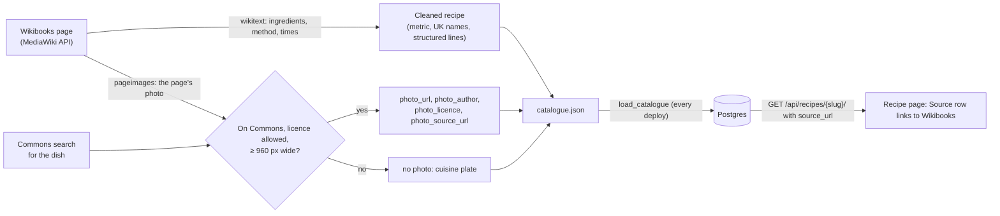

# Catalogue batch 1

Linear: TAS-48

## Summary

The catalogue has five hand-written recipes. This issue adds the first 50 recipes adapted from the Wikibooks Cookbook, cleaned into Tastebook's structured form (metric, UK names, every ingredient line structured), credited, linked to their original page and with a reusable Commons photo where one exists. It also commits the shortlist of about 300 Wikibooks recipes that TAS-49 (Catalogue batch 2) and later batches work through. To credit the original properly, a recipe gains an optional source address, and the recipe page links the source credit to it. Eight cuisines join today's ten so the shortlist can reach beyond them.

Evidence: feature — people see 50 new recipes on `/recipes`, eight new cuisine filters, and a source credit that links to the Wikibooks page.

One PR (the human chose not to split): the code is about 15 files, and the data (`catalogue.json`, the shortlist) is reviewed by sample, as decided at slicing.

## Required reading

- `AGENTS.md`: hard constraints, the API contract steps and the Tests section.
- `docs/architecture.md` (the paragraph on `load_catalogue`): the catalogue changes only through `catalogue.json`; the loader replaces what the database holds.
- `backend/recipes/catalogue.json`: the shape every new recipe and ingredient copies (`ingredient_groups`, lines with `amount`, `amount_max`, `unit`, `ingredient`, `note`, `optional`, and ingredients with `contains_*` and `synonyms`).
- `backend/recipes/services.py:52-221`: `load_catalogue()`. Every concrete, editable model field is accepted from the file (`_plain_fields`, line 178), so `source_url` and `original_text` load with no loader change.
- `backend/recipes/models.py:154-266`: `Recipe`, its `source` and photo fields and the `recipe_photo_is_credited` constraint. `models.py:277-304`: `Ingredient` and its `contains_*` flags. `models.py:350-366`: `Unit`.
- `backend/recipes/photos.py:5-10`: `COMMONS_FILE` and `COMMONS_FILE_PAGE`, the patterns every photo address must match.
- `backend/recipes/migrations/0004_cuisine.py`: the data migration pattern for the new cuisines.
- `backend/recipes/serializers.py:221-259`: `RecipeSerializer` and its `extra_kwargs`.
- `frontend/src/recipes/recipe-facts.tsx`: the Source row this changes. `frontend/src/recipes/recipe-photo-credit.tsx`: how a credit links today (a plain `<a>`, styled by `enamel.css`).
- `frontend/src/recipes/convert.ts:99-111`: the step temperature pattern the recipes' method text must match (`180°C (160°C fan)`).
- `backend/tests/test_catalogue.py`: the tests about the repo's own file, several of which change.
- `specs/lessons/blank-model-fields-are-optional-in-the-schema.md`: `source_url` is `blank=True`, so it needs `required: True` in `extra_kwargs`.
- `specs/lessons/django-admin-is-on-screen.md`: the recipe's admin page gains a field, so verify screenshots it.

## Product behaviour

One claim per acceptance criterion, in the issue's order.

1. The repo holds a shortlist of about 300 complete Wikibooks recipes across cuisines.
2. The 50 shortlisted batch-1 recipes open from `/recipes` and show their own pages.
3. Each new recipe reads in metric and UK names, every ingredient line structured.
4. Each new recipe has a difficulty and one-pot value; unsettled ones are listed in the PR.
5. Each new recipe's Source row reads the Wikibooks credit and links to its original page.
6. Each new recipe shows a credited, reusable Commons photo, or the cuisine plate when there is none.
7. New ingredients join the shared list with what they contain; nothing comes from an outside database.
8. The PR records a sample check of the batch against Wikibooks with no errors left.

## Technical design

- **Approach:**
  - **Model.** `Recipe` gains `source_url`, an optional `URLField` after `source`. Migration `0012_recipe_source_url`.
  - **Cuisines.** Data migration `0013_more_cuisines` adds American, Caribbean, German, Korean, Middle Eastern, Moroccan, Turkish and Vietnamese.
  - **API.** `RecipeSerializer` sends `source_url` (always, `''` when there is none). Regenerate `backend/schema.yml` and `frontend/src/api/schema.d.ts`.
  - **Admin.** `RecipeAdmin` shows `source_url` next to `source` (read-only, like every catalogue field).
  - **Recipe page.** The Source row's text is a link to `source_url` when the recipe has one; otherwise plain text, as today.
  - **Data.** `backend/recipes/catalogue-shortlist.json` (new) holds the shortlist. `backend/recipes/catalogue.json` gains the 50 recipes and the ingredients they need. The loader needs no change.
  - **Docs.** `GLOSSARY.md`'s Source credit row names `Recipe.source_url`.
- **API contract:** `GET /api/recipes/{slug}/` gains `source_url: string`, required in the schema, `''` when the recipe has no original page. `GET /api/recipes/` is unchanged (summaries don't carry the source). `GET /api/cuisines/` returns 18 cuisines instead of 10; its shape is unchanged.
- **Blast radius:** see [Blast radius](#blast-radius).
- **Not changing:** the loader (`services.py`), the recipe list page, the photo code and the cuisine plate colours.



### Model and migrations

```py
# backend/recipes/models.py, after source
source_url = models.URLField(
    'source address',
    max_length=500,
    blank=True,
    help_text="The original recipe's page, which the source credit links to. Leave empty when there is none.",
)
```

- `0012_recipe_source_url` is generated by `makemigrations` (one `AddField`).
- `0013_more_cuisines` is hand-written, mirroring `0004_cuisine.py`'s `CUISINES` list and `RunPython`. It creates the rows with `bulk_create(..., ignore_conflicts=True)`, because cuisines are editable in the admin and production may already hold one of them. Its reverse is `migrations.RunPython.noop`, because it can't tell a cuisine it added from one staff added.

```py
CUISINES = [
    ('American', 'american'),
    ('Caribbean', 'caribbean'),
    ('German', 'german'),
    ('Korean', 'korean'),
    ('Middle Eastern', 'middle-eastern'),
    ('Moroccan', 'moroccan'),
    ('Turkish', 'turkish'),
    ('Vietnamese', 'vietnamese'),
]
```

### Serializer and admin

- `RecipeSerializer.Meta.fields`: add `'source_url'` straight after `'source'`. `extra_kwargs`: add `'source_url': {'required': True, 'allow_blank': True}`.
- `RecipeAdmin.fieldsets` (`admin.py:111`): `(None, {'fields': ('equipment', 'source', 'source_url')})`.

### Recipe page

In `frontend/src/recipes/recipe-facts.tsx`, add a component beside `NamesFact` and use it in the Source row. Early return, no inline ternary:

```tsx
type SourceCreditProps = { source: string; sourceUrl: string };

// The credit itself is the link, so its accessible name is the whole credit.
const SourceCredit = ({ source, sourceUrl }: SourceCreditProps) => {
  if (sourceUrl === '') {
    return source;
  }
  return <a href={sourceUrl}>{source}</a>;
};

// in RecipeFacts:
{recipe.source !== '' && (
  <Fact term="Source">
    <SourceCredit source={recipe.source} sourceUrl={recipe.source_url} />
  </Fact>
)}
```

The link takes the global `a` style from `enamel.css` (cobalt, underlined), like the photo credit's link. It opens in the same tab, like the photo credit.

### The shortlist file

`backend/recipes/catalogue-shortlist.json` (new). It is not loaded; it is the plan the batches work through. A list of objects, ordered by `batch` (1 first, then `null`), then `cuisine`, then `title`:

```json
[
  {
    "page": "https://en.wikibooks.org/wiki/Cookbook:Shepherd%27s_Pie_I",
    "title": "Shepherd's pie",
    "cuisine": "British",
    "course": "Main",
    "batch": 1
  }
]
```

- `page`: the canonical page address, after redirects, exactly as stored in the recipe's `source_url` (the form `https://en.wikibooks.org/wiki/Cookbook:<Title>`, spaces as `_`, other characters percent-encoded as MediaWiki's `canonicalurl` gives them).
- `title`: the Tastebook title, in UK English and sentence case, as the catalogue will use it.
- `cuisine`: one of the 18 Tastebook cuisine names. `course`: one of Baking, Breakfast, Dessert, Main, Side.
- `batch`: `1` for this issue's 50, `null` for the rest. TAS-49 and later batches set their own number.

**Choosing the shortlist.** A Wikibooks page is shortlisted only when all of these hold:

1. It is a recipe page in the `Cookbook:` namespace with an ingredients list that gives amounts, and a method of at least two steps that uses every ingredient.
2. It is a dish a UK home cook would make: ingredients a UK supermarket sells, equipment from the catalogue's 11 pieces, and no step that needs a commercial kitchen.
3. It fits one of the five courses. Soups and starters count as Main. Sauces, drinks, condiments, preserves and spice mixes are not shortlisted.
4. It is not one of the five hand-written dishes (chicken tikka masala, Greek salad, oat and raisin cookies, spaghetti aglio e olio, Spanish tortilla), and no other shortlisted page is the same dish. Where Wikibooks has several versions ("Shepherd's Pie I", "II"), take the most complete one.
5. Its cuisine maps to a Tastebook cuisine through the Wikibooks cuisine pages below. A page linked from none of them is not shortlisted.

| Tastebook cuisine | Wikibooks pages to pick from |
| --- | --- |
| American | Cookbook:Cuisine of the United States, Southern Cuisine, New England Cuisine, Cajun Cuisine, Louisiana Creole cuisine, Tex-Mex Cuisine, Midwestern Cuisine |
| British | Cookbook:Cuisine of the United Kingdom, Cuisine of Scotland, Cuisine of Wales, Cuisine of Northern Ireland, Cornish Cuisine, and Category:English recipes |
| Caribbean | Cookbook:Caribbean Cuisine, Cuisine of Jamaica, Cuisine of Trinidad and Tobago, Cuisine of Cuba, Cuisine of Puerto Rico, Cuisine of Haiti, Cuisine of the Bahamas |
| Chinese | Cookbook:Cuisine of China, Sichuan Cuisine |
| French | Cookbook:Cuisine of France |
| German | Cookbook:Cuisine of Germany |
| Greek | Cookbook:Cuisine of Greece, Cuisine of Cyprus |
| Indian | Cookbook:Cuisine of India |
| Italian | Cookbook:Cuisine of Italy |
| Japanese | Cookbook:Cuisine of Japan |
| Korean | Cookbook:Cuisine of Korea |
| Mexican | Cookbook:Cuisine of Mexico, Cuisine of Yucatan |
| Middle Eastern | Cookbook:Middle Eastern Cuisine, Cuisine of Lebanon, Cuisine of Syria, Cuisine of Israel, Palestinian Cuisine, Cuisine of Iraq, Cuisine of Iran |
| Moroccan | Cookbook:Cuisine of Morocco |
| Spanish | Cookbook:Cuisine of Spain, Basque Cuisine |
| Thai | Cookbook:Cuisine of Thailand |
| Turkish | Cookbook:Cuisine of Turkey |
| Vietnamese | Cookbook:Cuisine of Vietnam |

**Spread.** Between 280 and 320 entries. No cuisine has more than 40. Every cuisine has at least 5, or every page that qualifies when fewer than 5 do (name those cuisines and their counts in the PR description).

**Batch 1.** The 50 entries with `batch: 1` cover at least 12 cuisines, at most 6 from any one, and at least 25 Main, 4 Baking, 4 Dessert, 3 Side and 3 Breakfast.

### Recipe rules

Every batch-1 recipe in `catalogue.json` follows these. TAS-49 and later batches follow them too.

**Fetching.** Use the MediaWiki APIs at `https://en.wikibooks.org/w/api.php` and `https://commons.wikimedia.org/w/api.php`. Send `User-Agent: Tastebook catalogue (https://github.com/milobedini/tastebook)`, ask for up to 50 titles per query, and wait at least one second between requests (the APIs answer with an HTML error page when hurried). Read each page's wikitext (`action=query&prop=revisions&rvprop=content&rvslots=main&redirects=1`), its canonical address (`prop=info&inprop=url`, field `canonicalurl`) and its lead image (`prop=pageimages&piprop=name`). Keep any scripts and downloads in a temporary directory outside the repo; nothing fetched is committed except the cleaned data.

**Recipe fields.**

| Field | Rule |
| --- | --- |
| `slug` | `slugify(title)`; unique in the file. |
| `title` | The UK name of the dish in sentence case ("Shepherd's pie", "Pad thai"). |
| `description` | One sentence of your own, at most 300 characters, in the style of the hand-written five. Never copied from the page. |
| `cuisines` | The shortlist entry's one cuisine. |
| `courses` | The shortlist entry's course. Add Breakfast as a second course only when the page says it is a breakfast dish. |
| `difficulty` | See Difficulty and one-pot below. |
| `prep_minutes`, `cook_minutes` | The page's own times when it gives prep and cook separately. Otherwise worked out from the method, and listed in the PR's "Needs a look" table as estimated. |
| `extra_minutes`, `extra_label` | Waiting time the method states (marinating, chilling, proving, resting, cooling, soaking), with that word as the label. When the method states two, add them and use the longer one's word. |
| `servings` or `yield_amount` and `yield_unit` | The page's "Servings" or "Yield". Baking that makes pieces ("makes 12 muffins") uses a yield. When the page gives neither, estimate servings and list it in "Needs a look". |
| `equipment` | Every one of the 11 pieces the method uses (Hob for any pan on a heat, Oven for baking or roasting). |
| `one_pot` | See Difficulty and one-pot below. |
| `source` | Exactly `Adapted from the Wikibooks Cookbook (CC BY-SA 4.0), converted to metric, ingredients restructured`. |
| `source_url` | The page's `canonicalurl`. |
| `photo_*` | See Photos below. All four, or none. |
| `ingredient_groups` / `ingredient_lines` | Groups only where the page groups its ingredients ("For the sauce"); otherwise ungrouped lines. |
| `steps` | The page's method, rewritten in UK English with metric amounts and temperatures, one step per instruction paragraph. Every ingredient line is used by a step. |

**Ingredient lines.** Every line on the page becomes one or more structured lines:

- `ingredient` names an entry in the file's `ingredients` list (see Ingredients).
- `amount` is a number. Fractions become decimals to at most three places (⅓ is `0.333`). A range ("2–3") is `amount` 2 and `amount_max` 3. A vague amount ("a few sprigs", "a splash") has no amount, and the words go in `note`.
- `unit` is one of `g`, `kg`, `ml`, `l`, `tsp`, `tbsp`, `pinch`, `clove`, `tin`, `slice`, `bunch`, `handful`, or none for a count ("2 eggs"). Never `cup`, `oz`, `lb` or `fl_oz`.
- `note` holds preparation and form: "finely chopped", "softened", "400 g" for a tin.
- `optional` is `true` when the page says optional, "if desired" or "to garnish, optional".
- "Salt and pepper to taste" becomes two lines, `salt` and `black pepper`, each with no amount and note `to taste`.
- `original_text` is the page's line as written, with wiki markup (links, bold, templates) removed, at most 300 characters. A line that splits into two structured lines puts the same `original_text` on both. When the original is longer than 300 characters, leave it empty and list the line in "Needs a look". The recipe page offers "Show original" from this field wherever it differs from what is shown.

**Converting to metric.** An amount the page already gives in metric is used as it is. Otherwise:

| From | To |
| --- | --- |
| US cup of a dry ingredient in the table below | grams, cups × the table's grams |
| US cup of anything else (liquids included) | ml, cups × 240. A dry ingredient not in the table is listed in "Needs a look". |
| oz | g, × 28.35 |
| lb | g, × 453.6 |
| fl oz | ml, × 29.57 |
| US pint, quart, gallon | ml, × 473, × 946, × 3785 |
| stick of butter | g, × 115 |
| tbsp of butter | g, × 15 |
| tsp, tbsp of anything else | unchanged |
| can or tin of any size | `amount` the count, `unit` `tin`, `note` the nearest UK tin size: `400 g`, or `200 g` for a can under 10 oz |
| inches (tin sizes, thickness) | cm in the step or note, × 2.54, to the nearest whole cm |
| °F | °C = (°F − 32) × 5 ÷ 9, to the nearest 10, written `180°C (160°C fan)` with the fan temperature 20 lower |

Round a converted gram or millilitre amount: below 10, to the nearest 1; from 10 to 99, to the nearest 5; from 100 to 999, to the nearest 25; from 1,000, to the nearest 50 and written in `kg` or `l` (1,250 g is `1.25` `kg`).

Grams per US cup:

| Ingredient | g | Ingredient | g |
| --- | --- | --- | --- |
| plain flour | 125 | long-grain or basmati rice | 185 |
| self-raising flour | 125 | risotto rice | 200 |
| strong white bread flour | 130 | couscous | 175 |
| wholemeal flour | 120 | polenta | 160 |
| cornflour | 120 | red lentils | 190 |
| caster sugar | 200 | porridge oats | 90 |
| granulated sugar | 200 | dried breadcrumbs | 110 |
| light or dark brown soft sugar | 220 | fresh breadcrumbs | 50 |
| icing sugar | 120 | ground almonds | 100 |
| cocoa powder | 85 | desiccated coconut | 80 |
| butter | 225 | chopped nuts | 120 |
| grated cheddar | 100 | raisins or sultanas | 150 |
| grated parmesan | 100 | chocolate chips | 170 |
| frozen peas | 140 | peanut butter | 250 |

**UK names.** Ingredient names, notes and steps use the UK word. The US word becomes a synonym of the ingredient. At least these:

| US | UK | US | UK |
| --- | --- | --- | --- |
| all-purpose flour | plain flour | ground beef | beef mince |
| cilantro | coriander | shrimp | prawns |
| zucchini | courgette | arugula | rocket |
| eggplant | aubergine | garbanzo beans | chickpeas |
| scallion, green onion | spring onion | molasses | black treacle |
| heavy cream | double cream | semisweet chocolate | dark chocolate |
| light cream | single cream | golden raisins | sultanas |
| powdered or confectioners' sugar | icing sugar | canola oil | rapeseed oil |
| superfine sugar | caster sugar | bell pepper | red, green or yellow pepper |
| baking soda | bicarbonate of soda | chili | chilli |
| cornstarch | cornflour | yogurt | yoghurt |

In steps: broil → grill, skillet → frying pan, stove or stovetop → hob, plastic wrap → cling film, aluminum foil → foil, cookie sheet → baking tray. Spelling is British throughout (colour, flavour, caramelise).

**Ingredients.** Reuse an existing ingredient whenever it is the same thing; never add a near-duplicate ("onions" when `onion` exists). Name a new one as the UK shopping list does, lower case except proper nouns, in the form the existing list names a similar ingredient (`ground cumin`, `chopped tomatoes`). Each new ingredient sets every `contains_*` flag that applies, by the models' help text:

- `contains_meat`: meat, poultry, gelatine, lard, suet, and meat or chicken stock.
- `contains_fish`: fish, shellfish, anchovies, fish sauce, oyster sauce, shrimp paste, Worcestershire sauce.
- `contains_dairy`: milk, cream, butter, cheese, yoghurt, ghee.
- `contains_animal_rennet`: cheeses whose protected recipe needs calf rennet (parmesan, pecorino, gruyère, grana padano, gorgonzola, manchego, roquefort). Other cheeses are `false`.
- `contains_egg`: eggs, mayonnaise, egg noodles, fresh egg pasta.
- `contains_other_animal_product`: honey.
- `contains_gluten`: wheat, barley and rye, oats, bread, breadcrumbs, pasta, couscous, bulgur, soy sauce, beer.

When the usual UK supermarket product varies (stock cubes, puff pastry), set the flag if common versions contain it, so a diet tag is never claimed wrongly. Synonyms are unique across every ingredient. The `ingredients` list stays in alphabetical order. No outside ingredient or nutrition database is used: the list grows only from these recipes.

**Difficulty and one-pot.**

- `easy`: one cooking stage, basic techniques (chop, fry, simmer, bake, mix), nothing timing-critical.
- `medium`: two or more components cooked separately, or one technique that takes care (a roux, deep-frying, shaping dough, folding egg whites).
- `hard`: pastry or yeasted dough made from scratch with proving or resting, tempering, or three or more timed components.
- `one_pot`: `true` when every cooking step happens in one pan, pot, tin or tray. Bowls for mixing raw ingredients and serving dishes don't count.
- The page's Wikibooks difficulty category (such as "Category:Medium Difficulty recipes"), when it has one, is a hint. Where it disagrees with these rules, or a recipe sits between two levels, or one-pot depends on reading the method one way, use the rules' answer and list it in "Needs a look".

**Photos.** Answer "Page's photo, else Commons":

1. Take the page's lead image (`pageimages`). It counts only when it is hosted on Commons: the Wikibooks `imageinfo` says `"imagerepository": "shared"`.
2. Otherwise search Commons (`list=search&srnamespace=6&srsearch=<dish name> filetype:bitmap`) and take the first result that shows the finished dish (not an ingredient, a person or a menu). Look at the thumbnail before taking it.
3. A file qualifies only when, from Commons' `imageinfo` with `iiprop=url|size|extmetadata`:
   - it is a JPEG, PNG or WebP at least 960 px wide;
   - its `LicenseShortName` is public domain, CC0, CC BY or CC BY-SA (any version). Never NC, ND, GFDL-only or fair use.
4. Store:
   - `photo_url`: `imageinfo.url` with its query string (`?utm_source=…`) removed, so it matches `COMMONS_FILE`.
   - `photo_author`: `extmetadata.Artist` with HTML removed, at most 200 characters; `Unknown author` when Commons gives none.
   - `photo_licence`: `Public domain` for any public domain mark, `CC0 1.0` for CC0, otherwise `LicenseShortName` as Commons gives it (`CC BY-SA 4.0`).
   - `photo_source_url`: `imageinfo.descriptionurl`.
5. No qualifying file: no photo fields, so the recipe shows its cuisine plate.

Photos are linked, never copied into the repo or into Vercel Blob.

**"Needs a look".** The PR description has a "Needs a look" table, one row per unsettled value: slug, field, what was decided and why it is unsure. It holds estimated times and servings, difficulty and one-pot calls, dry cups not in the grams table, and empty `original_text`.

**Sample check.** Before asking for review, check every fifth batch-1 recipe in file order (10 recipes) against its Wikibooks page: each line's ingredient, converted amount and unit, notes and optional flag; every step present and in order; times, servings, cuisine, course; the photo's licence and author on Commons. Fix every error found, then sweep all 50 for the same kind of error. The PR description lists the 10 slugs, the checks and "No errors left". The review stage samples others.

### Steps

1. **Add the source address.** `backend/recipes/models.py` (edit), `backend/recipes/migrations/0012_recipe_source_url.py` (new, generated), `backend/recipes/serializers.py` (edit), `backend/recipes/admin.py` (edit).
   Add `source_url` as sketched, generate the migration, add it to `RecipeSerializer` and `RecipeAdmin`.
   Done when: `uv run --env-file .env python manage.py makemigrations --check` reports no changes and the backend tests in Tests for `source_url` pass.
2. **Regenerate the API contract.** `backend/schema.yml`, `frontend/src/api/schema.d.ts` (edit, generated).
   Run `spectacular --file schema.yml --validate --fail-on-warn`, then `pnpm generate:api`.
   Done when: `schema.d.ts` types `Recipe.source_url` as `string`, not optional.
3. **Link the credit on the recipe page.** `frontend/src/recipes/recipe-facts.tsx` (edit), `frontend/src/test/handlers.ts`, `frontend/src/recipes/recipe-page.test.tsx`, `frontend/src/recipes/recipes-page.test.tsx`, `frontend/e2e/phone-width.spec.ts` (edit fixtures).
   Add `SourceCredit`. Give every typed `Recipe` fixture a `source_url` (`''`, except `phone-width.spec.ts`'s recipe, which gets `https://en.wikibooks.org/wiki/Cookbook:Roast_Pork_Shoulder_with_Crackling` so the long credit is a link at 320 px).
   Done when: `pnpm lint` is clean and the recipe page test for the link passes.
4. **Add the eight cuisines.** `backend/recipes/migrations/0013_more_cuisines.py` (new), `backend/tests/test_recipes.py` (edit).
   Done when: `GET /api/cuisines/` lists 18 cuisines in the test, and the admin cuisine test adds Ethiopian.
5. **Commit the shortlist.** `backend/recipes/catalogue-shortlist.json` (new).
   Done when: the shortlist tests pass.
6. **Add the 50 recipes and their ingredients.** `backend/recipes/catalogue.json` (edit).
   The five hand-written recipes stay first and unchanged; the 50 follow in shortlist order. Run `pnpm format` so Biome lays the file out.
   Done when: `uv run --env-file .env python manage.py load_catalogue` prints `Loaded the catalogue: 55 recipes, …` and the catalogue tests pass.
7. **Update the tests about the repo's catalogue.** `backend/tests/test_catalogue.py` (edit), `frontend/e2e/recipe.spec.ts` (edit).
   Done when: `uv run pytest` and `pnpm test:e2e` pass.
8. **Update the glossary.** `GLOSSARY.md` (edit).
   Source credit row: meaning "Where a recipe came from: an author, a website, or "Adapted from the Wikibooks Cookbook (CC BY-SA 4.0), …", linked to the original page when the recipe has its address." In code: `` `Recipe.source`, `Recipe.source_url` ``.
   Done when: the row names both fields.
9. **Sample check and PR notes.** PR description only.
   Done when: the description has the "Needs a look" table, the sample check (10 slugs, "No errors left") and, if any, the cuisines with fewer than 5 shortlisted pages.

### Tests

- `backend/tests/test_catalogue.py`
  - `HAND_WRITTEN` (new module constant): the five hand-written titles in alphabetical order. `CREDIT` (new): the exact source string above.
  - `test_loads_a_recipe_with_its_details_ingredients_and_method`: `SHAKSHUKA` gains `'source_url': 'https://en.wikibooks.org/wiki/Cookbook:Shakshouka'`, asserts: the response has `'source_url': 'https://en.wikibooks.org/wiki/Cookbook:Shakshouka'` straight after `'source'`.
  - `test_loads_the_repos_catalogue_in_place_of_the_recipes_already_there` (edit), asserts: `titles()` has 55 entries, includes each of `HAND_WRITTEN`, and excludes "Typed in the admin".
  - `test_the_repos_recipes_are_found_by_their_ingredients_us_names` (edit), asserts: `[title for title in titles(q) if title in HAND_WRITTEN] == expected` for the same five cases.
  - `test_every_wikibooks_recipe_is_credited_and_links_to_its_page` (new), after `load_catalogue`, for every recipe from `GET /api/recipes/` whose detail `source` isn't `Tastebook`, asserts: there are 50, every `source` equals `CREDIT`, and every `source_url` matches `^https://en\.wikibooks\.org/wiki/Cookbook:[^?#]+$`.
  - `test_no_recipe_in_the_repos_catalogue_measures_in_cups_ounces_or_pounds` (new), asserts: the set of `unit`s across every line of every recipe's detail includes `g` and `ml`, and has none of `cup`, `oz`, `lb`, `fl_oz`.
  - `test_every_photo_in_the_repos_catalogue_has_a_licence_that_allows_reuse` (new), asserts: at least one recipe has a photo, and every photo's `licence` matches `^(Public domain|CC0 1\.0|CC BY(-SA)? \d\.\d( [a-z]{2,3})?)$`.
  - `test_the_shortlist_holds_about_300_wikibooks_pages_spread_across_cuisines` (new), reads `catalogue-shortlist.json` (a plan, not loaded, so it is read as a file) and `GET /api/cuisines/`, asserts: between 280 and 320 entries; every `page` unique and matching the Wikibooks pattern above; every `cuisine` a name from the endpoint; every `course` one of the five; no cuisine more than 40; exactly 50 with `batch` 1.
  - `test_the_catalogue_holds_the_shortlists_first_batch` (new), asserts: the set of `source_url`s of the Wikibooks recipes from the API equals the set of `page`s with `batch` 1.
- `backend/tests/test_recipes.py`
  - `test_returns_the_whole_recipe_with_its_details` (edit): the recipe is made with `source_url='https://en.wikibooks.org/wiki/Cookbook:Shakshouka'`, asserts: the JSON has that `source_url`.
  - `test_lists_the_seeded_cuisines_alphabetically` (edit), asserts: the 18 names in alphabetical order (American, British, Caribbean, Chinese, French, German, Greek, Indian, Italian, Japanese, Korean, Mexican, Middle Eastern, Moroccan, Spanish, Thai, Turkish, Vietnamese) and that `Middle Eastern`'s slug is `middle-eastern`.
  - `test_a_staff_user_adds_a_cuisine_in_the_admin` (edit): posts `Ethiopian` / `ethiopian`, asserts: the names from `Chinese` to `French` are `['Chinese', 'Ethiopian', 'French']`.
  - `test_the_recipe_page_in_the_admin_shows_its_ingredients_and_method_read_only` (edit): the recipe has a `source_url`, asserts: the page contains "Source address" and the address.
- `frontend/src/recipes/recipe-page.test.tsx`
  - `it.each` "links the source credit to the original page only when the recipe has its address" over `['https://en.wikibooks.org/wiki/Cookbook:Shakshouka', 1]` and `['', 0]`, asserts: the Source row's text is "Adapted from the Wikibooks Cookbook (CC BY-SA 4.0)" in both, and `getAllByRole('link', { name: 'Adapted from the Wikibooks Cookbook (CC BY-SA 4.0)' })` has that many links, the one with `href` the address.
- `frontend/e2e/recipe.spec.ts`
  - "a Wikibooks recipe credits and links to its original page through the real API": opens the first Wikibooks recipe in `catalogue.json` by its slug, asserts: the link named with the full `CREDIT` text has `href` its `source_url`, and `accessibility.check()` passes.

Then the repo's checks: `pnpm lint`, `pnpm test`, `pnpm test:e2e`, and in `backend/` `uv run ruff check . && uv run ruff format --check .` and `uv run pytest`.

## Decisions

- The recipe gets an optional `source_url`, rather than a link inside the `source` text, because the API should give the page a real address to link and `source` stays a plain credit. Triage brief, agreed in question 1.
- The whole credit text is the link, because the credit names the original and the link's accessible name then says where it goes. Asked: How should the recipe page link the source credit to the original? → Link the credit text.
- The shortlist may use today's ten cuisines plus American, Caribbean, German, Korean, Middle Eastern, Moroccan, Turkish and Vietnamese, added in one data migration. Asked: Which cuisines can the shortlist of about 300 recipes use? → Today's ten plus eight.
- Dry ingredients in cups become grams from the fixed table above; any other cup amount becomes ml, and a dry one not in the table is flagged. Asked: How should dry ingredients given in cups be converted? → Grams, from a fixed table.
- A recipe's photo is its Wikibooks page's own Commons photo, else the first fitting Commons search result. Asked: Where should a recipe's photo come from? → Page's photo, else Commons.
- The five hand-written recipes stay, first in the file, and the shortlist skips their dishes. Asked: Should the five hand-written recipes stay in the catalogue? → Keep them.
- One PR holds the source link and the recipes. Asked: Should the source link ship in its own PR before the recipes? → One PR.
- The eight cuisines are created with `ignore_conflicts=True` and the migration doesn't reverse, because staff can add cuisines in the admin and production may already hold one. (agent)
- The shortlist lives at `backend/recipes/catalogue-shortlist.json` beside the catalogue, as JSON so a test can check it against the catalogue and each batch can mark its own entries. (agent)
- No fetch or conversion script is committed: cleaning needs judgement on every line, and the rules above (which later batches reuse) are the repeatable part. Automated tests guard what can be checked offline: credit, link, units, licences, the shortlist's shape. (agent)
- `original_text` keeps each Wikibooks line, so the recipe page's existing "Show original" works for these recipes. (agent)
- Photos must be at least 960 px wide, so a recipe's photo isn't blurry at the page's widest. (agent)

## Assumptions

- Every new recipe carries the same credit, "…, converted to metric, ingredients restructured", even when its page already gave metric amounts, because the issue fixes the wording. Confirm with: Milo Bedini, at spec approval.
- Soups and starters count as Main; sauces, drinks, condiments, preserves and spice mixes are left off the shortlist, because the five courses have no place for them. Confirm with: Milo Bedini, at spec approval.
- The equipment list stays at its 11 pieces; a recipe lists only those it uses. Confirm with: Milo Bedini, at spec approval.
- The eight new cuisines show the default plate colour (`--cuisine-other`). `docs/design.md` says a cuisine gets its colour when added, but five of today's ten have none either, so colours are a follow-up for design. Confirm with: Milo Bedini, at spec approval.
- Wikibooks text is CC BY-SA 4.0 (older revisions 3.0, which 4.0 may adapt), so the fixed credit wording holds for every page. Confirm with: Milo Bedini, at spec approval.

## Blast radius

- **`Recipe` in `schema.d.ts` gains a required `source_url`.** Every typed `Recipe` fixture fails to type-check until it has one: `frontend/src/test/handlers.ts`, `recipe-page.test.tsx`, `recipes-page.test.tsx`, `e2e/phone-width.spec.ts`. `pnpm lint` finds them all.
- **`GET /api/cuisines/` returns 18.** The filter panel's Cuisine group shows 18 chips; verify it at 375 px and 320 px. `test_lists_the_seeded_cuisines_alphabetically` and the admin cuisine test change (Korean is now seeded).
- **The catalogue has 55 recipes.** `test_catalogue.py`'s tests about the repo's file change as listed. The e2e assertions in `recipes.spec.ts` and `recipe.spec.ts` name hand-written recipes and stay true with more recipes (checked: each `toHaveCount(0)` is about a hand-written recipe a filter excludes). `/recipes` renders 55 cards with lazy photos; Lighthouse on the preview must stay at its thresholds.
- **New ingredients and synonyms.** Synonyms are unique across ingredients; a clash fails `load_catalogue`, and so the build.

## Out of scope

- TAS-49 (Catalogue batch 2) and later batches: the next 50 from the shortlist.
- Cuisine plate colours for the new cuisines (follow-up for design).
- New courses (Starter, Soup) or equipment.
- Showing the source credit or link on recipe cards.
- A tool that fetches or converts Wikibooks recipes.
- Licence links in the credit beyond the wording the issue fixes.

## Validation criteria

- [ ] `pnpm lint` and `pnpm test` pass.
- [ ] In `backend/`: `uv run ruff check . && uv run ruff format --check .`, `uv run pytest`, `makemigrations --check`, and `spectacular --validate --fail-on-warn` pass.
- [ ] `pnpm test:e2e` passes, with axe on the Wikibooks recipe page.
- [ ] `load_catalogue` loads 55 recipes on the preview's database.
- [ ] The PR has the "Needs a look" table and the sample check with "No errors left".
- Evidence: feature — a laptop screenshot of `/recipes` with the new recipes; phone screenshots of a Wikibooks recipe with its photo and photo credit, its Source row link, one with the cuisine plate, the Cuisine filter group with 18 cuisines, and the admin recipe page's Source address; a walkthrough from the list to a recipe and its credit link.
