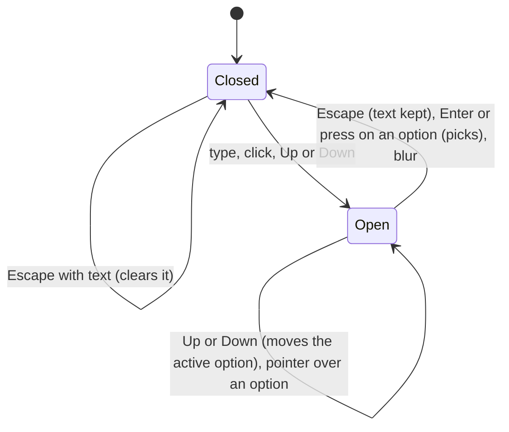

# Restyle fields, search and select in Picnic and add a combobox

Linear: TAS-77

## Summary

Dino's fields still have Enamel's shape: 44 px, a 1 px border on Surface. This work restyles Field, Input, SearchInput and NativeSelect to the Picnic fields board, and adds a Dino Combobox that the ingredient picker then uses in place of its cmdk popover. It lands in two PRs, each merging to `main` on its own:

- **Part 1 (this issue, TAS-77):** Field, Input, SearchInput and NativeSelect, their stories and baselines, and the recipes page's search field.
- **Part 2 (a sub-issue filed when this spec is approved):** the Combobox, the ingredient picker moving onto it, and cmdk's removal.

Evidence: feature — part 1 changes the search field on the recipes page (hidden label, 48 px pill, clear button); part 2 changes how ingredients are picked in the filters.
Design: skip — the fields board (`docs/design/dino/fields.dc.html`) draws every field state and the combobox, so the work builds to it.
Components: Field (changed: hidden label), Input (changed), SearchInput (changed: clear button), NativeSelect (changed), Combobox (new, part 2), RemovableChip (changed: remove label, part 2).

## Required reading

- `AGENTS.md`: hard constraints, Tests, and the baselines rules (made only on a GitHub Actions runner).
- `docs/design.md`: States (Focus, Disabled), Components (Field, Combobox), Space and shape (Corners), Rules (State).
- `docs/design/dino/fields.dc.html` and `fields.dc.png`: the board. Its `<style>` block holds the exact sizes; this spec quotes them.
- `docs/design/dino/forced-colours.dc.html`: disabled stays dashed; the ring becomes the system colour.
- `specs/lessons/story-play-leaves-real-focus.md`: the visual spec blurs focus after play, so a story that must show an open list or a focus ring can't get it from play.
- `specs/lessons/storybook-under-vitest-has-no-manager.md`: pseudo-states aren't forced under Vitest, and a stateful story keeps its value in React state.
- `specs/lessons/cmdk-names-its-input-from-the-command-label.md`: the space-in-a-flex-option rule still applies to the Combobox's options (part 2 deletes the lesson's cmdk half).
- `specs/lessons/biome-wants-native-landmark-elements.md`: Biome's a11y rules shape the listbox markup (see Decisions).
- PR #76 (TAS-78, open): mirror how it adds a corner token (`--radius-row`) to `picnic.css`, the radius lint's message and the Corners line of `docs/design.md`. Part 2 adds `--radius-option` the same way.
- `frontend/src/dino/checkbox-row.stories.tsx`: a stateful story seeded from its args, with a play function.
- `frontend/src/recipes/ingredient-picker.tsx`: today's picker, its option markup and its comment on spaces.

## Product behaviour

**Part 1: fields**

1. Inputs, search fields and selects are 48 px pills with a 2 px Field border and no fill.
2. Hovering a field turns its border Muted.
3. A focused field's border turns Ink and reads 3 px thick, with no ring standing off it.
4. An invalid field has a Danger border, and its error replaces the help with an icon.
5. A disabled field is dashed on Surface with Muted text, stays focusable, and can't be changed.
6. A disabled select can't be opened by pointer or keyboard, and Tab still reaches it.
7. The recipes page's search field has a visually hidden label that still names it.
8. Typing in a search field shows a 44 px "Clear search" button with no fill.
9. Clear search empties the field and puts focus back in it.
10. The select stays a native select with a chevron.
11. The Servings examples use `inputmode="numeric"`, so phones show the number keyboard.
12. Under forced colours, a disabled field's dashed border and text draw in GrayText.
13. Every field state is a story whose baseline matches the board.

**Part 2: combobox**

14. The combobox input is named by its Field label.
15. `aria-expanded` is true only while the list of options shows.
16. Up and Down move the active option, opening the list when it's closed.
17. Enter picks the active option; Escape closes the list, then clears the text.
18. The active option scrolls into view as it moves.
19. The active option has a Line fill and a 3 px Ink outline on its own edge.
20. Letters matching the search are bold in each option.
21. Chosen ingredients show as removable chips above their field and in Filters on.
22. The list opens in the page's flow under the field, on Surface, with no shadow.
23. Ingredient filters are picked with the combobox, and cmdk is gone.
24. Every combobox state is a story whose baseline matches the board.

## Technical design

- **Approach:** frontend only. Part 1 edits Dino's field components and the recipes page's search. Part 2 adds `combobox.tsx` and `match-range.ts` to Dino, rewrites `ingredient-picker.tsx` on top of them, and removes cmdk.
- **API contract:** No change.
- **Blast radius:** see [Blast radius](#blast-radius) below.
- **Not changing:** see [Out of scope](#out-of-scope).

### How it works today

- `frontend/src/dino/input.tsx:6` `Input`: `h-11`, a 1 px `border-field`, `bg-surface`, `px-3`; disabled uses the native `disabled` attribute. `:17` `SearchInput` wraps it with a search icon and no clear button.
- `frontend/src/dino/field.tsx:47` `Field`: a visible `<label htmlFor>`, the control through a render prop `children(control)`, then help or an error with `CircleAlert` (`items-center`).
- `frontend/src/dino/native-select.tsx:6` `NativeSelect`: the same look as Input on a `<select>`, with a `ChevronDown`.
- `frontend/src/recipes/recipes-page.tsx:46` `RecipeSearch` renders `<Field label="Search recipes">` with a visible label and passes `onChange(event)`.
- `frontend/src/recipes/ingredient-picker.tsx:19` `IngredientPicker`: a secondary Button opens a Radix Popover with cmdk's `Command`; the panel is `rounded-card border border-field bg-surface` (no shadow class today, despite the issue's mention of `shadow-lg`); options are `rounded-note` with `data-[selected=true]` fill and outline. Two pickers sit in `recipe-filter-panel.tsx:186` and `:200`, labelled "Include an ingredient" and "Exclude an ingredient". Chosen ingredients show only as chips in Filters on (`active-filters.tsx`).
- No number field exists in the app. Input, NativeSelect and a disabled field appear on no page: only in stories.

### The field look (part 1)

The board's `.in` rule, in Picnic's tokens. Input and NativeSelect each carry it (two uses: the rule of three keeps them as two literal class lists; the combobox uses `Input` itself).

| State | Board | Classes |
| --- | --- | --- |
| Rest | 48 px, pill, 2 px Field, transparent, 18 px padding, 700 16/24 | `h-12 w-full min-w-0 rounded-pill border-2 border-field bg-transparent px-4.5 font-bold text-body text-ink transition-colors placeholder:font-semibold placeholder:text-muted` |
| Hover | border Muted | `hover:border-muted` |
| Focus | border Ink plus a 1 px Ink outline at offset 0 (3 px in all) | `focus-visible:border-ink focus-visible:outline-1 focus-visible:outline-offset-0 focus-visible:outline-ink` |
| Invalid | border Danger | `aria-invalid:border-danger` |
| Disabled | dashed, Surface fill, Muted text | `aria-disabled:cursor-not-allowed aria-disabled:border-dashed aria-disabled:bg-surface aria-disabled:text-muted` |
| Forced colours, disabled | dashed, GrayText | `forced-colors:aria-disabled:border-[GrayText] forced-colors:aria-disabled:text-[GrayText]` |

Precedence, as the board's CSS order gives it: an invalid field keeps its Danger border when hovered or focused (focus still adds the 1 px Ink outline); a disabled field keeps its Field border colour when hovered. Write the variants so these hold (for example `hover:not-aria-invalid:not-aria-disabled:border-muted` and `focus-visible:not-aria-invalid:border-ink`), and check them in Storybook.

**Disabled is `aria-disabled`, never `disabled`.** `Input` and `NativeSelect` take their props without `disabled` (`Omit<ComponentProps<'input'>, 'disabled'>`, the same for `select`), so the type stops anyone reaching for it. When `aria-disabled` is true or `'true'`:

- `Input` sets `readOnly`, so it stays focusable and selectable but can't be typed into.
- `NativeSelect` calls `preventDefault()` on `mousedown`, and on `keydown` for every key but Tab, so it can't open or change value. It calls the caller's own `onMouseDown` and `onKeyDown` after, when given.

```ts
const isAriaDisabled = (value: ComponentProps<'input'>['aria-disabled']) => value === true || value === 'true';
```

Each of the two files keeps its own one-line copy of this check (two uses).

### Field (part 1)

- New optional prop `hideLabel?: boolean`. When true the `<label>` takes `sr-only` instead of `text-label`. Absolutely positioned, it adds no gap.
- The error paragraph becomes `items-start`, and its `CircleAlert` takes `mt-px` and `strokeWidth={2.5}`, as on the board.

### SearchInput (part 1)

```ts
type SearchInputProps = Omit<ComponentProps<'input'>, 'type' | 'value' | 'onChange' | 'disabled'> & {
  value: string;
  onValueChange: (value: string) => void;
};
```

- Markup: a `relative` wrapper with the `group` class; the `Search` icon (`size-5`, `strokeWidth={2.5}`, `absolute top-3.5 left-4`, `text-muted`, `group-focus-within:text-ink`, `aria-hidden`); `<Input type="search">` with `pl-11.5`, plus `pr-12.5` while the value isn't empty, and `[&::-webkit-search-cancel-button]:appearance-none` so Chromium's own clear button doesn't double ours.
- While `value !== ''`, a `<button type="button" aria-label="Clear search">` sits at `absolute top-0.5 right-0.5`, `size-11 rounded-pill bg-transparent text-ink hover:text-muted`, holding `X` (`size-4.5`, `strokeWidth={2.5}`, `aria-hidden`). It takes the global 3 px Ink focus ring (`picnic.css`), not the board's colour-only focus (see Decisions).
- Pressing it calls `onValueChange('')` and focuses the input through a ref.
- Typing calls `onValueChange(event.target.value)`.

### NativeSelect (part 1)

The field look plus `cursor-pointer appearance-none pr-11.5`. The chevron: `ChevronDown`, `size-5`, `strokeWidth={2.5}`, `absolute top-3.5 right-4`, `text-muted`, `pointer-events-none`, `aria-hidden`. The aria-disabled handlers above.

### Recipes page (part 1)

`recipes-page.tsx`: `RecipeSearch` takes `onValueChange: (text: string) => void` and renders `<Field label="Search recipes" hideLabel>{(control) => <SearchInput {...control} value={value} onValueChange={onValueChange} />}</Field>`. `handleSearchChange` takes the text instead of the event; its body is otherwise unchanged. Drop the `ChangeEvent` import.

### Combobox (part 2)

`frontend/src/dino/combobox.tsx`, exported from `dino/index.ts` with its option type.

```ts
export type ComboboxOption = { value: string; name: string; hint?: string };

type ComboboxProps = {
  label: string;
  placeholder?: string;
  // What matches the search, without the chosen ones; the caller filters.
  options: ComboboxOption[];
  chosen: Pick<ComboboxOption, 'value' | 'name'>[];
  search: string;
  onSearchChange: (search: string) => void;
  onChoose: (value: string) => void;
  onRemove: (value: string) => void;
  // Each chip's accessible name is `${removeLabel}: ${name}`, like the board's "Remove ingredient: Onion".
  removeLabel: string;
  emptyText: string;
  // Opens the list on first render; the open-list story needs it, since play's focus is blurred before the shot.
  defaultOpen?: boolean;
};
```

It renders a `Field` itself, so the label, chips, input and list come out in the board's order:

```tsx
<Field label={label}>
  {(control, { labelId }) => (
    <>
      {chosen.length > 0 && (
        <div className="mb-1 flex flex-wrap gap-2">
          {chosen.map(({ value, name }) => (
            <RemovableChip key={value} removeLabel={removeLabel} onRemove={() => remove(value)}>{name}</RemovableChip>
          ))}
        </div>
      )}
      <div>
        <Input {...control} ref={inputRef} role="combobox" aria-labelledby={labelId}
          aria-expanded={expanded} aria-controls={expanded ? listboxId : undefined}
          aria-activedescendant={expanded ? optionId(activeIndex) : undefined}
          aria-autocomplete="list" autoComplete="off" placeholder={placeholder} value={search}
          onChange={type} onKeyDown={keyDown} onClick={open} onBlur={close} />
        {expanded && <ul id={listboxId} role="listbox" aria-labelledby={labelId} …>{/* options */}</ul>}
        <div role="status">{open && options.length === 0 && <p …>{emptyText}</p>}</div>
      </div>
    </>
  )}
</Field>
```

- **Field change:** `Field`'s render prop gets a second argument, `{ labelId }`, and the `<label>` gets `id={labelId}` (`${id}-label`). Existing callers ignore the argument. The input is named by the label both ways (`htmlFor` and `aria-labelledby`), as the board's input and listbox both point at the label.
- **RemovableChip change:** a new optional `removeLabel?: string`, default `'Remove filter'`; its `aria-label` becomes `` `${removeLabel}: ${children}` ``. Every current chip keeps its name.
- **State:** `open: boolean` (from `defaultOpen ?? false`) and `activeValue: string | null`. Derived in render: `expanded = open && options.length > 0`; `activeIndex = Math.max(0, options.findIndex((option) => option.value === activeValue))`, so with no active value, or one that left the list, the first option is active.
- **IDs:** from `useId()`: `listboxId = ${id}-listbox`, `optionId(index) = ${id}-option-${index}`.
- **Events:**

| Event | Result |
| --- | --- |
| Typing (`onChange`) | `onSearchChange(text)`, `open = true`, `activeValue = null` |
| Click on the input | `open = true` |
| Down | `preventDefault`. Closed: `open = true`, first option active. Open: next option, wrapping to the first |
| Up | `preventDefault`. Closed: `open = true`, last option active. Open: previous option, wrapping to the last |
| Enter | When expanded: `preventDefault`, pick the active option |
| Escape | Open: `preventDefault`, `stopPropagation`, `open = false`, text kept. Closed with text: `preventDefault`, `stopPropagation`, `onSearchChange('')`. Closed and empty: nothing, so an enclosing sheet can take it |
| Pointer moves over an option | that option becomes active |
| Pointer presses an option (`onMouseDown`) | `preventDefault` (focus stays in the input), then pick it |
| Blur | `open = false` |
| A chip's remove | `onRemove(value)`, then focus the input (the chip is gone, so focus would fall to the page) |

  Picking calls `onChoose(value)`, `onSearchChange('')`, sets `open = false` and `activeValue = null`; focus stays in the input.
- **Scroll into view:** a `useEffect` on `[expanded, activeIndex]` calls `document.getElementById(optionId(activeIndex))?.scrollIntoView({ block: 'nearest' })` while expanded. It syncs with the DOM, the one thing effects are for.
- **Markup and look** (the board's `.list` and `.opt`):
  - Listbox: `<ul>` with `mt-2 flex max-h-72 flex-col gap-0.5 overflow-y-auto rounded-card border-2 border-field bg-surface p-1.5`. No shadow, no portal: it sits in the page's flow.
  - Option: `<li id role="option" aria-selected tabIndex={-1}>` with `flex min-h-12 cursor-pointer items-center justify-between gap-2 rounded-option px-3.5 text-body text-ink aria-selected:bg-line aria-selected:outline-3 aria-selected:-outline-offset-3 aria-selected:outline-ink`. `aria-selected` is `true` on the active option and `false` on the others.
  - The active option ends with `CornerDownLeft` (`size-4`, `strokeWidth={2.5}`, `aria-hidden`), the board's Enter hint.
  - Option text: one inline `<span>` holding the name and, when there's a hint, `{' '}<span className="text-muted">· {hint}</span>`, keeping the space outside the muted span (the lesson's rule). The accessible name stays "aubergine · also eggplant".
  - The empty message: `<p className="mt-2 rounded-card border-2 border-field bg-surface px-3.5 py-3 text-muted">`.
- **Bold matches:** a `Highlighted` component in `combobox.tsx` wraps the matched range in `<b className="font-extrabold">`. Bold the name when `matchRange(name, search)` has a non-empty range; otherwise bold within the hint. An empty search bolds nothing.
- **Biome:** `lint/a11y/noNoninteractiveElementToInteractiveRole` rejects `role="listbox"` on `<ul>` and `role="option"` on `<li>`, and `lint/a11y/useFocusableInteractive` wants options focusable. Keep the board's `ul` and `li`, each with a `biome-ignore lint/a11y/noNoninteractiveElementToInteractiveRole: the ARIA listbox pattern, as on the fields board` comment; `tabIndex={-1}` satisfies the other rule without putting options in the Tab order. Picking on `onMouseDown`, not `onClick`, keeps `lint/a11y/useKeyWithClickEvents` quiet: the keyboard path is on the input. (Checked with Biome on a probe file while writing this spec.)

### matchRange (part 2)

`frontend/src/dino/match-range.ts`, exported from `dino/index.ts`:

```ts
// Where search first occurs in text, ignoring case, accents and the search's surrounding spaces; indices are into text.
export const matchRange = (text: string, search: string): { start: number; end: number } | null;
```

An empty or blank search returns `{ start: 0, end: 0 }`, so it matches everything and bolds nothing. Fold each character of `text` on its own (`normalize('NFD')`, drop `\p{M}`, `toLocaleLowerCase('en-GB')`) and keep, for each folded character, the index of the original it came from, so the range maps back onto the unfolded text.

`recipes/ingredient-match.ts`'s `matchesIngredient` then becomes `[ingredient.name, ...ingredient.synonyms].some((name) => matchRange(name, text) !== null)` and drops its own `folded`, so the app has one folding rule. Its table test stays as it is and proves the change.

### Ingredient picker (part 2)

```ts
type IngredientPickerProps = {
  label: string;
  offered: IngredientOption[]; // without the ingredients picked in either list
  chosen: IngredientOption[]; // picked in this list, in the order picked
  onPick: (slug: string) => void;
  onRemove: (slug: string) => void;
};
```

It owns `search` (`useState('')`), filters `offered` with `matchesIngredient`, maps each ingredient to `{ value: slug, name, hint: synonyms.length > 0 ? `also ${synonyms.join(', ')}` : undefined }`, and renders inside `<div className="w-full">` (the filter group lays its children out in a wrapping row):

```tsx
<Combobox label={label} placeholder="Type an ingredient" options={options} chosen={chosen.map(toOption)}
  search={search} onSearchChange={setSearch} onChoose={onPick} onRemove={onRemove}
  removeLabel="Remove ingredient" emptyText="No ingredients match." />
```

`recipe-filter-panel.tsx` `IngredientFilterGroup` passes, for each list, `chosen = slugs.flatMap((slug) => ingredients.filter((ingredient) => ingredient.slug === slug))` (a slug the API doesn't know gets no chip, as in Filters on), and `onRemove` drops the slug from that list through `onChange`. Labels stay "Include an ingredient" and "Exclude an ingredient". The segmented control stays between the two.



## Decisions

- Land it in two PRs, the fields first and then the combobox, because each reviews on its own and the fields' baselines shouldn't wait on the picker. Asked: two PRs, fields first? → Two PRs, fields first.
- Hand-build the combobox to the ARIA combobox pattern (list autocomplete, `aria-activedescendant`) and drop cmdk, because cmdk's list is always rendered and named from its own hidden label, so it can't give an `aria-expanded` that follows the list or a Field-named input. Asked: hand-build and drop cmdk? → Yes, on condition that it matches the board's markup exactly and the tests cover: the input named by the Field label; `aria-expanded` true only while the list shows; Up and Down move the active option (opening the list if closed), Enter picks, Escape closes then clears; the active option scrolls into view.
- Open the list in the page's flow under the field, because the board draws it there and an in-flow list can't cover the field below or need a portal. Asked: in flow or floating? → In flow under the field.
- Show chosen ingredients as chips above their field and still in Filters on, because the board puts them above the field and `docs/design.md` (Layout) keeps every active filter above the list. Asked: chips where? → Both places.
- A disabled select uses `aria-disabled` and blocks opening, because `docs/design.md` (States) keeps disabled controls focusable. Asked: how should a disabled select stay reachable? → aria-disabled, block opening.
- The same `aria-disabled` rule applies to Input (it turns `readOnly`), and both drop `disabled` from their prop types, because `docs/design.md` States says every disabled control stays focusable, and a type is the cheapest guard against reaching for `disabled` (agent).
- Keep the board's `<ul>`/`<li>` listbox with a `biome-ignore` on each, plus `tabIndex={-1}` on options, because the human asked for the board's markup exactly and Biome rejects it otherwise; `<div>`s would pass Biome with no comment but differ from the board (agent).
- Pick an option on `mousedown`, because it keeps focus in the input (no blur closing the list first) and satisfies Biome's click-needs-a-key rule; the keyboard path lives on the input (agent).
- The pointer over an option makes it the active one, so only one option ever looks filled and Enter picks what the pointer shows (agent).
- The first option is active whenever the list opens or the search changes, as the board shows "Chick" active while typing (agent).
- Hover turns a field's border Muted with no fill, as the board draws it ("border lightens"); `docs/design.md`'s hover line for outlined controls (border Ink, Surface fill) contradicts the Field row's "no fill", so the board's specific drawing is taken. See Assumptions (agent).
- The clear button takes the global 3 px Ink focus ring, not the board's colour-only focus, because `docs/design.md` States wins over a board and a colour change alone is a weak focus indicator (agent).
- The combobox's chips are named "Remove ingredient: aubergine", as on the board, through a new optional `removeLabel` on RemovableChip; Filters on keeps "Remove filter: With aubergine" (agent).
- The Combobox lives in Dino despite one use, because the issue and `docs/design.md` (Components) name it a Dino component (agent).
- The caller filters the options and Dino only bolds, so Dino needn't know about synonyms; one `matchRange` serves both the bolding and `matchesIngredient`, so there's one folding rule (agent).
- Number fields: none exist in the app, so `inputmode="numeric"` goes on the Servings examples in the stories and the rule stays in `docs/design.md` (Field). No NumberInput component, which nothing needs yet (agent).
- Option corners are 16 px (`--radius-option`): the board's value, the panel's 24 px less its 2 px border and 6 px padding. `docs/design.md`'s Corners line says "less its padding" only, so part 2 adds the border to it (agent).

## Blast radius

- `Field` (part 1 `hideLabel`, part 2 the render prop's second argument): used by `recipes-page.tsx` and the Field stories. Both changes are optional and additive; re-run `recipes-page.test.tsx`.
- `SearchInput`'s props change from `onChange(event)` to `value` and `onValueChange(text)`. Its only caller is `recipes-page.tsx:47`; the search tests (`searchBox()` at `recipes-page.test.tsx:120`) and `e2e/recipes.spec.ts:19` find it by role and name, which don't change.
- `Input` and `NativeSelect` lose `disabled` from their types: no product code passes it (only stories). `pnpm lint` type-checks.
- `RemovableChip` gains an optional prop: Filters on (`active-filters.tsx`) keeps its names; its tests assert "Remove filter: …".
- `matchesIngredient`'s body changes; its table test pins the behaviour.
- `picnic.css`, `tools/biome/no-arbitrary-radius.grit` and `docs/design.md` Corners (part 2): PR #76 (TAS-78) edits the same lines for `--radius-row`. Whichever merges second rebases and keeps both tokens.
- Every `fields.dc.png` story baseline changes: Field, Input, SearchInput, NativeSelect (part 1), Combobox (part 2).

## Out of scope

- RemovableChip's own Picnic restyle (it stays as it is), Filter chip, Button and the checkbox (TAS-78).
- Laying out the recipes page or the filter panel to the Picnic boards (TAS-83 (lay out the pages)).
- A text area, number input or any field the app doesn't have.
- The search icon button that replaces the search field on narrow screens (`docs/design.md`, Layout).
- Forced-colours screenshots: the visual spec runs in normal colours only.

## Steps

**Part 1 (this issue)**

1. **Field.** `frontend/src/dino/field.tsx` (edit)
   Add `hideLabel`. Make the error `items-start` with the icon's `mt-px` and `strokeWidth={2.5}`.
   Done when: the WithHelp and WithError stories pass.

2. **Input.** `frontend/src/dino/input.tsx` (edit)
   Apply the field look table. Drop `disabled` from the props type; set `readOnly` when `aria-disabled` is true.
   Done when: `pnpm lint` passes and the Input stories pass.

3. **SearchInput.** `frontend/src/dino/input.tsx` (edit)
   The new props, icon, padding and clear button as above.
   Done when: the SearchInput stories pass.

4. **NativeSelect.** `frontend/src/dino/native-select.tsx` (edit)
   The field look, the chevron, no `disabled` in its type, and the aria-disabled handlers.
   Done when: the NativeSelect stories pass.

5. **Recipes page search.** `frontend/src/recipes/recipes-page.tsx`, `recipes-page.test.tsx` (edit)
   `hideLabel` and `onValueChange` as above. Add the clear test below.
   Done when: `pnpm test` passes, including the new test.

6. **Stories.** `frontend/src/dino/input.stories.tsx`, `field.stories.tsx`, `search-input.stories.tsx`, `native-select.stories.tsx` (edit)
   The stories listed under Tests, with the board's copy.
   Done when: `pnpm test` runs every story green.

7. **Baselines.** `frontend/visual/baselines/dino-{field,input,searchinput,nativeselect}--*.png` (regenerate, plus the new `dino-field--is-disabled.png`)
   Run the **Update screenshots** workflow on the branch. Compare each with `fields.dc.png` by eye before committing.
   Done when: the visual check passes in CI and the baselines match the board.

**Part 2 (sub-issue)**

8. **Corner token.** `frontend/src/dino/picnic.css`, `tools/biome/no-arbitrary-radius.grit`, `docs/design.md` (edit)
   Add `--radius-option: 16px` after `--radius-check`; add `-option` to the lint's message; Corners line: "16 px for a list's options (the panel's corner less its border and padding)".
   Done when: `pnpm lint` passes with `rounded-option` in use.

9. **matchRange.** `frontend/src/dino/match-range.ts`, `match-range.test.ts` (new); `frontend/src/dino/index.ts`, `frontend/src/recipes/ingredient-match.ts` (edit)
   Done when: `match-range.test.ts` and the unchanged `ingredient-match.test.ts` pass.

10. **Field and RemovableChip.** `frontend/src/dino/field.tsx`, `removable-chip.tsx` (edit)
    The `{ labelId }` render-prop argument and the label's id; the optional `removeLabel`.
    Done when: every existing story and page test still passes.

11. **Combobox.** `frontend/src/dino/combobox.tsx`, `combobox.stories.tsx` (new); `frontend/src/dino/index.ts`, `boards.ts` (edit: `'Dino/Combobox': 'docs/design/dino/fields.dc.png'`)
    Done when: the Combobox stories' play functions pass and `pnpm lint` is clean.

12. **Ingredient picker.** `frontend/src/recipes/ingredient-picker.tsx`, `recipe-filter-panel.tsx`, `recipes-page.test.tsx`, `frontend/e2e/recipes.spec.ts`, `frontend/e2e/phone-width.spec.ts` (edit)
    Rewrite the picker on the Combobox; update the tests as listed.
    Done when: `pnpm test` and `pnpm test:e2e` pass.

13. **Remove cmdk.** `frontend/package.json`, `pnpm-lock.yaml` (`pnpm --filter frontend remove cmdk`); `frontend/src/test/setup.ts` (edit the comment only: "jsdom lays nothing out, so it has neither; Radix measures with one and the combobox scrolls its active option."); `specs/lessons/cmdk-names-its-input-from-the-command-label.md` (delete: cmdk is gone and its space rule lives in the option's comment).
    Done when: `grep -r cmdk frontend/src` finds nothing and `pnpm test` passes.

14. **Baselines.** `frontend/visual/baselines/dino-combobox--*.png` (new), through the Update screenshots workflow.
    Done when: the visual check passes in CI.

### Tests

**Part 1**

- `frontend/src/dino/input.stories.tsx` (`Dino/Input`, label "Recipe name", placeholder "Like “Nonna’s lasagne”")
  - Default, IsHover, IsFocus (value "Chana mas"), IsInvalid: screenshot only.
  - IsDisabled (`aria-disabled`, value "bbcgoodfood.com/recipes/chana-masala"), play: Tab, then type "x", asserts: the textbox has focus and its value is still "bbcgoodfood.com/recipes/chana-masala".
- `frontend/src/dino/field.stories.tsx`
  - WithHelp: unchanged play, asserts the description "Shown on cards and at the top of the recipe.".
  - WithError (label "Servings", `inputMode="numeric"`, value "four"): unchanged play, asserts `aria-invalid="true"` and the description "Enter a number, like 4.".
  - IsDisabled (new; label "Recipe link", help "Imported recipes keep their link.", `aria-disabled`), play asserts: the textbox named "Recipe link" has the description "Imported recipes keep their link." and `aria-disabled="true"`.
- `frontend/src/dino/search-input.stories.tsx` (rendered in `<Field label="Search recipes" hideLabel>`, value in React state seeded from args)
  - Default (empty, placeholder "Search recipes"), play: asserts no button named "Clear search"; type "dahl", asserts the button "Clear search" shows; click it, asserts the searchbox named "Search recipes" has value "" and has focus.
  - IsHover: screenshot only.
  - IsFocus (value "dahl"): screenshot only, with the clear button showing.
- `frontend/src/dino/native-select.stories.tsx` (label "Cuisine", options Indian, Italian, Korean)
  - Default, IsHover, IsFocus: screenshot only.
  - IsDisabled (`aria-disabled`), play: `userEvent.tab()`, asserts the combobox "Cuisine" has focus; `fireEvent.mouseDown(select)` and `fireEvent.keyDown(select, { key: 'ArrowDown' })` each return `false` (default prevented), and `fireEvent.keyDown(select, { key: 'Tab' })` returns `true`.
- `frontend/src/recipes/recipes-page.test.tsx`
  - "clears the search with its clear button" (new): render `/recipes?q=tart`, click "Clear search", asserts: the searchbox "Search recipes" has value "", has focus, the address search is "", and "Clear search" is gone.

**Part 2**

- `frontend/src/dino/match-range.test.ts`, one `it.each` table of `[text, search, expected]`:
  - `['Chickpeas', 'chick', { start: 0, end: 5 }]`
  - `['Chicken thighs', 'KEN', { start: 4, end: 7 }]`
  - `['crème fraîche', 'creme', { start: 0, end: 5 }]`
  - `['creme fraiche', 'crème', { start: 0, end: 5 }]`
  - `['crème fraîche', 'fraiche', { start: 6, end: 13 }]`
  - `['aubergine', ' aub ', { start: 0, end: 3 }]`
  - `['aubergine', '', { start: 0, end: 0 }]`
  - `['aubergine', 'kale', null]`
- `frontend/src/dino/combobox.stories.tsx` (`Dino/Combobox`, label "Ingredients", chosen Onion and Garlic, options filtered in the story's render from Chickpeas, Chicken thighs, Chickpea flour and Cumin; search and chosen in React state)
  - Default, play (ends as it began):
    - asserts the combobox named "Ingredients" has `aria-expanded="false"`;
    - Down, asserts `aria-expanded="true"`, a listbox named "Ingredients", and `aria-activedescendant` pointing at the option "Chickpeas" with `aria-selected="true"`;
    - Down, asserts the active option is "Chicken thighs"; Up, asserts "Chickpeas";
    - Enter, asserts a button "Remove ingredient: Chickpeas", no listbox, `aria-expanded="false"`, value "";
    - click "Remove ingredient: Chickpeas", asserts it's gone and the combobox has focus;
    - type "chi", asserts the listbox shows; Escape, asserts no listbox and value "chi"; Escape, asserts value "".
  - OpensWithUp, play: Up from closed, asserts the active option is "Cumin" (the last).
  - Bold, play: type "pea", asserts the option "Chickpeas" holds a `b` element with text "pea" and the option "Cumin" isn't shown.
  - LongList (20 options), play: focus, press Down 12 times, asserts the listbox's `scrollTop` is above 0 and the active option's bounding box lies inside the listbox's.
  - NoMatch (`search: 'kale'`, `defaultOpen`), play asserts: the status reads "No ingredients match." and `aria-expanded="false"`.
  - IsOpen (`search: 'chick'`, `defaultOpen`, `pseudo: { focusVisible: ['input'] }`): screenshot only, the board's open state.
- `frontend/src/recipes/recipes-page.test.tsx` (update the helpers: `openPicker(name)` clicks Filters, then clicks the combobox named `name` inside the Ingredients group and returns it)
  - "includes an ingredient found by a synonym": after the click on "aubergine · also eggplant", asserts no listbox, the combobox "Include an ingredient" has focus, a button "Remove ingredient: aubergine" inside the Ingredients group and "Remove filter: With aubergine" in Filters on.
  - "offers the any or all choice only once two ingredients are included" and "offers an ingredient picked in one list nowhere else": the same assertions as today, reaching the list through the combobox.
  - "says when no ingredient matches": type "kale", asserts the status "No ingredients match.", no option, and the combobox's `aria-expanded="false"`.
  - "closes the list with Escape, then clears the text" (replaces "closes the picker with Escape"): type "aub", Escape, asserts no listbox, value "aub", the address unchanged; Escape, asserts value "".
  - "removes an included ingredient from the chip above its field" (new): render `/recipes?include_ingredient=aubergine`, open Filters, click "Remove ingredient: aubergine", asserts the address search is "" and the combobox "Include an ingredient" has focus.
  - "removes an excluded ingredient from its chip": scope the click to the "Filters on" list, since the same filter now has a chip in the panel too.
- `frontend/e2e/recipes.spec.ts`: replace the button click and `combobox 'Search ingredients'` with `getByRole('combobox', { name: 'Exclude an ingredient' }).fill('plain yogurt')`; the rest stands.
- `frontend/e2e/phone-width.spec.ts`: click the combobox "Exclude an ingredient" instead of the button; the option and no-sideways-scroll assertions stand.

## Assumptions

- Field hover follows the board (Muted border, no fill) over `docs/design.md`'s general hover line for outlined controls. Confirm with: Milo, at spec approval.
- Blocking `mousedown` and `keydown` stops a select opening in Chromium, Firefox and desktop Safari; whether iOS Safari's picker still opens on tap is unverified, and no page has a disabled select yet. Confirm with: Milo, when a page first disables a select.
- The ingredient fields keep their labels "Include an ingredient" and "Exclude an ingredient", now as visible Field labels. Confirm with: Milo, at spec approval.
- An option's `aria-selected="false"` on every inactive option, and `aria-controls` only while expanded, are within "the board's markup exactly": the board draws only the open state. Confirm with: Milo, at spec approval.

## Validation criteria

- [ ] `pnpm lint` (Biome and types) passes.
- [ ] `pnpm test` passes: page tests and every story's play and axe check.
- [ ] `pnpm test:e2e` passes (part 2 changes two specs).
- [ ] The visual check passes in CI against baselines regenerated by the Update screenshots workflow, each compared with `fields.dc.png`.
- [ ] Part 1: on the recipes page, the search field's label is hidden, it's a 48 px pill, and typing shows Clear search.
- [ ] Part 2: in the filter panel, typing in "Include an ingredient" opens the list under it, arrows and Enter pick, and the chip appears above the field and in Filters on.
- Evidence: feature — the verify stage's screenshots and walkthrough of the recipes page search (part 1) and the ingredient combobox (part 2).
