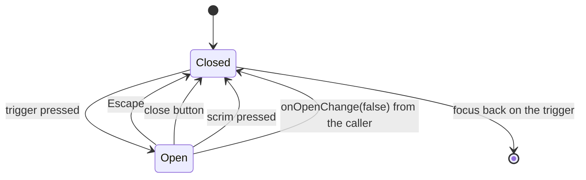

# Restyle banners, toasts and dialogs in Picnic and add notes and sheets

Linear: TAS-79

## Summary

Dino's feedback components still wear their pre-Picnic shapes, and two that the Picnic screens need don't exist. This restyles Banner (and gives it one action slot), Toast (Sonner, now 150 ms in and out instead of Sonner's 400 ms) and ConfirmDialog to the feedback board (`docs/design/dino/feedback.dc.html`), and adds two components: Note, a butter heads-up panel with at most one action, and Sheet, a bottom sheet for light tasks drawn on the shopping-list board (`docs/design/picnic/shopping-list.dc.html:85-125`). Every filled panel gets the 2 px transparent border that forced colours draws. Each component gets its stories and fresh baselines. It ships in one PR and unblocks TAS-83 (Picnic page layouts).

Evidence: feature — the danger banner on the home, recipe list and recipe pages (shown when a load fails) changes look in production; Note, Sheet, Toast and ConfirmDialog have no page callers yet and show only in Storybook.
Design: skip — the feedback board draws the note, banner, toast and dialog in every state, and the shopping-list board draws the sheet; build to them.

## Required reading

- `AGENTS.md`: hard constraints, Tests, rule of three.
- `docs/design.md`: Colour, Type, Space and shape (Corners, Shadows, Motion), States, Components (Note, Banner, Toast, Sheet, Dialog), Rules (Shape, Touch and motion).
- `docs/design/dino/feedback.dc.html` and `feedback.dc.png`: the source of every value for Note, Banner, Toast and Dialog. Its `<style>` block (lines 22 to 37) is the reference CSS for `.note`, `.banner`, `.toast`, `.toast-act`, `.btn-on-pastel`.
- `docs/design/picnic/shopping-list.dc.html:85-125` and `shopping-list.dc.png`: the sheet ("Add to the list").
- `frontend/src/dino/confirm-dialog.tsx`, `alert-dialog.tsx`: mirror the Radix trigger-and-portal pattern and the `fade` classes for Sheet.
- `frontend/src/dino/empty-state.tsx`: mirror its `action?: ReactNode` slot for Banner.
- `frontend/src/dino/servings-stepper.tsx`: a module-private button styled in place, the pattern for Note's action.
- `specs/TAS-76.md`: the shape of an earlier Dino restyle (values table, stories table, baselines step).
- `specs/lessons/design-doc-wins-over-a-board.md`: each board-versus-doc difference below is decided for the doc and listed in Decisions.
- `specs/lessons/story-play-leaves-real-focus.md`: Is Focus stories force the ring with the pseudo-states parameter; play's focus is blurred before the shot.
- `specs/lessons/storybook-under-vitest-has-no-manager.md`: don't assert forced hover, pressed or focus styles in play; keep a stateful story's value in React state.
- `specs/lessons/factory-runs-make-baselines-in-place.md`: how the implement stage makes the baselines.
- `specs/lessons/pressed-scale-and-the-44px-story-check.md`: the 44 px check measures layout height, so `scale-97` on press is safe.

## Product behaviour

1. A note is a butter panel with On pastel text and at most one outlined action.
2. A banner has a 2 px status border, its icon, Surface fill and 20 px corners.
3. A banner can show one action under its text; without one it shows none.
4. A toast is a dock-coloured pill with a short message and at most one action.
5. A toast slides in and out in 150 ms, not 400 ms.
6. The dialog says what happens, offers Cancel and a danger button naming the action.
7. When the dialog opens, focus starts on Cancel.
8. A sheet slides up over the scrim: Surface, 32 px top corners, grab handle, Display L title, close button.
9. Escape, the close button and the scrim each close the sheet, and focus returns to its trigger.
10. Every filled panel (note, toast, dialog, sheet) has a 2 px transparent border that forced colours draws.
11. Each component's stories have baselines that match their board.

## Technical design

- **Approach:** frontend only, in `frontend/src/dino/`. Banner, Toaster, ConfirmDialog (and its `alert-dialog.tsx` parts) are restyled in place; their props stay the same except Banner, which gains an optional `action`. Note (`note.tsx`) and Sheet (`sheet.tsx`) are new and exported from `index.ts`. `boards.ts` names their boards. `docs/design.md` gains the two rules this spec settles (the faint fill on a pastel or dock action, the sheet's width).
- **API contract:** No change.
- **Blast radius:** see [Blast radius](#blast-radius).
- **Not changing:** the Banner callers' code, `Button`, `IconButton`, `EmptyState`, `CheckboxRow`, `picnic.css` (every token needed exists: `--color-butter`, `--color-dock`, `--color-on-dock`, `--color-on-pastel`, `--color-scrim`, `--radius-sheet`, `--radius-note`, `--radius-card`, `--shadow-lift`).

### Shared values

- The 2 px transparent border on every filled panel is `border-2 border-transparent` (the sheet's is `border-2 border-b-0 border-transparent`, since its foot sits on the screen's edge).
- Panel motion is 150 ms ease-out: `duration-150 ease-out` with tw-animate-css's `animate-in` / `animate-out` utilities. Reduced motion is already handled globally in `picnic.css` (and by Sonner's own CSS for toasts).
- Text in a note, a banner's body, the dialog's description and the sheet's description is Body (16/24, weight 600), the `body` default; no class is needed for size. Muted text is `text-muted`.
- Icons are Lucide, `aria-hidden="true"`, `strokeWidth={2.5}`, drawn in `currentColor`.
- Padding is measured outside the 2 px border, so where a board panel has no border, the class is the board's padding less 2 px (board 10 px → `py-2`).

### Note (`note.tsx`, new)

Values from `.note` and `.btn-on-pastel` (`feedback.dc.html:27-29`).

```ts
type NoteAction = { label: string; onClick: () => void };

type NoteProps = {
  children: ReactNode;
  icon?: LucideIcon;
  // At most one action (docs/design.md, Components), so it's a single object, not a slot.
  action?: NoteAction;
};
```

- Panel: `<div>` with `flex items-center gap-3 rounded-note border-2 border-transparent bg-butter text-on-pastel`, plus `py-2 pr-2.5 pl-3.5` with an action or `px-3.5 py-2.5` without. No role: it is static content, not an announcement.
- Icon (when given): `size-4.5 shrink-0`.
- Text: `<p className="min-w-0 grow">{children}</p>`.
- Action: a module-private `<button type="button" onClick={action.onClick}>` with `min-h-11 shrink-0 cursor-pointer whitespace-nowrap rounded-pill border-2 border-on-pastel bg-transparent px-5 text-label text-on-pastel transition hover:bg-on-pastel/10 active:scale-97 active:bg-on-pastel/20 focus-visible:outline-on-pastel`.
- Export `Note` from `index.ts`.

### Banner (`banner.tsx`, edit)

Values from `.banner` (`feedback.dc.html:30-33`). `toneStyles`, `Tone` and the roles stay.

```ts
type BannerProps = {
  tone: Tone;
  title: string;
  children?: ReactNode;
  // At most one, under the text: a Dino Button, usually secondary (docs/design.md, Components).
  action?: ReactNode;
};
```

```tsx
<div role={role} className={cn('grid grid-cols-[1.375rem_minmax(0,1fr)] gap-x-3 rounded-note border-2 bg-surface py-3.5 pr-3.5 pl-4', border)}>
  <Icon aria-hidden="true" strokeWidth={2.5} className={cn('size-5.5', text)} />
  <div className="flex flex-col items-start gap-1">
    <p className="font-extrabold">{title}</p>
    {children && <div className="text-muted">{children}</div>}
    {action && <div className="mt-2">{action}</div>}
  </div>
</div>
```

The action wrapper's `mt-2` plus the column's `gap-1` gives the board's 12 px between text and action. The banner keeps its status border, so it takes no transparent border.

### Toast (`sonner.tsx`, edit)

Values from `.toast` and `.toast-act` (`feedback.dc.html:34-37`). Sonner injects its own CSS at load (`node_modules/sonner/dist/index.mjs:457`), including `[data-sonner-toast]{transition:transform .4s,opacity .4s,height .4s,…}` and a 0.5 s exit for stacked toasts. `unstyled: true` drops Sonner's look but not these transitions, so the duration and easing are set with Tailwind's important modifier, which beats Sonner's selector whatever the stylesheet order.

```tsx
<Sonner
  className="duration-150! ease-out!"
  icons={{ error: <CircleAlert aria-hidden="true" strokeWidth={2.5} className="size-4.5" /> }}
  toastOptions={{
    unstyled: true,
    classNames: {
      toast: 'flex min-h-14 w-full items-center gap-3 rounded-pill border-2 border-transparent bg-dock py-1 pr-1 pl-4.5 text-label text-on-dock shadow-lift duration-150! ease-out! *:duration-150!',
      icon: 'shrink-0',
      content: 'min-w-0 grow',
      actionButton: 'min-h-11 shrink-0 cursor-pointer rounded-pill border-2 border-on-dock bg-transparent px-4 text-label text-on-dock transition hover:bg-on-dock/10 active:scale-97 active:bg-on-dock/20 focus-visible:outline-on-dock'
    }
  }}
  {...props}
/>
```

- `min-h-14` (56 px with the border) rather than a fixed height, so a long message wraps at 320 px.
- `*:duration-150!` covers Sonner's `[data-sonner-toast]>*{transition:opacity .4s}`; the Toaster's own `className` covers its `transition:transform .4s`.
- A single `transition-duration` value applies to every property in Sonner's `transition-property` list, so the computed duration is `0.15s`.
- The error toast is `toast.error(message, { action })`; it shows the CircleAlert before the message and keeps the dock colours (board: "no colour change on the dock").

### Dialog (`alert-dialog.tsx`, `confirm-dialog.tsx`, edit)

Values from the dialog on `feedback.dc.html:110-122`. `ConfirmDialog`'s props don't change.

- `alert-dialog.tsx`: `fade` gains `ease-out`. `AlertDialogContent` becomes `fixed top-1/2 left-1/2 z-50 flex w-[calc(100%-2.5rem)] max-w-sm -translate-x-1/2 -translate-y-1/2 flex-col gap-3 rounded-card border-2 border-transparent bg-surface p-5.5 text-ink` (20 px from each edge on a phone, as drawn). `AlertDialogTitle` becomes `text-display-l` (the `h2` base style already gives the serif and italic). `AlertDialogDescription` stays `text-muted`.
- `confirm-dialog.tsx`: the actions row becomes `mt-2 flex flex-wrap justify-end gap-2.5`; Cancel becomes `variant="secondary"`.
- Focus on Cancel: Radix AlertDialog already focuses `AlertDialog.Cancel` on open (`onOpenAutoFocus` focuses its `cancelRef`), and `Button` passes the ref through (React 19 refs are props). No code changes; the story now asserts it.

### Sheet (`sheet.tsx`, new)

Values from `shopping-list.dc.html:86-93`. Built on Radix Dialog (`import { Dialog } from 'radix-ui'`), which gives the modal, the focus trap, Escape, closing on a press outside (the scrim) and focus returning to the trigger.

```ts
type SheetProps = {
  trigger: ReactElement;
  title: string;
  description?: string;
  children: ReactNode;
  // Optional, so a sheet's own action (like "Add 10 things") can close it; uncontrolled without them.
  open?: boolean;
  onOpenChange?: (open: boolean) => void;
};
```

```tsx
<Dialog.Root open={open} onOpenChange={onOpenChange}>
  <Dialog.Trigger asChild>{trigger}</Dialog.Trigger>
  <Dialog.Portal>
    <Dialog.Overlay data-slot="sheet-scrim" className={cn('fixed inset-0 z-50 bg-scrim', fade)} />
    <Dialog.Content
      // Radix warns about a missing description unless told there is none; with one, keep its own link.
      {...(description === undefined && { 'aria-describedby': undefined })}
      className="fixed inset-x-0 bottom-0 z-50 mx-auto flex max-h-[90dvh] w-full max-w-xl flex-col overflow-y-auto rounded-t-sheet border-2 border-b-0 border-transparent bg-surface px-4.5 pt-1.5 pb-6 text-ink shadow-lift duration-150 ease-out data-[state=open]:animate-in data-[state=open]:slide-in-from-bottom data-[state=closed]:animate-out data-[state=closed]:slide-out-to-bottom"
    >
      <span aria-hidden="true" className="mx-auto h-1.25 w-10 shrink-0 rounded-pill bg-field forced-colors:bg-[CanvasText]" />
      <div className="mt-3.5 flex items-start justify-between gap-3">
        <div className="flex min-w-0 flex-col gap-0.5">
          <Dialog.Title className="text-display-l">{title}</Dialog.Title>
          {description && <Dialog.Description className="text-muted">{description}</Dialog.Description>}
        </div>
        <Dialog.Close asChild>
          <IconButton icon={X} label="Close" />
        </Dialog.Close>
      </div>
      <div className="mt-3 flex flex-col gap-3">{children}</div>
    </Dialog.Content>
  </Dialog.Portal>
</Dialog.Root>
```

- `fade` is the same string as in `alert-dialog.tsx` (with `ease-out`), written again in `sheet.tsx`: its second use, so it isn't shared yet (`AGENTS.md`, rule of three).
- `max-w-xl` is 576 px; `mx-auto` with `inset-x-0` centres it from tablets up. On a phone it is full width.
- The handle is decorative (`aria-hidden`) and does nothing when dragged (see Out of scope). Under forced colours it fills with `CanvasText`, a system colour, so it stays visible.
- `data-slot="sheet-scrim"` lets the story press the scrim, which has no role.
- Export `Sheet` from `index.ts`.



### Boards (`boards.ts`, edit)

```diff
   'Dino/Banner': 'docs/design/dino/feedback.dc.png',
+  'Dino/Note': 'docs/design/dino/feedback.dc.png',
   'Dino/Toast': 'docs/design/dino/feedback.dc.png',
   'Dino/ConfirmDialog': 'docs/design/dino/feedback.dc.png',
+  'Dino/Sheet': 'docs/design/picnic/shopping-list.dc.png',
```

### The doc (`docs/design.md`, edit)

Two rules the doc lacked, settled in this spec's interview:

```diff
-- **Hover** (pointers only): a pastel fill moves 20% towards Ink (…); an outlined control's border turns Ink and it fills with Surface; ghost and icon buttons fill with Surface or Line. …
+- **Hover** (pointers only): a pastel fill moves 20% towards Ink (…); an outlined control's border turns Ink and it fills with Surface; an outlined control on a pastel or the dock (a note's or a toast's action) keeps its border and fills with its text colour at 10% (20% while pressed); ghost and icon buttons fill with Surface or Line. …
```

```diff
-| Sheet | Slides up over a scrim, Surface colour, 32 px top corners, a grab handle, a title in Display L, a close button. For light tasks (adding a recipe to the list, filters). |
+| Sheet | Slides up over a scrim, Surface colour, 32 px top corners, a grab handle, a title in Display L, a close button. Full width on a phone; from tablets up, centred and at most 576 px wide. Escape, the close button and the scrim close it. For light tasks (adding a recipe to the list, filters). |
```

Keep every other word of both lines as it is.

### Stories

Story names follow the board's states; `isHover`, `isPressed` and `isFocus` come from `@/dino/story-states`. Baseline file names are `dino-<title>--<story>.png`.

| File | Stories (new in bold) |
| --- | --- |
| `note.stories.tsx` (new) | **Default**, **WithIcon**, **IsHover**, **IsPressed**, **IsFocus** |
| `banner.stories.tsx` | Success, Warning, Danger |
| `sonner.stories.tsx` | Default, **IsHover**, **IsPressed**, **IsFocus**, **Error** |
| `confirm-dialog.stories.tsx` | Default, Open |
| `sheet.stories.tsx` (new) | **Default**, **Open** |

- Note: Default args `{ children: 'Left out salt, water and vegetable oil: you probably have them.', action: { label: 'Add them', onClick: fn() } }`. WithIcon args `{ children: 'Start the night before: the chickpeas soak for 12 hours.', icon: Timer }`. IsHover, IsPressed and IsFocus use Default's args with `isHover`, `isPressed`, `isFocus` (the action is the only control).
- Banner, the board's copy: Success `{ title: 'Imported', children: 'All 9 ingredients and 6 steps came across.' }`; Warning `{ title: 'Imported, with 2 gaps', children: 'Two ingredients had no amount. Add them before you cook.', action: <Button variant="secondary">Fill the gaps</Button> }`; Danger `{ title: 'Couldn’t reach that page', children: 'Check the link is a recipe page, like bbcgoodfood.com/recipes/…, then try again.', action: <Button variant="secondary">Try again</Button> }`.
- Toast: IsHover, IsPressed and IsFocus run Default's play and target the action only, `{ pseudo: { hover: ['[data-button]'] } }` (and `active`, `focusVisible`), so the "Show a toast" button keeps its resting look. Error shows `toast.error('Couldn’t save. You’re offline.', { action: { label: 'Try again', onClick: () => undefined }, duration: Number.POSITIVE_INFINITY })` from a "Show an error" button.
- ConfirmDialog, the board's copy: trigger `<Button variant="danger">Delete recipe</Button>`, title `Delete this recipe?`, description `Chana masala and its 2 notes will be deleted for everyone in your household. The 6 things it put on the shopping list stay.`, confirmLabel `Delete recipe`.
- Sheet: a render that holds `open` in React state and passes `open` and `onOpenChange`. Trigger `<Button variant="secondary">Add to the list</Button>`, title `Add to the list`, description `Chana masala`. Children: the Default Note (its action does nothing), three `CheckboxRow`s each holding its own checked state and starting ticked (Garlic, `2 cloves`; Spinach, `275 g`; Bean sprouts, `225 g`), and `<Button size="large" onClick={() => setOpen(false)}>Add 3 things</Button>`. Default is closed; Open's play ends with the sheet open.

### Steps

1. **Add Note.** `frontend/src/dino/note.tsx` (new), `note.stories.tsx` (new), `index.ts` (edit), `boards.ts` (edit: the Note line)
   Build Note as sketched and its stories.
   Done when: the Note stories pass in `pnpm test` (play, axe, 44 px check).

2. **Restyle Banner and add its action.** `frontend/src/dino/banner.tsx`, `banner.stories.tsx` (edit)
   Apply the new classes and the `action` prop; move the stories to the board's copy.
   Done when: the Banner stories and `frontend/src/app/home-page.test.tsx`, `frontend/src/recipes/recipes-page.test.tsx`, `recipe-page.test.tsx` pass.

3. **Restyle Toast at 150 ms.** `frontend/src/dino/sonner.tsx`, `sonner.stories.tsx` (edit)
   Apply the classes, the important duration and the error icon; add the state and Error stories.
   Done when: the Toast stories pass in `pnpm test`.

4. **Restyle the dialog.** `frontend/src/dino/alert-dialog.tsx`, `confirm-dialog.tsx`, `confirm-dialog.stories.tsx` (edit)
   Apply the classes and the secondary Cancel; move the story to the board's copy and assert focus on Cancel.
   Done when: the ConfirmDialog stories pass in `pnpm test`.

5. **Add Sheet.** `frontend/src/dino/sheet.tsx` (new), `sheet.stories.tsx` (new), `index.ts` (edit), `boards.ts` (edit: the Sheet line)
   Build Sheet as sketched and its stories.
   Done when: the Sheet stories pass in `pnpm test`.

6. **Write the two rules into the doc.** `docs/design.md` (edit)
   Apply the two diffs above.
   Done when: the States Hover line and the Sheet row read as above.

7. **Refresh the baselines.** `frontend/visual/baselines/` and `frontend/visual/baselines/forced-colours/`: `dino-banner--{success,warning,danger}.png`, `dino-confirmdialog--{default,open}.png`, `dino-toast--default.png` (edit); `dino-note--{default,withicon,ishover,ispressed,isfocus}.png`, `dino-toast--{ishover,ispressed,isfocus,error}.png`, `dino-sheet--{default,open}.png` (new). 17 in each folder, 34 files.
   On the run's own GitHub Actions runner (`specs/lessons/factory-runs-make-baselines-in-place.md`): build Storybook, run the whole visual suite to confirm every other story still matches, then `pnpm --filter frontend exec playwright test -c playwright.visual.config.ts -g "Dino/(Note|Banner|Toast|ConfirmDialog|Sheet) " --update-snapshots=changed`. Compare each image with `feedback.dc.png` or `shopping-list.dc.png` before committing.
   Done when: CI's `test:visual` passes in both projects, including "every baseline has a story" and "every story title has a board image".

Commit per step: Note, Banner, Toast, dialog, Sheet, the doc, then the baselines.

### Tests

- `frontend/src/dino/note.stories.tsx`
  - Default: click "Add them", asserts: `onClick` called once; the note's panel `toHaveStyle({ backgroundColor: 'rgb(255, 224, 138)', borderTopWidth: '2px', borderTopColor: 'rgba(0, 0, 0, 0)' })`; the button `toHaveStyle({ borderTopColor: 'rgb(42, 20, 64)', color: 'rgb(42, 20, 64)' })`.
  - WithIcon, asserts: the text "Start the night before: the chickpeas soak for 12 hours." shows, the panel contains one `svg`, and `queryByRole('button')` is `null`.
- `frontend/src/dino/banner.stories.tsx`
  - Warning, asserts: `within(getByRole('status')).getByRole('button', { name: 'Fill the gaps' })` is visible and the banner `toHaveStyle({ borderTopColor: 'rgb(255, 224, 138)', borderTopLeftRadius: '20px', backgroundColor: 'rgb(42, 29, 71)' })`.
  - Danger, asserts: `within(getByRole('alert')).getByRole('button', { name: 'Try again' })` is visible.
- `frontend/src/dino/sonner.stories.tsx`
  - Default: click "Show a toast", asserts: "Saved to Favourites" and the "Undo" button are visible; the toast (`closest('[data-sonner-toast]')`) `toHaveStyle({ transitionDuration: '0.15s', backgroundColor: 'rgb(255, 244, 234)', borderTopWidth: '2px', borderTopColor: 'rgba(0, 0, 0, 0)' })`.
  - Error: click "Show an error", asserts: "Couldn’t save. You’re offline." and a "Try again" button are visible, the toast contains an `svg`, and its `backgroundColor` is `rgb(255, 244, 234)`.
- `frontend/src/dino/confirm-dialog.stories.tsx`
  - Open: click "Delete recipe", asserts: the `alertdialog` named "Delete this recipe?" is visible; its "Cancel" button `toHaveFocus()`; the dialog `toHaveStyle({ borderTopWidth: '2px', borderTopColor: 'rgba(0, 0, 0, 0)' })`; the heading `toHaveStyle({ fontSize: '34px' })`. Click Cancel, asserts: no `alertdialog` and the trigger has focus. Opens again so the story ends open.
- `frontend/src/dino/sheet.stories.tsx`
  - Open, step "Open it": click "Add to the list", asserts: the `dialog` named "Add to the list" with description "Chana masala" is visible; the "Close" button `toHaveFocus()`; the dialog `toHaveStyle({ borderTopLeftRadius: '32px', borderBottomLeftRadius: '0px', backgroundColor: 'rgb(42, 29, 71)' })`; the heading `toHaveStyle({ fontSize: '34px' })`.
  - Open, step "Close each way": press `{Escape}`, asserts: no `dialog`, trigger has focus. Open, click "Close", asserts: no `dialog`. Open, click `[data-slot="sheet-scrim"]` (its top-left corner, outside the sheet), asserts: no `dialog`. Open, click "Add 3 things", asserts: no `dialog`.
  - Open, step "Ends open": click "Add to the list", asserts: the dialog is visible.
- `frontend/src/app/home-page.test.tsx`, `frontend/src/recipes/recipes-page.test.tsx`, `frontend/src/recipes/recipe-page.test.tsx`: unchanged, asserts: their banner `alert` text still shows.
- `frontend/visual/stories.spec.ts`: compares the 34 refreshed or new baselines, and the forced-colours project checks behaviour 10.

Commands: `pnpm lint`, `pnpm test`, `pnpm test:e2e`, `pnpm --filter frontend build-storybook && pnpm --filter frontend test:visual` (on the runner).

## Decisions

- **One PR, one commit per component**, because every baseline is made on a GitHub Actions runner and the five share one board, so two PRs would mean two screenshot rounds and two reviews of the same rules. About 14 source files plus 34 baselines. Asked: one PR or two → One PR.
- **Note and banner text use Body (16/24, weight 600)**, because the board's 14 px isn't in Picnic's type scale and Body is what the rest of the page reads in. The board's note is weight 700; Body's 600 is used. Asked: which role for 14 px note and banner text → Body, 16 px.
- **The note's and toast's outlined actions fill faintly under the pointer**: their text colour at 10% on hover, 20% and 97% scale while pressed, and their border stays. The doc's outlined hover (Ink border, Surface fill) would put a dark plum fill on butter or the dock. Written into `docs/design.md`, States. Asked: how the outlined actions look under the pointer → Faint fill.
- **Dragging the grab handle does nothing in this PR**; it is decorative, and Escape, the close button and the scrim close the sheet. Drag-to-close is filed as its own issue. Asked: should dragging the handle close the sheet → File as follow-up.
- **A sheet is full width on a phone and centred at up to 576 px from tablets up**, because a full-width sheet on a laptop stretches its rows past reading width. Written into `docs/design.md`, Components. Asked: how wide a sheet is on a tablet or laptop → Centred, up to 576 px.
- **The sheet's close button is Dino's `IconButton` (a Surface circle)**, because docs/design.md says an icon button is a 44 px circle on Surface; the board draws a field-outlined circle. Built to the doc (`specs/lessons/design-doc-wins-over-a-board.md`).
- **The sheet takes the lift (`shadow-lift`)**, because docs/design.md (Shadows) names the lift for sheets; the board draws an upward `0 -10px 30px` shadow. Built to the doc.
- **The dialog's Cancel is a secondary (outlined) button**, not today's ghost, because the board draws it outlined and the doc says only that it's "Cancel".
- **Note's action is a `{ label, onClick }` object, Banner's a `ReactNode` slot**, because the note's On pastel outlined button exists nowhere else in Dino (so Note draws it and the type allows only one), while the banner's action is an ordinary Dino `Button` the caller may want as a link or with a loading state, as `EmptyState` already takes it.
- **The On pastel outlined button is written twice (Note's action, Sonner's `actionButton`)**, not made a `Button` variant, because Sonner renders its own button from class names and `AGENTS.md` abstracts on the third use.
- **Sonner's 400 ms is overridden with important utilities on its toast and toaster classes**, because Sonner injects its transitions at load and its selector can come after Tailwind's; an important `duration-150!` wins in any order. No global CSS rule in `picnic.css` is added.
- **The sheet is built on Radix Dialog**, because `radix-ui` is already a dependency, ConfirmDialog uses its AlertDialog sibling, and it gives the focus trap, Escape, outside press and focus return without code.
- **Sheet takes optional `open` and `onOpenChange`**, because a sheet's own action ("Add 10 things") has to close it; without them it manages itself like ConfirmDialog.
- **The toast's error state is `toast.error` with a CircleAlert icon on the same dock colours**, because the board draws it ("icon, no colour change on the dock").
- **Design: skip**, because the feedback and shopping-list boards draw every component and state this builds.

## Blast radius

- `Banner` gains an optional prop and changes its padding and title weight. Its four callers (`home-page.tsx:13`, `recipes-page.tsx:57`, `recipe-page.tsx:110`, `recipe-filter-panel.tsx:42`) pass only `tone` and `title`, so they compile unchanged and keep their `alert` role; re-check their page tests and `e2e/phone-width.spec.ts` at 320 px.
- `Toaster`, `toast` and `ConfirmDialog` have no callers outside `src/dino/`, so only their stories and baselines move.
- `alert-dialog.tsx` is used only by `confirm-dialog.tsx`.
- `index.ts` gains two exports; `boards.ts` gains two lines, which the visual spec's "every story title has a board image" test checks both ways.
- `docs/design.md` changes two lines; TAS-83 (Picnic page layouts) and any open Dino PR editing the same lines resolves a one-line conflict.

## Assumptions

- **The toast's position and where the Toaster is mounted stay as they are** (Sonner's default, and not yet mounted in the app), because nothing calls `toast` yet; the first feature that does mounts it. Confirm with: Milo at spec approval.
- **A sheet's body scrolls as a whole (handle and header included) when it's taller than 90% of the screen**, because the board shows no tall sheet and one scroll region is simpler for keyboard and screen-reader users. Confirm with: Milo at spec approval.
- **A note has no live-region role**, because it's part of the page from the start, not an announcement; a banner keeps its `alert` or `status` role. Confirm with: Milo at spec approval.

## Out of scope

- Closing a sheet by dragging its handle: filed as its own issue at this spec's request.
- Mounting the Toaster in the app, and any page using Note, Sheet, Toast or ConfirmDialog: TAS-83 (Picnic page layouts) and later features.
- Empty state, error with retry and loading, which share the feedback board: not in this issue.
- `Button`, `IconButton` and `CheckboxRow` looks.
- Any change to which pages show a banner or what it says.

## Validation criteria

- [ ] `pnpm lint` (Biome and `tsc -b`) passes.
- [ ] `pnpm test` passes, including every story's play, axe and the 44 px check.
- [ ] `pnpm test:e2e` passes, with axe on the pages that show a banner.
- [ ] CI's `test:visual` passes with the 34 refreshed or new baselines, each matching `feedback.dc.png` or `shopping-list.dc.png`, and the forced-colours shots show each filled panel's outline.
- [ ] By keyboard in the Sheet story: Tab stays inside the open sheet, Escape closes it and focus returns to "Add to the list".
- Evidence: feature: the danger banner on the recipe list page when its load fails, on a phone and a laptop, and the Storybook stories of the five components.
