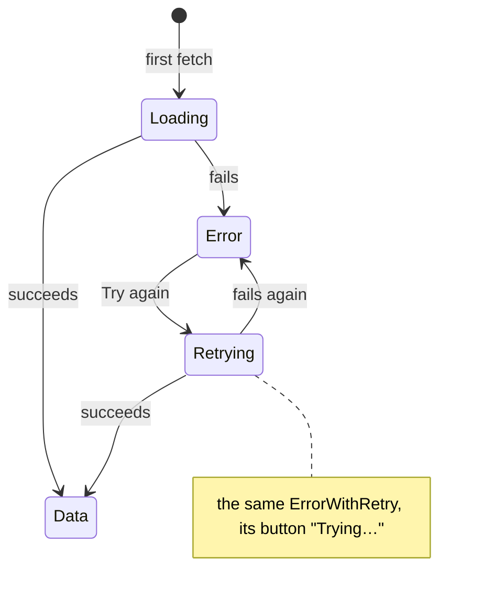

# Restyle the empty state in Picnic and add error-with-retry and loading states

Linear: TAS-80

## Summary

The empty state still shows Enamel's lucide icon. Every failed load is a hand-rolled danger Banner with a "Try again" button that disappears while it retries. Every load shows a bare "Loading…" line. This work builds the right-hand column of the feedback board in Dino:

- the Empty state with a dashed empty polaroid, a why-line and a doodle slot;
- a new Error with retry, whose Try again shows "Trying…" while it retries;
- a new Loading: blank polaroids and a status line, shown only after half a second.

The home page, the recipe list, the recipe page and the filter panel's three groups move onto them. TAS-83 (page layouts) waits for this.

Evidence: feature: the recipe list's empty states, every failed load and the list's and recipe's loading change look.
Design: skip. `docs/design/dino/feedback.dc.html` draws all three components, including Try again's retrying state and the filtered empty state's "one fewer?" doodle, and `docs/design.md` (States › Loading, Components) gives the rules. Build to the board.
Components: EmptyState (changed: empty polaroid, why-line required, doodle), ErrorWithRetry (new), Loading (new).

## Required reading

- `AGENTS.md`: hard constraints, Tests, the rule of three, and the `dino` label rule in Standards.
- `docs/design.md`: Voice (errors and empty states), Space and shape (Corners, Motion), States (Loading), The fun, rationed (Polaroids, Tilt, Doodles), Components (Empty state, Error with retry, Loading), Rules (Type and icons: `currentColor`). Where the board and this file disagree, this file wins.
- `docs/design/dino/feedback.dc.html` lines 126-159 and `feedback.dc.png`: the board's right-hand column. This spec quotes its values.
- `frontend/src/dino/empty-state.tsx` and `empty-state.stories.tsx`: what changes.
- `frontend/src/dino/banner.tsx`: the Dino component shape to mirror (props type, `role`, `cn`).
- `frontend/src/dino/button.tsx`: `loading` and `loadingLabel`, `aria-describedby` merging, and the private `Spinner` that Loading copies.
- `frontend/src/dino/polaroid.tsx`: the leans (±3 degrees) and `large-text:` straightening that the blank polaroids mirror.
- `frontend/src/dino/button.stories.tsx` (`PrimaryIsLoading`): a story whose `render` holds state and whose `play` clicks into the loading state.
- `frontend/src/app/home-page.tsx:30-60`: the timestamp branching this keeps, and the `isRetrying` state this removes.
- `specs/lessons/tanstack-refetch-resets-error-state.md`: why the pages branch on `errorUpdatedAt`, not `isError` or `isPending`.
- `specs/lessons/design-doc-wins-over-a-board.md`: the board and doc differences, listed under Decisions.
- `specs/lessons/factory-runs-make-baselines-in-place.md`, `specs/lessons/story-play-leaves-real-focus.md`, `specs/lessons/screenshot-tolerance-is-in-pixels.md`: how the baselines are made and shot.

## Product behaviour

**Empty state**

1. An empty state shows a tilted dashed empty polaroid where the icon was.
2. Every empty state on the recipe list says what's empty and why, in two lines.
3. The filtered empty state offers Clear filters as its way out.
4. The filtered empty state shows a "one fewer?" doodle that screen readers skip.

**Error with retry**

5. A failed load says what failed and how to fix it, with Try again.
6. While a retry runs, Try again reads "Trying…", is busy and ignores presses.
7. The error stays on screen while its retry runs, and stays if it fails again.
8. The home page, recipe list, recipe page and the course, cuisine and ingredient filters all use it.

**Loading**

9. The recipe list and the recipe page show two blank polaroids and a line while loading.
10. The blank polaroids don't shimmer or move.
11. The loading polaroids and line appear only after half a second.
12. The loading region carries `aria-busy="true"`.

**Stories**

13. Each of the three components has stories, each with a baseline that matches the board.

## Technical design

### How it works today

- `EmptyState` (`frontend/src/dino/empty-state.tsx:11-18`) takes a required lucide `icon`, a `title` (an `h2`), optional `children` (a muted `p`) and an optional `action`. Its only user is `NoRecipes` (`frontend/src/recipes/recipes-page.tsx:89-110`). `NoRecipes` passes `CookingPot` and a title and no `children`. Only the filtered branch has an action.
- Error with retry is hand-rolled four times as a `Banner tone="danger"` plus a secondary Button:
  - `ApiUnreachable` (`frontend/src/app/home-page.tsx:11-18`);
  - `RecipesUnavailable` (`frontend/src/recipes/recipes-page.tsx:55-62`);
  - `RecipeUnavailable` (`frontend/src/recipes/recipe-page.tsx:109-117`);
  - `GroupUnavailable` (`frontend/src/recipes/recipe-filter-panel.tsx:39-46`), whose buttons say "Load cuisines again" and so on.
- During a retry, the pages branch on `isPending`. A refetch resets a never-successful query to pending, so the error and its button vanish and the loading text shows instead. Home keeps its own `isRetrying` (`home-page.tsx:31-36`) to show "Checking the API…".
- Loading is a bare `p` in four places:
  - `recipes-page.tsx:155` ("Loading recipes…");
  - `recipe-page.tsx:98-103` ("Loading recipe…");
  - `home-page.tsx:43` ("Checking the API…");
  - the filter groups (`recipe-filter-panel.tsx:100`, "Loading courses…" and so on).

### What changes

```diff
 frontend/src/dino/
~  empty-state.tsx            empty polaroid, required why-line, doodle beside the action
~  empty-state.stories.tsx    Default (with doodle), WithoutDoodle, WithoutAction
+  error-with-retry.tsx       ErrorWithRetry
+  error-with-retry.stories.tsx
+  loading.tsx                Loading
+  loading.stories.tsx
~  index.ts                   exports ErrorWithRetry and Loading
~  boards.ts                  Dino/ErrorWithRetry and Dino/Loading → feedback.dc.png
~  picnic.css                 --animate-reveal and its keyframes
 frontend/src/app/
~  home-page.tsx              ErrorWithRetry; isRetrying goes
~  home-page.test.tsx
 frontend/src/recipes/
~  recipes-page.tsx           ErrorWithRetry, Loading, why-lines and doodle
~  recipes-page.test.tsx
~  recipe-page.tsx            ErrorWithRetry, Loading
~  recipe-page.test.tsx
~  recipe-filter-panel.tsx    ErrorWithRetry in QueryGroup; GroupUnavailable goes
 frontend/visual/baselines/ (and forced-colours/)
~  dino-emptystate--default.png, dino-emptystate--without-action.png
+  dino-emptystate--without-doodle.png, dino-errorwithretry--default.png,
+  dino-errorwithretry--is-retrying.png, dino-loading--default.png
```

No API change. No backend change.

### EmptyState (`frontend/src/dino/empty-state.tsx`)

```ts
type EmptyStateProps = {
  title: string;
  // Why it's empty: docs/design.md, Voice.
  children: ReactNode;
} & ({ action?: undefined; doodle?: undefined } | { action: ReactNode; doodle?: string });
```

- `icon` goes. `children` becomes required. `doodle` is the note's text. It needs an `action`, because the arrow points at the action.
- Root: `div` with `flex flex-col items-center gap-3 rounded-card border border-line px-6 py-7 text-center`. The `h2` stays a direct child of the root. The recipes page test finds the action through the heading's `parentElement`.
- The empty polaroid is the first child, `aria-hidden="true"`:
  - an outer `span`: `flex h-23 w-24 -rotate-4 items-start justify-center border-[2.5px] border-field border-dashed pt-2 large-text:rotate-0`;
  - an inner `span`: `h-13.5 w-18.5 border-2 border-line border-dashed`.
- Then the `h2` (`title`, with the base `text-title italic`), then `<p className="max-w-[30ch] text-muted">{children}</p>`.
- With an `action`, the last child is the action row:

  ```tsx
  <div className="@container mt-1 w-full">
    <div className="grid grid-cols-[minmax(0,1fr)_auto_minmax(0,1fr)] items-end gap-2">
      <div className="col-start-2">{action}</div>
      {doodle && <Doodle note={doodle} />}
    </div>
  </div>
  ```

- `Doodle` is private to the file. It renders `aria-hidden="true"` `div` with `hidden @3xs:flex flex-col items-start gap-0.5 text-muted`, holding two children:
  - `<span className="-rotate-5 font-serif text-caption italic">{note}</span>`;
  - the board's arrow, drawn in `currentColor`: `<svg viewBox="0 0 70 60" className="h-12 w-14 -scale-x-100 rotate-20">` with `<path d="M8 6c20 4 38 18 44 40M44 40l8 8 6-11" fill="none" stroke="currentColor" strokeWidth="2.5" strokeLinecap="round" strokeLinejoin="round" />`.
- The row is its own container. The doodle shows only when the row is at least 16rem (256 px) wide, so it never overflows at 320 px (WCAG 1.4.10). On a 375 px phone it shows. At large text it hides, because rem grows with the reader's setting.

### ErrorWithRetry (`frontend/src/dino/error-with-retry.tsx`)

```ts
type ErrorWithRetryProps = {
  // What failed, short: "Couldn't load recipes".
  title: string;
  // How to fix it: "Check your connection, then try again."
  children: ReactNode;
  // Resolves when the retry has finished, whatever its result. A query's refetch fits.
  onRetry: () => Promise<unknown>;
};
```

- It owns the retrying state. The pages can't derive it, because a refetch resets the query's error (lesson `tanstack-refetch-resets-error-state`):

  ```ts
  const [isRetrying, setIsRetrying] = useState(false);
  const retry = async () => {
    setIsRetrying(true);
    try {
      await onRetry();
    } finally {
      setIsRetrying(false);
    }
  };
  ```

- Root: `div role="alert"` with `flex w-full flex-col items-center gap-2.5 rounded-card border border-line p-6 text-center`. `w-full` lets it fill a filter group's wrapping row.
- Children, in order:
  1. `<CircleAlert aria-hidden="true" strokeWidth={2.25} className="size-8 text-danger" />`.
  2. `<p id={titleId} className="font-serif text-title italic">{title}</p>`, with `titleId` from `useId()`. It is not a heading (see Decisions).
  3. `<p className="text-muted">{children}</p>`.
  4. The button:

     ```tsx
     <Button variant="secondary" className="mt-1" loading={isRetrying} loadingLabel="Trying…" aria-describedby={titleId} onClick={() => void retry()}>
       Try again
     </Button>
     ```

- The Button ignores presses while `loading`, so a second press can't start a second retry.
- Focus stays on the button through the retry, because the same element stays mounted.

### Loading (`frontend/src/dino/loading.tsx`)

```ts
type LoadingProps = {
  // What's happening, as an "-ing" line: "Finding recipes…".
  children: string;
};
```

- Root: `<div aria-busy="true" className="flex animate-reveal flex-col gap-4">`.
- First child: an `aria-hidden="true"` row, `flex gap-4.5 px-1 pt-1.5`, of two blank polaroids from a private `BlankPolaroid` with a `lean: Lean` prop (`'left'` then `'right'`). `Lean` is imported from `./polaroid`.
- `BlankPolaroid` is a `span`:
  - classes `flex w-30 flex-col border-2 border-transparent bg-surface px-2 pt-2 pb-2.5 large-text:rotate-0`;
  - plus `-rotate-3` for `left` or `rotate-3` for `right`;
  - inside it, a photo `span` (`block aspect-4/3 bg-line`) and a caption `span` (`mt-2 block h-2.5 w-16 rounded-pill bg-line`).
  - The transparent border is what forced colours draws.
  - Nothing animates on it.
- Second child: `<p role="status" className="flex items-center gap-2.5 text-label"><Spinner />{children}</p>`.
- `Spinner` is a private copy of `button.tsx`'s, with `className="size-4.5 animate-spin motion-reduce:animate-none"`. Don't extract it: this is its second use (`AGENTS.md`, rule of three).
- The half-second wait is CSS, not state. Add to `@theme static` in `frontend/src/dino/picnic.css`, beside the transition defaults:

  ```css
  /* docs/design.md, States › Loading: a loading region shows only after half a second. */
  --animate-reveal: reveal 0s 500ms both;
  @keyframes reveal {
    from {
      visibility: hidden;
    }
  }
  ```

  The backwards fill keeps the region hidden for the delay, and the forwards fill shows it. The reduced-motion rule (`picnic.css`) shortens durations, not delays, so the wait holds there too. `visibility: hidden` keeps the line out of the accessibility tree until it shows. `aria-busy` is on the region from the start.

### Pages

The three page queries and the filter groups use one branch:

1. With data, show it.
2. Else, if `errorUpdatedAt > 0`, show the error. A refetch leaves `errorUpdatedAt` alone, so the error and its "Trying…" stay up through the retry.
3. Else, show the loading state.



- **`frontend/src/recipes/recipes-page.tsx`**
  - `RecipeList` destructures `{ data, errorUpdatedAt, refetch }`.
  - With data, it renders `<Recipes …>` as today.
  - With `errorUpdatedAt > 0`, it renders `<ErrorWithRetry title="Couldn't load recipes" onRetry={refetch}>Check your connection, then try again.</ErrorWithRetry>`.
  - Otherwise it renders `<Loading>Finding recipes…</Loading>`.
  - Replace the comment above the branch with: `// A refetch resets a never-successful query to pending but leaves errorUpdatedAt, so the error stays up through its retry.`
  - Delete `RecipesUnavailable`. Drop `Banner` and `CookingPot` from the imports.
  - `NoRecipes` passes no icon and gains the why-lines below. Only the filtered branch has an action and the doodle.

  | When | Title (unchanged) | Why-line (new) | Action | Doodle |
  | --- | --- | --- | --- | --- |
  | No search, no filters | `No recipes yet.` | `Recipes show here once they're in the catalogue.` | none | none |
  | Search, no filters | `No recipes match “<term>”.` | `Nothing in the catalogue mentions it. Try another word.` | none | none |
  | Filters, no search | `No recipes match these filters.` | `Nothing in the catalogue has all of them. Try removing a filter.` | Clear filters | `one fewer?` |
  | Search and filters | `No recipes match “<term>” with these filters.` | `Nothing in the catalogue has all of them. Try removing a filter.` | Clear filters | `one fewer?` |

- **`frontend/src/recipes/recipe-page.tsx`**
  - `RecipeLoading` keeps its `<title>Recipe · Tastebook</title>` and renders `<Loading>Opening the recipe…</Loading>` in place of the `p`.
  - `RecipeUnavailable` keeps its `<title>` and renders `<ErrorWithRetry title="Couldn't load the recipe" onRetry={onRetry}>Check your connection, then try again.</ErrorWithRetry>`. Its prop becomes `onRetry: () => Promise<unknown>`.
  - `RecipeForSlug` destructures `{ data, errorUpdatedAt, refetch }`. It branches as above: `null` means not found, then data, then `errorUpdatedAt > 0`, then loading. It passes `onRetry={refetch}`. Use the same comment as the list. Drop `Banner` from the imports.
- **`frontend/src/app/home-page.tsx`**
  - Delete `ApiUnreachable`, `isRetrying`, `retry`, and the `useCallback` and `useState` imports.
  - `ApiStatus` returns "Checking the API…" only while `lastCheckedAt === 0`.
  - The failure branch (condition unchanged) renders `<ErrorWithRetry title="Couldn't reach the API" onRetry={refetch}>Check your connection, then try again.</ErrorWithRetry>` and then `<LastChecked …>`.
  - Shorten the comment to say the timestamps, which a re-check leaves alone, say what the last check found.
  - "Checking the API…" stays a plain line (see Decisions).
- **`frontend/src/recipes/recipe-filter-panel.tsx`**
  - Delete `GroupUnavailable`. `QueryGroup` loses `retryLabel`.
  - Its error branch becomes `errorUpdatedAt > 0`, rendering `<ErrorWithRetry title={errorTitle} onRetry={refetch}>Check your connection, then try again.</ErrorWithRetry>`.
  - Its loading `p` stays as it is.
  - The titles become `Couldn't load courses`, `Couldn't load cuisines` and `Couldn't load ingredients`. Each group's button reads Try again, with the title as its accessible description, and sits inside its named group.
  - Drop `Banner` and `Button` from the imports if nothing else uses them.

## Decisions

- **Error with retry in the filter panel too.** The issue names three pages, but `docs/design.md` says one component for every place a load can fail. Asked: filter panel's errors use Error with retry too? → Yes, same component.
- **The recipe list's empty states each gain a short fixed why-line** (table above). Describing the chosen filters in words is a feature of its own. Asked: add a line saying why nothing shows? → Add a short fixed line.
- **The filtered empty state carries the board's "one fewer?" doodle.** It is browse's one doodle while it shows, so TAS-83 can't add another to that screen state. Asked: use the board's doodle now? → Use it there.
- **The doodle takes a string, not a free slot.** EmptyState draws the arrow at its own action, so a page can't place a doodle that points at nothing. A doodle with no action is a type error.
- **The doodle hides when its row is under 16rem.** It sits in a grid column beside the action, not absolutely as on the board, so it never covers the why-line. A container query keeps it from overflowing at 320 px and at large text.
- **ErrorWithRetry owns its retrying state, and the pages keep the error up during a retry.** A refetch resets a never-successful query's error, so `isError` and `isPending` can't tell a retry from a first load. `errorUpdatedAt` can. Home's own `isRetrying` goes, and so does every page's swap to loading text during a retry. Focus now stays on the button.
- **The error's title is a `p` in Title type, not a heading.** An `h2` in the filter panel would sit among the polaroid captions' `h2`s inside a fieldset, and would break the list's headings check. `role="alert"` already announces it.
- **The empty state's title stays an `h2`**, as today.
- **After a failed retry the alert isn't announced again.** The button's return from "Trying…" to "Try again" is the feedback, on the focused element. Remounting the alert to re-announce it would move focus off the button.
- **Copy:** "Couldn't load recipes", "Couldn't load the recipe", "Couldn't reach the API", "Couldn't load courses", "Couldn't load cuisines" and "Couldn't load ingredients". Each has "Check your connection, then try again." The loading lines are "Finding recipes…" and "Opening the recipe…". The retrying label is "Trying…". This follows the board and Voice: errors say what's wrong and how to fix it.
- **Loading is used only where a region of content loads** (the recipe list and the recipe page). Home's "Checking the API…" is a status line, and the filter groups' "Loading courses…" lines are a few chips. Blank polaroids would claim content that isn't coming, so both keep their plain line.
- **The recipe page's loading shows the same two blank polaroids as the list.** A single hero-shaped blank polaroid would be a variant the board doesn't draw.
- **The half-second wait is a CSS animation delay**, not a timer in state. It needs no `useEffect`, can't flash, and survives reduced motion.
- **Spinner is copied into `loading.tsx`, not extracted.** This is its second use (`AGENTS.md`: abstract on the third).
- **The blank polaroids lean ±3 degrees**, the Polaroid's own leans, not the board's -3 and 2.5. One tilt set for every polaroid.
- **No split.** About 16 source files plus baselines, well under one PR's limit, and the three components only review well beside the pages that use them.
- **Board and doc differences** (lesson `design-doc-wins-over-a-board`):
  - The board strokes the error icon with a fixed `var(--danger)`. The doc says icons use `currentColor`. Built: `text-danger` on a `currentColor` icon. It looks the same.
  - The board sets the doodle's note at 19 px. The doc's type scale has no 19 px serif role. Built: Caption (21/22) italic.
  - The board draws Try again and "Trying…" side by side to show both states. Built: one button that changes state.
  - The board's caption "Shared by the four places that need it" is an annotation. It is now six places (home, list, recipe and three filter groups).

## Assumptions

- The empty state and the error keep the board's 1 px Line outline in 24 px card corners. The doc names a card's corner but doesn't say whether these two are cards, and the board draws both as one. Confirm with: Milo Bedini, at spec approval.
- The blank polaroids are Surface frames with a Line photo and caption, as the board draws them, not Paper. Paper would read as a real polaroid waiting for a photo. Confirm with: Milo Bedini, at spec approval.
- The search-only why-line, "Nothing in the catalogue mentions it. Try another word.", is true enough. Search matches title, description, ingredient names and synonyms, and cuisines (`backend/recipes/models.py:60-75`). Confirm with: Milo Bedini, at spec approval.

## Blast radius

- `EmptyState` loses `icon` and requires `children`. Its only user is `recipes-page.tsx`, and its stories change here. `pnpm lint` type-checks both.
- `frontend/src/dino/index.ts` gains two exports. `frontend/scripts/dino-bundle.ts` reads components from the export lines, so the bundle picks them up with no edit. Its regex needs `export { X } from './file';`, one per line.
- `picnic.css` gains one `--animate-*` token. It is additive: nothing else uses `animate-reveal`.
- Copy that tests and e2e match on:
  - Unchanged: the empty titles, "Clear filters", "Try again" and "Checking the API…". `frontend/e2e/recipes.spec.ts` needs no change.
  - Changed: "The … couldn't be loaded.", "The API is unreachable.", "Load … again", "Loading recipes…" and "Loading recipe…". The three page test files are updated here. Grep `src` and `e2e` for each old string before committing; the rest of the codebase has no other match (checked on `main` at `b08ed3d`).
- `Banner` loses its last page user. It stays in Dino for importing's banners. Its stories and baselines don't change.

## Out of scope

- Laying out the home, recipe list and recipe pages as on the boards: TAS-83 (page layouts).
- Changing the empty titles' wording or full stops, or describing the chosen filters in the why-line.
- The chip row's own "Clear filters" (`frontend/src/recipes/active-filters.tsx`).
- Restyling Banner, Toast or Note, or the recipe page's "Recipe not found".
- Loading for home's API check and the filter groups' loading lines, or delaying them by half a second.
- Extracting `Spinner` into its own file.

### Steps

1. **Add the reveal animation.** `frontend/src/dino/picnic.css` (edit). Add `--animate-reveal` and `@keyframes reveal` as sketched.
   Done when: `pnpm lint` is clean and `animate-reveal` appears in the built CSS (`pnpm --filter frontend build`).
2. **Build Loading and its stories.** `frontend/src/dino/loading.tsx` (new), `frontend/src/dino/loading.stories.tsx` (new). Add `export { Loading } from './loading';` to `frontend/src/dino/index.ts` (edit), and `'Dino/Loading': 'docs/design/dino/feedback.dc.png'` to `frontend/src/dino/boards.ts` (edit).
   Done when: the Loading story's play passes in `pnpm test`.
3. **Build ErrorWithRetry and its stories.** `frontend/src/dino/error-with-retry.tsx` (new), `frontend/src/dino/error-with-retry.stories.tsx` (new). Add the export to `index.ts` and `'Dino/ErrorWithRetry'` to `boards.ts`.
   Done when: both ErrorWithRetry stories pass in `pnpm test`, including the 44 px check.
4. **Restyle EmptyState and its stories.** `frontend/src/dino/empty-state.tsx` (edit), `frontend/src/dino/empty-state.stories.tsx` (edit).
   Done when: the EmptyState stories pass in `pnpm test`, and `pnpm lint` reports the one type error, `recipes-page.tsx`'s `icon`, fixed in step 5.
5. **Move the recipe list over.** `frontend/src/recipes/recipes-page.tsx` (edit), `frontend/src/recipes/recipes-page.test.tsx` (edit).
   Done when: `pnpm test` passes the recipes page tests listed below.
6. **Move the filter panel over.** `frontend/src/recipes/recipe-filter-panel.tsx` (edit), `frontend/src/recipes/recipes-page.test.tsx` (edit).
   Done when: the filter group error tests below pass.
7. **Move the recipe page over.** `frontend/src/recipes/recipe-page.tsx` (edit), `frontend/src/recipes/recipe-page.test.tsx` (edit).
   Done when: the recipe page tests below pass.
8. **Move the home page over.** `frontend/src/app/home-page.tsx` (edit), `frontend/src/app/home-page.test.tsx` (edit).
   Done when: the home page tests below pass.
9. **Make the baselines.** Run `pnpm --filter frontend test:visual:update` on the run's runner (lesson `factory-runs-make-baselines-in-place`). Look at each changed shot against `feedback.dc.png` before committing. Commit:
   - in `frontend/visual/baselines/` and `frontend/visual/baselines/forced-colours/`: `dino-emptystate--default`, `dino-emptystate--without-action`, `dino-emptystate--without-doodle`, `dino-errorwithretry--default`, `dino-errorwithretry--is-retrying` and `dino-loading--default`;
   - no other baseline.
   Done when: `pnpm --filter frontend test:visual` passes and the diff touches only those 12 images.

### Tests

Interaction tests in the stories run under `pnpm test` in Chromium, with axe and the 44 px check.

- `frontend/src/dino/loading.stories.tsx` (title `Dino/Loading`)
  - `Default`, children `Finding recipes…`. Asserts:
    - the element with `aria-busy="true"` has computed `animation-delay` `0.5s`;
    - `waitFor` the status `Finding recipes…` to be visible;
    - the status sits inside the `aria-busy` element.
- `frontend/src/dino/error-with-retry.stories.tsx` (title `Dino/ErrorWithRetry`), args `title: 'Couldn’t load recipes'`, children `Check your connection, then try again.`
  - `Default`, with `onRetry: fn(async () => undefined)`. Asserts:
    - the alert has text `Couldn’t load recipes` and `Check your connection, then try again.`;
    - the button `Try again` has accessible description `Couldn’t load recipes`;
    - after clicking it, `onRetry` was called once and the button named `Try again` is back without `aria-busy`.
  - `IsRetrying`, with `onRetry: fn(() => new Promise(() => {}))`, which never resolves. Play clicks Try again. Asserts:
    - the button is named `Trying…` with `aria-busy="true"`;
    - clicking it again leaves `onRetry` called once;
    - the alert still has text `Couldn’t load recipes`.
- `frontend/src/dino/empty-state.stories.tsx` (title `Dino/EmptyState`, `icon` arg removed), args `title: 'No recipes match'` and children `Nothing is vegetarian, one-pot and under 30 minutes yet. Try removing a filter.`
  - `Default`, with action `<Button variant="secondary">Clear filters</Button>` and `doodle: 'one fewer?'`. Asserts:
    - the heading `No recipes match` and the button `Clear filters` are visible;
    - the text `one fewer?` is visible and its closest `[aria-hidden="true"]` ancestor isn't null.
  - `WithoutDoodle`, with the action only. Asserts: the button `Clear filters` is visible and `queryByText('one fewer?')` is null.
  - `WithoutAction`: shot only.
- `frontend/src/recipes/recipes-page.test.tsx`
  - The first-load test (around line 212): asserts `Finding recipes…` shows and its closest `[aria-busy="true"]` isn't null. After release, `Finding recipes…` is gone.
  - The parametrised no-recipes test (around line 349) gains a why column. Asserts each row shows its title and why-line from the table, and `queryByText('one fewer?')` is null. Rows:
    - `/recipes` with `Recipes show here once they're in the catalogue.`;
    - `/recipes?q=xyzzy` with `Nothing in the catalogue mentions it. Try another word.`
  - The parametrised filtered empty-state test (around line 744). Asserts:
    - each row also shows `Nothing in the catalogue has all of them. Try removing a filter.`;
    - `one fewer?` has a closest `[aria-hidden="true"]`;
    - Clear filters still clears to the row's search with focus on Filters.
  - The parametrised failure test (around line 375). Asserts the alert has text `Couldn't load recipes` and `Check your connection, then try again.`, with a `Try again` button and no count.
  - "loads again and shows the recipes when the retry succeeds". After the click, while the response is held, asserts:
    - the button `Trying…` has `aria-busy="true"`;
    - the alert still says `Couldn't load recipes`;
    - `Finding recipes…` isn't shown.
    After release: the heading `Shakshuka` shows and the alert is gone.
  - "brings the alert back when the retry fails again". After the click, asserts `Trying…`. After release, asserts `findByRole('button', { name: 'Try again' })` without `aria-busy`, and the alert says `Couldn't load recipes`.
  - "keeps the previous results while a search loads": asserts `Finding recipes…` isn't shown, in place of `Loading recipes…`.
  - The parametrised filter group failure test (around line 767) drops the retry-label column. For each of cuisines, courses and ingredients, asserts:
    - the group's alert says `Couldn't load <noun>`;
    - within the group, the button `Try again` has accessible description `Couldn't load <noun>`;
    - clicking it after `server.resetHandlers()` shows the group's controls and no alert.
  - The filter group loading test (around line 799): unchanged.
- `frontend/src/recipes/recipe-page.test.tsx`
  - "shows a loading message, then the recipe": asserts `Opening the recipe…` with a closest `[aria-busy="true"]`, then the recipe, then `Opening the recipe…` gone.
  - "shows an alert and a retry when the request fails": asserts the alert says `Couldn't load the recipe` and `Check your connection, then try again.`
  - The two retry tests mirror the recipe list's. During the held retry, asserts `Trying…` with `aria-busy="true"`, the alert still up, and no `Opening the recipe…`. After a failed retry, asserts `Try again` is back and the alert says `Couldn't load the recipe`.
  - "says the recipe isn't found": unchanged.
- `frontend/src/app/home-page.test.tsx`
  - Every `The API is unreachable.` becomes `Couldn't reach the API`.
  - "checks the API again and shows its status when the retry succeeds". During the held retry, asserts:
    - the button `Trying…` has `aria-busy="true"`;
    - the alert still says `Couldn't reach the API`;
    - `Checking the API…` isn't shown.
    After release: `API: ok, database: ok` shows and `Try again` is gone.
  - "brings the message and retry back when the retry fails again". During the retry, asserts `Trying…` and the alert. After release, asserts `Try again` is back without `aria-busy`, with the alert.
  - "keeps the message and retry up during an automatic check": asserts `Try again` stays and isn't busy during the automatic check, with the new title.

## Validation criteria

- [ ] `pnpm lint` is clean.
- [ ] `pnpm test` passes: page tests and every story's play, axe and 44 px check.
- [ ] `pnpm --filter frontend build-storybook && pnpm --filter frontend test:visual` passes with the six new or changed baselines in each folder, each looked at against `docs/design/dino/feedback.dc.png`.
- [ ] `pnpm test:e2e` passes unchanged. axe runs on the recipe list's filtered empty state in `frontend/e2e/recipes.spec.ts`.
- [ ] On the preview: a filtered search with no matches shows the empty polaroid, the why-line, Clear filters and the doodle. At 320 px wide, the doodle is hidden and nothing scrolls sideways.
- Evidence: feature. The verify stage records:
  - one laptop screenshot of the filtered empty state;
  - phone screenshots of each empty state, the recipe list's error with Try again and "Trying…", and the list's loading;
  - a walkthrough.
