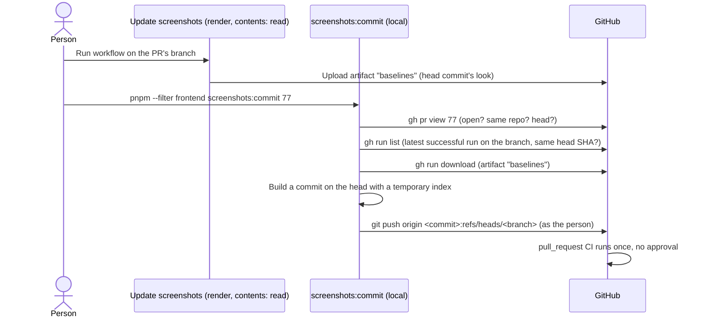

# Make Update screenshots satisfy a PR's required checks without an approval click

Linear: TAS-91

## Summary

The Update screenshots workflow commits new baselines with `github.token` and then dispatches CI. On tastebook#77 the dispatched run's checks didn't count towards the PR's required checks, and the bot's push started the `pull_request` CI only after a maintainer approved it. This work stops the workflow pushing at all: it renders the baselines and uploads them as an artifact, as it does today, and a new local command, `pnpm --filter frontend screenshots:commit <PR>`, downloads them, commits them and pushes as the person who runs it. A person's push starts the PR's own CI once, with no approval, so the required checks report as usual. The workflow no longer holds a write token, and CI loses the `workflow_dispatch` trigger that existed only for it.

Evidence: chore — nothing changes for people using Tastebook; this changes a workflow and adds a developer command.
Design: skip — tooling only; nothing on screen changes.

## Required reading

- `AGENTS.md`: Hard constraints (Everywhere, Frontend, Workflows) and the Commands table, whose Story screenshots row this work edits.
- `.github/workflows/update-screenshots.yml`: the workflow this work cuts down to its render job.
- `.github/workflows/ci.yml:3-8`: the triggers; `workflow_dispatch` goes.
- `frontend/scripts/update-visual-baselines.ts`: mirror its shape for the new script (a top-of-file usage comment, `execFileSync`, `import.meta.dirname`, `console.error` then `process.exit(1)` on a refusal), and its refusal message, which this work rewords.
- `specs/TAS-74.md`, Decisions: the "Workflow starts CI" decision this work replaces, and the Assumption about dispatched checks that tastebook#77 disproved.
- `specs/lessons/factory-runs-make-baselines-in-place.md`: factory runs make baselines on their own runner and never use this workflow or command; unchanged.
- `specs/lessons/screenshot-tolerance-is-in-pixels.md`: `test:visual:update` rewrites only shots outside the tolerance, so an unchanged branch's artifact matches its committed baselines and the command commits nothing.

## Product behaviour

1. Running Update screenshots and then `screenshots:commit <PR>` leaves the PR's required checks green with no approval click.
2. The new commit starts CI once: one `pull_request` run, no dispatched run.
3. The Update screenshots workflow holds no write token, so a fork's PR has none to use.
4. The command refuses a PR that is closed, merged or from a fork.
5. The command refuses when the latest successful run isn't for the PR's head commit.
6. The command commits nothing and says so when no story's look changed.
7. The command never touches the person's checkout, index or current branch.

## Technical design

- **Approach:**
  - **Workflow.** `update-screenshots.yml` keeps its `render` job unchanged except for the artifact's retention and a new last step that writes the next command to the job summary. The `commit` job is deleted, so the workflow's only token is the top-level `contents: read`. The workflow still runs only by `workflow_dispatch` on a branch of this repo, and still refuses `main` and tags.
  - **CI.** `ci.yml` loses `workflow_dispatch` and the comment above it. Nothing else dispatches CI (`grep -rn "workflow run ci" .github` finds only the step this work deletes).
  - **Command.** A new script, `frontend/scripts/commit-visual-baselines.ts`, run as `pnpm --filter frontend screenshots:commit <PR>`. It uses the person's own `gh` login and git identity. It builds the commit with git plumbing against a temporary index (`GIT_INDEX_FILE`), so it works from any branch, with any uncommitted changes, and runs no hooks: the hooks check the person's checkout, not the pushed commit, which changes only PNGs.
- **API contract:** No change.
- **Blast radius:** `ci.yml` is every PR's required checks; removing `workflow_dispatch` changes only how it can be started, not its jobs or their names. Re-check that a PR's Frontend, Backend, End-to-end and API contract checks still run. The `baselines` artifact name and contents are unchanged.
- **Not changing:** see Out of scope.



### The command

Arguments: exactly one, the PR number, matching `/^[1-9]\d*$/`. Anything else prints `Usage: pnpm --filter frontend screenshots:commit <PR number>` and exits 1.

Every refusal prints its message with `console.error` and exits 1. Messages, in the order the checks run:

| Check | Command | Refusal message |
| --- | --- | --- |
| PR is open | `gh pr view <n> --json state,isCrossRepository,headRefName,headRefOid,url` | `PR #<n> is <state lower-cased>, so there's nothing to update.` |
| PR is from this repo | same | `PR #<n> comes from a fork. Its author updates its screenshots.` |
| A successful run exists | `gh run list --workflow update-screenshots.yml --branch <headRefName> --status success --limit 1 --json databaseId,headSha,url` | `No successful Update screenshots run on <headRefName>. Run the workflow on that branch first.` |
| The run is for the head | compare `headSha` with `headRefOid` | `The latest Update screenshots run on <headRefName> is for <headSha first 7>, but the PR's head is <headRefOid first 7>. Run the workflow again.` |
| The artifact holds only screenshots | after `gh run download <databaseId> --name baselines --dir <temp dir>` | `The run's artifact holds <name>, which isn't a screenshot.` (first entry that isn't a file ending `.png`) |
| The branch hasn't moved | `git fetch origin refs/heads/<headRefName>`, then `git rev-parse FETCH_HEAD` | `<headRefName> moved since the run. Run the workflow again.` |

Then, from the repo root (`join(import.meta.dirname, '..', '..')`):

```ts
// Sketch: a commit on the PR's head whose only change is frontend/visual/baselines, built without the checkout.
const index = join(tempDir, 'index');
const git = (args: string[]) =>
  execFileSync('git', args, { cwd: repoRoot, encoding: 'utf8', env: { ...process.env, GIT_INDEX_FILE: index } }).trim();

git(['read-tree', headRefOid]);
git(['rm', '-r', '--cached', '--quiet', '--ignore-unmatch', 'frontend/visual/baselines']);
pngNames.map((name) =>
  git(['update-index', '--add', '--cacheinfo', `100644,${git(['hash-object', '-w', join(artifactDir, name)])},frontend/visual/baselines/${name}`])
);
const tree = git(['write-tree']);
if (tree === git(['rev-parse', `${headRefOid}^{tree}`])) {
  console.log("No story's look changed.");
  process.exit(0);
}
const commit = git(['commit-tree', tree, '-p', headRefOid, '-m', 'Update story screenshots', '-m', `Baselines from ${run.url}.`]);
// The hooks check the checkout, not this commit, which changes only PNGs.
git(['push', '--no-verify', 'origin', `${commit}:refs/heads/${headRefName}`]);
console.log(`Pushed ${commit.slice(0, 7)} to ${headRefName}: ${url}`);
```

- Start from an empty baselines folder, as the deleted commit job did, so a deleted or renamed story's baseline goes.
- `tempDir` comes from `mkdtempSync(join(tmpdir(), 'tastebook-screenshots-'))`; the artifact downloads into `join(tempDir, 'baselines')`, a new empty folder. Remove `tempDir` (`rmSync`, `recursive`, `force`) in a `finally`, on success and on refusal.
- The push is a plain push, never `--force`: if someone pushed in between, git rejects it and the script exits with git's error.
- `gh` and `git` calls that fail (not logged in, no network) let `execFileSync` throw; the script doesn't catch them, so the person sees the tool's own error.
- The commit takes the author and committer from the person's git config, so it's theirs.

### Steps

1. **Cut the workflow down to its render job.** `.github/workflows/update-screenshots.yml` (edit)
   Delete the `commit` job and the comment above it. In the `upload-artifact` step set `retention-days: 7`. Add a last step to `render`:
   ```yaml
   - name: Say how to commit the screenshots
     run: |
       echo "Commit these screenshots from your machine: \`pnpm --filter frontend screenshots:commit <PR number>\`" >> "$GITHUB_STEP_SUMMARY"
   ```
   Keep `permissions: contents: read`, the concurrency group and the "Refuse main and tags" step as they are.
   Done when: the file has one job, no `permissions` block other than the top-level `contents: read`, and no `github.token`.

2. **Stop CI being dispatchable.** `.github/workflows/ci.yml` (edit)
   Delete line 7's comment and line 8's `workflow_dispatch:`.
   Done when: `grep -n workflow_dispatch .github/workflows/ci.yml` finds nothing.

3. **Add the command.** `frontend/scripts/commit-visual-baselines.ts` (new), `frontend/package.json` (edit)
   Write the script as The command describes. First line: `// Commits the baselines from a PR's latest Update screenshots run and pushes them as you. Usage: pnpm --filter frontend screenshots:commit <PR number>.` Type the `gh` JSON it reads (`type PullRequest = { state: 'OPEN' | 'CLOSED' | 'MERGED'; isCrossRepository: boolean; headRefName: string; headRefOid: string; url: string }`, `type Run = { databaseId: number; headSha: string; url: string }`). Add `"screenshots:commit": "node scripts/commit-visual-baselines.ts"` to `frontend/package.json` after `test:visual:update`.
   Done when: `pnpm lint` passes (the script is in `tsconfig.node.json`'s `scripts` include) and the manual checks under Validation criteria give the stated results.

4. **Point people at the command.** `frontend/scripts/update-visual-baselines.ts` (edit), `AGENTS.md` (edit)
   Change the refusal message to `Baselines are made on CI's Linux image only, so they match the check. Run the Update screenshots workflow on your branch, then pnpm --filter frontend screenshots:commit <PR number>.` In `AGENTS.md`'s Commands table, change the end of the Story screenshots row from `or the **Update screenshots** workflow on your branch` to `or the **Update screenshots** workflow on your branch, then \`pnpm --filter frontend screenshots:commit <PR number>\` to commit them as you`.
   Done when: `grep -rn "Update screenshots" AGENTS.md frontend/scripts` shows both new texts.

### Tests

No automated test. The script wraps `gh` and `git` against a live PR, the repo's rules forbid mocking anything but HTTP through MSW and time, and its sibling `update-visual-baselines.ts` has none either. Each behaviour is checked by hand on a real PR, under Validation criteria.

## Decisions

- The workflow uploads the baselines and a person commits them locally, because a person's push starts the PR's `pull_request` CI once with no approval and no extra secret exists to guard. Asked: which GitHub App should push the new baselines? → No App: the workflow uploads an artifact without pushing, and a local command downloads, commits and pushes as the person; drop the `ci.yml` dispatch.
- The workflow still runs on the PR's branch and the command takes the PR number, because with no key there's nothing to keep on `main`. Asked: how should someone tell the workflow which PR to update? → Keep running it on the PR's branch; the command takes the PR number, checks it's open and from this repo, downloads the latest successful run's baselines for its branch, commits and pushes.
- Repository Actions settings (route 2 in the issue) aren't used, because their approval policy covers fork and first-time-contributor PRs and can't exempt `github-actions[bot]` on a branch PR, and with no bot push there's nothing to exempt (agent).
- The command refuses a run whose `headSha` isn't the PR's head, because baselines rendered from an older commit would undo or miss a later look change (agent).
- The command builds the commit with a temporary index and `commit-tree` instead of checking out the branch, so it works from any branch with uncommitted changes and runs none of the checkout's hooks (agent).
- The command accepts only `.png` files from the artifact, so a tampered artifact can't add anything else to the commit (agent).
- The artifact keeps 7 days instead of 1, because a person now downloads it from their machine, maybe the next day (agent).
- The script lives in `frontend/scripts/` beside `update-visual-baselines.ts`, as a frontend package script, because it's the other half of the same job (agent).

## Assumptions

- A push by a repo collaborator starts `pull_request` CI and Labeler with no approval; GitHub holds runs only for fork PRs, first-time contributors and pushes it attributes to a bot. Confirm with: Milo, on the first hand-made PR after merge.
- The person running the command has `gh` logged in with access to this repo, and the repo's remote is named `origin`. The script doesn't check either; `gh` or `git` fails with its own error. Confirm with: Milo, at spec approval.
- Factory PRs keep making baselines on their own runner (`specs/lessons/factory-runs-make-baselines-in-place.md`), so the factory never needs the workflow or the command. Confirm with: Milo, at spec approval.

## Out of scope

- The visual check itself, `playwright.visual.config.ts`, the tolerance and `test:visual:update`'s behaviour.
- How factory runs make baselines.
- Repository and branch-protection settings: nothing needs to change there.
- A GitHub App or any new secret.
- `preview-checks.yml` and `backup.yml`, which keep their own `workflow_dispatch` triggers.
- Earlier specs (`specs/TAS-74.md`, `specs/TAS-77.md`) that mention the workflow; they record what was decided then.

## Validation criteria

- [x] `pnpm lint` passes.
- [x] `pnpm test` passes (nothing in it changes; it proves the reworded script still type-checks with the rest).
- [x] `pnpm --filter frontend screenshots:commit abc` prints the usage line and exits 1.
- [x] Against a merged PR (for example `81`), the command prints `PR #81 is merged, so there's nothing to update.` and exits 1.
- [x] On this PR's branch, before any Update screenshots run, the command prints `No successful Update screenshots run on tastebook/tas-91-make-update-screenshots-satisfy-a-prs-required-checks. Run the workflow on that branch first.`
- [ ] After a person runs the workflow on this PR's branch (the factory's token can't dispatch it), the command, run by that person, prints `No story's look changed.`, exits 0, and `git status` in the checkout is as it was before.
- [ ] After merge: on a hand-made PR with a look change, run Update screenshots, then the command. The PR gets one commit authored by the person, one `pull_request` CI run with no approval click, and its four required checks green. Then push another commit and run the command again: it refuses with the head-mismatch message.
- Evidence: chore — "No visible change."
